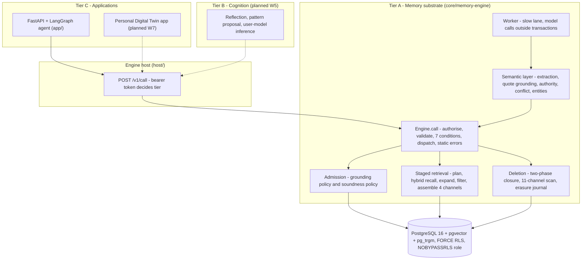
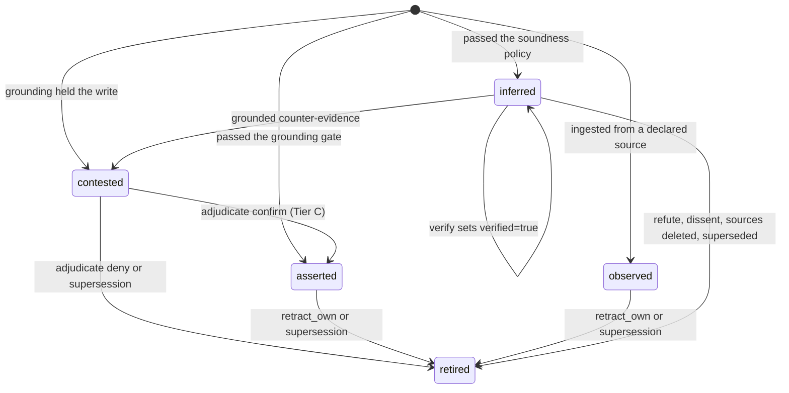
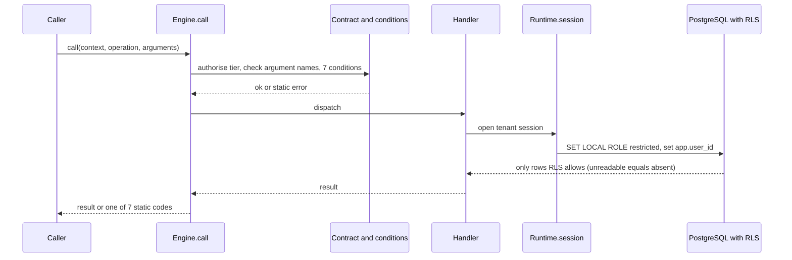
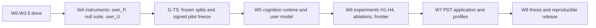

# ChronaMind — Project Showcase

> **A bi-temporal, write-governed, lineage-deletable cognitive memory engine for long-term AI agents,
> with a FastAPI + LangGraph agent application that uses it as its long-term memory.**

Prepared for the academic demonstration, from the repository's own documents on `main` (`862e7d5`, 2026-11-27).
Every claim below cites the document or code that states it. Status is reported the way the project reports it:
*an optimistic claim is worse than a gap*.

**Status legend:** ✅ implemented and enforced (database constraint or test) · 🟡 partial · 🗺️ planned (W4–W8) ·
📐 research design (decided, not yet run)

---

## At a glance

| | Today (`main`) | Source |
|---|---|---|
| Waves complete | **W0, W0b, W1, W2, W3, W3.5** (gates G0 → G3.5 met; G3.5 on 2026-11-26) | `PLAN/V2/ROADMAP_V2.md` §1, §6.1 |
| Next wave | **W4 — Measurement instruments** (the "ruler" before the cognition runtime) | `ROADMAP_V2.md` §7 |
| Public API | **32 operations**, one entry point (`Engine.call`), **all wired** (`UNWIRED_OPERATIONS = {}`) | `api/contract.py`, `api/wiring.py:44`, `tests/test_api_contract.py:97` |
| Database migrations | **33**, append-only, checksum-bound, each with an exact rollback | `src/custom_memory_engine/schema/001…033` |
| Declared invariants | **17** (`I1′`–`I17`), **all `ENFORCED`** | `PLAN/V2/INVARIANT_LEDGER.md` |
| Threat model | **47** cross-tenant / leak paths (`T-01`–`T-47`), each with a mitigation and a covering test | `PLAN/V2/THREAT_MODEL.md` |
| Decision records | **`V2-D01`–`V2-D125`** (a handful still open, e.g. thresholds `V2-D30`) | `PLAN/V2/DECISIONS_V2.md` |
| Test suite | **4,520+ passed / 21 skipped** on PostgreSQL 16.15 + pgvector 0.8.7 (documented figure, 2026-11-21) | `core/memory-engine/CLAUDE.md` |
| Commits | 349 on `main` | `git log` |

All paths below are relative to `core/memory-engine/` unless they start with `app/`, `docs/` or `.github/`.

---

## Contents

1. [Executive summary](#1-executive-summary)
2. [The problem](#2-the-problem)
3. [Research questions, hypotheses and contributions](#3-research-questions-hypotheses-and-contributions)
4. [System overview](#4-system-overview)
5. [Core concepts](#5-core-concepts)
6. [Feature tour](#6-feature-tour)
7. [Engineering rigour](#7-engineering-rigour)
8. [Evaluation and measured results](#8-evaluation-and-measured-results)
9. [Progress: what each wave delivered](#9-progress-what-each-wave-delivered)
10. [What is to come (W4–W8)](#10-what-is-to-come-w4w8)
11. [Live demonstration guide](#11-live-demonstration-guide)
12. [Anticipated questions](#12-anticipated-questions)
13. [Honest limitations](#13-honest-limitations)
14. [Repository map and reading guide](#14-repository-map-and-reading-guide)
15. [Glossary](#15-glossary)

---

## 1. Executive summary

LLM assistants either forget everything between sessions or keep memories as loose text snippets. Those snippets
cannot tell an old preference from a current one, cannot say *why* the assistant believes something, cannot keep a
guess apart from a fact, and cannot really forget something when asked.

ChronaMind is a **memory engine** that solves these problems as **database properties**, not as conventions in
application code:

- **Time is exact.** Every memory carries *when it was true* (event time), *when it was first seen* (observation time),
  and *when the system believed it* (belief time, from the database clock). The system can answer "what did you believe
  about X on date Y?" exactly.
- **Guesses can never become facts.** Inferred knowledge lives on a separate epistemic track. There is no operation
  that turns an inference into an asserted fact, and the read path renders inferences in a separate *hypotheses* channel
  with their statistical bound.
- **Every memory has provenance.** A memory can always answer "why are you here?", down to the source turn and the
  exact quote that grounds it.
- **Deletion is complete.** Deleting a memory reaches every artifact derived from it at any depth. An 11-channel leak
  scanner verifies it, and the deletion survives even a database restore from an older backup.
- **Tenants are isolated by PostgreSQL itself.** Row-level security under a non-superuser role decides what a caller
  can see. "Does not exist" and "you may not read it" are the same answer, so the API cannot be used as an existence
  oracle.

Version 1 (a bi-temporal *claims* store, frozen as tag `cme-v1.0.0`) proved the substrate. Version 2, approved on
2026-10-31, generalises it into a **general-purpose cognitive memory engine** in three tiers:

- **Tier A, substrate:** the product. Done through W3.5.
- **Tier B, cognition:** reflection and pattern discovery as an *untrusted client* of the public API. Planned for W5.
- **Tier C, applications:** the root FastAPI + LangGraph agent already uses the engine over HTTP. The Personal Digital
  Twin application is planned for W7.

---

## 2. The problem

The proposal's abstract (`Graduation_Project_Proposal.md`) and the V2 critique (`PLAN/V2/CRITIQUE.md`) list
the failure modes of existing agent memory:

| Failure mode | What goes wrong | ChronaMind's answer |
|---|---|---|
| No notion of time | "I moved to Paris" does not retire "I live in Berlin"; history and present are confused | Bi-temporal versions with a GiST exclusion constraint (`I5`) and close-then-insert supersession |
| No provenance | The agent cannot say why it believes something | Provenance edges and evidence rows; every rendered item carries a provenance bundle (`R1`) |
| Inference presented as fact | LLM "reflection" writes guesses into the same store as facts | Lifecycle axis + no-factification rule (`I1′`) + channel separation (`I14`) |
| Memory poisoning | Injected or third-party text is stored as the user's belief | Write-time grounding gate, authority ladder, third-party quarantine (`V2-D87`) |
| Incomplete deletion | Derived summaries, embeddings or caches keep deleted content | Unbounded deletion closure + 11-channel leak scan + erasure journal (`I8`, `T-46`) |
| Weak multi-tenancy | Isolation lives in application code | `FORCE ROW LEVEL SECURITY`, `NOSUPERUSER NOBYPASSRLS` runtime role, composite tenant foreign keys |

The project compared 12 reference engines: Mem0, Graphiti/Zep, Hindsight, Quipu, Veracium, Honcho, Cognee, Letta,
MemOS, Memobase, MIRIX and LangMem (`PLAN/V2/COMPONENT_MAP.md` §5). It found that none of them combines bi-temporal
exclusion, PostgreSQL RLS, deletion receipts and channel-enforced epistemic separation. Several widely cited
components were also defective in the shipped code:

- Mem0's open-source engine keeps deleted plaintext in its history tables.
- Graphiti's entity deduplication strips every non-ASCII script, so Arabic names collide.
- Hindsight's temporal analyser silently drops non-English queries.

ChronaMind therefore adopts *mechanisms* from these engines (component-level, with their defects named) and never
the store itself.

---

## 3. Research questions, hypotheses and contributions

### 3.1 The original (v1) research contract — still governs the `H1`–`H4` protocol

From `Graduation_Project_Proposal.md` §4. This document is frozen and checksum-bound.

| RQ | Question | Hypothesis | Benchmark |
|---|---|---|---|
| RQ1 | Does retaining bi-temporal version history improve answers about past and changed user states without harming present-state answers? | **H1:** P beats A2 (valid-time filtering without history) on the history-dependent stratum, and is non-inferior on the present-state stratum | own Suite T |
| RQ2 | Does hybrid (dense + lexical) retrieval find gold evidence more completely than either channel alone? | **H2:** Recall@k beats dense-only *and* lexical-only (intersection-union test) | LongMemEval_S |
| RQ3 | Does the write-time gate reduce poisoning without blocking legitimate updates? | **H3:** Attack success rate drops versus P-nogate, with legitimate-update acceptance non-inferior | own Suite G |
| RQ4 | Can lineage deletion remove a memory and all its derived artifacts? | **H4:** Zero leaks on every in-boundary channel, with an exact Clopper–Pearson upper bound ≤ u\* | own Suite D |

The statistics are pre-registered: cluster bootstrap, sign-flip permutation, Holm correction and Clopper–Pearson
bounds. `H5` (a usability study with human participants) is disabled by an ethics scope decision
(`decisions/RL-015-ethics-h5.md`).

### 3.2 The V2 research programme — four contribution families

From `PLAN/V2/RESEARCH_PROGRAM_V2.md`:

| Family | Claim | Status |
|---|---|---|
| **F1 — Substrate** | A bi-temporal, evidence-grounded, lineage-deletable store is realisable with database-enforced invariants, measurable cost and **no forking across agent domains** | ✅ substrate built; W2's zero-fork dual-profile gate (G2) met; `H1`–`H4` re-run as substrate experiments in W6 🗺️ |
| **F2 — Epistemic separation** | Kind, retention and lifecycle are independent axes, so inferred artifacts **structurally cannot** masquerade as facts | ✅ enforced (`I1′`, `I6`, `I14`); measured in W5–W6 🗺️ |
| **F3 — Verifiable abstraction** | Pattern discovery made falsifiable (support/opportunity ledgers, finite-sample bounds, refutation, held-out verification) beats free-form LLM reflection | 📐 statistics decided; admission predicate implemented; the reflection runtime is W5 🗺️ |
| **F4 — Evolving user model** (Personal Digital Twin) | An evidence-grounded user model improves personalization over time, tracks change, respects correction and does not degrade under noise | 🗺️ W4 instrument (`own_U`) then W5 runtime; **cannot be de-scoped** (`V2-D26`) |

Each family has falsification criteria and pre-declared gates (`G4`/`G4b`/`G5`/`G5b`/`G6`, section 10). The plan
also states what a negative result would mean. For example, if study S14 fails, the stated Personal Digital Twin
purpose is not achieved.

---

## 4. System overview

The repository holds **two independent projects**. They share no code, interpreter, linter, lock file, database or
CI job (`PLAN/INDEPENDENCE_BOUNDARY.md`, root `CLAUDE.md`).

| Part | Where | Interpreter | Role |
|---|---|---|---|
| **Memory engine** | `core/memory-engine/` | CPython 3.12 | The research contribution: the substrate, its schema, governance, evaluation |
| **Agent application** | `app/`, `evals/`, `alembic/` | CPython 3.14 | FastAPI + LangGraph chat agent that uses the engine as its long-term memory **over HTTP** (`V2-D93`) |



**Key design rule (Charter):** Tier B may only call Tier A's public API. It has no database credentials, no engine
imports and no privileged read path, so you could delete Tier B and still ship a working memory engine
(`PLAN/V2/CHARTER.md`).

---

## 5. Core concepts

### 5.1 Bi-temporal memory: three clocks

| Clock | Meaning | Who sets it |
|---|---|---|
| `event_range` | When the fact was true in the world | The producer, or inferred (`event_basis` is explicit or inferred) |
| `observed_at` | When the source was first seen | The ingest clock |
| `recorded_range` | When the system *believed* it (belief time) | **Only** the database transaction clock, never the caller (`V2-D06`, `V2-D73`) |

*Example.* On Nov 1 the user says "I live in Berlin". On Nov 20 they say "I moved to Paris last week". The engine
closes the Berlin belief and inserts Paris. A `historical_as_of` query for Nov 10 still answers Berlin, and a
`current_state` query answers Paris. Belief time never moves backwards within a scope (`I4`, migration 9). Any
request that tries to supply its own reference time is refused with `validation_error/reference_time_is_the_engine_clock`.

### 5.2 Orthogonal axes replace a single "type" enum

v1 had one `layer` enum (episodic, semantic, opinion, persona). V2 (`V2-D01`) describes a memory as a point on
independent axes:

| Axis | Values |
|---|---|
| **kind** (fixed at creation) | `episode` · `claim` · `procedure` · `abstraction` |
| **lifecycle** (epistemic status) | `observed` · `asserted` · `inferred` · `contested` · `retired` |
| **retention** (cost policy only) | `working` · `session` · `durable` |
| **scope** | hierarchical path such as `/u/42/p/my-repo/` |
| **derivation** | grounded in evidence, or inferred from sources plus a registered method |
| *facet* (a tag, not an axis) | preference · goal · constraint · context · decision_pattern · meta_preference |

Two rules bind these axes:

- **Retention never changes answerability.** Only episodes and procedures may be `working` or `session`. Claims and
  abstractions are durable until retired (`V2-D29`, `I6`).
- **"Archived" is gone.** `retired` is the lifecycle value, and retention is a cost policy (`V2-D38`).

### 5.3 No-factification: inference is a lifecycle, not a kind

Every product of reasoning carries `lifecycle = inferred` plus a derivation record (sources, method, version,
parameters hash). **There is no transition `inferred → asserted`** (`I1′`). Promoting a guess to a fact needs *new
grounded evidence*, which creates a *new* artifact linked by `corroborated_by`.

### 5.4 The closed lifecycle

The transition table lives in `model/axes.py::TRANSITIONS` and is mirrored by migration 7, so code and database
enforce the same table. It has 11 transitions and 16 legal (kind, lifecycle) pairs:



The legal lifecycle values per kind:

- **episode:** observed, inferred, contested, retired
- **claim:** all five
- **procedure:** asserted, inferred, contested, retired
- **abstraction:** inferred, contested, retired. An abstraction can never be asserted.

### 5.5 Provenance edges and association edges are different graphs

| | Provenance (`memory_derivation`, evidence) | Association (`association`) |
|---|---|---|
| Meaning | "B was derived from A" | "A is related to, contradicts, refines… B" (10 closed types) |
| On deletion | **cascades**: dependents are re-derived or retired | removed only with an endpoint |
| Used for | why-explanations, deletion closure, staleness | retrieval expansion (one hop by default) |

Association degree is capped at 32 per artifact by default. A database function enforces the cap under an advisory
lock: 20 concurrent writers commit exactly the cap (`V2-D13`, migration 3).

### 5.6 Scopes and tenant isolation

- **Scope paths.** A scope is a canonical path with a **mandatory trailing `/`**: `/u/<user>/`, with project
  (`/u/<id>/p/<repo>/`), organisation (`/u/<id>/o/<org>/`) and task (`/u/<id>/s/<task>/`) sub-scopes (`V2-D64`).
- **Matching.** Subtree matching uses `pg_catalog.starts_with`, **never `LIKE`**. `LIKE` treats `_` and `%` as
  wildcards, and with it `/u/4/` matched `/u/42/`. This was reproduced on PostgreSQL 16.15 (`V2-D35`, `T-01`).
- **Reading other scopes.** A caller names up to 16 selectors. Row-level security *independently* enforces the
  caller's access list, computed from `app.user_id` and `scope_grant` (`V2-D45`). Grants confer read access only;
  writes land in the caller's own namespace (`V2-D53`).
- **Unreadable sources.** A provenance source the caller cannot read renders as an **opaque per-caller HMAC handle**.
  The handle is stable for that caller, cannot be correlated across callers, and is never accepted as an id
  (`V2-D37`, `I17`).

### 5.7 Abstractions are gated by finite-sample verification

An abstraction ("user prefers morning meetings") carries a three-state evidence ledger: support *s*, counter *k*, and
undetermined *u*, with opportunity *o = s+k+u* (`V2-D18`). Verification requires all of the following
(`soundness/admission.py`, `V2-D19`, `V2-D40`, `V2-D114`):

- `confidence_lower = 1 − CP_upper(k+u, o) ≥ τ` at a one-sided 97.5% level. Undetermined evidence counts as failure.
- Coverage of at least `τ_coverage`.
- At least 3 refutation attempts and a clean negative control.
- A *temporally and contextually disjoint* held-out slice.

The ledger is **derived by the engine from evidence**, never supplied by the caller (`V2-D114`). The defaults are
τ = 0.90 and τ_coverage = 0.60. With these, zero counter-examples need at least 36 opportunities. The thresholds are
documented defaults until the pilot freezes them (`V2-D30`).

*Why `k+u` and not `k`?* The earlier draft's bound `1 − CP_upper(k, o)` would admit s=5, k=0, u=45 (5 supports out of
50) at τ = 0.90. The correct bound gives 0.033. `scripts/check_statistics.py` pins that regression case.

### 5.8 Derived staleness

`stale` is **computed, never stored** (`V2-D24`, `I13`). A verified abstraction becomes stale when any of these holds:

- The SHA-256 hash of its transitive provenance closure differs from the hash it was verified against.
- Its support falls below the threshold.
- Any of its sources is retired.
- Its method's version changed.
- Its `expires_at` has passed.

A stale verified abstraction drops from *facts* to *hypotheses*. A stored flag could disagree with the graph after a
deletion, and a derived one cannot (`engine/staleness.py`).

### 5.9 Deletion that reaches derived artifacts

Deletion computes the **unbounded** provenance closure with cycle detection. v1's depth limit of 3 is no longer a
correctness bound (`V2-D09`). It then runs in two phases (`PLAN/V2/DELETION_ORDER.md`, `V2-D50`):

- **Phase A**, sources-first: classify each dependent as *delete*, *alive*, *re-derive* (stale) or *retire*
  (`source_deleted`, tombstoned).
- **Phase B**, dependents-first: apply the decisions, edges before rows.

An exhaustive model of every DAG with up to 5 nodes (63,488 cases) gives:

- 0 violations for sources-first classification, against 10,838 for dependents-first.
- An earlier non-transitive rule left 698 nodes alive with a deleted node in their closure. The corrected rule
  leaves 0.

---

## 6. Feature tour

### 6.1 One door: `Engine.call` and the 32-operation contract ✅

`api/entry.py::Engine.call` processes every call in the same order:

1. Authorise by tier and role. An unknown operation and a forbidden one get the same answer.
2. Validate argument names against `api/contract.py`.
3. Check the declared condition codes in a fixed `CONDITION_ORDER`: cheap argument checks first, database-reading
   checks last.
4. Dispatch to the registered handler.
5. Record any cross-namespace read as a content-free `scope_read` audit row.
6. Map every failure to **seven static error codes**:
   - `validation_error`
   - `forbidden` (absent and unreadable look the same)
   - `precondition_failed`
   - `rejected`
   - `resource_limit` (never silent truncation)
   - `retryable_conflict`
   - `internal_error` (no detail, returned only by `Engine.call`)



**The 32 operations** (`api/contract.py`; `tests/test_api_contract.py` asserts the count), in 11 capability classes:

| Class | Operations |
|---|---|
| Ingest | `ingest_episode`, `ingest_artifact` |
| Read | `query`, `refine`, `get`, `provenance`, `constraints` |
| Assert and withdraw | `assert`, `retract_own` |
| Infer and verify | `infer`, `verify`, `refute` |
| Associate | `link`, `unlink` |
| Entities | `create_entity`, `link_entity` |
| Outcomes | `record_outcome` |
| Lifecycle (user) | `adjudicate`, `dissent`, `lift` |
| Maintain (admin) | `purge_working`, `expire`, `rebuild_index`, `register_method` |
| Delete and export | `delete`, `export` |
| Scope and sharing | `create_scope`, `grant_access`, `revoke_access`, `set_visibility` |
| Introspection | `stats`, `cost` |

Tier B (cognition) may call 19 of them. `infer`, `verify` and `refute` are Tier-B-only. `adjudicate`, `dissent`,
`lift`, `delete`, `export` and the scope class are Tier-C-only. Machine-checked tier rules TB1–TB10 and AD1 are tested
against the real matrix and against a deliberately broken copy (`tests/test_tier_permissions.py`).

> Note on counts: several documents still say "29" or "31" operations. The code and its test are authoritative at
> 32: 29 in `V2-D46`, plus `lift` and `constraints` (`V2-D105`), plus `set_visibility` (`V2-D113`).

### 6.2 The engine host: HTTP transport ✅

`host/` (`V2-D93`, `E-046`, starlette + uvicorn) exposes `POST /v1/call {operation, arguments}`.

- **Tier from the token.** The tier comes from the bearer token, never from the request body. A body that tries to
  promote itself is refused (`T-34`).
- **Bounded transport.** Bodies are bounded, there are rate and concurrency limits (`V2-D117`), and an unauthenticated,
  content-free `/healthz`. The seven codes map to HTTP statuses with no identifiers or content.
- **Delegating service tokens.** A service token can act for the end user it names (`V2-D120`). The root app uses this.

### 6.3 Tenant isolation and security ✅

- **Runtime role.** Every statement runs through `Runtime.session` → `security/scoping.py::tenant_scope`, which does
  `SET LOCAL ROLE` plus `app.user_id` in one transaction. The runtime role is `NOSUPERUSER NOBYPASSRLS`, with an exact
  per-table grant matrix (`security/provisioning.py::TABLE_GRANTS`, mirrored by `security/rls.sql`).
- **Composite tenant keys.** Every foreign key between tenant tables is composite on `(id, user_id)`, and every engine
  function pins `search_path` (`V2-D54`, migration 4). An independent audit had found that one tenant could block
  another tenant's delete through an invisible foreign-key violation (S-01, Critical), and that a temp table could
  shadow an engine table (S-02, High). Both are fixed and tested.
- **Privileged functions.** `SECURITY DEFINER` functions are never gated by session settings alone. They also require
  a durable row written in the same transaction (#228).
- **Content-free logs.** Logs carry no content: no `content`, `evidence_span` or `embedding` keys anywhere
  (`security/audit_guard.py`).

### 6.4 Lifecycle governance inside the database ✅

These are `CHECK` constraints, `EXCLUDE` constraints and deferred constraint triggers, not handler code:

- **Lifecycle legality per kind:** migration 7, twin of `model/axes.py::LEGAL_LIFECYCLE`.
- **Entry records:** migration 14. Entering `asserted` needs an accept decision, entering `inferred` needs a
  derivation and a registered method, and entering `contested` needs a hold (`V2-D61`).
- **No overlapping beliefs:** a GiST exclusion `no_bitemporal_overlap` on `COALESCE(semantic_slot, predicate_key)`
  forbids two simultaneous beliefs for one single-valued slot (`I5`, migration 24).
- **Append-only method registry** (`I3`), **procedure shape** (migration 21) and **tombstones** after
  retire-by-deletion.

### 6.5 The semantic layer: language in, governed candidates out ✅

`semantic/` (`V2-D88`–`V2-D91`) sits **above** the entry point. Every write it produces still goes through the gate.

| Module | Guarantee |
|---|---|
| `grounding.py` | The quote must exist verbatim in the source. Matching folds Unicode NFC and whitespace only, never case or diacritics. Numbers, dates and ids in a claim must appear in the cited fragment, with script-agnostic digits (Arabic-Indic digits count). |
| `authority.py` | `USER > SYSTEM > ASSISTANT > THIRD_PARTY`. A weaker source never supersedes a stronger one. Migration 24 holds it as a **generated column**, so it cannot be forged. |
| `conflict.py` | Recall → LLM adjudication → deterministic commit. The GiST constraint has the last word (`V2-D89`). |
| `entities.py` | Cascaded resolution: exact → alias → trigram → vector *proposal*. Ambiguity is reported, never guessed, and a cosine match never merges entities on its own (`V2-D101`). |
| `ingestor.py` / `slow_lane.py` | Two lanes: the turn is durable immediately and understood shortly after by a worker. Model calls run **outside any transaction**, every job runs under the tenant role, and a stale deletion epoch dead-letters the job (`V2-D106`). |

The layer works across languages: English, Arabic, mixed script and Arabizi are in the evaluation set. No
provider SDK enters the engine; `integrations/` holds the only wire protocols (`V2-D94`).

### 6.6 Staged, hybrid retrieval with four channels ✅

Retrieval runs in five stages (`engine/planning.py::STAGES`, `V2-D11`/`V2-D76`/`V2-D86`):

| Stage | What happens |
|---|---|
| 1. Plan | A pure, replayable plan records mode, recall arms and hop budget |
| 2. Candidates | One SQL statement applies the temporal, typed-artifact and read predicates **before** `LIMIT`. Three recall arms: dense (HNSW over `halfvec`, local `bge-m3` embeddings), full-text (`'simple'` configuration, language-free) and trigram (`pg_trgm`). They are fused with reciprocal rank fusion (k = 60) |
| 3. Expand | Associations, one hop by default; the response is at most 2 × `limit` (`V2-D79`) |
| 4. Filter / re-rank | An optional local **relevance judge** (`bge-reranker-v2-m3` ONNX) gates the fused page at a measured floor (`V2-D104`) |
| 5. Assemble | Four channels with per-channel token budgets and reported coverage |

**Channels** (`PLAN/V2/CHANNELS.md`, `engine/channels.py`). Membership is a pure function of the tuple (kind,
lifecycle, verified, stale, open contradiction), checked over all 60 legal tuples:

| Channel | Contains |
|---|---|
| **facts** | Observed or asserted items with no open contradiction; fresh *verified* abstractions **only as bounded summaries** ("in 34 of 40 observed sessions…") |
| **hypotheses** | Everything inferred, verified or not, with support, uncertainty and a label |
| **procedures** | Settled procedures, ranked by recorded outcomes |
| **conflicts** | Contested items, or grounded items with an open contradiction; both sides shown, never merged |
| *none* | Retired items (audit only) |

An abstraction cannot render without its bound: `BoundedFact` makes an unbounded one unconstructible. Every read path
(`query`, `get`, `change`, `refine`) must route through `assemble` (#229).

**Query modes:** `current_state`, `historical_as_of`, `historical_window`, `change` (a diff of two as-of views keyed by
belief identity, `V2-D81`) and `audit_as_of` (Tier C only, results go to `audit[]`).

**`refine`:** a 15-minute, in-memory capability handle that narrows a previous result under its original read set and
can never widen it (`V2-D83`). It takes four rule-based operators, and chains are at most 4 deep.

### 6.7 Procedures and outcome feedback ✅

Procedures store preconditions and steps in an append-only `procedure_shape` table (migration 21). `record_outcome`
updates success and failure counts. The procedures channel is ordered by Laplace-smoothed success, (s+1)/(s+f+2), so an
unseen procedure starts at 0.5. Ties break by last use, then id (`V2-D75`, `engine/procedure_ranking.py`).

### 6.8 Verification, refutation, sticky dissent ✅ (mechanism) / 🗺️ (reflection runtime)

The operations below are wired (`V2-D97`, `V2-D105`), but **no Tier-B reflection runtime proposes abstractions yet**.
That is W5.

- `verify` runs the admission predicate over a held-out split and pins the support and held-out artifact ids
  (`V2-D112`, `I11`).
- `refute` retires an inference or moves it to contested (`C-026`).
- `dissent` writes a `negative_constraint` when the user rejects an inference, so the same guess cannot be re-proposed.
  `lift` reopens it **only on new grounded evidence**, and deleting that evidence re-blocks it (`I16`).

### 6.9 Deletion through cognition, and erasure that survives a restore ✅

- **Scope of a delete.** `delete` removes the target plus everything derived from it, including entity mentions and
  orphaned entities (migrations 27 and 30) and export snapshots (migration 28).
- **11-channel leak scan.** The scanner checks:
  - the 7 v1 channels;
  - hypothesis rendering;
  - abstraction statements and bounds;
  - verification records and method parameters;
  - pre-deletion export snapshots.
- **Erasure journal** (`V2-D122`, `V2-D125`, migration 33). Restoring an older backup re-applies the deletions the
  backup predates, including the evidence turns and write identities, so a deleted claim cannot be re-derived. The
  worker and host refuse a database the journal has not been replayed into. `scripts/rehearse_restore.py` measures this
  over real `pg_dump`/`pg_restore` (`T-46`).

### 6.10 Operations ✅

Several operational pieces are in place:

- **Worker:** an engine-side worker with leases and dead-lettering (`custom_memory_engine.worker`, `V2-D106`).
- **Deployment:** a systemd unit, a container image and compose file, and a probe that checks health from the queue
  rather than the process id (`deploy/`, `V2-D103`).
- **Exports:** an epoch-bound export manifest (`V2-D99`).
- **Scheduled maintenance:** `expire` and `rebuild_index` run on a scheduler, with `/metrics` (`V2-D119`).
- **Backup and restore:** a documented policy for both (`V2-D119`).

### 6.11 Agent profiles: one engine, many domains ✅ / 🟡

A profile is data, bound when the handlers are registered (`V2-D08`, `V2-D67`). Two profiles ship as packaged
documents: `profiles/conversational.json` and `profiles/coding.json`. Gate **G2** (zero-fork dual-profile) is met, and
CI runs a `dual-profile` job on one database.

The research profile is shown only as an expressible configuration in a test. The enterprise profile is
`/u/<owner>/o/<org>/`. The registry of all four profiles is W7 (`A-010`).

### 6.12 The agent application (root `app/`) ✅

A FastAPI + LangGraph chat service (`README.md`, `docs/`) with:

- **Auth:** JWT, sessions, and `register`, `login` and `session` routes.
- **Chat:** chat and streaming endpoints, plus a LangGraph agent with checkpointing and tool calling.
- **LLM service:** circular model fallback, retries and a total timeout budget.
- **Observability:** Langfuse tracing, Prometheus and Grafana, structured logs and slowapi rate limits.
- **Long-term memory is the ChronaMind engine**, reached by `app/services/memory_engine.py` over HTTP
  (`docs/memory.md`):
  - Before each reply the agent queries the engine and receives labelled sections: *Known facts*, *Hypotheses
    (inferred, not confirmed)*, *Procedures*, *Open contradictions*, *Earlier conversation (verbatim; may be
    outdated)*.
  - After the reply it ingests the turn and asserts the user's statement.
  - A **language-independent semantic slot classifier** (`app/services/memory_slots.py`, `V2-D121`) recognises the
    single-valued `residence`, `employer` and `name` slots. "I live in Berlin" then "I moved to Paris", or the same two
    statements in Arabic, leaves **one** known fact. The value must occur verbatim in the message.
  - The app does not keep a plaintext memory cache (`V2-D116`).
  - With no `MEMORY_ENGINE_URL`, the agent has no long-term memory. There is no silent fallback.

CI includes an **`app-engine-boundary`** required check (`tests/test_memory_engine_boundary.py`, `T-43`).

---

## 7. Engineering rigour

| Practice | How it is done |
|---|---|
| **Documented ≠ enforced** | `INVARIANT_LEDGER.md` lists each invariant with status, enforcing site (`path::symbol`), tests, gap and owner. `tests/test_invariants_declared_and_enforced.py` fails if a declared invariant has no honest row. **All 17 are `ENFORCED`** today. |
| **A fix needs a control** | Every guarantee needs a mutation control: the test must fail when the guard is removed. #229 is the exemplar (nine regressions, eight failing on the parent commit). During E-038, three deliberate breakages (a stored `stale` column, the epoch removed from the cache key, a cache that never stores) each made the matching test fail. |
| **Twin rules kept equal** | SQL guards and their Python twins are paired and tested: `procedure_shape`, `rls_read_using`, `LEGAL_LIFECYCLE`, `authority_rank`, slot normalisation. |
| **Catalog rules for every future migration** | Every foreign key between tenant tables carries `user_id`, and every engine function pins `search_path` with `pg_temp` last (`tests/integration/test_tenant_integrity_db.py`). |
| **Append-only migrations** | 33 migrations, each with a rollback that restores the previous catalog fingerprint **exactly**; shipped sources are never edited. |
| **Frozen research records** | Proposal, methodology checklist and changelog are MD5-checked in CI (`validation/document_hashes.txt`). |
| **Governance scripts that fail on drift** | `scripts/check_plan_refs.py` (every cited `V2-D##` exists), `audit_status.py --check`, `plan_coverage.py --check` (every invariant, table, operation, migration and channel has an owner), `check_evidence.py` (closure records), `check_statistics.py`, `check_test_split_gate.py`. |
| **Closure is a procedure** | An issue closes only after a written evidence record passes `check_evidence.py`; a passing test name is not enough (`PLAN/V2/CLOSURE_PROTOCOL.md`). |
| **CI and branch protection** | `main` is protected: eight required checks (engine `static`, `verify`, `default-install`, `deploy-smoke`; `app-engine-boundary`; root `checks`; and others), up-to-date branches, conversation resolution, no force pushes (`.github/workflows/README.md`). |
| **AI-assisted review gate** | A repository-owned `review-pr` skill reviews every push, reads its instructions from the base branch, and cannot edit, merge or approve (`V2-D57`, `V2-D85`). It is documented as **AI review acting for the owner, not human peer review**. |
| **Fast, isolated test databases** | Each xdist worker has its own database; each database test runs in a private clone of a migrated template (≈0.03 s instead of a 0.9 s migration). |

---

## 8. Evaluation and measured results

### 8.1 The apparatus (built in v1, reused by V2)

| Component | Where | What |
|---|---|---|
| Public benchmarks | `research/benchmarks/longmemeval/`, `locomo/` | Fetched and verified: LongMemEval `oracle`/`S` (500/30/56), LoCoMo `locomo10` (10/1,986/4) |
| Own suites (script-first, deterministic) | `research/benchmarks/own_T`, `own_G`, `own_I`, `own_D`, `own_C` | Temporal (T), gate/poisoning (G), injection (I), deletion (D); `dev` = 20, `test` = 50 scenarios |
| Frozen splits | `research/benchmarks/splits/FREEZE_LIST.md`, `scripts/check_test_split_gate.py` | Test splits cannot be read before gate G-TS (`V2-D42`) |
| Harness, baselines, judge, statistics | `evaluation/harness`, `baselines`, `judge`, `stats` | Six baseline adapters, an LLM judge with validation gates, cluster bootstrap, sign-flip permutation, Holm, Clopper–Pearson |
| Pre-registered pilot plan | `evaluation/pilot_plan.md` | Protocol before data |

### 8.2 Results already measured (development data; not confirmatory)

| Measurement | Result | Source |
|---|---|---|
| **Deletion (G3 mechanism check)** | System P: **0/20** dev scenarios leaking on all 11 channels; the A8 ablation: 20/20 leaking (positive control) | `reports/deletion/suite_d_dev_11ch_*.json`, `V2-D84` |
| **Retrieval ranking** (64 labelled questions) | Hybrid RRF nDCG **0.882** vs BM25-reranked 0.765 vs recency-reranked 0.726 | `reports/retrieval/README.md`, `V2-D100` |
| **Value of the dense arm** | Recall@5 **0.982** hybrid vs 0.393 lexical-only | `reports/model_selection/README.md` |
| **Relevance judge** | No-match false positives 0.125 → **0**; `bge-reranker-v2-m3` separates answerable from unanswerable by 2.73 logits on the full uncensored set (`jina` overlaps and was rejected) | `reports/retrieval/README.md`, `V2-D104` |
| **Model selection** (46 cases incl. Arabic and mixed script) | `gpt-6.2-sol`: extraction 29/30, adjudication 13/14, 100% quote grounding, 0 JSON failures; `claude-haiku-5-5` is the latency fallback | `reports/model_selection/README.md`, `V2-D102` |
| **Slot classifier** | 34/34 on each of four models, no false "single" | `V2-D121` |
| **Deletion-order model** | 0 / 63,488 violations (sources-first) vs 10,838 (dependents-first) | `tests/test_deletion_order_model.py` |

These figures are honest about what they are. The deletion figure is a **dev-split mechanism check** (N = 20,
Clopper–Pearson upper bound 0.168). The confirmatory bound needs the frozen N = 50 test split, which may only be read
after G-TS (signed pilot freeze). **No confirmatory experiment has been run yet.**

The instruments also caught their own mistakes. Growing the model-evaluation set exposed a harness defect: expected
labels used the engine's strategy names, which models never emit. Every adjudication figure published before the fix
is recorded as **void** (`V2-D102`, `V2-D107`).

---

## 9. Progress: what each wave delivered

| Wave | Purpose | Gate | Status |
|---|---|---|---|
| **W0** | Freeze v1 (`cme-v1.0.0`), honest rebaselining | G0 | ✅ |
| **W0b** | Meta-architecture audit, API hardening; frozen 29-operation contract | G0b | ✅ |
| **W1** | Substrate v2: axes, lifecycle, scope, associations, entry records, conformance suite | G1 type-completeness | ✅ |
| **W2** | Generality proof: coding-agent profile, zero fork, dual-profile CI | G2 | ✅ |
| **W3** | Procedures, staged retrieval, channels, deletion through cognition, staleness | G3 channel + deletion integrity | ✅ |
| **W3.5** | Semantic and retrieval stabilisation, the HTTP host, every operation wired, pre-W4 audit | G3.5 relevance, multilingual, quarantine | ✅ met 2026-11-26 |
| **W4** | Measurement instruments | G4 null-suite floor, G4b instrument validity | 🗺️ next |
| **W5** | Cognition runtime and evolving user model | G5, G5b | 🗺️ |
| **W6** | Verification economics, meta-memory, substrate experiments (`H1`–`H4`) | G6 | 🗺️ |
| **W7** | Profiles and applications (PDT) | G7 | 🗺️ |
| **W8** | Thesis, release, reproducibility | G8 | 🗺️ |

**Highlights of the latest work.**

- **W3 (Nov 2026).**
  - E-030: procedure storage.
  - E-031: retrieval planner and temporal query modes.
  - E-032: association expansion.
  - E-033: assembly with budgets and coverage.
  - E-034: `refine`.
  - E-035: channel-integrity fuzz and red-team gate.
  - E-036: per-stage retrieval cost and the `cost` operation.
  - E-037: deletion through cognition (11 channels).
  - E-038: derived staleness with the closure hash and an epoch-keyed cache.
  - #229: W3 audit closures.
- **W3.5 / W3.6.**
  - E-040: multilingual storage (migration 23).
  - E-041: hybrid read path.
  - E-042: semantic layer.
  - E-044: slot-aware exclusion (migration 24).
  - E-045: write-path repair.
  - E-046: HTTP host and `refute`.
  - E-047: asynchronous slow lane.
  - E-048: the six remaining operations wired.
  - E-049: the engine embeds queries.
  - E-050: retrieval re-measured.
  - E-051: entity embeddings.
  - E-052: worker deployment.
  - E-053: relevance judge, `lift` and `constraints`.
- **Pre-W4 audit (#243–#258).**
  - Closed invariant gaps `I2` (migration 29), `I7` (sharing, migration 32), `I8` (entity erasure, migration 30),
    `I11` (migration 31) and `I15` (derived ledger).
  - Added host rate limits, `/metrics`, the scheduler, the delegation model, the app's semantic slot classifier, and
    the erasure journal plus T-46 restore safety (migration 33).
  - Three independent review rounds produced `V2-D123`–`V2-D125`.

---

## 10. What is to come (W4–W8)

**W4 — build the ruler before the thing it measures** (`ROADMAP_V2.md` §7). The plan puts instruments before
capability on purpose: "an instrument that cannot discriminate its baselines is not an instrument."

- `own_P`, a generative-process suite (`C-011`): a hidden rule produces an event stream; the rule is ground truth.
- A null suite with no planted pattern (`C-012`), to measure confabulation directly. Not started.
- Abstraction metrics (`SD-001`), the CP-bound admission helper (`SD-002`) and the dependence correction (`SD-008`).
  Drafts landed early.
- Hierarchical beta-binomial pooling for sparse users (`SD-003`), block-permutation nulls and conformal intervals
  (`SD-004`), and always-valid repeated looks (`SD-005`).
- `own_U`, a latent-user generator with preference change points (`UM-001`), user-model metrics UM1–UM10 (`UM-002`),
  and personalization baselines (`UM-003`).
- A linguistic realism track (`UM-016`) that renders every scenario in paraphrased, Arabic and code-switched
  registers.
- **G4:** the false-abstraction rate on the null suite is ≤ 5% with a finite-sample bound. **G4b:** the instruments
  discriminate their baselines.

**W5 — cognition runtime and the evolving user model** (§8):

- Semantic clustering → LLM hypothesis proposal → blind evidence scoring → statistical verifier (`C-020`, `C-021`).
- A statement renderer that cannot alter the predicate (`C-022`), and a reflection scheduler with budget, backoff and
  always-valid looks (`C-023`).
- User-model inference of preferences, goals, constraints and decision patterns (`UM-010`), the trust ladder
  provisional → verified → decision support (`UM-011`), sticky dissent with K = 7 persistence (`UM-012`, `UM-015`),
  facet decay (`UM-013`) and a protected-attribute deny-list (`UM-014`).
- **G5:** precision@verified beats free-form reflection. **G5b:** personalization utility beats no-model, and UM8
  (re-proposing a dissented inference) is 0.
- Entry to G5 requires G-TS: frozen splits plus a signed pilot freeze.

**W6** (§9):

- Meta-memory: coverage, plus "unknown unknowns" reported as gaps.
- The **`H1`–`H4` substrate experiments** under the frozen v1 protocol (`R-010`).
- Cross-profile transfer, ablation matrices and the cost/latency/quality frontier.

**W7** (§10):

- A profile registry for all four profiles.
- The **Personal Digital Twin application** on the public API: timeline, provenance, a *hypothesis panel visibly
  separate from facts*, correction, deletion and export.
- Coding-agent integration via MCP, API versioning, an ethics surface and a permission audit.

**W8** (§11):

- The thesis across F1–F4, including negative results.
- One-command clean-checkout reproduction of every table and figure.
- An MIT release of the suites and a data statement.

**Open decisions before W4/W5** (`DECISIONS_V2.md` §4):

- `V2-D30`: freeze τ and τ_coverage.
- `V2-D31`: the pooling window.
- `V2-D34`: the dissent window K.
- `V2-D14`: retention and expiry defaults.
- `V2-D16`: an ethics determination, owned by the supervisor.

**Known open issues:**

- #258 `move`: deliberately not offered.
- #261–#264: restore-recovery limitations, tracked openly.



---

## 11. Live demonstration guide

> These commands are taken from the repository's documentation (`core/memory-engine/CLAUDE.md`,
> `core/memory-engine/README.md`, `docs/`). **Nothing was executed while preparing this document. Rehearse every
> step on the demo machine beforehand.** The engine's commands run from `core/memory-engine/`.

**Prerequisites:**

- `uv`, CPython 3.12 for the engine, and CPython 3.14 for the app.
- Docker Desktop, for a disposable PostgreSQL 16.15 + pgvector container.
- An LLM key in `.env.development`, only for the chat part.

**Suggested 15–20 minute script:**

| # | Step | Command | What it shows |
|---|---|---|---|
| 1 | The plan is machine-checked | `python3 scripts/check_plan_refs.py` · `python3 scripts/audit_status.py --check` · `uv run --no-sync python scripts/plan_coverage.py --check` | Every decision cited exists; every invariant, table, operation, migration and channel has an owner |
| 2 | Frozen research records are intact | `md5sum -c validation/document_hashes.txt` · `diff <(python3 validation/cp_bounds.py) validation/cp_bounds.output.txt` | The proposal is checksum-bound; the Clopper–Pearson table reproduces exactly |
| 3 | Fast unit suite (no database) | `uv run --no-sync pytest -q -m 'not integration'` | The contract, channel model, lifecycle and deletion-order model in seconds |
| 4 | A story told by test names | `uv run --no-sync pytest -q tests/test_channel_membership_model.py tests/test_deletion_order_model.py -v` | Sentence-named tests: "a verified inferred claim or procedure is still a hypothesis", "the smallest counterexample for dependents-first classification" |
| 5 | Start the database | `docker compose --env-file .env -p cme-verify up -d --wait` | Disposable PostgreSQL 16.15 + pgvector on `:5433` |
| 6 | Integration scenarios | `uv run --env-file .env pytest -q tests/integration/test_staleness_db.py tests/integration/test_cross_domain_entity.py -v` | Derived staleness after a deletion; cross-scope entity rules |
| 7 | The bi-temporal SQL checks | `docker compose --env-file .env -p cme-verify exec -T db psql -U cme_test -d cme_compatibility -v ON_ERROR_STOP=1 < validation/bitemporal_checks.sql` | 43 assertions on the reduced bi-temporal schema |
| 8 | The agent with ChronaMind memory | `make dev` from the repository root (with the engine host running and `MEMORY_ENGINE_URL` set; see `docs/memory.md`) | Say "I live in Berlin", then "I moved to Paris": one known fact remains; ask "where do I live?" |
| 9 | Clean up | `docker compose --env-file .env -p cme-verify down -v` | |

**On this machine.** Local Windows notes from `.claude/skills/run-chronamind/SKILL.md`, a local untracked helper:

- `driver.py up` and `driver.py smoke` drive register → login → session → chat over HTTP and handle the antivirus SSL
  workarounds.
- The project pins CPython 3.12.16. If `uv sync` cannot find it, add `-o addopts=` to pytest, because xdist may be
  missing.

**Fallback without Docker or an LLM key:** steps 1–4 need neither. Pair them with the diagrams in sections 4–6 and the
measured results in section 8.

**Talking points while it runs:**

- `forbidden` is the same answer for "absent" and for "not yours".
- An abstraction never appears without its bound.
- Deletion reaches depth 9 as easily as depth 1.
- Belief time comes from the database clock, never from the caller.

---

## 12. Anticipated questions

1. **What is new, given that Mem0, Zep and others exist?** The individual ingredients are not new, and the proposal says
   so. The contribution is combining them *as enforced database invariants*, plus an ablation-controlled,
   pre-registered evaluation. `COMPONENT_MAP.md` §5 documents, engine by engine, what each competitor lacks.
2. **Why PostgreSQL and not a graph or vector database?** A second datastore moves isolation and deletion outside the
   transaction and outside RLS. pgvector's `halfvec` + HNSW closes the recall gap, and the association graph is a
   bounded recursive CTE (`COMPONENT_MAP.md` §1).
3. **How do you prevent hallucinated memories?** In three layers:
   - Quote grounding: the claim's quote must exist verbatim, and its specifics must appear in that fragment.
   - The authority ladder and third-party quarantine.
   - The lifecycle: an LLM inference can only ever be `inferred`, and renders in *hypotheses*.
4. **Can an inference ever become a fact?** No. There is no `inferred → asserted` transition in code or in the
   database. Only new grounded evidence creates a new asserted artifact.
5. **How do you know deletion is complete?** In three ways:
   - The unbounded provenance closure, with the two-phase order proven on an exhaustive DAG model.
   - An 11-channel leak scanner: 0/20 dev scenarios leak, and the ablation leaks 20/20 as a positive control.
   - The erasure journal, which makes deletions survive restores.

   The project also states the limit honestly: a scanner measures the enumerated channels and does not prove erasure,
   and external sources are outside the boundary.
6. **Why the Clopper–Pearson bound with `k+u`?** It is exact for finite samples, and counting "undetermined" as failure
   prevents a pattern with 5 supports out of 50 from passing. The r3 regression case is pinned in CI.
7. **Is the statistics validated?** The admission predicate is implemented and tested against two reference
   implementations on 104 (k, n) pairs. The null suite that measures the false-abstraction rate is W4 and not built yet.
8. **Have the hypotheses been tested?** Not confirmatorily. Development-split mechanism checks exist (section 8.2).
   Confirmatory runs need gate G-TS, a signed pilot freeze, and the test splits are locked until then.
9. **How is multi-tenancy guaranteed?** By PostgreSQL itself: a `NOSUPERUSER NOBYPASSRLS` role, `FORCE ROW LEVEL
   SECURITY`, composite tenant foreign keys, pinned `search_path`, and 47 threat paths with covering tests.
10. **Does it work beyond English?** Yes, by design and by measurement:
    - Language-free full-text plus trigram search, and multilingual `bge-m3` embeddings.
    - Grounding that keeps diacritics and scripts.
    - An evaluation set with Arabic, mixed-script and Arabizi cases.
    - A slot classifier that works on Arabic input.
11. **Why not let the LLM decide conflicts?** The LLM proposes. A deterministic commit and the GiST exclusion
    constraint have the last word, and the model's answers are collected *before* the write transaction.
12. **What does the user model (the Personal Digital Twin) look like?** It is a *view over artifacts*, not a separate
    store. Preferences and goals are abstractions with ledgers and a trust ladder, and user dissent is sticky. It is
    W4/W5 work and cannot be de-scoped.
13. **How is the agent app connected?** Over a narrow HTTP contract (`POST /v1/call`), never by import. The app sees
    labelled channels, so its prompt can distinguish facts from hypotheses.
14. **How was code quality assured?** Through mutation controls, twin rules, invariant-ledger tests, governance
    scripts, eight required CI checks and an AI review gate on every push. The project explicitly does **not** claim
    human peer review.
15. **What happens with expired or outdated knowledge?** Verified abstractions go stale automatically (five derived
    causes) and drop to hypotheses. `expire` is scheduled, and retention never changes what is answerable.
16. **How much does a query cost?** The hot path makes zero generative model calls (`charged_calls = 0`). The `cost`
    operation reports per-stage cost, and the relevance judge is local and optional.
17. **Why not a server-side `move`?** A copy would double the deletion surface. Sharing is `set_visibility` plus a
    grant (`V2-D113`, #258).

---

## 13. Honest limitations

- **No confirmatory experiment has been run.** All results are development-split or engineering measurements.
- **The cognition tier does not exist yet.** `verify`, `refute`, `dissent` and `lift` work as operations, but nothing
  proposes abstractions automatically until W5.
- **Thresholds are defaults, not frozen values:** τ = 0.90, τ_coverage = 0.60 and K = 7 (`V2-D30`, `V2-D34`).
- **Profiles:** only conversational and coding ship as packaged profiles.
- **Supervisor sign-offs** on the research-instrument memos (RL-010…RL-016) are recorded as pending. `V2-D16`, the
  ethics determination for one study, belongs to the supervisor.
- **Review gate:** it is AI review acting for the owner, not human peer review.
- **Restore safety:** three edge cases remain open as their own issues, #262–#264.
- **Document drift:** some documents lag the code, for example operation counts of 29/31 versus the real 32, and
  `schema/README.md`'s migration table. The project's rule is that code and tests are the fact.

---

## 14. Repository map and reading guide

```text
ChronaMind/
├── app/, evals/, alembic/, docs/      FastAPI + LangGraph agent (CPython 3.14)
├── .github/workflows/                 CI: engine gates, app checks, AI review
└── core/memory-engine/              The memory engine (CPython 3.12)
    ├── src/custom_memory_engine/
    │   ├── api/          Engine.call, contract (32 ops), handlers, wiring
    │   ├── engine/       retrieval, channels, staleness, deletion, verification, procedures
    │   ├── schema/       migrations 001-033 + rollbacks + migrate.py
    │   ├── semantic/     grounding, authority, conflict, entities, two-lane ingest
    │   ├── scope/        paths, access, opaque provenance
    │   ├── security/     tenant_scope, RLS, provisioning, audit guard
    │   ├── host/         HTTP transport
    │   ├── worker/       slow-lane worker
    │   └── integrations/ the only place a model provider exists
    ├── tests/            unit + tests/integration (PostgreSQL)
    ├── PLAN/V2/          approved plan, decisions, ledger, threat model, roadmap
    ├── research/benchmarks/  LongMemEval, LoCoMo, own suites
    ├── evaluation/       harness, baselines, judge, stats
    └── reports/          measured results
```

| To understand… | Read |
|---|---|
| The research contract | `Graduation_Project_Proposal.md` (frozen), `PLAN/V2/RESEARCH_PROGRAM_V2.md`, `STATISTICS.md` |
| The target design | `PLAN/V2/CHARTER.md`, `ARCHITECTURE_V2.md`, `CHANNELS.md`, `DELETION_ORDER.md`, `API_V2.md` |
| Why each choice was made | `PLAN/V2/DECISIONS_V2.md`, `COMPONENT_MAP.md` |
| What is actually enforced | `PLAN/V2/INVARIANT_LEDGER.md`, `THREAT_MODEL.md` |
| Progress and plans | `PLAN/V2/ROADMAP_V2.md` |
| The user model | `PLAN/V2/USER_MODEL.md` |
| The app's memory integration | `docs/memory.md` |

---

## 15. Glossary

| Term | Meaning |
|---|---|
| **Bi-temporal** | Tracking both when something was true (event time) and when the system believed it (belief/recorded time) |
| **Episode / claim / procedure / abstraction** | What happened / what is believed / how to do something / what recurs (inferred only) |
| **Lifecycle** | Epistemic status: observed, asserted, inferred, contested, retired |
| **No-factification** | Inferred content can never be presented or promoted as fact |
| **Grounding** | Admission of observed/asserted content: a declared source, a verbatim quote, and checks on authority and conflict |
| **Soundness** | Admission of inferred content: sources, a registered method, and an evidence ledger |
| **Ledger (s, k, u, o)** | Support, counter, undetermined and opportunity counts behind an abstraction |
| **Clopper–Pearson (CP) bound** | An exact finite-sample binomial confidence bound, used to admit verified abstractions |
| **Channel** | Where a result renders: facts, hypotheses, procedures, conflicts |
| **Scope** | A hierarchical namespace path (`/u/42/p/repo/`) that is the unit of isolation and sharing |
| **RLS** | PostgreSQL row-level security, which decides visibility per row inside the database |
| **Provenance closure** | Everything transitively derived from a memory, used for deletion and staleness |
| **Staleness** | A derived property that demotes a verified abstraction whose evidence changed |
| **Tier A / B / C** | Substrate / cognition (untrusted client) / applications |
| **Profile** | A data document that adapts the engine to a domain (conversational, coding…) with no code fork |
| **Sticky dissent** | A user's rejection of an inference blocks it from being re-proposed until new grounded evidence appears |
| **G-TS** | The gate that unlocks the frozen test splits for confirmatory experiments |
| **PDT** | Personal Digital Twin: the evidence-grounded evolving user model and its application |
