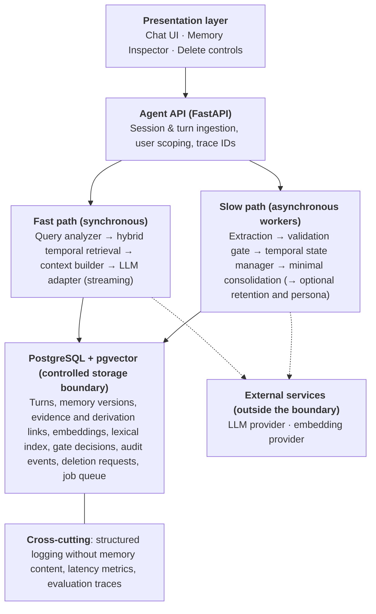
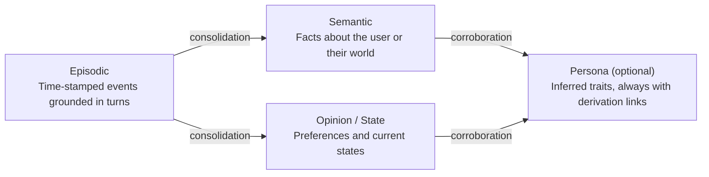
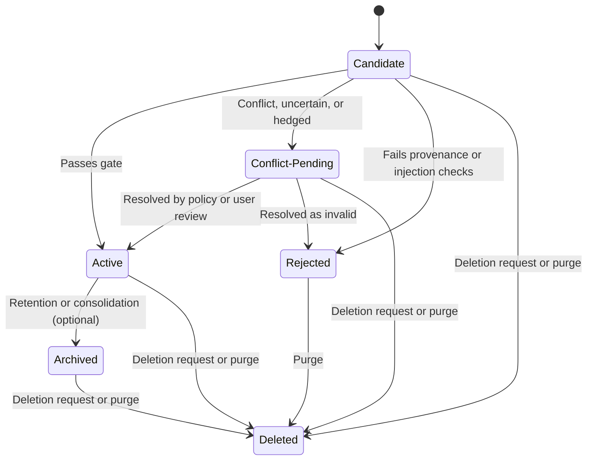
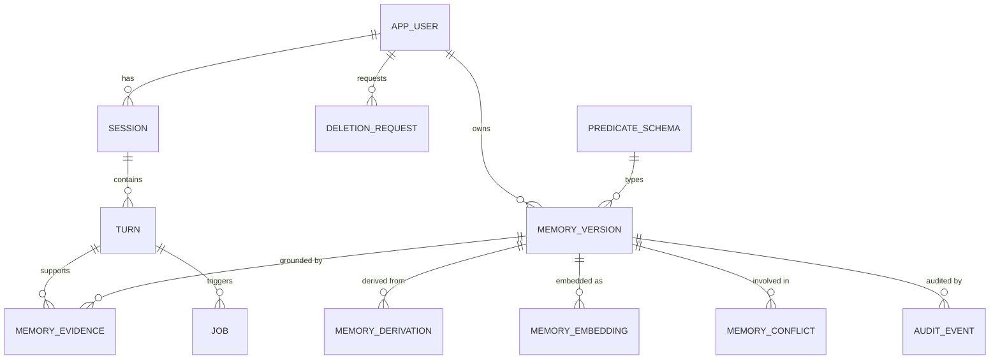
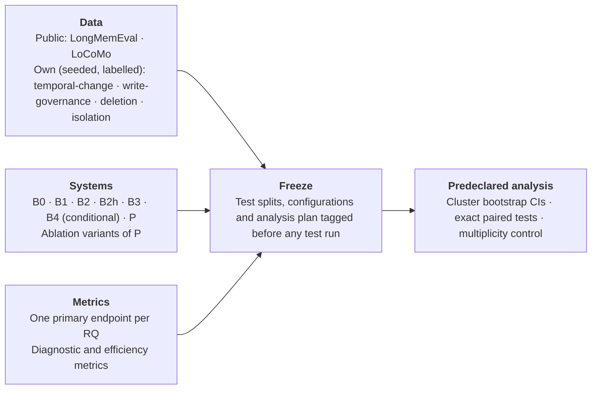

# Personal Digital Twin Agent
## with Temporally-Aware, Governed Long-Term Memory

**Graduation Project Proposal**

> **Status note.** This is a research proposal. No experiment described here has been run. The only code executed for this proposal is a reduced-schema design check of the bi-temporal constraints and query predicates on PostgreSQL 16.15 (Section 7.4; `validation/bitemporal_checks.sql`, output in `validation/bitemporal_checks.output.txt`; 43 assertions passed, as reported in the saved log). That check does not cover pgvector, row-level security, the job queue, concurrency, the full application schema, or the end-to-end deletion procedure. **Research experiments H1–H4 have not been run.** The archival-precondition tests introduced in V4 (Section 7.5) are specified but have **not** been executed; the existing SQL harness does not cover them and they are listed as planned. Everything stated about expected behaviour is a hypothesis, and every numeric value marked *provisional* is a planning placeholder to be revisited after a pilot study. Citations in square brackets refer to the numbered list in [References](#references); entries marked *preprint* have not been peer reviewed as far as could be established. Changes to this document across its revision history are summarised in `CHANGELOG.md`.

---

## Abstract

Large language model (LLM) assistants are increasingly used across many conversations, yet handle long-term memory unevenly. Some forget everything between sessions. Others store user information as unstructured text snippets that cannot distinguish an old preference from a current one, cannot say why something is remembered, and cannot reliably forget it on request. This project designs, implements, and evaluates a temporally-aware, governed long-term memory engine for conversational LLM agents, and uses controlled ablations to measure what three design choices contribute: **(i)** bi-temporal versioning of memories (measured as the incremental effect of retaining version history beyond valid-time filtering), **(ii)** a write-time validation gate, and **(iii)** lineage-tracked deletion of a memory and the artifacts derived from it.

The engine organizes memories into three core layers (episodic, semantic, opinion/state) and records provenance for each one. A fourth, persona layer is specified but optional, and is not needed for any research question. The engine models time with two independent clocks, valid time and recorded time, so that changed facts are versioned rather than overwritten, and it answers current-state, historical, and audit-time queries through three distinct predicates. A validation gate decides whether an extracted candidate may influence answers. Retrieval combines dense and lexical search under the temporal predicate that matches the question. Deletion follows recorded derivation links within a precisely defined storage boundary. A fast synchronous path answers the user while a slower asynchronous path extracts and versions memories.

Many of these ingredients exist individually in recent work, so this proposal does **not** claim that any one of them is new. The research contribution is an open, reproducible, ablation-controlled evaluation of the three mechanisms above, with predeclared primary endpoints, cluster-aware paired statistics, and public benchmarks used only for the properties they actually measure. Properties that no public benchmark measures (write governance, deletion leakage, cross-user exposure) are tested on separate, seeded, labelled suites, and a deletion result of zero observed leaks is reported with a scenario-level upper confidence bound and not as a guarantee. A Personal Digital Twin application, defined conservatively as a transparent, user-controlled, evidence-grounded record of what the system has learned about a person (and not as a behavioural simulation of that person), demonstrates the engine but is not itself a research claim.

## Contents

1. [Introduction and Problem Statement](#1-introduction-and-problem-statement)
2. [Motivation and Significance](#2-motivation-and-significance)
3. [Objectives](#3-objectives)
4. [Research Questions and Hypotheses](#4-research-questions-and-hypotheses)
5. [Scope](#5-scope)
6. [Related Work and Positioning](#6-related-work-and-positioning)
7. [Proposed System](#7-proposed-system)
8. [Data Model](#8-data-model)
9. [Technology Stack](#9-technology-stack)
10. [Evaluation Methodology](#10-evaluation-methodology)
11. [The Personal Digital Twin Application](#11-the-personal-digital-twin-application)
12. [Deliverables](#12-deliverables)
13. [Risk Management](#13-risk-management)
14. [Ethics, Privacy and Security](#14-ethics-privacy-and-security)
15. [Feasibility and Resources](#15-feasibility-and-resources)
16. [Expected Outcomes and Contributions](#16-expected-outcomes-and-contributions)
17. [References](#references)

## 1. Introduction and Problem Statement

Conversational assistants built on LLMs are stateless by design: each request is processed with only the text placed in its context window. Two workarounds are common. One replays long conversation histories, which is costly, and model accuracy can depend on where in a long input the relevant information sits [8]. The other retrieves stored snippets by vector search (Retrieval-Augmented Generation, RAG) [7]. Neither treats user knowledge as data that changes over time.

Consider a user who said in March, "I'm vegetarian," and in August, "I started eating fish again." A store of raw snippets holds both statements and may retrieve either, so the assistant can give an outdated answer. Recent work calls this failure *ghost memory*: old, current, and transition facts coexist in the memory bank and are mixed at retrieval time [20]. Related weaknesses appear in four forms:

1. **Temporal confusion:** outdated facts are presented as current, and historical questions ("what did I prefer last year?") are answered unreliably. LongMemEval defines *knowledge updates* and *temporal reasoning* as separate abilities for this reason [9].
2. **Ungoverned writes:** an extracted statement can become a stored "fact" with no validation step, whether it came from a misunderstanding, a hedged remark, an assistant's own guess, or deliberately injected content. Attacks on agent memory through ordinary query-only interaction have been demonstrated [30], [32].
3. **Unreliable forgetting:** in memory pipelines that do not record derivation, deleting a source message does not necessarily remove the embeddings, summaries, or profile traits built from it. A recent benchmark reports that retrieval-based and external-memory methods can still leak deleted information after a deletion request [28].
4. **Limited transparency:** users often cannot see what the assistant remembers about them or why.

**Gap and problem statement.** Individual remedies are already being explored: temporal knowledge graphs [5], [18], bitemporal memory stores [21], [22], [23], state-aware overlays [20], transactional write validation with cascading retraction [24], and provenance-grounded memory [25]. Based on a limited, non-exhaustive literature survey (see the audit record), we did not find a study that isolates the *separate* contributions of bi-temporal version history (beyond valid-time filtering), write-time validation, and lineage-based deletion inside one open, reproducible system, under one evaluation protocol that reports both benefit and cost. This proposal addresses that measurement gap. It asks, for each mechanism, whether it measurably improves a precisely defined outcome, at what cost in accuracy on legitimate inputs, latency, and complexity, and where it fails.

### 1.1 Terminology

- **Memory item / version.** A *version* is one row asserting a statement about a user, with a valid-time range, a recorded-time range (absent while the row is only a staged candidate), a lifecycle status, and links to its evidence. A *memory item* is the set of versions that share a logical identity (`memory_key`), including versions that are no longer believed.
- **Valid time** is when a statement held in the world; **recorded time** is when the system held that statement as its belief [11]. Four derived conditions use these two clocks and are defined formally in Section 7.4: a version is a *current belief* if its recorded range is open; it is *superseded* if its recorded range has been closed (the system no longer believes it, and it is kept for audit only); it is *historical* if its valid range has ended; and it is *currently valid* if its valid range contains the reference time. These are independent: a historical version can be a current belief, because the system may now believe that something held in the past.
- **Personal Digital Twin (in this proposal).** A transparent, user-controlled, evidence-grounded, temporally updated representation of information a user has shared with the assistant. It is *not* claimed to simulate the user's behaviour, predict their actions, reproduce their personality, or be complete. Every statement in it is linked to the user turns that support it, and the user can inspect, correct, and delete it. The term is used for continuity with the project title, and the proposal makes no claim about fidelity to the person.
- **Derived artifact.** Any stored object computed from other memories or turns: summaries, consolidated semantic memories, persona traits (if the optional persona layer is implemented), embeddings, lexical-index entries, and caches.

## 2. Motivation and Significance

- **Practical relevance:** long-term memory is offered by open-source libraries and research systems [5], [6], [16], [17], and its behaviour is hard to compare across systems. A measurable, reproducible design and protocol are useful to researchers and developers.
- **Correctness:** assistants for tutoring, personal planning, or customer support need to distinguish what is true now from what was true earlier. Benchmarks such as LongMemEval treat this as a distinct ability [9].
- **Privacy and user control:** data-protection regimes such as the GDPR give data subjects a right to erasure under defined conditions and with defined exceptions [14]. A memory system that supports user-initiated deletion should be tested for it. A technical deletion test is evidence about system behaviour and is not a legal compliance determination (Section 14).
- **Security:** persistent memory is an attack surface. Injected content can influence later behaviour [30], [31], [32], [33]. A write-time gate is one defence whose cost to legitimate users must be measured alongside its protective effect.
- **Educational value:** the project combines databases, information retrieval, NLP, software engineering, security, and human-centred design.

## 3. Objectives

| # | Objective | Measured by |
| --- | --- | --- |
| O1 | Design a layered memory model with three core layers (episodic, semantic, opinion/state) and a specified but optional persona layer, with explicit lifecycle states and provenance for every memory. | Published schema and data dictionary; automated invariant and lifecycle tests (Section 8) pass |
| O2 | Implement bi-temporal versioning so that changed facts are versioned, never silently overwritten, and so that current-state, historical-as-of, and audit-as-of queries are answered by distinct, tested predicates. | H1 primary endpoint (temporal answer accuracy, P versus A2, two strata); invariant and query-predicate tests |
| O3 | Implement a write-time validation gate and strict per-user isolation. | H3 primary endpoints (poisoning success rate and legitimate-update acceptance rate); cross-user exposure count on the isolation test |
| O4 | Implement hybrid temporal retrieval and quantify the contribution of each retrieval signal. | H2 primary endpoint (evidence Recall@k); ablation deltas |
| O5 | Implement lineage-tracked deletion within a defined storage boundary. | H4 primary endpoint (post-deletion leakage, scenario level, in-boundary channels) |
| O6 | Separate synchronous answering from asynchronous memory processing and characterise the cost of doing so. | P50/P95 retrieval latency, end-to-end latency, tokens and cost per query, storage growth (descriptive; no hypothesis) |
| O7 | Evaluate under a predeclared, reproducible protocol with pinned baselines and cluster-aware statistics. | Frozen test splits, pinned baseline versions, published analysis plan and scripts |
| O8 | Deliver a working Personal Digital Twin application (as defined in Section 1.1) that exposes memory contents, provenance, and deletion to the user. | Demonstration against a written feature checklist; optional usability study (Section 10.9) |

## 4. Research Questions and Hypotheses

Each research question has one hypothesis. H1 and H3 each have two co-primary conditions (a benefit condition and a no-harm condition), and every condition has a defined endpoint and contrast below. The hypothesis, the endpoint, the experiment, the statistical test, and the conclusion all refer to the same construct. Metrics are defined precisely in Section 10.3. Primary endpoints and contrasts are fixed before any held-out test run and are not changed afterwards (Section 10.7).

| RQ | Question | Hypothesis | Primary endpoint | Primary contrast |
| --- | --- | --- | --- | --- |
| RQ1 | Does retaining bi-temporal version history improve correct answers about past and changed user states, without harming answers about the present, compared with an otherwise identical system that keeps valid-time filtering but discards superseded versions? | **H1:** On the controlled temporal-change suite, the full system (P) has higher temporal answer accuracy than the same system with version history discarded (A2) on history-dependent questions, **and** is not worse than A2 on present-state questions by more than a margin declared before test freeze. | Temporal answer accuracy (TAA), custom temporal-change suite, held-out test split, in two strata: history-dependent and present-state (Section 10.3) | P − A2, paired by question, clustered by scenario. History-dependent stratum: superiority. Present-state stratum: non-inferiority. P − P-flat is a diagnostic comparison and is not confirmatory |
| RQ2 | Does hybrid (dense + lexical) retrieval retrieve gold evidence more completely than either channel alone, and how much does each retrieval signal contribute? | **H2:** On LongMemEval_S, hybrid retrieval has higher evidence Recall@k than dense-only retrieval *and* than lexical-only retrieval. | Evidence Recall@k, LongMemEval_S, answerable questions, held-out test split | P − P(dense-only) and P − P(lexical-only); both must favour P |
| RQ3 | Does the write-time validation gate reduce the effect of injected or unsupported memory writes without blocking legitimate updates? | **H3:** Compared with the same system without the gate (P-nogate), the gate lowers poisoning success rate while legitimate-update acceptance does not fall by more than a margin declared before test freeze. | Poisoning success rate (ASR) **and** legitimate-update acceptance rate (LUAR), write-governance suite, test split | ASR: P − P-nogate (must be lower). LUAR: P − P-nogate (loss must stay within the declared margin) |
| RQ4 | Can deletion by recorded lineage remove a memory and its derived artifacts from every store inside the controlled storage boundary? | **H4:** After deletion requests, no leak is observed for P on any in-boundary channel in any scenario of the deletion suite. The confirmatory summary is a scenario-level exact upper confidence bound on the proportion of scenarios with at least one leak. It is not a claim of an absolute guarantee. | Post-deletion leakage rate (PDLR), scenario level: the proportion of test scenarios with at least one leak on any in-boundary channel, deletion suite, test split | Observed leaking-scenario count for P, with the exact Clopper–Pearson interval at scenario level. Event-level PDLR and per-channel leak counts are diagnostics. P-nolineage (positive control) and external baselines are compared descriptively |

Latency, cost, and storage growth (objective O6) are characterised descriptively and are not hypothesis tests. Comparisons of P against external baselines (B1, B2, B2h, B3, and B4 if included) are reported with confidence intervals as secondary, exploratory results. The proposal does not predict that P will outperform any external system.

**Reading H1.** A2 deletes superseded versions, so it cannot answer history-dependent questions from stored data. A positive history-dependent difference is therefore expected by construction if P's pipeline (extraction, conflict detection, versioning, retrieval, rendering) works at all. H1 tests whether P realises that gain end to end, and whether retaining history costs accuracy on present-state questions, for example through stale values re-entering the context (reported for state-aware overlays [20] and for rendered versioned edges [27]). H1 does not claim that *recorded time* improves answer accuracy: A2 removes valid-time history and recorded-time history together, and the contribution of recorded time alone is expected to appear only in audit queries, which are verified by deterministic tests (Section 7.4) and not scored in TAA. P − P-flat measures the combined effect of validity filtering plus retained history and is reported as a diagnostic.

### 4.1 What counts as support for each hypothesis

| Hypothesis | Supported if | Not supported if | Inconclusive if |
| --- | --- | --- | --- |
| H1 | **Both** conditions hold. *History-dependent stratum:* the paired TAA difference (P − A2) is positive, its Holm-adjusted p-value (Section 10.6) is below 0.05, and the conservative interval's lower bound is above 0. *Present-state stratum:* the lower end of the one-sided 97.5% cluster-bootstrap interval for (P − A2) is above −δ_pres, the non-inferiority margin declared in the frozen plan | The history-dependent interval lies entirely at or below 0 (its upper end is at or below 0); **or** the 95% cluster-bootstrap interval for the present-state difference lies entirely below −δ_pres (retained history costs more present-state accuracy than the margin allows) | The history-dependent interval extends above 0 but the support criterion is not met (for example, it contains 0, including with a negative point estimate, and is too wide to exclude both a negligible and a useful difference); or the history-dependent gain is positive and the present-state interval straddles −δ_pres; or too few independent scenarios exist for inference (Section 10.6) |
| H2 | Both contrasts (vs dense-only, vs lexical-only) are positive and the larger of their two p-values, Holm-adjusted across the confirmatory family, is below 0.05 (an intersection-union test, so no further correction within H2) | Either contrast has an upper bound at or below 0 | Either interval contains 0 while the other favours P |
| H3 | The ASR reduction is significant after Holm adjustment with its interval entirely below 0, **and** LUAR non-inferiority holds (loss within the pre-declared margin, Section 10.6) | ASR is not reduced; or the LUAR interval lies entirely beyond the margin, so the loss exceeds it (a gate that rejects everything fails here) | ASR reduces but the LUAR interval straddles the margin |
| H4 | **All three** of the following hold. (a) Zero leaks are observed for P on every in-boundary channel in every test scenario. (b) The exact (Clopper–Pearson) two-sided 95% scenario-level upper bound on the proportion of leaking scenarios is at or below the informativeness limit u* declared in the frozen plan. (c) The positive control (P-nolineage) is detected as leaking in at least the predeclared minimum share of scenarios. "Supported" means *no leak observed on the tested probes, with a scenario-level upper bound at or below u* and a sensitive probe set*. It does not mean leakage is impossible, and it is not a claim of an absolute deletion guarantee | **At least one** confirmed in-boundary leakage event is observed for P (each leak is analysed and reported, and the observed leaking-scenario proportion is reported with its exact interval) | Zero leaks are observed, but at least one of the following prevents a valid conclusion: the scenario-level upper bound exceeds u* (for example, zero leaks in fewer than 36 scenarios cannot give an upper bound at or below 0.10; arithmetic in Section 10.6); the positive control is not detected in the predeclared minimum share of scenarios (the probes are then not shown to be sensitive); or another explicitly defined precondition in the frozen plan is not met (for example, the deletion suite could not be generated to the predeclared diversity requirements). The three outcomes are mutually exclusive: "Supported" requires (a), (b), and (c); "Not supported" requires any confirmed leak; "Inconclusive" is the no-leak case where (b) or (c) fails, or another defined precondition is not met |

**Thresholds.** No fixed effect-size threshold is imposed on H1 or H2. Two margins are explicit usability requirements and are set before test runs, in the frozen analysis plan: the LUAR margin δ in H3 (set from the development-split operating curve) and the H1 present-state margin δ_pres (set from the development-split variation of the present-state difference and agreed with the supervisor, since there is no operating curve for it). Neither is fixed here, and the earlier "at least 90%" figure remains withdrawn because it had no stated justification. The H4 informativeness limit u* and the minimum positive-control detection share are likewise declared before test freeze. The retrieval-latency budget is a design requirement and not a hypothesis (Section 10.3, efficiency metrics).

## 5. Scope

### In scope

**Essential research components** (required for the research questions):

- Text-based conversational memory for an assistant serving multiple isolated users.
- Memory extraction, provenance tracking, bi-temporal versioning with distinct current-state, historical-as-of, and audit-as-of predicates, write validation, hybrid retrieval, and lineage-based deletion.
- Minimal consolidation: derived semantic memories and summaries with derivation links. It is essential because it creates the derived artifacts that lineage deletion (H4) must remove. Without it, lineage deletion would have nothing to trace.
- The three core memory layers (episodic, semantic, opinion/state).
- An evaluation harness, a controlled temporal-change suite, a write-governance suite, a deletion suite, a cross-user isolation test, and ablations.

**Application features that demonstrate the research** (kept minimal and subordinate to the evaluation):

- A web chat interface and a memory inspector showing layers, versions, timelines, and source turns, with delete controls.

**Optional enhancements** (pursued only if the essential components are complete and their evaluation is not threatened):

- Retention scoring and archival; the persona layer and persona summary (not required for any objective measure, hypothesis, or deliverable of Sections 3, 4, and 12; confirmatory runs disable it, and if implemented it is evaluated only as exploratory ablation A10); a review queue for conflict-pending memories; an explanation ("why did you say that?") panel; the Graphiti baseline (Section 10.1); alternative score-fusion variants; the usability study (subject to ethics determination).

### Out of scope

- Training or fine-tuning a foundation LLM (existing models are used through an adapter), and therefore any claim about removing information from model parameters.
- Multimodal memory (images, audio, video) and tool-using or web-browsing agent memory. LongMemEval-V2 [40] targets web-agent trajectories and is not used.
- Shared or multi-principal memory (for example household or workplace assistants).
- Production-scale deployment, multi-region hosting, or commercial launch.
- Clinical, legal, or other high-stakes decision support.
- Adaptive white-box attackers, corruption of an external document corpus (as in PoisonedRAG [13]), and attacks on the LLM provider.
- Guarantees about copies of data outside the controlled storage boundary (Section 7.7).

## 6. Related Work and Positioning

### 6.1 Closest prior work

*Source note.* Descriptions of the 2025 and 2026 preprints rest on their abstracts and metadata, with one exception. The full texts of [20]–[29] were retrieved in the V2/V3 Stage-2 audit, and the passages relevant to the statements made about them below (ablations, temporal handling, deletion, evaluation design, limitations) were read. The depth of reading differs between papers and is recorded in `Source_Evidence_Ledger.md`, Section E, together with the explicit *Reading depth* column introduced in V4. Reported results were not reproduced and the full texts were not audited line by line. The descriptions of [5], [16], and [30]–[37] remain abstract-based. Peer-reviewed status is marked in the reference list.

| Work | Key idea | Relation to this project |
| --- | --- | --- |
| RAG (Lewis et al., 2020) [7] | Retrieve external passages to ground generation. | Basis for retrieval over stored text. By itself it has no notion of time, versioning, or per-user governance. |
| Generative Agents (Park et al., 2023) [2] | Memory stream scored by recency, importance, and relevance; reflections as higher-level memories. | Source of the idea of scored retrieval and reflection. It does not model validity intervals or deletion. |
| MemGPT / Letta (Packer et al., 2023, preprint) [1] | Operating-system-style paging between context and external storage. | Addresses context management. Temporal correctness and deletion are not its stated focus. |
| MemoryBank (Zhong et al., 2024) [3] | Forgetting-curve-inspired memory strengthening and decay. | Precedent for retention scoring. |
| A-MEM (Xu et al., 2025) [16]; MemoryOS (Kang et al., 2025) [17] | Agentic note linking and evolving memory; hierarchical short/mid/long-term memory with a user-profile tier. | Established precedents for layered or tiered memory. Layering alone is therefore not claimed as new. |
| Mem0 (Chhikara et al., 2025, preprint) [6], [19] | Production memory layer. The 2025 paper describes LLM-selected ADD/UPDATE/DELETE operations and an optional graph variant. | Selected baseline. The current open-source README (checked 16 Oct 2026) describes a newer "ADD-only" algorithm in which nothing is overwritten. Claims about Mem0 must therefore be tied to a pinned version. |
| Zep / Graphiti (Rasmussen et al., 2025, preprint) [5], [18] | Temporal knowledge graph with bi-temporal edges and automatic fact invalidation. | Closest established system. It already provides bi-temporal facts and an episode-removal call, so this project does not claim to introduce either. |
| A-TMA (2026, preprint) [20] | Overlay that keeps superseded and transition records and labels evidence as current, historical, or transition; reports a conflict-heavy LoCoMo-derived benchmark. | Direct evidence that state-aware handling matters. Informs the design of the temporal-change suite and the H1 present-state check. Its component ablation (three profiles, 240 probes) reports small and mixed effects, and every ablated variant keeps the history bank, so it does not test retaining history itself (full text). |
| TOKI [21]; Quipu [22]; Graph-native bitemporal store [23] (2026, preprints) | Bitemporal operators for contradiction resolution; gated, governed bitemporal graph store; Neo4j-based bitemporal memory with time-travel retrieval. | Bitemporal memory with gating or contradiction handling has been proposed in several forms. Bitemporality and gating are treated as established ideas. TOKI's reported memory-layer ablation compares memory with no memory, which is not a history-retention ablation. In [23], a small LongMemEval run (60 sampled questions) found its time-travel path no better than current-state search, which the authors attribute to over-fetching followed by post-filtering (full texts). |
| MemTX [24]; Eywa [25]; Mi-Memory [26] (2026, preprints) | Transactional belief commit with cascading repair on retraction; evidence-before-belief memory with write validation; lifecycle framework with audit and rollback records. | Overlap with the validation gate and lineage deletion. The novelty of those two mechanisms is therefore **not** claimed. The full texts state that end-to-end erasure tests are not yet reported for Eywa, and Mi-Memory lists propagation-complete forgetting as an open challenge and deletion propagation as outside its reported evidence. |
| GateMem [28]; Agentic Unlearning [29] (2026, preprints) | Benchmark combining utility, access control, and agent-facing forgetting; dependency-closure unlearning across parameters and memory. | Existing evaluations of forgetting and unlearning. GateMem measures forgetting behaviourally (non-recoverability at the agent interface) and states that it does not certify physical erasure from every store. This project's deletion suite is narrower (single-user, in-boundary stores, no parameter unlearning) and probes stores as well as answers. |
| Ground Truth First [27] (2026, preprint) | Script-first benchmark generation with per-fact validity intervals and injection probes. | Methodological precedent for generating labelled scenarios from a script before rendering text. It also reports, within one system and a corpus of about 380 validated questions, that explicit versioned edges rendered at answer time underperformed prose-inline history (72/81 versus 79/81 on past-value knowledge-update questions) because superseded edges put stale values back into the answerer's view (full text; single-system result). This motivates the render rule in Section 7.3 and the present-state condition of H1. |
| LoCoMo [4]; LongMemEval [9] | Public long-term conversational memory benchmarks. | Used for the properties they measure (Section 10.2). |
| PoisonedRAG [13]; MINJA [30]; AgentPoison [31]; InjecMEM [32]; Trojan Hippo Bench [33] | Knowledge-base poisoning; memory injection through ordinary interaction; backdoor-style memory poisoning; single-interaction injection; persistent memory attacks and defences. | Threat-model references. PoisonedRAG concerns corrupting an external knowledge base, not conversational memory, and is cited for motivation only. |

Temporal database theory, in particular bitemporal modelling of valid time and transaction time [11], provides the formal basis for the versioning model.

### 6.2 Classification of each claimed contribution

| Component | Classification | Justification |
| --- | --- | --- |
| Memory layers (three core, one optional persona layer) | Established technique reused | Tiered or layered memory appears in [2], [16], [17]. No novelty claimed. |
| Bi-temporal versioning | Established technique reused; engineering contribution | Theory [11]; systems [5], [18], [21], [22], [23]. The project's contribution is a relational realisation with database-enforced constraints and an ablation that separates retained version history from valid-time filtering (H1). No inspected full text reports that separation, but the survey is limited and this is not a novelty claim. |
| Validation gate | Established idea; evaluation contribution | Related ideas in [22], [24], [25]. Novelty of the algorithm is not claimed. The contribution is a two-sided evaluation of a specific lightweight gate (harm rejection *and* legitimate acceptance). |
| Retention scoring | Established technique reused (optional component) | Precedents [2], [3]. Evaluated only as an optional exploratory ablation. |
| Hybrid retrieval with Reciprocal Rank Fusion | Established technique reused | [10], [12]. Mem0 and Graphiti also describe multi-signal retrieval [18], [19]. |
| Asynchronous write path | Engineering contribution | Standard architecture, with idempotency and failure handling specified in Section 7.3. |
| Lineage-based deletion and channel-level leakage measurement | Engineering contribution; novelty unverified | Cascading retraction and dependency-closure ideas exist [24], [29]. Whether the specific combination here (layered conversational memory, relational lineage, per-channel leakage probes) is new could not be established and is not claimed. |
| Temporal-change, write-governance, deletion, and isolation suites | Evaluation contribution | Overlap with [20], [27], [28], [33] is acknowledged. The suites are released for reuse only if they prove valid in the pilot. |
| Personal Digital Twin application | Engineering contribution | Demonstrates the engine. Not a research claim. |

### 6.3 Smallest defensible research contribution

The research contribution is **the measured, ablation-isolated effect of three mechanisms (retained bi-temporal version history beyond valid-time filtering, write-time validation, lineage-based deletion) in one open implementation, under a predeclared protocol that reports both benefits and costs**, together with the reusable suites needed to measure properties public benchmarks do not cover. A negative or null result on any hypothesis is a valid and reportable outcome. The application is a vehicle for the engine, not a separate contribution.

## 7. Proposed System

Mechanisms below are classified as (E) supported by established research or documentation, (D) a reasonable engineering design that requires experimental validation, or (S) specified here because earlier descriptions were under-specified.

### 7.1 Architecture overview



The job queue is a PostgreSQL table claimed with `SELECT … FOR UPDATE SKIP LOCKED`, a pattern the PostgreSQL documentation describes for queue-like tables [38]. This keeps memory writes and job state in one transactional store and keeps the set of stores that must be covered by deletion small. Redis, Celery, or ARQ are used only if the pilot shows that the PostgreSQL queue cannot meet the load (Section 9).

### 7.2 Memory layers: three core and one optional (E for layering; S for the boundaries below)

The layers differ in **role and derivation**, not in whether they change over time. Every non-episodic layer is bi-temporally versioned; "stable" does not mean immutable.

**Persona decision.** The persona layer is **optional**, and no research question, objective measure (Section 3), or deliverable (Section 12) depends on it. It is specified here so that the schema can hold it, and it is switched off in P for all confirmatory runs (H1 to H4). If it is implemented, it is evaluated only as the exploratory variant A10, and any persona-related deletion probes are reported as a separate exploratory stratum. The following is **essential**, however: minimal consolidation of episodic memories into semantic memories and summaries with derivation links, because H4 needs derived artifacts to trace and delete.

| Layer | Content | Created by | Notes |
| --- | --- | --- | --- |
| Episodic | Time-stamped events grounded in specific turns ("On 3 May the user said they moved to Cairo"). | Extraction from turns | Highest volume. Valid time is the event's occurrence. Events are not superseded, though they can be corrected. |
| Semantic | Facts about the user or the user's world ("works as a civil engineer"). | Extraction, or consolidation of episodes | Single- or multi-valued according to the predicate schema (Section 7.4). Changes create new versions. |
| Opinion / State | Preferences, attitudes, and current states that are expected to change ("prefers tea", "is preparing for an exam"). | Extraction | Versioned. Context-dependent preferences can coexist and are modelled as multi-valued unless the predicate is declared single-valued. |
| Persona (optional) | Higher-level traits inferred from many memories ("tends to plan travel far in advance"). | Consolidation only, never directly from a single turn | Always labelled as an inference. Carries derivation links to every supporting memory. Not part of P in confirmatory runs. |



**Persona promotion rule (S; applies only if the optional persona layer is implemented).** A trait may be proposed only when it is supported by memories from at least *k* distinct sessions and is not contradicted by a currently valid memory. *k* is a configuration parameter set on the development split by inspecting the false-trait rate, and is not fixed in this proposal. A persona trait is never an independent source of truth. Deleting any supporting memory triggers re-evaluation or deletion of the trait (Section 7.7).

### 7.3 Fast path and slow path (D)

**Fast path.** (1) The user's turn is stored. (2) A query analyzer determines the *target time* and the *query mode*: current, historical (as of a valid time), or change ("what changed?"). It uses rules plus an optional small-model call, and its accuracy is measured on the development split. Audit-as-of is not inferred from ordinary conversation. It is available only through the memory inspector and the API, where the caller supplies the belief time. (3) Candidate memories are selected by the user scope and the temporal predicate for the mode (current-state, historical-as-of, or change window; Section 7.4), applied together with the status rule of Section 7.6. (4) Dense (pgvector) and lexical (PostgreSQL full-text) channels each rank candidates and the lists are fused. (5) The context builder assembles a token-budgeted context in which each memory is rendered with its validity dates, a role label (*current*, *historical*, or, in change mode, *previous* and *current*), and, where available, a source snippet. **Render rule (D):** superseded versions are never rendered, and in current mode a historical version is not rendered either, so that old values cannot re-enter the answerer's view as if they were current. Rendering versioned history indiscriminately has been reported to return stale values to the answerer [27], so this rule is tested through the present-state condition of H1 and is a design choice, not an established result. (6) The LLM streams the answer. (7) The assistant turn is stored and a job is enqueued. The answer never waits for background processing. The most recent turns of the current session are always included verbatim, so asynchronous write lag is not visible inside a session. A snapshot-consistent transaction is used for steps (3) to (5), so a concurrent write cannot produce a half-updated view.

**Slow path.** A worker claims a job and extracts structured candidate memories with a schema-validated prompt. Malformed output is rejected and retried. Each candidate then passes the validation gate (Section 7.5). Accepted candidates are committed by the temporal state manager in **one database transaction** that closes superseded beliefs first and then inserts the new versions (rule R1 in Section 7.4), records evidence and derivation links, and writes the audit event. The following rules apply.

- **Idempotency.** A unique constraint on (user, source turn, extractor version, candidate fingerprint) in PostgreSQL makes retries harmless. Constraints in the primary store are used rather than cache keys, because a cache is not a durable record.
- **Ordering.** Jobs for a given user are processed one at a time (per-user advisory lock). This avoids concurrent contradictory updates for one user while allowing parallelism across users.
- **Failure handling.** Failed jobs are retried with back-off up to a fixed limit, then moved to a dead-letter table for inspection. A failing job does not block later jobs for other users.
- **Visibility lag.** The delay between a turn and its memories becoming active is measured and reported (P50/P95). The evaluation harness waits for the queue to drain before asking benchmark questions, and a separate freshness check measures the lag.

### 7.4 Bi-temporal model (E for theory [11]; S for the update procedure)

Each version carries two independent ranges.

- **Valid time** `valid_range = [valid_from, valid_until)`: when the statement held in the world.
- **Recorded time** `recorded_range = [recorded_from, recorded_until)`: when the system held this row as its belief. `recorded_from` is set from a **transaction clock** at the moment the row is committed to Active. Application code cannot supply it. In production the transaction clock is the database's `now()` (the worker's commit time, which lags the turn by the visibility lag). For evaluation replay it is an *injectable simulated clock* (see "Clocks in evaluation replay" below), so that recorded time follows the dialogue's timestamps and not the wall-clock time of the experiment. A row with an open upper bound is a *current belief*. Closing the upper bound means the belief was replaced or withdrawn, and the row remains only for audit.
- **Staging rows have no recorded range.** Candidate, Conflict-Pending, and Rejected rows are not beliefs. Their `recorded_range` is NULL, so they are outside the belief timeline and cannot be returned by any query predicate below, including audit. When a Conflict-Pending row is later resolved to Active, `recorded_from` is the time of that decision, which can be later than the turn. `valid_from` still records when the statement held.

**Formal conditions.** For a committed version *r* (status Active or Archived), write V(*r*) for `valid_range`, R(*r*) for `recorded_range`, and ρ for the *reference time* (wall-clock `now()` in production; the question's reference time in replay). The conditions below are derived from the two ranges and are never stored.

| Condition | Definition | What it means |
| --- | --- | --- |
| Current belief | R(*r*) has no upper bound | The system holds *r* as its present belief |
| Superseded | R(*r*) has an upper bound | A later transaction replaced or withdrew the belief. Kept for audit only |
| Currently valid | ρ ∈ V(*r*) | The statement is held to be true in the world now |
| Historical | V(*r*) has an upper bound ≤ ρ | The statement is held to have ended in the world |

The conditions are independent. *Current belief ∧ currently valid* is what the system believes holds now. *Current belief ∧ historical* is what the system now believes held in the past, and it is an Active row. *Superseded* rows record what the system used to believe, and they can be valid-open (v1 below) or valid-ended (v1′). In particular, **a historical version is not superseded**: it is the system's current belief about a past state.

**Update procedure (supersession).** A row is never edited in place. Only the upper bound of a recorded range changes, and only to close it. The worked example uses three events, with reference time ρ = 1 October. Valid-from values marked *inferred* default to the turn date (see "Delayed reports, corrections, and uncertain times" below).

- **E1, 10 March.** The user says "I'm vegetarian." Row v1 is committed with valid_from 10 Mar (inferred) and recorded_from 10 Mar.
- **E2, 5 August.** The user says "I started eating fish again." In one transaction, v1 is closed in recorded time, the old statement is re-issued with its valid range truncated at 5 Aug (v1′), and the new statement is inserted (v2).
- **E3, 20 August.** The user says "Actually I switched in mid-July, not August." The valid boundary moves from 5 Aug to 15 Jul (taken as 15 July for the example). v1′ and v2 are closed in recorded time and re-issued with corrected valid ranges (v1″, v2′). v1 was closed at E2 and is untouched.

| Row | Statement | valid_range | recorded_range | Derived conditions at ρ = 1 Oct |
| --- | --- | --- | --- | --- |
| v1 | diet = vegetarian | [10 Mar, ∞) | [10 Mar, 5 Aug) | Superseded at E2 (valid-open) |
| v1′ | diet = vegetarian | [10 Mar, 5 Aug) | [5 Aug, 20 Aug) | Superseded at E3 |
| v2 | diet = eats fish | [5 Aug, ∞) | [5 Aug, 20 Aug) | Superseded at E3 |
| v1″ | diet = vegetarian | [10 Mar, 15 Jul) | [20 Aug, ∞) | Current belief, historical (the system now believes this held until 15 Jul) |
| v2′ | diet = eats fish | [15 Jul, ∞) | [20 Aug, ∞) | Current belief, currently valid |

**Query predicates.** Three query types exist, each with one predicate. The historical-as-of type has a point form and a window form (change queries). *t* is the valid time asked about and β is the belief time asked about. Every predicate also requires `user_id` to equal the caller's user.

| Query type | (t, β) | Predicate on committed rows | Worked example (ρ = 1 Oct) |
| --- | --- | --- | --- |
| Current-state | (ρ, ρ) | status = Active; ρ ∈ R; ρ ∈ V | "What do I eat?" returns v2′ (fish) |
| Historical-as-of | (t ≤ ρ, ρ) | status = Active; ρ ∈ R; t ∈ V | "What was my diet on 1 April?" returns v1″ (vegetarian). On 20 July it returns v2′ (fish), because the system now believes the change happened on 15 July. Before E3 it would have returned v1′ (vegetarian) |
| Historical-as-of, window form (change queries) | (window W, ρ) | status = Active; ρ ∈ R; V overlaps W | "What changed since March?", W = [1 Mar, 1 Oct), returns v1″ and v2′ |
| Audit-as-of | (any t, β ≤ clock) | status ∈ {Active, Archived}; β ∈ R; t ∈ V | "On 1 June, what did the system believe about 1 April?" returns v1. "On 10 August, what did it believe about 20 July?" returns v1′ (vegetarian), whereas the present belief about 20 July is fish. "On 10 August, about 10 August?" returns v2 |

Current-state and historical-as-of queries use the system's present belief (β = ρ) and differ in the valid time asked about. Audit-as-of queries fix a past belief time. The distinction between *what the system now believes about a past state* (historical-as-of, v1″) and *what it believed in the past* (audit-as-of, v1) is the core of the bitemporal model [11]. Current-state and historical-as-of retrieval exclude Archived rows. Audit-as-of includes them, because archival is a retention action and does not change what was believed. Audit-as-of is never used to build answer context. Closing a valid range in place would destroy the audit answer, so supersession always adds rows and closes only the recorded range of the old belief.

**Implementation rules.**

- **R1, close then insert.** A supersession transaction first closes the recorded range of every replaced row, then inserts the replacement rows. All rows touched in one transaction share one recorded instant. The order matters because the exclusion constraint (invariant 4) is checked per statement.
- **R2, truncated re-issue.** The replaced statement is re-issued with `valid_range = [old valid_from, new valid_from)` only if that range is non-empty. If the new valid_from equals the old one (a same-day correction), no re-issue row is created and the old row is only closed in recorded time. If the new valid_from precedes the old valid_from, the relation is routed to Conflict-Pending, not committed automatically.
- **R3, strictly increasing clock.** Closing a belief at the instant it was recorded would give an empty recorded range, which the constraints reject. The clock interface therefore returns strictly increasing values per user, adding a minimal increment when an instant repeats (for example sessions with identical timestamps in replay).
- **R4, staging and commit.** `recorded_from` is assigned when a row enters Active. Promoting a Conflict-Pending row that conflicts with a current belief must close that belief in the same transaction, or the exclusion constraint rejects the promotion.
- **R5, archival and audit.** Archiving changes `status` only and leaves both ranges unchanged. Archival is permitted only when the Archival precondition of Section 7.5 is met and recorded. The precondition has two branches — **(S) Superseded:** *r*'s recorded range is already closed (the system no longer holds *r* as its belief); or **(C) Active derived replacement:** an Active, non-Archived derived version *r′* exists with a `MEMORY_DERIVATION` link from *r′* to *r* and *r′* carries the same user-level fact. The V3 "valid-ended" sub-branch is **removed in V4**: a version whose valid range has ended but whose recorded range is still open is a *historical current belief* about a past period and must stay reachable through historical-as-of retrieval. Archival of such a row (without (S) or (C)) would silently remove the fact from the only predicates ordinary users can reach, which is the archival bug this revision fixes. Archived rows remain visible to audit-as-of queries and the inspector. Branches (S) and (C) are the only two paths that keep the no-silent-loss guarantee: under (S), the row is no longer a current belief, so no predicate on current beliefs can lose it by its being archived; under (C), its user-level content is still returned, through *r′*, by exactly the predicate it would have been returned by before archival.
- **R6, deletion over audit.** Deleting a memory item removes every version that shares its `memory_key`, including superseded and re-issued rows, because a re-issued row cites the same evidence as the row it re-issues. Audit-as-of queries therefore cannot recover deleted content (Section 7.7).
- **R7, multi-valued predicates.** Ending a multi-valued fact ("I no longer speak French") uses the same close-then-insert pattern with a truncated valid range. Multi-valued rows are not subject to the non-overlap constraint.
- **R8, parameter checks.** Historical-as-of rejects *t* > ρ. Audit-as-of rejects β later than the clock. Planned future states use the separate "plans to" predicate (Section 7.5) and are not served by these predicates.

**What was executed.** The worked example, the query predicates (current-state, historical-as-of point and window, audit-as-of), the staging rule, the constraints of invariants 2 to 4 (the update guard as a trigger, and the single-valued exclusion constraint with `btree_gist`), rules R1, R3, R4, R5 *status-only* branch, and R6, the same-day branch of R2, and the *t* > ρ check of R8 were run as SQL on PostgreSQL 16.15 (docker image `postgres:16-alpine`) in a **reduced schema** (`validation/bitemporal_checks.sql`, output in `validation/bitemporal_checks.output.txt`; the saved log reports **43 assertions, all passed**, ending with the line `ALL ASSERTIONS PASSED`). That schema has no pgvector, no row-level security, no job queue, no concurrent writers, and none of the other tables of Section 8, and it was run with an emulated clock. It is a design check on the bi-temporal rules. It is **not** a test of the application and does not exercise the full application and integration layer. **Not executed** (planned, see Section 15 and the checklist): row-level security (invariant 7), the job queue with `SKIP LOCKED`, idempotency, and the per-user advisory lock (invariant 9), pgvector and hybrid retrieval, concurrent supersessions by two workers, the harness replay-clock test, the end-to-end deletion procedure (invariant 8), traceability (invariant 1), the Archival-precondition tests (invariant 10, Section 7.5), and the full schema of Section 8. **Research experiments H1–H4 have not been run.**

**Clocks in evaluation replay (S).** Benchmark and suite data carry their own timestamps (LongMemEval provides `haystack_dates` and `question_date`; LoCoMo provides session dates; suite T is scripted with dates). Replaying them with wall-clock time would make every belief "recorded" on the day of the experiment and would make "current" mean the evaluation date. The engine therefore takes all time from a single injected clock interface. (1) During ingestion of a turn the clock is set to that turn's timestamp, so `recorded_from` equals the turn's (simulated) time. (2) When a question is asked, the reference time is set to the question's date (or, where a benchmark gives none, to the timestamp of the last ingested turn), and retrieval is run `as_of` that time. (3) Before ingestion, sessions are sorted by timestamp with a stable sort (ties are allowed and keep their original order), because benchmark files do not always list sessions chronologically. In the cleaned LongMemEval oracle file checked during this audit, 34 of 500 questions list `haystack_dates` out of chronological order. After sorting, the injected clock is non-decreasing within a user's history, the harness checks this, and any remaining violation is reported as a data error. The clock interface then makes its output strictly increasing by adding a minimal increment when an instant repeats (rule R3). (3a) The reference time of a question is `max(question_date, timestamp of the last ingested turn)`, so that no belief is recorded after the time at which it is queried. In the same file, 43 of 500 questions have a `question_date` earlier than the latest session date, typically by hours on the same day. Whether such questions are kept with this rule or excluded and counted is decided on the development split before the freeze. The S and M variants were not checked, and the same counts must be recomputed on the exact files used. (4) The clock is switched to real time in the production configuration, and a configuration flag records which mode produced each row. Invariant 3 in Section 8 is read in this light: application code cannot back-date a row relative to the clock it is given, and only the clock interface (a single, audited component) can be set to simulated time. Cases where a user reports something *later* than it happened are handled by `valid_from`, not by changing `recorded_from`.

**Delayed reports, corrections, and uncertain times.**

- *Delayed report* ("I've been vegetarian since 2019", said in 2024): `valid_from` is 2019 and `recorded_from` is the time of the turn.
- *Retroactive correction* ("No, I never lived in Paris, I meant Lyon"): a new version takes the same valid range as the erroneous one, and the erroneous belief is closed in recorded time only.
- *Revised timing* ("actually I switched in July, not August"): the affected rows are closed in recorded time and re-issued with corrected valid ranges and new recorded ranges, as in event E3 of the worked example above.
- *Unknown start time:* `valid_from` defaults to the turn time and is flagged `valid_from_basis = inferred`, so questions about "since when" can be answered with the appropriate uncertainty.

**Which predicates are single-valued?** Not all of them. A *predicate schema* declares each predicate as **single-valued** (for example current city, employer), **multi-valued** (for example languages spoken, hobbies), or **event** (instantaneous, never superseded). Only single-valued predicates are subject to supersession and to the non-overlap constraint. For open-domain content that fits no declared predicate (as in LongMemEval), the system falls back to a conflict detector (Section 7.5) that retrieves similar existing memories for the same user and asks a relation classifier whether the candidate is an *update*, a *correction*, *additive*, a *duplicate or reinforcement*, *unrelated*, or *uncertain*. Uncertain cases go to Conflict-Pending. The database constraint can only be as strong as the canonicalisation of subject and predicate keys. Semantically equivalent statements stored under different keys are not caught by the constraint and are the responsibility of the conflict detector, whose errors are measured (Section 10.3).

### 7.5 Memory lifecycle and the validation gate (D)

Lifecycle statuses are *Candidate*, *Conflict-Pending*, *Rejected*, *Active*, *Archived*, and *Deleted*. `status` describes the row's processing state. Belief time is carried only by the recorded range (Section 7.4). **Superseded is a derived condition, not a stored status**: a committed version whose recorded range has been closed. It is not the same as a version whose valid range has ended. Such a *historical* version is still a current belief, stays Active, and is returned by historical-as-of queries. **Deleted is terminal.** The version rows are physically removed (Section 7.7), so no row holding content carries the status Deleted. The event is recorded only in `AUDIT_EVENT` and shown as the terminal state in the diagram.

| Transition | Trigger |
| --- | --- |
| (new) → Candidate | Extracted from a turn by a worker |
| Candidate → Active | Passes every gate check below. The row enters the belief timeline: `recorded_from` is set to the commit time |
| Candidate → Conflict-Pending | Conflict, relation classified as uncertain, or hedged or hypothetical content |
| Candidate → Rejected | Fails provenance or injection checks, or malformed output |
| Conflict-Pending → Active / Rejected | Resolved by policy or by user review. Unresolved items never enter answer context. On Active, `recorded_from` is the resolution time, and a conflicting current belief is closed in the same transaction (rule R4) |
| Active → Archived | Retention policy or consolidation (optional component). An Archived version is still a belief, because its ranges are unchanged. It stays visible to audit-as-of queries and the inspector, and is excluded from current-state and historical-as-of retrieval **only when the Archival precondition below is met**, so that archival never silently removes a user fact — current or historical — from ordinary retrieval |
| Any → Deleted (including Candidate) | User deletion request or retention purge. Content and derived artifacts are erased, including every version of the same memory item (Section 7.7) |



**Gate checks (S).** The gate makes one of three decisions: *accept*, *hold* (Conflict-Pending), or *reject*. It does not try to decide whether a statement about the world is true. The user is treated as the authority on facts about themselves. Its job is to prevent writes that the user did not actually assert. A candidate is accepted only if all of the following hold.

1. **Evidence support.** A cited evidence span exists in a *user-authored* turn and supports the candidate (checked by literal span matching plus a verifier). Statements made by the assistant become candidates only after the user confirms them, which blocks the assistant's own guesses from being stored as user facts.
2. **Assertion mode.** The statement is classified as *asserted*, as opposed to *hedged* ("maybe I'll move"), *hypothetical*, *planned*, *quoted or pasted third-party content*, *reported speech about another person*, or *joking*. Only asserted statements can supersede an existing single-valued state. Hedged and hypothetical content is held. Plans are stored under a separate "plans to" predicate and do not replace current state.
3. **Instruction screen.** Content that tries to install a persistent instruction for the assistant ("always tell the user…", "ignore previous…") is not stored as a user fact. It is rejected or held according to a fixed policy.
4. **Conflict relation.** The conflict detector classifies the relation to existing memories (Section 7.4). *Update* or *correction* with asserted mode may supersede. *Uncertain* is held.
5. **Extractor confidence.** A confidence value may be used only after its calibration on the development split has been checked (reliability diagram and expected calibration error). Verbalised LLM confidence is often poorly calibrated, so if calibration is poor the gate uses the categorical checks above and does not threshold a number.

Each gate decision stores its inputs and outcome in `MEMORY_CONFLICT` for audit and for the error analysis in Section 10.3.

**Archival precondition (S; corrected in V4 to fix the historical-memory archival bug).** Current-state and historical-as-of retrieval exclude Archived rows, as in V2 and V3. To prevent silent loss of **any** user fact — currently valid *or* historical-but-still-believed — the archival procedure (optional component; invoked by retention policy or by consolidation) is only allowed to move a version *r* from Active to Archived when at least one of the following holds, and the archival transaction records which:

- **(S) Superseded:** *r*'s recorded range is already closed; the system no longer holds *r* as its belief. By definition no current-state and no historical-as-of query predicate can return *r* even before archival (those predicates require ρ ∈ R, which fails for a closed recorded range), so excluding Archived rows loses nothing retrievable to ordinary users. Only audit-as-of can reach *r*, and audit-as-of continues to include Archived rows.
- **(C) Active derived replacement:** there exists at least one Active, non-Archived version *r′* with a `MEMORY_DERIVATION` link from *r′* to *r* (that is, *r′* is a consolidated semantic memory, summary, or other derived artifact built from *r*, carrying the same user-level fact), and *r′* is itself in a state where the fact remains answerable: it is a *current belief* (recorded range open), its valid range covers at least the valid range of *r* that would otherwise be answerable, and it is returned by the same predicates (current-state and historical-as-of over the relevant time) that would have returned *r*. The derivation link makes the knowledge accessible through *r′* and the deletion lineage of Section 7.7 ensures that deleting *r* also removes or re-derives *r′*.

The V3 "valid-ended" branch, which allowed archival of a historical version solely because its valid range had ended at or before the archival time, is **removed in V4**. The reason is the historical-memory archival bug: a version whose valid range has ended but whose recorded range is still open is a *current belief about a past period* (for example row v1″ of the worked example in Section 7.4, which encodes the system's present belief that the user was vegetarian until 15 July). Historical-as-of retrieval exists precisely to answer questions about such past periods, and it excludes Archived rows. Allowing archival of v1″ would make the question "what was my diet on 1 April?" unanswerable from the user's point of view, even though the system still holds the fact. The V4 rule forbids that path: for a historical current belief, only branch (C) — an Active derived replacement that is itself still returned by historical-as-of — permits archival.

A proposed archival of a version that satisfies neither (S) nor (C) is **not performed**; the retention policy either waits (until the row is superseded, or until a derived replacement is created by consolidation) or asks the user. This rule is tied to the no-silent-loss guarantee of invariant 10 (Section 8). The enforcement code and its deterministic tests are **planned, not executed** in V4; the reduced-schema SQL check (`validation/bitemporal_checks.sql`) already exercises the status transition and the exclusion of Archived rows from current-state and historical-as-of predicates, but it does not test the precondition itself (see `Methodology_and_Consistency_Checklist.md`, Section 5, and the planned test cases listed there).

**Four behaviourally distinct version conditions (V4 summary).** Combining lifecycle `status` with the two derived conditions on the ranges, the following four cases are the ones the archival and retrieval rules must handle. Deletion is treated separately (Section 7.7) because it is terminal and physically removes rows.

| Condition | Defining predicates | Returned by current-state? | Returned by historical-as-of (point / window)? | Returned by audit-as-of? | Eligible for archival? |
|---|---|---|---|---|---|
| **Currently valid current belief** | status Active; recorded range open; ρ ∈ V | **Yes** (if ρ ∈ V and ρ ∈ R) | Yes (for t with t ∈ V) | Yes (for β ≥ recorded_from) | **Only via branch (C):** an Active derived replacement *r′* that keeps the fact answerable |
| **Historical current belief** (valid range ended ≤ ρ; recorded range still open) | status Active; recorded range open; V has upper bound ≤ ρ | No (ρ ∉ V) | **Yes** (for t with t ∈ V) | Yes (for β ≥ recorded_from) | **Only via branch (C):** otherwise archival would silently remove the row from historical-as-of (the V4 fix) |
| **Superseded** (recorded range closed) | status Active or Archived; recorded range has upper bound | No (ρ ∉ R) | No (ρ ∉ R) | Yes (for β ≥ recorded_from and β < recorded_until, and t ∈ V) | **Yes, via branch (S):** no ordinary predicate can return it, so archival loses nothing retrievable to users |
| **Archived** | status Archived; (S) or (C) was recorded at archival | No | No | Yes (for β ∈ R and t ∈ V) | Already Archived; may be deleted on request (R6) |

The two "current belief" rows are both Active and are both the system's present belief about something. They differ only in whether the thing is believed to hold *now* (currently valid) or *in a past period* (historical). The V4 Archival precondition treats them symmetrically: neither may be archived unless (C) holds. Supersededness is the only sufficient condition for safe archival without a replacement, because supersededness means the row is no longer a current belief at all.

### 7.6 Scoring and retrieval (E for components; D for their combination)

**Retention score (optional component, lifecycle use only).** Retention governs archival, compression, and promotion. It is not used in the primary retrieval ranking.

```
S_ret(m) = ( w_i·I(m) + w_c·C(m) + w_f·ln(1 + R(m)) / ln(1 + R_max) ) · exp( −λ_layer · Δt )
```

I is importance in [0, 1], C is confidence in [0, 1], R is the number of reinforcements (re-mentions or corroborations), R_max normalises the reinforcement term, Δt is the time since last reinforcement, and λ_layer is a layer-specific decay rate. The multiplicative form is bounded and avoids subtracting a time quantity from unitless scores. This form is a design choice inspired by [2], [3], not an established result. Weights and decay rates are not fixed in advance. They are fitted on the development split by measuring *answerability after archival* (the fraction of questions whose gold evidence is still retrievable) against storage reduction. Because I and C come from LLM judgments, their calibration is checked as in Section 7.5. A retention-weighted ranking variant exists only as exploratory ablation A9 (Section 10.4).

**Retrieval (primary configuration).**

1. *Hard predicate (Section 7.4):* user scope AND the temporal predicate for the query mode: current-state for *current* queries, historical-as-of for *as-of* queries, and the change-window predicate for *change* queries. Each requires status = Active, so Candidate, Conflict-Pending, Rejected, and Archived rows are excluded. The exclusion of Archived rows is safe for ordinary retrieval only because the V4 Archival precondition of Section 7.5 (and invariant 10 in Section 8) permits archival of a current belief — whether *currently valid* or *historical* — only when an Active derived replacement that is itself returned by the same predicate exists (branch (C)); supersededness (branch (S)) is the only other sufficient branch, and a superseded row is not returned by current-state or historical-as-of in any case. Audit-as-of queries continue to see Archived rows. Temporal validity is a filter and not an additive score term, so a semantically similar but invalid memory cannot outrank a valid one.
2. *Channels:* a dense channel (cosine similarity over a single frozen embedding model) and a lexical channel (PostgreSQL full-text search with `ts_rank_cd`). The PostgreSQL ranking functions use no global collection statistics [38] and are therefore **not** BM25 [10]. A BM25 implementation is evaluated as an alternative lexical channel if the built-in ranking is weak on the development split.
3. *Fusion:* Reciprocal Rank Fusion, `RRF(m) = Σ_c 1 / (k + rank_c(m))`, with *k* = 60, the value Cormack et al. report as near-optimal in their pilot [12]. A weighted-sum variant `α·dense + β·lexical`, with weights tuned on the development split, is evaluated as ablation A7 (Section 10.4).

Every component score is logged per result to support ablations and the explanation panel.

**Vector search and filtering (D).** pgvector documents that with an approximate HNSW index a `WHERE` filter is applied after the index scan and may return fewer than the requested rows, and it offers iterative scans, partial indexes, and partitioning as remedies [39]. Per-user stores are expected to be small enough that exact (non-indexed) search restricted by user is feasible and deterministic. The HNSW index is used only in the scalability measurements (Section 10.3, efficiency), where recall against exact search is also reported.

### 7.7 Deletion (D; guarantee limited to a defined boundary)

**Controlled storage boundary.** The boundary consists of the application's PostgreSQL database (tables, indexes, and the vector and lexical indexes in it), the job queue, and any application-level cache or evaluation-trace store the project creates. Application logs are designed to contain identifiers and event types only, never memory content, and this is verified.

**Explicit exclusions.** The deletion guarantee does **not** cover: write-ahead logs, replicas, and backups, which expire under their own retention schedule; physical remnants in storage until vacuuming (pgvector notes that HNSW indexes need vacuuming, which can be slow [39]); LLM or embedding provider logs and retention; text already shown to the user, copied, or exported; and parameters of any model, since the project never trains one.

**Lineage.** Every derived artifact (consolidated memory, summary, and persona trait if the optional layer is present) has derivation links to its sources in `MEMORY_DERIVATION`. Embeddings and lexical-index entries belong to exactly one version and are removed with it. The deletion target set also contains **every version of the same memory item**, including superseded and re-issued rows (rule R6), because those rows cite the same evidence. Deletion takes precedence over audit retention, so audit-as-of queries cannot reveal deleted content.

**Procedure.** A deletion request runs in one transaction. It marks the target and its transitive derivation closure with a *deletion epoch*, physically removes the version rows (no tombstone keeps a subject or predicate), erases embeddings and index entries, and deletes or re-derives dependent artifacts. A dependent artifact with remaining independent support is regenerated from the remaining sources and is **not** retained as-is, because its text may embed the deleted content. The audit record keeps only random identifiers, event type, user identifier, and timestamps. It keeps **no** content, content hash, subject, or predicate, because a hash would allow confirming what was deleted.

**Re-learning.** Deleting a memory does not delete the user's other turns. If the same information is stated elsewhere, the worker may legitimately extract it again. The default "forget" action therefore also offers to delete the memory's exclusive evidence turns, and the limitation is shown to the user.

**Races.** A worker's insert transaction re-checks the deletion epoch of every source it uses, so a job running during deletion cannot create a new derived artifact from deleted content. Retrieval and context assembly read within a snapshot and check the epoch at assembly time. Any cache entry is keyed by user and deletion epoch. A response that has already been streamed cannot be recalled, and this is documented as a limitation. What is measured is leakage into requests that begin after the deletion transaction commits.

**Verification.** Deletion is verified on seven in-boundary channels, enumerated in Section 10.3: a scan of every table, index text, queue payload and cache entry for canary strings and identifiers; lexical search; vector search; derived-memory lookup; assembled context for direct and indirect probes; final answers; and application logs.

### 7.8 Security and isolation (D)

**Threat model.** In scope: a user (or content a user pastes) attempting to inject false or instruction-like memories through ordinary conversation, across sessions [30], [32]; assistant-generated statements wrongly stored as user facts; and one user attempting to read another user's memories. Out of scope: adaptive white-box attackers, corruption of an external corpus [13], compromise of the database host or LLM provider, and tool-mediated attacks such as planted email content [33].

- Every query is scoped by user identity at the service boundary, and unscoped queries are rejected. PostgreSQL row-level security is used as a second layer. The PostgreSQL documentation notes that superusers, roles with `BYPASSRLS`, and table owners normally bypass row security, so the application connects with a restricted role and `FORCE ROW LEVEL SECURITY` is evaluated [38].
- Candidate, Conflict-Pending, and Rejected memories never enter the answer context.
- Isolation is enforced by excluding items before the context is assembled, and does not rely on the model declining to reveal them. This follows the exclusion-based approach studied in [35]. Leakage is measured at the **assembled context** (prompt exposure) as well as in the answer, following the argument that final-answer accuracy alone can hide inadmissible exposure [34].
- Provenance on every memory allows tracing and rolling back injected content.

## 8. Data Model

| Table | Fields |
| --- | --- |
| APP_USER | id · external_ref · created_at |
| SESSION | id · user_id · started_at · ended_at |
| TURN | id · session_id · user_id · sequence_no · role (user / assistant) · content · occurred_at |
| PREDICATE_SCHEMA | predicate_key · cardinality (single / multi / event) · default_layer |
| MEMORY_VERSION | id · memory_key · user_id · layer · status · subject_key · predicate_key · single_valued · content · valid_range · valid_from_basis · recorded_range (NULL while staged; set when committed to Active) · assertion_mode · confidence · importance · reinforcement_count · extractor_version |
| MEMORY_EVIDENCE | version_id · turn_id · evidence_span · evidence_role |
| MEMORY_DERIVATION | derived_version_id · source_version_id · derivation_type |
| MEMORY_EMBEDDING | version_id · embedding_model · embedding (vector) |
| MEMORY_CONFLICT | id · candidate_version_id · existing_version_id · relation · decision · reason_code · decided_by · decided_at |
| AUDIT_EVENT | id · user_id · memory_ref (random identifier, no content) · event_type · event_at · details (restricted schema, no content) |
| DELETION_REQUEST | id · user_id · scope (memory / topic / all) · target_ref · status · deletion_epoch · requested_at · completed_at |
| JOB | id · user_id · kind · turn_id · idempotency_key (unique) · status · attempts · next_run_at |



### Database invariants

Each invariant is tied to a mechanism that enforces it and a test that checks it. Invariants that a database constraint cannot express are enforced by transactional code and verified by tests, and are labelled as such.

| # | Invariant | Enforcement |
| --- | --- | --- |
| 1 | Every non-deleted version is traceable: it has at least one `MEMORY_EVIDENCE` row (extracted memories) or at least one `MEMORY_DERIVATION` row (consolidated memories, and persona traits if the optional layer is implemented). | Deferred constraint trigger; test |
| 2 | `valid_range` is non-empty and has a lower bound. `recorded_range` is NULL if and only if the row is a staging row (Candidate, Conflict-Pending, Rejected). Otherwise it is non-empty and has a lower bound. | `CHECK` constraints (executed on PostgreSQL 16.15, reduced schema) |
| 3 | Valid time and recorded time are separate clocks. `recorded_from` is assigned when the row is committed to Active, from the transaction clock (database `now()` in production; the injected simulated clock in evaluation replay, Section 7.4), never from application-supplied values, and the clock is strictly increasing per user (rule R3). After insertion only `status` and the upper bound of `recorded_range` may change, and the upper bound may change only once, to the clock value, to close a belief. | Clock function and an update-guard trigger; the guard and an emulated clock were executed on the reduced schema. The replay-mode test with the harness has not been run |
| 4 | For a single-valued predicate, no two believed (Active or Archived) versions overlap in **both** valid time and recorded time for the same user, subject key, and predicate key. | PostgreSQL exclusion constraint: `EXCLUDE USING gist (user_id WITH =, subject_key WITH =, predicate_key WITH =, valid_range WITH &&, recorded_range WITH &&) WHERE (single_valued AND status IN ('active','archived'))`, which needs the `btree_gist` extension [38]. The constraint is only as strong as key canonicalisation (Section 7.4). **Executed** on PostgreSQL 16.15 in a reduced schema: it rejected an overlapping believed row, allowed multi-valued overlap, and accepted every sequence of the worked example when rule R1 (close, then insert) was followed. **Not executed:** the full schema, concurrent supersessions by two workers, and load. Feasibility there remains a pilot item |
| 5 | Superseded beliefs (committed versions whose recorded range is closed) are retained until a deletion request or purge. Nothing is silently overwritten. A recorded range is closed only in a transaction that also inserts the replacement versions or records a retraction (rule R1). | Transactional supersession procedure (Section 7.4); test (executed in the reduced schema for the worked example) |
| 6 | Candidate, Conflict-Pending, and Rejected versions have no recorded range and are never returned by any query predicate (current-state, historical-as-of in either form, or audit-as-of). | Invariant 2 (NULL recorded range) plus retrieval through the predicate functions or views only, with a role that has no other read path; test (executed in the reduced schema, without the role restriction) |
| 7 | Every table that holds user data carries `user_id`, with row-level security for the application role, and all memory and retrieval queries are user-scoped. | Row-level security and service-boundary check [38]; cross-user test (Section 10.3) |
| 8 | Deletion leaves no memory content, embedding, lexical-index entry, derived artifact, cache entry, or queue payload in the boundary for the deleted material, and removes every version of the deleted memory item, including superseded ones. The audit record holds no content. | Transactional deletion procedure (Section 7.7). This cannot be a database constraint. It is verified by the deletion suite. Removal of all versions of one memory key was executed in the reduced schema |
| 9 | A retried job cannot create a duplicate memory. | Unique constraint on `JOB.idempotency_key` and on (user, source turn, extractor version, candidate fingerprint) |
| 10 | A row may be Archived only if the V4 Archival precondition of Section 7.5 is met: either **(S)** its recorded range is already closed (the row is superseded), or **(C)** at least one Active, non-Archived derived version *r′* exists with a `MEMORY_DERIVATION` link *r′* → *r* that carries the same user-level fact and is itself returned by the same current-state and historical-as-of predicates that would have returned *r* (that is, *r′* is a current belief whose valid range covers at least the valid range of *r* that would otherwise be answerable). The archival transaction records which branch applied. The V3 "valid-ended" branch is **removed** in V4 because it allowed archival of a historical current belief (recorded range open, valid range ended) and historical-as-of excludes Archived rows, which would silently remove the fact from the only predicate that could still return it. This invariant therefore prevents archival from silently removing any user fact — currently valid or historical — from current-state or historical-as-of retrieval. | Transactional archival procedure (Section 7.5). This cannot be a single-row database constraint. **Planned, not executed:** five deterministic test cases listed in `Methodology_and_Consistency_Checklist.md`, Section 5 — (T1) currently-valid current belief without a derived replacement → archival **rejected**; (T2) historical current belief (valid range ended, recorded range open) → still **retrievable** by historical-as-of, i.e. archival rejected unless (C) holds; (T3) superseded version → not returned by current-state or historical-as-of, archival accepted via (S); (T4) derived representation used as the (C) replacement → remains retrievable with correct `MEMORY_DERIVATION` provenance and participates in the deletion closure; (T5) deletion of the original memory → removes the derived replacement under R6 and the Section 7.7 closure, so the deleted information is not available through the derived representation. The reduced-schema SQL does not exercise the precondition. The exclusion of Archived rows from current-state and historical-as-of predicates was executed in the V2 reduced-schema SQL run |

## 9. Technology Stack

Each technology is retained only if a requirement justifies it.

| Requirement | Choice | Reason and alternatives considered |
| --- | --- | --- |
| API and typed contracts | Python 3.12, FastAPI, Pydantic | Mature AI ecosystem and typed request and response schemas. |
| Transactional store with temporal constraints, vector search, and full-text search | PostgreSQL (a currently supported release; 16 is documented as supported alongside 17 and 18, and the final version is fixed at implementation) with `pgvector` and `btree_gist` [38], [39] | One transactional store makes atomic supersession and deletion practical and keeps the deletion boundary small. Range types and exclusion constraints support the bi-temporal invariant. A separate graph database would add a service and a second store to delete from. |
| Lexical search | PostgreSQL full-text search (`tsvector`, GIN) with `ts_rank_cd` | No extra service. Not BM25 (Section 7.6); a BM25 channel is an evaluated alternative. |
| Background jobs | PostgreSQL job table claimed with `FOR UPDATE SKIP LOCKED` | Transactional with memory writes, durable idempotency, no extra store in the deletion boundary. Redis with Celery or ARQ is adopted only if a pilot load test shows this is insufficient. Any cache that is adopted is keyed by user and deletion epoch. |
| LLM | Provider-agnostic adapter; one frozen model (identifier, snapshot or version date, decoding parameters) for all experiments, either an open-weight model run locally or a hosted API | Reproducibility and cost control. Hosted models can change or be withdrawn, so the exact version and the date of use are recorded, and the evaluation harness caches outputs. |
| Embeddings | One frozen embedding model for all systems where the system allows it | Fair comparison. Where a baseline fixes its own embedder, this is documented as a difference. |
| Frontend | React with TypeScript, kept minimal | Needed for the timeline view in the memory inspector. A lighter framework is an acceptable fallback if the application threatens the evaluation. |
| Reproducibility | Docker Compose, pinned dependency lock files, Git with CI running automated tests | One-command environment; baseline versions pinned by commit or release. |
| Analysis | Python (pandas, SciPy, NumPy), Jupyter | Statistics and plots. |
| Evaluation harness | Record-and-replay of extraction outputs, keyed by (turn, extractor version) | Ablations that change only gating, versioning, or retrieval replay identical extractions. This isolates the component under test and avoids re-paying extraction cost. |


## 10. Evaluation Methodology



**Design principles.** (1) Every research question has primary endpoints (H1 and H3 each have two co-primary components), each defined once in Section 10.3 and reused unchanged in the experiment, the test and the conclusion. (2) Public benchmarks are used only for properties their documentation and labels support (Section 10.2). (3) Anything a public benchmark does not measure is measured on a separate suite built for that purpose. (4) Each suite includes at least one control whose expected outcome is known, so a measure that cannot detect the effect is noticed before test data are used. (5) No experiment has been run at proposal stage, and no number in this section is a result. Values marked *provisional* are planning values to be revisited after the pilot and fixed in the frozen analysis plan (Section 10.7).

### 10.1 Systems compared

| ID | System | Configuration |
| --- | --- | --- |
| B0 | No persistent memory | Only the current session is in context. Gives the floor, including answers a model produces without memory (guessing or parametric knowledge). |
| B1 | Full history in context | Entire history placed in the prompt up to the model's context limit; the number of truncated cases is reported. A cost reference as much as a quality reference. |
| B2 | Dense retrieval over raw turns | Raw turns embedded and retrieved by cosine similarity. No extraction, no time handling, no gate. |
| B2h | Hybrid retrieval over raw turns | B2 with the same dense + lexical + RRF retrieval as P. Added so that gains from hybrid retrieval can be separated from gains due to extracted, versioned memories. |
| B3 | Mem0 (open-source) | Pinned release or commit chosen at implementation. The checked repository head (14 Oct 2026, commit `0724291`) describes a single-pass ADD-only extraction, while the 2025 paper describes ADD/UPDATE/DELETE operations [6], [19]. The two differ, so results apply to the pinned version only. Apache-2.0 licence. The README names default models (an OpenAI LLM and embedder), which are replaced by the frozen models through configuration. |
| B4 | Graphiti (open-source, conditional) | Temporal knowledge graph with bi-temporal edges [5], [18], Apache-2.0. Included only if the decision rule below is met. The *Zep* cloud service evaluated in [5] is not Graphiti, so the paper's numbers are not reused. |
| P | Proposed system | Full configuration of the essential components (Section 7). The optional persona layer and retention-based ranking are **off** in P for H1 to H4 and are evaluated only as exploratory variants A10 and A9. |

**Selection of B3 and B4.** Mem0 is an open-source memory layer under a permissive licence (Apache-2.0) that can be configured with local models and a local vector store (README), and it is the baseline already named in the original proposal. Graphiti is the closest established system for bi-temporal memory, so omitting it would leave the most relevant comparison missing. It also needs a graph database (Neo4j, FalkorDB, or Neptune; the Kuzu backend is marked deprecated in its README) and uses LLM calls during ingestion (extraction and resolution steps, per its README and code), which adds services and cost. The number of calls per episode was not measured and is a pilot item. **B4 is therefore included only if, on the development split, (a) it runs end to end through the evaluation adapter with the frozen models and (b) its ingestion cost fits the budget.** If not, it is excluded, and the reason and the measured obstacle are reported. A-MEM, MemoryOS and MemOS were considered and not selected as baselines. They add integration effort, and their contribution (agentic or hierarchical organisation) is not what the research questions isolate. Newer 2026 systems [20]–[26] are preprints without verified, pinned, easily reproducible releases at the time of writing, and are discussed in Section 6 rather than run.

**Fair comparison.** Systems cannot be made identical internally. The protocol therefore separates *controlled variables* from *system-specific details*, and documents the latter.

| Controlled across systems | System-specific (documented, not equalised) |
| --- | --- |
| Answering LLM, prompt template, decoding parameters | Extraction and update logic, including each system's own prompts (run with the same frozen LLM) |
| Same ingested data in the same order with the same timestamps | Chunking, index structure, and ranking inside each system |
| Maximum number of memory tokens inserted into the answer prompt (value *provisional*, set on the development split). Each system's retrieved items are truncated in its own rank order | Whether the system supports validity intervals, deletion, or per-user scoping |
| Embedding model, where the system allows configuration | Embedding model where a system fixes its own (documented as a difference) |
| Hardware, runtime environment, and measurement procedure for latency | Ingestion cost, reported separately from query cost |
| The same adapter interface: `ingest(turn)`, `retrieve(query, as_of)`, `delete(ref)` where supported | Capabilities that are absent in a baseline are marked "not supported" and the item is not scored for that system |

### 10.2 Datasets and what each can legitimately support

| Dataset | What it evaluates (verified from its repository, data, and paper) | Used for | Not used for |
| --- | --- | --- | --- |
| **LongMemEval** [9] (ICLR 2025). 500 questions. Cleaned data on Hugging Face (MIT licence on the dataset card; MIT for the code). Variants `oracle`, `S` (about 115k tokens, around 40 sessions per history, per the repository), and `M` (500 sessions) | Five abilities: information extraction, multi-session reasoning, knowledge updates, temporal reasoning, abstention. Evidence labels: `answer_session_ids` (session level) and `has_answer` on turns (turn level). Official QA scoring is a GPT-4o-based judge with task-specific prompts; the paper reports over 97% judge agreement with human experts | **H2** (evidence Recall@k, S variant). End-to-end QA accuracy as a secondary, descriptive outcome. Knowledge-update and temporal-reasoning questions as an external check on H1 (descriptive) | Deletion, poisoning, or cross-user isolation (no such tasks or labels). Per-fact validity intervals (not annotated), so H1 is not tested here |
| **LoCoMo** [4] (ACL 2024). `locomo10.json`: 10 conversations, 1,986 questions (counts computed from the released file; categories 1 to 5 with 282, 321, 96, 841, and 446 questions). Licence CC BY-NC 4.0 (non-commercial, attribution) | Question answering with dialogue-level `evidence` ids (4 questions have none), event summarisation, and category labels. The official script scores categories with token F1 (multi-hop with partial F1) and scores the adversarial category by checking for an abstention phrase. The repository README does not state the category-name mapping, so the proposal reports numeric categories as in the script | Secondary, descriptive replication of retrieval and QA results, reported per conversation | Any hypothesis test: **only 10 independent conversations**, so cluster-aware inference is not reliable (Section 10.6). Deletion, poisoning, isolation. Commercial use or redistribution of derived data (non-commercial licence) |
| **Own suites** | Defined below | **H1, H3, H4**, isolation test | — |

LongMemEval-V2 [40] targets web-agent trajectories and is out of scope. Public benchmarks are publicly available and may overlap with LLM training data, which is why B0 is reported on every benchmark.

**Splits.** Every dataset is split into development and test. For LongMemEval the split is by question, stratified by question type, with a fixed seed (development fraction *provisional*, about one fifth). For own suites the split is by scenario, assigned by hashing the scenario identifier. A scenario never appears in both splits. Tuning, prompt design, threshold selection and the pilot use the development split only.

**Cost of public-benchmark ingestion.** One pass over LongMemEval_S is about 500 histories of about 115k tokens, roughly 57 million input tokens before prompt overhead, for the extraction step alone (arithmetic from the repository's description, not a measurement). If the pilot shows this to be unaffordable with the frozen model, a seeded, stratified test subset is declared before test freeze, and its size is reported as a limitation. Extraction outputs are recorded and replayed (Section 9), so extraction is paid once per extractor version.

#### Own suites: construction, labels, and controls

All suites follow a *script-first* procedure, as in [27]. A seeded generator first emits a structured script of facts, events, and probes with their ground truth, and only then is text rendered by an LLM. Gold answers are derived mechanically from the script, never from the rendered text. A verification step checks that every scripted fact is expressed in the rendered dialogue, and a human check is applied to a sample of each suite. Rendered dialogues are varied in wording and include implicit expressions ("started eating fish again" rather than "my diet changed from vegetarian to pescatarian"), distractor topics and sessions, and entity-value overlap between different synthetic users. Questions are paraphrased and never copy the stored value, so that the answer is not encoded in the question or the prompt.

| Suite | Target capability | Unit of evaluation (cluster) | Content | Labels and controls |
| --- | --- | --- | --- | --- |
| **Temporal-change (T)** | H1: history-dependent and present-state answers | Question (cluster: scenario, one synthetic person's multi-session history) | Facts that change, are corrected, are reported late, or have uncertain start times (Section 7.4). Question types: *current*, *as-of date* (inside the current period or inside an earlier one), *what changed*, *before the change*, and *stable* (nothing changed). A rule applied to the script assigns each scored question to a stratum: **history-dependent** if its gold answer requires a version that is not currently valid (as-of an earlier period, before the change, what changed), and **present-state** otherwise (current, stable, as-of inside the current period). Audit-as-of is not reachable through ordinary conversation (Section 7.3), so it is tested at the API level by deterministic checks against the script (Section 10.3), not by free-text questions, and it is not part of TAA | Gold value, validity interval, and stratum per question. Stable-fact questions and as-of questions whose gold is the **old** value stop a "latest value always" strategy from scoring well. Floor: B0. Mechanical control: A2 cannot answer history-dependent questions from stored data, so a history-dependent difference near zero would indicate a pipeline failure in P. Known-failure control for validity filtering: P-flat |
| **Write-governance (G)** | H3: false-write resistance and legitimate acceptance | Episode (cluster: scenario) | *Legitimate* events: explicit updates, corrections, new facts. *Non-assertions*: hedged, hypothetical, planned, joking, quoted or pasted third-party text, statements about other people. *Unsupported writes*: assistant guesses not confirmed by the user, instruction-like injections ("always tell the user…"), content pasted into the chat. Each episode ends with probe questions | Label per event (asserted / not asserted / injected), the intended end state, and the attacker target for injected events. Reference points: *accept-all* (P-nogate) and *reject-all*, which bound the trade-off. **Held-out attack families:** the test split contains injection phrasings and structures not used during tuning |
| **Deletion (D)** | H4: leakage after deletion | Scenario (cluster), containing several deletion events. Event-level results are diagnostics | Synthetic **canary** facts (fictional, so a model cannot guess them from parametric knowledge) stored as: a direct memory, a fact consolidated into a semantic memory, a fact in a summary, a fact superseded earlier (so that closed-belief versions must be removed too), and a fact present in several turns (re-learning case). Only if the optional persona layer is implemented: a fact supporting a persona trait, reported as a separate exploratory stratum. Deletion by memory, by topic, and "forget everything" | Probe set per event across channels (Section 10.3). **Never-stated control probes** estimate how often an answer matches a canary by chance. **Positive control:** P-nolineage must be detected as leaking in at least a predeclared minimum share of scenarios. Otherwise the probes are not shown to be sensitive and H4 is inconclusive. Re-learning cases are reported separately and are not part of H4 |
| **Isolation (I)** | Cross-user exposure (design requirement, not a hypothesis) | Query | Users with deliberately overlapping topics and canaries, adversarial prompts that ask for another user's memories, and direct queries issued with a missing or wrong user scope | Expected exposure count: zero. Reported with an exact upper bound |

**Size.** The number of scenarios and events is *provisional* and is set after the pilot. The pilot measures the variation between scenarios of the paired differences, and the test size is then chosen to reach an acceptable interval width, a precision calculation rather than a power claim (Section 10.6). Diversity requirements fixed in advance: several predicate types (single-valued, multi-valued, event), several domains of personal information, several change patterns, and a mix of explicit and implicit phrasing. For suite T, the proportion of history-dependent and present-state questions is fixed in the frozen plan, with both strata present in every scenario. For suite D, the number of *scenarios* sets the H4 bound (Section 10.6), and adding deletion events inside a scenario does not tighten it.

**Annotation.** Gold labels come from the script. Labels that involve interpretation (for example whether a rendered utterance is hedged or asserted) are checked on a sample by at least two independent annotators with written guidelines, and agreement is reported (Cohen's κ for categorical labels). Items with unresolved disagreement are excluded from the test split and counted.

**Release.** The generator, scripts, and the suites are released if the pilot shows them to be valid and if licensing allows. The LoCoMo licence is non-commercial, and the own suites do not copy any LoCoMo or LongMemEval content.

### 10.3 Metrics

Each metric has one definition, used unchanged in the experiment, the analysis and the conclusions. "Unit" is the unit of analysis. "Cluster" is the independent sampling unit used for resampling (Section 10.6).

#### Primary endpoints (per research question)

| Metric | RQ | Definition | Unit / cluster | Handling of edge cases |
| --- | --- | --- | --- | --- |
| **Temporal answer accuracy (TAA)** | RQ1 | Numerator: questions of a stratum whose final answer is correct against the scripted gold for the question's mode (current value; value valid on the as-of date; the change and its date; the value before the change; or the unchanged value). Denominator: all test questions of that stratum. **Strata:** *history-dependent* (the gold requires a version that is not currently valid: as-of an earlier period, before the change, what changed) and *present-state* (the gold is derivable from currently valid versions: current, stable, as-of inside the current period). Both strata are primary: the first for superiority and the second for non-inferiority (Section 4). Correctness is scored by exact or normalised match on the scripted value where the answer is categorical, and by the validated judge (Section 10.5) for free text. Also reported per mode. Audit-as-of is checked deterministically and is not part of TAA | Question / scenario | A refusal or "I don't know" counts as incorrect for answerable questions. An answer that states both the old and the new value without saying which is current is incorrect. A correct value with a wrong date is incorrect for change questions and is also recorded as a partial-credit diagnostic. |
| **Evidence Recall@k** | RQ2 | For each answerable LongMemEval_S question with gold evidence: the fraction of gold evidence units found in the top-k retrieved items. **Evidence units are gold turns (`has_answer`) mapped to the memory items extracted from them (via stored evidence links)**, or the turns themselves for raw-turn systems. This is computed on the LongMemEval_S test split after the evidence mapping is verified on the development split. k is fixed before test freeze (a small set of values is reported; one is designated primary) | Question / question (each question is an independent history) | Abstention questions (30 of 500 in the data) have no evidence and are excluded from this metric. The 56 single-session-assistant questions have evidence in assistant turns, and P's gate (Section 7.5) deliberately does not store assistant statements as user facts, so they are excluded from the primary metric and reported separately. Questions with several evidence units are scored by fraction (partial credit) and also by "all evidence found". |
| **Poisoning success rate (ASR)** | RQ3 | Numerator: injected-event episodes after which the attacker's target statement is *both* stored as an Active memory *and* used to answer a probe (or appears in the assembled context for it). Denominator: all injected-event episodes in the test split. The two components are also reported separately (stored; influenced the answer) | Episode / scenario | The attacker's target is defined in the script. A rejected or held write is a defence success. |
| **Legitimate-update acceptance rate (LUAR)** | RQ3 | Numerator: legitimate events (explicit updates, corrections, new facts) whose intended end state is present as an Active memory after processing. Denominator: all legitimate events in the test split | Episode / scenario | Reported with the proportion held in Conflict-Pending (held items are not accepted, so they count as not accepted). A gate that rejects everything has ASR = 0 and LUAR = 0, and therefore fails H3. |
| **Post-deletion leakage rate (PDLR)** | RQ4 | For each deletion event, a *leak* is observed if **any** probe, on any in-boundary channel, returns content derived from the deleted canary (exact canary match for SQL, lexical, vector-result, and derived-memory channels; a validated match for assembled context and answers). **Primary (scenario level):** numerator = test scenarios in which at least one deletion event has a leak; denominator = all test scenarios of the suite. **Diagnostics:** event-level PDLR (deletion events with at least one leak, over all deletion events) and leaks per channel. Events in one scenario share a synthetic person, a history, and canary families, so they are not independent observations and the event-level rate is not used for inference | Scenario (primary); deletion event (diagnostic) / scenario | Probes are issued only for requests that begin after the deletion transaction has committed. Re-learning cases (the same information stated in other, non-deleted turns) are scored separately and are not leaks. Never-stated control probes estimate false matches. |

#### Secondary and diagnostic metrics

| Metric | Definition | Purpose |
| --- | --- | --- |
| End-to-end QA accuracy | Per-benchmark official scoring where one exists: LongMemEval GPT-4o-judge prompts per question type (including abstention), LoCoMo token-F1 by category. Judge model and version recorded | Descriptive external comparison (Section 10.7). Not a test of H1 or H2 |
| Retrieval MRR and nDCG@k | Rank-based quality of gold evidence units, defined over the same evidence units and population as Evidence Recall@k | Diagnostic for RQ2. Separates ranking quality from coverage |
| TAA per mode | TAA restricted to each question mode (current, as-of, change, before the change, stable) | Shows which temporal ability drives each stratum. The two strata of the primary endpoint are the confirmatory split |
| Event-level PDLR and per-channel leak counts | Leaking deletion events over all deletion events, with a Clopper–Pearson interval that assumes independence, and the number of leaks on each of the seven channels | Diagnostics for H4. The event-level interval is too narrow when events cluster in scenarios, so it is not an inferential summary |
| Audit-as-of correctness | For each scenario, whether the audit-as-of predicate returns exactly the scripted belief history (set equality on version identifiers) for a grid of (valid time, belief time) pairs | Deterministic verification of the recorded-time design. Not LLM-scored and not part of TAA |
| P − P-flat and (A2 − P-flat) on suite T | Paired differences, per stratum | H1 diagnostics: the combined effect of validity filtering plus retained history, and the effect of validity filtering alone. Exploratory |
| Conflict-relation accuracy | Accuracy and per-class F1 of the conflict detector's relation label (update, correction, additive, duplicate, unrelated, uncertain) against the scripted label | Explains H1 and H3. A detector error rate is needed to interpret both |
| Gate decisions by event type | Accept / hold / reject rate for each non-assertion type and each injection family | Error analysis for H3 |
| Cross-user exposure count | Number of memory items or canaries of user A found in the assembled context or answer for user B on the isolation suite | Design requirement. Expected count is zero, reported with an exact upper bound |
| ANN recall against exact search | For the HNSW scalability measurements only (Section 7.6): fraction of the exact top-k results returned by the approximate index, with and without the user filter | Checks that approximate indexing, if adopted, does not silently lose valid memories. Not used in H1 to H4 |
| Retrieval latency (P50, P95) | Wall-clock time from receipt of the query to the assembled context, excluding LLM generation and external API calls | Cost of the retrieval design. **Not** a measure of response latency |
| End-to-end latency | Time to first streamed token and total time to the complete answer, including LLM calls, reported by provider/model | What the user perceives. Dominated by the LLM |
| Visibility lag | Time from a turn being received to its memories becoming Active (P50, P95) | Cost of the asynchronous path |
| Tokens, cost, storage | LLM and embedding tokens and cost per ingested turn and per query. Database size growth per 1,000 turns | Cost side of the quality-cost analysis |
| Unanswerable and abstention | Abstention accuracy on LongMemEval abstention questions and the LoCoMo adversarial category, reported separately from answerable questions | A system that always abstains must not look good on answerable questions, nor the reverse |

Latency figures are reported with hardware, concurrency, store size, and the model/provider, and are compared only between systems measured under the same conditions. **No latency target is claimed in this proposal.** Any latency budget is a design requirement to be set from the pilot measurements.

**Deletion channels.** The in-boundary channels checked after a deletion are: (1) a full-text scan of every table, index text, queue payload and cache entry in the boundary for canary strings and identifiers; (2) lexical search; (3) vector search; (4) derived-memory lookup (consolidated memories and summaries, plus persona traits if the optional layer is implemented); (5) assembled context for a *direct* probe ("what is my X?") and an *indirect* probe (a question whose answer depends on the canary); (6) the final answer; (7) application logs, checked for content. Channels (1) and (4) also check that no superseded or re-issued version of the deleted memory item remains. Exclusions (WAL, backups, replicas, provider logs, text already shown) are listed in Section 7.7 and are not measured.

### 10.4 Ablations

Each ablation changes one design choice, holds every other variable fixed (answer model, prompt, embedding model, retrieved-token budget, and the recorded extraction outputs), and is tied to the question it answers. Ablations that cannot be implemented without changing a second variable are redesigned or dropped.

| ID | Variant | Changes only | Compared with | Explains |
| --- | --- | --- | --- | --- |
| A1 (P-flat) | Versioning disabled: facts keep their timestamps and statements but have no validity intervals or supersession, so all versions are retrievable and the hard temporal predicate is absent | Temporal structure (validity filter and retained history together) | P, on suite T | H1 diagnostic: the combined effect of validity filtering plus retained history. Not confirmatory |
| A2 (P-nohistory) | Valid-time predicate kept, but supersession replaced by overwrite: when a replacing version commits, the replaced version is deleted, so no superseded or valid-ended rows and no recorded-time chain remain. A fact whose end is stated without a replacement keeps its valid_until | Whether superseded and valid-ended versions are retained | P, on suite T, both strata | H1, the primary contrast. History-dependent stratum for superiority, present-state stratum for non-inferiority |
| A2b (optional) | Versions are retained with valid ranges, but corrections are applied in place and no recorded range exists (a valid-time-only history) | Whether recorded time (belief history) is kept | P, on suite T and on the audit-as-of tests | Exploratory. Expected to differ from P only in audit-as-of results and in reconstructing earlier beliefs, not in current-state or historical-as-of answers. A2 removes valid-time history and recorded-time history together and cannot separate them, so A2b is the only variant that isolates recorded time |
| A3 (P-nogate) | Gate disabled: every extracted candidate becomes Active | Gate only | P, on suite G | H3. The primary contrast |
| A4 | Gate with only the *assertion-mode* check (no evidence check, no instruction screen), then only the *instruction screen* | Gate sub-checks | Full gate, on suite G | Which check provides the protection and which one costs legitimate updates |
| A5 (P-dense) | Lexical channel removed | Retrieval channel | P, on LongMemEval_S | H2 |
| A6 (P-lexical) | Dense channel removed | Retrieval channel | P, on LongMemEval_S | H2 |
| A7 | Weighted-sum fusion instead of RRF (weights tuned on development split) | Fusion method | P (RRF) | Whether RRF is the better fusion for this data |
| A8 (P-nolineage) | Deletion removes the target memory only, not the derivation closure | Lineage | P, on suite D | H4. Positive control for the leakage probes |
| A9 (optional) | Retention-weighted ranking in retrieval | Ranking signal | P | Exploratory; whether retention information helps retrieval at all (Section 7.6) |
| A10 (optional) | Persona layer on: P plus consolidation of persona traits (the layer is off in P) | Persona layer | P | Exploratory, and only if the optional persona layer is implemented. Whether persona traits change answers or cost, and whether they add leakage paths (a further class of derived artifact) |

The ablations used as confirmatory contrasts are A2 (H1), A3 (H3), and A5 and A6 (H2). A8 is the positive control for H4. All others (A1, A2b, A4, A7, A9, A10) are exploratory or diagnostic. They are reported with intervals, are not used to confirm hypotheses, and do not cause a change to the frozen analysis plan.

### 10.5 Answer scoring and the LLM judge

**Principle.** An LLM judge is a measuring instrument that must be validated, not a source of ground truth [15], [36].

1. **Prefer deterministic scoring.** Where the answer is categorical or a scripted value, exact or normalised match against the script is used. Suite T, G, D and I labels are derived from the script, so the judge is needed only for free-text matching.
2. **Judge rubric.** For free text the judge receives the question, the scripted gold answer, and the system answer, and returns a binary label with a rationale. Rubrics follow the style of the official LongMemEval prompts [9] for LongMemEval and are written per mode for suite T (for example, an answer giving both old and new values without identifying the current one is incorrect).
3. **Validation before use.** On a development sample, human labels are compared with the judge using accuracy and Cohen's κ, with the confusion matrix reported. The sample size is *provisional* and set so that the interval on agreement is informative. The judge is not used for test scoring until agreement is judged adequate for the endpoint, and the criterion is written down before the test split is scored. No agreement threshold is borrowed from another study, because agreement figures depend on the task and the rubric.
4. **Bias controls.** Judge position and verbosity effects, and preference for the judge's own model family, are documented in the literature [15]. Controls: the judge sees one answer at a time (no pairwise ordering), answer order is randomised, answers are length-normalised in the rubric ("do not reward extra detail"), and the judge model differs from the answering model where feasible. A perturbation check, such as appended irrelevant text and paraphrased answers, is run on the development sample, following the idea of reliability harnesses [36].
5. **Disagreements.** A random sample of test items stratified by system is re-scored by a human blind to the system identity. The proportion of disagreements and its effect on the primary contrasts is reported as a sensitivity analysis. If the sensitivity analysis changes the conclusion for a hypothesis, the hypothesis is reported as inconclusive.
6. **Reproducibility.** The judge model version, prompt, and decoding parameters are recorded, and judge outputs are cached.

### 10.6 Statistical analysis (predeclared)

**Why not simple per-question tests.** Questions drawn from the same conversation or scenario share a history, a profile, and often a failure cause, so they are not independent observations. Treating them as independent understates uncertainty. Statistical guidance for model evaluations recommends clustered standard errors in this case and paired comparisons on shared questions [37]. This analysis follows that guidance, and the guidance for choosing significance tests in NLP [41].

**Units and pairing.**

| Analysis | Independent cluster | Paired observation | Per-cluster outcome |
| --- | --- | --- | --- |
| H1 (suite T) | Scenario (one synthetic person's history) | Same question answered by P and by A2 on the same recorded extractions | For each stratum, the mean over the scenario's questions in that stratum of (correct under P − correct under A2) |
| H2 (LongMemEval_S) | Question (each has its own history) | Same question retrieved by P and by each single-channel variant | Recall@k difference for that question |
| H3 (suite G) | Scenario | ASR: same episodes under P and P-nogate. LUAR: same episodes | Per-scenario difference in the proportion of injected events that succeed, and in the proportion of legitimate events accepted |
| H4 (suite D) | Scenario | Not a comparison | Whether any leak occurred in any deletion event of the scenario, on any in-boundary channel |

**Repeated runs.** LLM calls are nondeterministic even with fixed seeds. Decoding temperature is set to the lowest available value, and each configuration is run *r* times (*provisional*; set from the pilot's run-to-run variation). Per-item outcomes are **averaged over runs before analysis**, so repeated runs reduce measurement noise and are never counted as extra independent observations. Run-to-run spread is reported separately. Extraction outputs are recorded and replayed so that ablations differ only in the component under test (Section 9).

**Primary tests.**

- *Estimate:* the mean of the per-cluster paired differences, with a 95% **cluster bootstrap** interval (resample clusters with replacement; percentile interval; 10,000 resamples or more, fixed seed). The within-cluster questions are not resampled separately.
- *Test:* a **paired sign-flip permutation test** on the per-cluster differences (exact enumeration when the number of clusters is small enough, otherwise Monte Carlo with a fixed seed). It assumes only that the sign of each cluster's difference is exchangeable under the null, and does not assume normality. Clusters with a difference of exactly zero contribute nothing and are counted and reported. Wilcoxon signed-rank is reported as a sensitivity check only when the number of clusters is large and ties are few.
- *Binary per-question outcomes* are collapsed to per-cluster means, as above. McNemar's test is not used for the primary analysis because it treats questions as independent.
- *H3's second component* (LUAR loss) is a **non-inferiority** comparison: the lower end of the one-sided 97.5% cluster-bootstrap interval for the LUAR difference (P − P-nogate) must lie above −δ, where δ is the margin declared in the frozen plan.
- *H1's second component* (present-state non-inferiority) is built like the LUAR criterion: the lower end of the one-sided 97.5% cluster-bootstrap interval for the present-state difference (P − A2) must lie above −δ_pres, where δ_pres is the margin declared in the frozen plan.
- *H4* has no hypothesis test, and a statistical test cannot confirm that leakage is zero. The primary result is the number of test scenarios with at least one leak, with the exact Clopper–Pearson interval at the **scenario level** (two-sided 95%; with zero leaks in *n* scenarios the upper limit is 1 − 0.025^(1/*n*)). Deletion events within one scenario share a synthetic person, a history, and canary families, so they are not independent. A Clopper–Pearson bound computed over events treats them as independent and is therefore too narrow. Scenarios are the independent clusters, so the scenario-level bound is the primary inferential summary. It is conservative with respect to the unknown within-scenario correlation, because it behaves as if the events of a scenario were fully dependent. The event-level rate with its own bound, and the per-channel leak counts, are reported as diagnostics and are labelled as valid only under independence. With zero observed leaks the within-scenario correlation cannot be estimated, so no design-effect correction is attempted. If the generator can produce one deletion event per scenario at acceptable cost, the two levels coincide.
- *What the H4 bound means.* The bound applies to scenarios drawn from the suite's generator, to the enumerated in-boundary channels, and to the probes used. It is not a bound on leakage through unprobed channels, unprobed paraphrases, or the exclusions of Section 7.7, and observing zero leaks is not proof that none exist. The positive control (P-nolineage) and the never-stated control probes are the evidence that the probes can detect a leak and do not fire by chance. Consistent with Section 4.1, "Supported" requires all three of: zero in-boundary leaks for P, scenario-level upper bound at or below the informativeness limit u* declared in the frozen plan, and the positive control detected in at least the predeclared minimum share of scenarios. "Not supported" is any confirmed in-boundary leak. "Inconclusive" is the no-leak case where the bound exceeds u*, or the positive control fails its criterion, or another explicitly defined precondition in the frozen plan is not met.
- *Arithmetic for H4* (computed in `checks/cp_bounds.py`; not a measurement). With zero leaks, 20 scenarios give an upper limit of 0.168, 36 give 0.097, 50 give 0.071, and 100 give 0.036. Reaching an upper limit of at most 0.20, 0.15, 0.10, or 0.05 requires at least 17, 23, 36, or 72 scenarios respectively. As an illustration only, with an assumed 12 events per scenario and 20 scenarios, an event-level bound computed under independence would be 0.015, about one eleventh of the scenario-level 0.168. The number of events per scenario does not tighten the scenario-level bound.

**Multiplicity.** The confirmatory family has three tests: H1 (superiority on the history-dependent stratum), H2 (its two contrasts are combined as an intersection-union test, so its p-value is the larger of the two), and the ASR reduction of H3. The family-wise error rate is controlled at 0.05 with the Holm step-down procedure. The two non-inferiority conditions, the present-state condition of H1 and the LUAR condition of H3, are co-primary conditions combined by intersection-union with their superiority tests, and therefore need no further correction. Decisions use the Holm-adjusted p-values. 95% intervals are reported for effect size, together with the more conservative (1 − 0.05/3) intervals. All other contrasts (baselines, ablations other than the confirmatory contrasts A2, A3, A5, and A6, per-mode and per-category breakdowns) are **exploratory**: they are reported with unadjusted intervals, labelled as exploratory, and not used to confirm or reject a hypothesis.

**Effect sizes and uncertainty.** Every result reports the absolute difference with its interval, the number of clusters, the number of clusters where P is better, equal, and worse, and a plot of the per-cluster differences. A p-value is never reported alone.

**Number of independent clusters.** This is a design quantity and not a free choice.

- Suite T, G and D: the number of scenarios. It is set after the pilot, subject to generation and verification cost, and recorded in the frozen plan. For suite D, the H4 upper bound is determined by this number and not by the number of deletion events.
- LongMemEval_S: the number of test questions (at most 414 answerable questions excluding assistant-evidence questions in the 500-question set, minus the development portion).
- LoCoMo: **10 conversations**. This is too few for reliable cluster-level inference, so LoCoMo results are descriptive only.
- *Feasibility floor (arithmetic, not a power claim):* a two-sided exact sign-flip test with *N* clusters cannot give a p-value below 2/2^N. With Holm adjustment over three tests, the smallest threshold to be met is 0.05/3 ≈ 0.0167, which requires at least *N* = 7 clusters with differences in the same direction. A suite with fewer non-tied clusters than this cannot support a confirmatory conclusion. For H1 the floor applies to the history-dependent stratum.
- *Decision rule:* if the pilot indicates that the planned number of clusters gives intervals too wide to separate a negligible difference from a useful one, or if fewer than the floor are available, the affected hypothesis is analysed descriptively and reported as inconclusive, and this limitation is stated in the results. No post hoc enlargement of the test split after seeing test results is allowed.

**Power.** No power calculation is claimed in this proposal. The pilot provides an estimate of between-scenario variance, from which the **expected width of the interval** for a candidate number of scenarios can be computed. That precision calculation, with its assumptions, is written in the frozen plan.

### 10.7 Pilot, freezing, aggregation and reporting

**Pilot (development split only).** The pilot (a) checks that each suite can be generated and verified, (b) checks that the adapter runs every selected baseline, (c) estimates run-to-run variation, between-scenario variation, and per-item costs, (d) validates the judge (Section 10.5), (e) calibrates the gate and the LUAR margin, (f) calibrates *k* for persona promotion (only if the persona layer is implemented), retention weights, and extractor confidence (Sections 7.5 and 7.6), (g) decides whether B4 is included and whether a LongMemEval subset is needed, and (h) sets the stratum mix of suite T, the margin δ_pres, and, for suite D, the informativeness limit u* and the minimum positive-control detection share. Nothing from the test splits is looked at.

**Freeze.** Before any test run, the following are committed and tagged in version control with their checksums: test split identifiers; generator seeds; baseline versions or commits and configurations; prompts; frozen model identifiers and dates; the extraction cache keys; the primary endpoints and contrasts; the LUAR margin; δ_pres; the H4 informativeness limit u* and minimum positive-control detection share; the stratum assignment rule and mix of suite T; *k* and other thresholds; the judge and its validation result; the aggregation rules below; and the analysis scripts. After the freeze, a change is allowed only to fix a defect that is independent of results (for example, a crash), is recorded in a deviations log, and, if it touches a primary endpoint or contrast, causes the affected result to be flagged. Each test run is made once per configuration for the confirmatory analysis. Selecting among repeated test runs is not allowed.

**Cross-dataset aggregation (predeclared).**

- Results are reported **separately for each dataset and each suite**. Metrics are not pooled across datasets, because their units, scoring rules, and sizes differ (LoCoMo has 10 conversations and 1,986 questions; LongMemEval has 500 independent histories; the own suites are scenario-based).
- **No overall score is computed or used for any hypothesis.** Each hypothesis is tested on the one dataset named in Section 4. External-benchmark results are shown side by side in a single table of per-benchmark differences (P versus each baseline), without averaging.
- If a reader-oriented summary is added later, it must be a macro-average of per-dataset values with equal weights, using the primary endpoint of each dataset, with missing metrics shown as missing and not imputed. This option is declared here in advance and is for presentation only. It is not used in conclusions.
- Aggregation rules are not changed after test results are seen.

**Reporting.** Negative, null, and inconclusive outcomes are reported. A table lists every confirmatory test, its adjusted p-value, interval, number of clusters, and verdict according to Section 4.1. Deviations from this plan are listed.

### 10.8 Quality–cost analysis

The quality–cost comparison is descriptive.

- *Plots:* one plot per dataset with a quality measure on the vertical axis and a cost measure on the horizontal axis. Quality: LongMemEval QA accuracy; TAA on suite T (per stratum). Cost: tokens or monetary cost per query (and, separately, ingestion cost per 1,000 turns), and, in a second plot, P95 retrieval latency.
- *Systems:* B0, B1, B2, B2h, B3, B4 (if included), P, and the non-exploratory ablation variants.
- *Dominated:* A system A *dominates* B if A is at least as good on both plotted axes and strictly better on at least one, using point estimates. A is *robustly* better than B in quality only if the 95% cluster-bootstrap interval of the paired quality difference lies entirely above zero while A's cost is no higher. Anything else is reported as a trade-off. The proposal does not assume that P lies on the frontier. If the data show that a cheaper configuration achieves comparable quality, that is reported as a result.

### 10.9 Optional usability study

The usability study is **optional and descriptive**. It is not part of the confirmatory evidence for any hypothesis.

- *Purpose:* to check whether the memory inspector (layers, versions, evidence, deletion) can be understood and used, and to find usability problems. It does not test whether the system is "accurate about the person".
- *Design:* a small formative study. Participants complete defined tasks (find a stored fact and its source; correct a memory; delete a memory and confirm that it is no longer used) using a fictional persona or self-chosen non-sensitive content, and complete the System Usability Scale. The number of participants is to be agreed with the supervisor and is not used for inferential claims. SUS scores are reported descriptively with the sample size, and not compared against benchmark thresholds as if the sample were representative.
- *Ethics:* participation is voluntary, with an information sheet, informed consent, and the right to withdraw and to delete all data. Real personal data is not requested. **Whether the study needs formal ethics review at the university is to be confirmed with the supervisor before any participant is recruited.** The study is not started without that confirmation, and no approval is assumed in this proposal. If approval is not obtained, the usability evidence is limited to a cognitive walkthrough by the project and is reported as such.

## 11. The Personal Digital Twin Application

The application demonstrates the engine and gives the project a user-facing surface. It is **not a research contribution** and is the first thing to be reduced if the evaluation is threatened. In the terms of Section 1.1, it presents a transparent, user-controlled, evidence-grounded record of what the assistant has learned, and makes no claim to represent or predict the person.

**Core (required for the evaluation and demonstration)**

- Multi-session chat with streaming, memory-grounded answers.
- Memory inspector: browse memories by layer, view versions on a timeline (valid time and recorded time), and open the source turn for every memory.
- Deletion controls: delete one memory, a topic, or everything. A deletion receipt states what was removed, what was re-derived, and the documented exclusions (Section 7.7), and does not claim legal erasure.

**Optional (only if the core and its evaluation are complete)**

- Review queue for Conflict-Pending memories ("Did you move, or are you planning to?").
- Persona summary (requires the optional persona layer): corroborated traits, each labelled as an inference with links to its evidence.
- "Why did you say that?" panel listing the memories used for an answer and their score components.

**Constraint.** Feature work on optional items does not start until the core evaluation harness runs end to end on the development split.

## 12. Deliverables

1. Memory engine source code in an open repository, with automated tests (including the invariant and lifecycle tests of Section 8) and a one-command setup.
2. Database schema, migrations, predicate schema, and data dictionary.
3. Evaluation framework: the adapter interface, baseline adapters with pinned versions, the suite generators with seeds, frozen test-split identifiers, and the analysis scripts and plan (Section 10.7).
4. The own suites (temporal-change, write-governance, deletion, isolation), released if the pilot shows them valid and licensing allows.
5. Experimental results for H1 to H4, with the confirmatory table of Section 10.7, the exploratory comparisons, ablations, the quality–cost analysis, and a deviations log.
6. A demonstration application satisfying the core feature list of Section 11.
7. Graduation thesis, a demonstration video, and the final presentation. The thesis reports negative and inconclusive results as they occur, together with the limitations in Section 15.

## 13. Risk Management

| Risk | Likelihood | Impact | Mitigation |
| --- | --- | --- | --- |
| Database design changes late | Medium | High | Design the schema and invariant tests first; migrations are versioned; data dictionary reviewed before the evaluation harness is built |
| Temporal semantics are mis-specified (for example, corrections or delayed reports handled wrongly) | Medium | High | The worked example and rules R1 to R8 of Section 7.4 are kept as executable tests (a reduced-schema version passed on PostgreSQL 16.15); feasibility on the full schema and with concurrent writers is checked in the pilot |
| Canonicalisation of subject and predicate keys is weak, so equivalent facts escape the constraint | High | Medium | Predicate schema; relation classifier as a second line; its error rate is measured and reported; open-domain content is handled by the classifier only |
| LLM extraction errors (missed, hallucinated, or mis-typed memories) | High | High | Schema-validated output; evidence-span check; recorded extraction outputs allow errors to be analysed separately from the downstream mechanisms; extraction quality is reported |
| Poorly calibrated confidence values | High | Medium | The gate uses categorical checks first; numeric confidence is used only after the calibration check (Section 7.5) |
| Gate over-blocks legitimate updates | Medium | High | LUAR is a co-primary endpoint; reject-all reference; A4 shows which check costs updates |
| Retained history degrades answers about the present (stale values re-enter the context) | Medium | High | Render rule and role labels (Section 7.3); present-state non-inferiority is a co-primary condition of H1; the A1 diagnostic and the per-stratum results show where the loss arises; related reports in [20], [27] |
| Zero observed leaks are over-interpreted, or too few scenarios make the bound uninformative | Medium | Medium | Scenario-level primary bound; informativeness limit u* and positive control declared before freeze; no guarantee claim; unprobed channels and the Section 7.7 exclusions stated |
| Duplicate or concurrent background jobs | Medium | Medium | Database idempotency constraints; per-user advisory lock; tests for retries |
| Deleted data persists in a store that was not covered | Medium | High | Lineage tables; deletion channels enumerated in Section 10.3; positive control A8; boundary and exclusions stated; known limitations reported rather than hidden |
| Race between deletion and a running job or retrieval | Medium | Medium | Deletion epoch re-checked at insert and at context assembly (Section 7.7); the concurrency tests are part of the deletion suite |
| Evaluation cost (LLM and embedding calls) exceeds budget | High | High | Recorded extraction outputs; caching of judge and answer outputs; a seeded, stratified LongMemEval subset declared before freeze; local open-weight model as fallback |
| Provider model changes or is withdrawn | Medium | Medium | Frozen model identifier and date; outputs cached; adapter allows a local model |
| Baseline cannot be run fairly (Graphiti, Mem0) | Medium | Medium | Pinned versions; B4 conditional with a stated decision rule; differences documented. A baseline that cannot be run is excluded and reported |
| Too few independent clusters for confirmatory inference | Medium | High | Feasibility floor in Section 10.6; descriptive analysis and an "inconclusive" verdict are predeclared; no post hoc enlargement of the test set |
| Judge unreliable or biased | Medium | High | Deterministic scoring where possible; validation and perturbation checks before use; blind human re-scoring of a sample (Section 10.5) |
| Test-set contamination or tuning on test data | Low | High | Freeze with checksums; held-out attack families; development-split-only tuning; deviations log |
| Benchmark licence or access restriction | Low | Medium | LoCoMo is CC BY-NC 4.0 (non-commercial); own suites do not copy its content; licences recorded in the evidence ledger |
| Application work crowds out the evaluation | Medium | High | Application is optional beyond the core (Section 11); work on it does not start before the harness runs on the development split |

## 14. Ethics, Privacy and Security

- **Data used.** Development and evaluation use public benchmarks and synthetic scenarios. No real personal data is collected for the confirmatory evaluation.
- **Usability study.** Optional (Section 10.9). It involves human participants and therefore **must be confirmed with the supervisor and, if required, with the university's ethics process before recruitment**. No approval is assumed. Participants receive an information sheet, give informed consent, may withdraw, and can have their data deleted. Non-sensitive or fictional content only.
- **Data minimisation and retention.** The prototype stores only content needed for the stated purposes. Application logs contain identifiers and event types and not memory content (verified, Section 7.7). Evaluation artifacts for synthetic data may be retained and released. Artifacts from any human participants are deleted or anonymised at the end of the study, according to the consent terms.
- **Third-party processing.** If a hosted LLM or embedding API is used, text sent to it leaves the controlled storage boundary and is subject to that provider's terms and retention. This is one reason evaluation uses synthetic and public data. If real users were ever involved, provider terms would need to be reviewed first.
- **User control and transparency.** Users can inspect every stored memory and its source turn, and request deletion. The assistant can show which memories informed an answer (optional panel).
- **Security.** Threat model and mitigations are in Section 7.8. The project evaluates specific defences against a stated, limited attacker class. It does not claim general robustness against memory poisoning, and adaptive or white-box attackers are out of scope. No security claim is made beyond the measured results.
- **Deletion and the law.** A deletion test of the prototype is evidence about the technical behaviour of a defined storage boundary. It is not a determination of compliance with the GDPR or any other law. Article 17 GDPR provides a right to erasure under defined grounds and with defined exceptions [14], and the regulation does not apply to processing by a natural person in the course of a purely personal or household activity (Article 2(2)(c)). Whether and how the regulation would apply to a deployment depends on the controller, the purpose, and the jurisdiction, and a research prototype that is not deployed is not assessed here. Any real deployment would need legal review. Backups, provider logs, and already-delivered text are outside the guarantee (Section 7.7).
- **Responsible scope.** The system is not intended for clinical, legal, financial, or other high-stakes decisions. The limitations are documented in the thesis.

## 15. Feasibility and Resources

**Assessment.** The project is scoped by technical dependencies and deliverables, not by a staffing assumption. It combines established components (PostgreSQL, pgvector, FastAPI, a frozen LLM accessed through an adapter) with a bounded research programme: four mechanisms to ablate, four suites to build, and one pinned baseline set. It does not train models. The largest uncertainties are listed below and are resolved by the pilot (Section 10.7), not assumed away.

**Essential, optional, and deferrable work.**

| Category | Items |
| --- | --- |
| Essential (needed for H1 to H4) | Schema, bi-temporal supersession with the query predicates, extraction and replay, validation gate, hybrid retrieval, minimal consolidation (derived semantic memories and summaries), lineage deletion, evaluation harness and adapters, suites T, G, D, I, judge validation, statistical scripts |
| Demonstration | Chat interface and memory inspector with deletion controls (Section 11 core) |
| Optional | Retention scoring and archival, persona layer (not needed for H1 to H4), review queue, explanation panel, B4 (Graphiti), score-fusion variants (A7), ablations A9 and A10, usability study |
| Deferred if the evaluation is threatened | All optional items, then the polish of the interface |

**Technical bottlenecks and dependencies.**

- *LLM cost and rate limits.* Extraction over LongMemEval_S is the largest cost (Section 10.2). Replay of recorded extractions, caching, and a declared subset are the mitigations.
- *Suite generation and verification.* The script-first generators and human verification of samples are substantial work, and suite size depends on what the pilot shows is affordable.
- *Baseline integration.* Mem0 and, if included, Graphiti must be adapted to a common interface. Graphiti needs a graph database service.
- *Exclusion-constraint feasibility.* The bi-temporal constraint on PostgreSQL ranges (Section 8, invariant 4) was executed only on a reduced schema (PostgreSQL 16.15, no pgvector, no concurrent writers, emulated clock). Feasibility on the full schema and under concurrent supersession remains a pilot item. Fallback: enforce the invariant in the transactional supersession procedure with serialisable isolation, and test it.
- *Hosted-model drift.* Frozen identifier and date, cached outputs, and a local fallback model.

**Resources.**

| Resource | Requirement |
| --- | --- |
| Hardware | Development machines running Docker Compose with PostgreSQL. A GPU machine or cloud credits only if a local open-weight model or local embedding model is used |
| LLM access | One frozen model, hosted API with a capped budget or a local model; budget to be estimated from the pilot's measured per-turn and per-query costs |
| Software | Open-source stack (PostgreSQL, pgvector, Python, FastAPI, React, Docker). Licences of baselines and datasets recorded (Mem0 and Graphiti: Apache-2.0; LongMemEval: MIT; LoCoMo: CC BY-NC 4.0) |
| Data | Public benchmarks plus the own synthetic suites |
| Participants | Only if the optional usability study is approved |

**Not claimed.** This proposal does not claim a specific duration, throughput, or latency. Time and budget estimates are to be derived from the pilot and agreed with the supervisor.

## 16. Expected Outcomes and Contributions

Expected outcomes are what the project aims to deliver. They are not results, and none is guaranteed. Each is tied to a deliverable (Section 12) and to an experiment (Section 10).

| # | Outcome | Type | Evidence it produces |
| --- | --- | --- | --- |
| 1 | An open relational realisation of bi-temporal, evidence-linked, lineage-tracked conversational memory, with database-enforced invariants where PostgreSQL allows and tested transactional code elsewhere | Engineering | Schema, invariant tests, code (O1, O2) |
| 2 | A measured estimate of the incremental effect of retaining bi-temporal version history beyond valid-time filtering (P versus A2), reported separately for history-dependent and present-state questions, with intervals and a verdict under Section 4.1. P versus P-flat is reported as a diagnostic | Research (H1) | Suite T, Section 10.6 |
| 3 | A measured estimate of the contribution of hybrid retrieval over each single channel on a public benchmark | Research (H2) | LongMemEval_S, evidence Recall@k |
| 4 | A two-sided evaluation of a lightweight write-time gate, reporting both false-write resistance and legitimate-update acceptance, and which of its checks matter | Research (H3) | Suite G, ablation A3 and A4 |
| 5 | A deletion-leakage measurement over enumerated in-boundary channels, with a positive control, a scenario-level exact upper bound, and a stated list of what is excluded from the measurement (Section 7.7). The verdict follows the mutually exclusive rules of Section 4.1: "Supported" only when zero leaks are observed, the scenario-level bound is at or below u*, and the positive control is detected in at least the predeclared minimum share of scenarios; "Not supported" when any in-boundary leak is confirmed; "Inconclusive" otherwise. Zero observed leaks is never reported as an absolute deletion guarantee | Research (H4) | Suite D, ablation A8 |
| 6 | A pinned, adapter-based comparison against external memory systems with per-benchmark reporting and quality–cost plots, interpreted as exploratory | Evaluation | Section 10.7 and 10.8 |
| 7 | Reusable, seeded, labelled suites for temporal change, write governance, deletion, and isolation (if valid after the pilot) | Evaluation | Section 10.2 |
| 8 | A demonstration application that exposes memory contents, provenance, and deletion | Engineering | Section 11 core |

The project does not expect to show that the system is better than any named external system, and a null or negative outcome for any hypothesis is a valid result. The proposal makes no claim about legal compliance, about absolute deletion (a result of zero observed leaks is reported as "no leak observed, with a stated upper bound"), about modelling a person's behaviour, or about robustness to adaptive attackers.

## References

Entries marked *preprint* are arXiv preprints for which no peer-reviewed version could be confirmed at the time of checking (16 October 2026). Entries marked *software* or *documentation* are not peer reviewed. Details of how each entry was checked, and what could not be checked, are in `Source_Evidence_Ledger.md` (which carries the new per-row Reading depth column; earlier revisions of the ledger are summarised in `CHANGELOG.md`).

1. C. Packer, S. Wooders, K. Lin, V. Fang, S. G. Patil, I. Stoica, J. E. Gonzalez. "MemGPT: Towards LLMs as Operating Systems." arXiv:2310.08560, 2023 (v2, 12 Feb 2024). *Preprint.* The project later became Letta (https://github.com/letta-ai/letta).
2. J. S. Park, J. C. O'Brien, C. J. Cai, M. R. Morris, P. Liang, M. S. Bernstein. "Generative Agents: Interactive Simulacra of Human Behavior." In *Proceedings of the 36th Annual ACM Symposium on User Interface Software and Technology (UIST '23)*, pp. 1–22, 2023. DOI: 10.1145/3586183.3606763.
3. W. Zhong, L. Guo, Q. Gao, H. Ye, Y. Wang. "MemoryBank: Enhancing Large Language Models with Long-Term Memory." *Proceedings of the AAAI Conference on Artificial Intelligence* 38(17), 2024. DOI: 10.1609/aaai.v38i17.29946.
4. A. Maharana, D.-H. Lee, S. Tulyakov, M. Bansal, F. Barbieri, Y. Fang. "Evaluating Very Long-Term Conversational Memory of LLM Agents." In *Proceedings of the 62nd Annual Meeting of the Association for Computational Linguistics (Volume 1: Long Papers)*, pp. 13851–13870, 2024. DOI: 10.18653/v1/2024.acl-long.747. Data and code: https://github.com/snap-research/locomo (CC BY-NC 4.0).
5. P. Rasmussen, P. Paliychuk, T. Beauvais, J. Ryan, D. Chalef. "Zep: A Temporal Knowledge Graph Architecture for Agent Memory." arXiv:2501.13956, 2025. *Preprint.*
6. P. Chhikara, D. Khant, S. Aryan, T. Singh, D. Yadav. "Mem0: Building Production-Ready AI Agents with Scalable Long-Term Memory." arXiv:2504.19413, 2025. *Preprint.*
7. P. Lewis, E. Perez, A. Piktus, F. Petroni, V. Karpukhin, N. Goyal, H. Küttler, M. Lewis, W. Yih, T. Rocktäschel, S. Riedel, D. Kiela. "Retrieval-Augmented Generation for Knowledge-Intensive NLP Tasks." *Advances in Neural Information Processing Systems 33 (NeurIPS 2020).*
8. N. F. Liu, K. Lin, J. Hewitt, A. Paranjape, M. Bevilacqua, F. Petroni, P. Liang. "Lost in the Middle: How Language Models Use Long Contexts." *Transactions of the Association for Computational Linguistics* 12:157–173, 2024. DOI: 10.1162/tacl_a_00638.
9. D. Wu, H. Wang, W. Yu, Y. Zhang, K.-W. Chang, D. Yu. "LongMemEval: Benchmarking Chat Assistants on Long-Term Interactive Memory." ICLR 2025. arXiv:2410.10813. Data and code: https://github.com/xiaowu0162/LongMemEval (MIT).
10. S. Robertson, H. Zaragoza. "The Probabilistic Relevance Framework: BM25 and Beyond." *Foundations and Trends in Information Retrieval* 3(4):333–389, 2009. DOI: 10.1561/1500000019.
11. R. T. Snodgrass. *Developing Time-Oriented Database Applications in SQL.* Morgan Kaufmann, 2000.
12. G. V. Cormack, C. L. A. Clarke, S. Büttcher. "Reciprocal Rank Fusion Outperforms Condorcet and Individual Rank Learning Methods." In *Proceedings of the 32nd International ACM SIGIR Conference on Research and Development in Information Retrieval*, pp. 758–759, 2009. DOI: 10.1145/1571941.1572114.
13. W. Zou, R. Geng, B. Wang, J. Jia. "PoisonedRAG: Knowledge Corruption Attacks to Retrieval-Augmented Generation of Large Language Models." In *34th USENIX Security Symposium (USENIX Security 25)*, 2025. https://www.usenix.org/conference/usenixsecurity25/presentation/zou-poisonedrag.
14. Regulation (EU) 2016/679 of the European Parliament and of the Council of 27 April 2016 (General Data Protection Regulation), *Official Journal of the European Union* L 119, 4 May 2016, Article 17 (Right to erasure) and Article 2(2)(c).
15. L. Zheng, W.-L. Chiang, Y. Sheng, S. Zhuang, Z. Wu, Y. Zhuang, Z. Lin, Z. Li, D. Li, E. P. Xing, H. Zhang, J. E. Gonzalez, I. Stoica. "Judging LLM-as-a-Judge with MT-Bench and Chatbot Arena." *Advances in Neural Information Processing Systems 36 (NeurIPS 2023), Datasets and Benchmarks Track.*
16. W. Xu, Z. Liang, K. Mei, H. Gao, J. Tan, Y. Zhang. "A-MEM: Agentic Memory for LLM Agents." *Advances in Neural Information Processing Systems 38 (NeurIPS 2025).* arXiv:2502.12110. (NeurIPS 2025 poster listing confirmed on the NeurIPS site.)
17. J. Kang, M. Ji, Z. Zhao, T. Bai. "Memory OS of AI Agent." In *Proceedings of the 2025 Conference on Empirical Methods in Natural Language Processing (EMNLP 2025)*, pp. 25961–25970. DOI: 10.18653/v1/2025.emnlp-main.1318.
18. Graphiti. Software repository, Zep AI. https://github.com/getzep/graphiti (Apache-2.0; head commit `d50741d`, 15 Oct 2026, was inspected). *Software.*
19. Mem0. Software repository. https://github.com/mem0ai/mem0 (Apache-2.0; head commit `0724291`, 14 Oct 2026, was inspected). *Software.*
20. Z. Shi, Y. Tang, A. K. H. Tung. "A-TMA: Decoupling State-Aware Memory Failures in Long-Term Agent Memory." arXiv:2607.01935, 2026. *Preprint.*
21. Z. Wang. "TOKI: A Bitemporal Operator Algebra for Contradiction Resolution in LLM-Agent Persistent Memory." arXiv:2606.06240, 2026. *Preprint.*
22. S. Brown. "Quipu: A Governed Bitemporal Knowledge Graph Store." arXiv:2608.16813, 2026. *Preprint.*
23. A. Niksarli, G. Baheti. "A Graph-Native Bitemporal Memory Store for Conversational AI Agents." arXiv:2607.26520, 2026. *Preprint.*
24. X. Li, Y. Wang, H. Lu, Z. Chen, M. Li, P. Song, M. Zheng, T. Cai. "MemTX: Transactional Belief Commit for Stateful Agent Memory." arXiv:2607.23929, 2026. *Preprint.*
25. R. Joshi. "Eywa: Provenance-Grounded Long-Term Memory for AI Agents." arXiv:2605.30771, 2026. *Preprint.*
26. X. Liu, H. Teng, C. Li, Y. Ni, S. Lu, A. Wang, Y. Liu, Y. Wang, X. Li, X. Yi, Y. Li, K. Zhao, J. Liang, Y. Chen, J. Chen, H. Qu, K. Shao, J. Luan. "Mi-Memory: A Lifecycle Memory Framework for Personal AI." arXiv:2607.18975, 2026 (technical report). *Preprint.*
27. Q. Spencer. "Ground Truth First: A Longitudinal Evaluation Instrument for Agent Memory, and the Tenure Crossover in Memory-Architecture Rankings." arXiv:2607.21962, 2026. *Preprint.*
28. Z. Ren, Y. Yang, Y. Chen, Z. Zhao, B. Fu, Z. Shu, B. Zhang, Y. Xu, D. Guo, S. Yan. "GateMem: Benchmarking Memory Governance in Multi-Principal Shared-Memory Agents." arXiv:2606.18829, 2026. *Preprint.*
29. B. Wang, F. Wang, P. Wang, J. Cong, Y. Yu, Y. Yin, Z. Han, B. Wei. "Agentic Unlearning: When LLM Agent Meets Machine Unlearning." arXiv:2602.17692, 2026. *Preprint.*
30. S. Dong, S. Xu, P. He, Y. Li, J. Tang, T. Liu, H. Liu, Z. Xiang. "Memory Injection Attacks on LLM Agents via Query-Only Interaction." arXiv:2503.03704, 2025. *Preprint.*
31. Z. Chen, Z. Xiang, C. Xiao, D. Song, B. Li. "AgentPoison: Red-teaming LLM Agents via Poisoning Memory or Knowledge Bases." *Advances in Neural Information Processing Systems 37 (NeurIPS 2024), Main Conference Track.* arXiv:2407.12784.
32. H. Tian, G. Zhang, Z. Sha, J. Wang, Y. Liu, Z. Huang, K. Yang, X. Huang. "InjecMEM: Memory Injection Attack on LLM Agent Memory Systems." arXiv:2608.23471, 2026. *Preprint.*
33. D. Das, J. Piet, D. Kaviani, L. Beurer-Kellner, F. Tramèr, D. Wagner. "Trojan Hippo Bench: A Dynamic Benchmark for Persistent Memory Attacks and Defenses in LLM Agents." arXiv:2605.01970, 2026. *Preprint.*
34. Z. Wang, X. Wang, E. Addai, D. Ambekar, X. Xu. "The Right Memory in the Wrong Context: Verifying Retrieval Admissibility in Long-Term Agent Memory." arXiv:2610.07309, 2026. *Preprint.*
35. S. Liu. "Audience-Bound Persistent Memory: Authorization Across the Memory Lifecycle." arXiv:2609.36373, 2026. *Preprint.*
36. S. Dev, A. Sloan, J. Kavner, N. Kong, M. Sandler. "Judge Reliability Harness: Stress Testing the Reliability of LLM Judges." arXiv:2603.05399, 2026. *Preprint.*
37. E. Miller. "Adding Error Bars to Evals: A Statistical Approach to Language Model Evaluations." arXiv:2411.00640, 2024. *Preprint.*
38. The PostgreSQL Global Development Group. *PostgreSQL Documentation*, version 16: Constraints (5.4, exclusion constraints), Row Security Policies (5.8), Range Types (8.17), Controlling Text Search (12.3, ranking functions), and the SELECT locking clause (`SKIP LOCKED`). https://www.postgresql.org/docs/16/. Pages retrieved 16 October 2026. *Documentation.* The `btree_gist` extension is documented at https://www.postgresql.org/docs/16/btree-gist.html.
39. pgvector. *Open-source vector similarity search for Postgres*, README (v0.8.7 referenced; filtering with approximate indexes, iterative index scans). https://github.com/pgvector/pgvector. *Software documentation.*
40. D. Wu, Z. Ji, A. Kawatkar, B. Kwan, J.-C. Gu, N. Peng, K.-W. Chang. "LongMemEval-V2: Evaluating Long-Term Agent Memory Toward Experienced Colleagues." arXiv:2605.12493, 2026. *Preprint.*
41. R. Dror, G. Baumer, S. Shlomov, R. Reichart. "The Hitchhiker's Guide to Testing Statistical Significance in Natural Language Processing." In *Proceedings of the 56th Annual Meeting of the Association for Computational Linguistics (Volume 1: Long Papers)*, pp. 1383–1392, 2018. DOI: 10.18653/v1/P18-1128.
