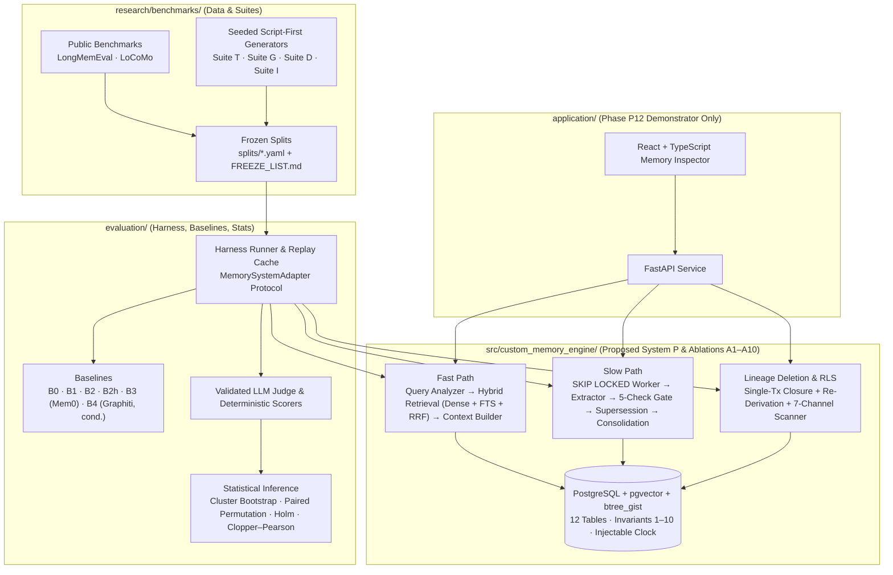

> **Direction notice (2026-10-31).** This v1 package architecture is **superseded for post-v1.0.0 design** by [`V2/ARCHITECTURE_V2.md`](V2/ARCHITECTURE_V2.md), approved as part of the canonical implementation plan on 2026-10-31 ([`V2/APPROVAL.md`](V2/APPROVAL.md)); where they conflict for V2 work, V2 wins. What still binds: this document's description of the **shipped v1 packages** (the code under `src/custom_memory_engine/` that V2 migrations extend additively) and the independence boundary it references. Nothing below is rewritten.

# System & Package Architecture (`custom-memory-engine/`)

**Authority:** Implements `Graduation_Project_Proposal.md` §§7–11 and `TECHNICAL_SPECIFICATION.md` under `D-ARCH` (**Option C — Hybrid Architecture**, [`../reference/ARCHITECTURE_DECISION_MATRIX.md`](../reference/ARCHITECTURE_DECISION_MATRIX.md)).

---

## Owner placement & consolidation revision (2026-10-25)

All research specifications, literature references, benchmark suites, evaluation harnesses, and engine implementation components are consolidated into the single dedicated top-level directory **`custom-memory-engine/`**. See [Independence Boundary §0](INDEPENDENCE_BOUNDARY.md) and the [current decision records](../decisions/). Dependency, database, runtime, and evaluation-vs-web isolation from root `app/` remain strictly enforced.

## 1. Architectural Overview

The Research Lab separates the **core bi-temporal memory engine** (`src/custom_memory_engine/`), the **evaluation harness and baselines** (`evaluation/`), the **benchmark suites** (`research/benchmarks/`), and the **Personal Digital Twin demonstrator** (`application/`):



**Critical Separation Rule:** All benchmark and hypothesis runs (`H1`–`H4`, pilot `RL-100`) call `src/custom_memory_engine/` directly through the Python `MemorySystemAdapter` protocol in `evaluation/harness/`. They never pass through `application/` (the Phase P12 HTTP/UI layer).

---

## 2. Package & Directory Structure

```text
research-lab/
├── pyproject.toml                  # Standalone package & dependency manifest (RL-003)
├── uv.lock                         # Locked dependency graph (RL-003)
├── docker-compose.yml              # Isolated PostgreSQL + pgvector + btree_gist (RL-004)
├── .env.example                    # RL_* environment template (RL-003)
├── src/custom_memory_engine/
│   ├── schema/                     # 12-table SQL DDL, triggers, RLS policies, migrations (RL-040, RL-041)
│   ├── clock/                      # Injectable transaction clock & monotonic per-user guard (RL-044)
│   ├── engine/                     # Supersession (R1/R2), archival (R5), query predicates (RL-042, RL-043)
│   ├── queue/                      # FOR UPDATE SKIP LOCKED worker & per-user advisory lock (RL-044)
│   ├── retrieval/                  # pgvector dense + FTS lexical + RRF (k=60) + context renderer (RL-050, RL-051)
│   ├── gate/                       # 5-check validation gate & conflict detector (RL-060)
│   ├── consolidation/              # Episodic → semantic/summary consolidation with MEMORY_DERIVATION (RL-061)
│   ├── deletion/                   # Transactional lineage closure, re-derivation, 7-channel scanner (RL-070)
│   ├── security/                   # RLS role enforcement & audit-log redaction guard (RL-071, RL-072)
│   ├── optional/                   # Gated exploratory modules: A9, A10, BM25, Redis (RL-080..083)
│   └── tests/                      # T1–T5 archival suite (RL-090), invariants 1–9 (RL-091), load tests (RL-093)
├── evaluation/
│   ├── harness/                    # MemorySystemAdapter, config runner, manifest writer, replay cache (RL-030, RL-032)
│   ├── baselines/                  # B0, B1, B2, B2h, B3 (Mem0), B4 (Graphiti) adapters (RL-031)
│   ├── judge/                      # Deterministic matcher + calibrated LLM judge + bias checks (RL-033)
│   ├── stats/                      # Cluster bootstrap, permutation test, Holm, Clopper–Pearson (RL-034)
│   └── runs/                       # Immutable pilot/ and H1–H4 run outputs (RL-100..105)
├── research/
│   └── benchmarks/
│       ├── longmemeval/            # Fetcher, SHA-256 manifest, official scorer adapter (RL-020, RL-025)
│       ├── locomo/                 # Fetcher, SHA-256 manifest, official token-F1 adapter (RL-021, RL-025)
│       ├── own_T/                  # Temporal-change script-first generator (RL-024)
│       ├── own_G/                  # Write-governance script-first generator (RL-022)
│       ├── own_D/                  # Deletion & canary script-first generator (RL-023)
│       ├── own_I/                  # Cross-user isolation generator (RL-022)
│       └── splits/                 # Frozen dev/test split YAML files + FREEZE_LIST.md (RL-026)
├── application/
│   ├── api/                        # Thin FastAPI wrapper for PDT Inspector (RL-120)
│   └── web/                        # Minimal React + TypeScript timeline & deletion UI (RL-121)
└── reports/
    ├── analysis/                   # Confirmatory tables, plots, cost/latency profiles (RL-110, RL-111)
    ├── thesis/                     # Final graduation thesis document (RL-130)
    └── reproducibility/            # One-command reproduction scripts & transcripts (RL-131)
```

---

## 3. Technology Stack Baseline (`RL-003`, `RL-012`, `RL-013`)

| Layer | Technology | Rationale |
|---|---|---|
| **Language & Packaging** | Python `3.12+`, `uv` (`pyproject.toml` + `uv.lock`) | Matches Proposal §9; deterministic dependency locking. |
| **Database & Extensions** | PostgreSQL `16.x` (baseline `16.15` verified in `validation/bitemporal_checks.sql`; final pin in `RL-012`) with `pgvector` and `btree_gist` | Single transactional store for bitemporal exclusion constraints (`Invariant 4`), FTS (`tsvector` + GIN), dense vectors, and `SKIP LOCKED` job queue. |
| **Database Driver** | `psycopg` v3 (`psycopg[binary,pool]`) + `pgvector` Python client | Native support for PostgreSQL `tstzrange` (`Range` types), session GUCs (`SET LOCAL app.clock`), advisory locks, and explicit SQL transactions without ORM magic. |
| **Schemas & Validation** | `pydantic` v2 | Typed data contracts for extraction candidates, gate decisions, and run manifests. |
| **Statistics & Analysis** | `numpy`, `scipy`, `pandas`, `matplotlib` | Cluster bootstrap, exact binomial bounds, and reporting tables/figures. |
| **Quality & Testing** | `pytest`, `ruff`, `pyright` | Enforces unit, invariant, and static-type verification in CI (`RL-005`). |
