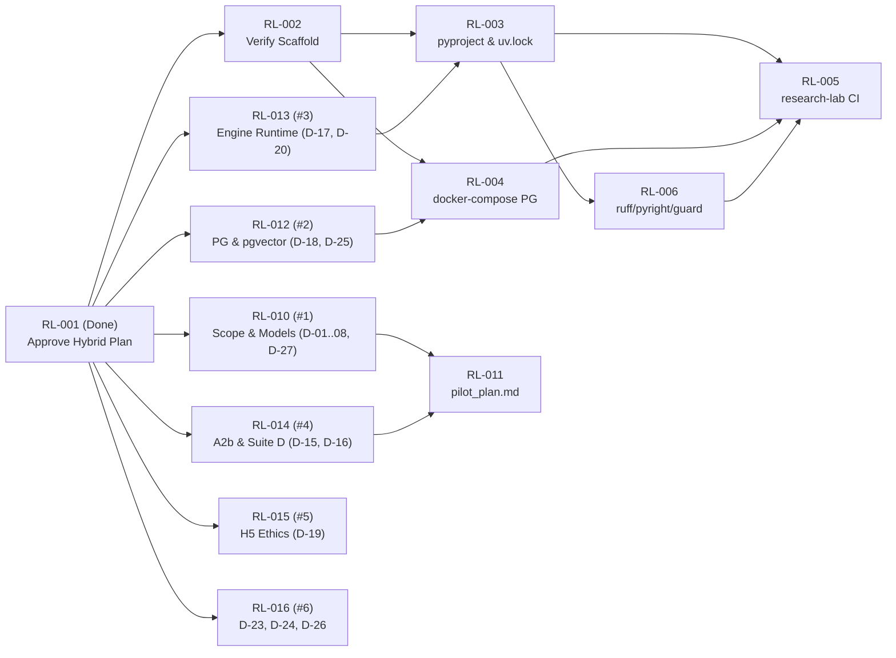
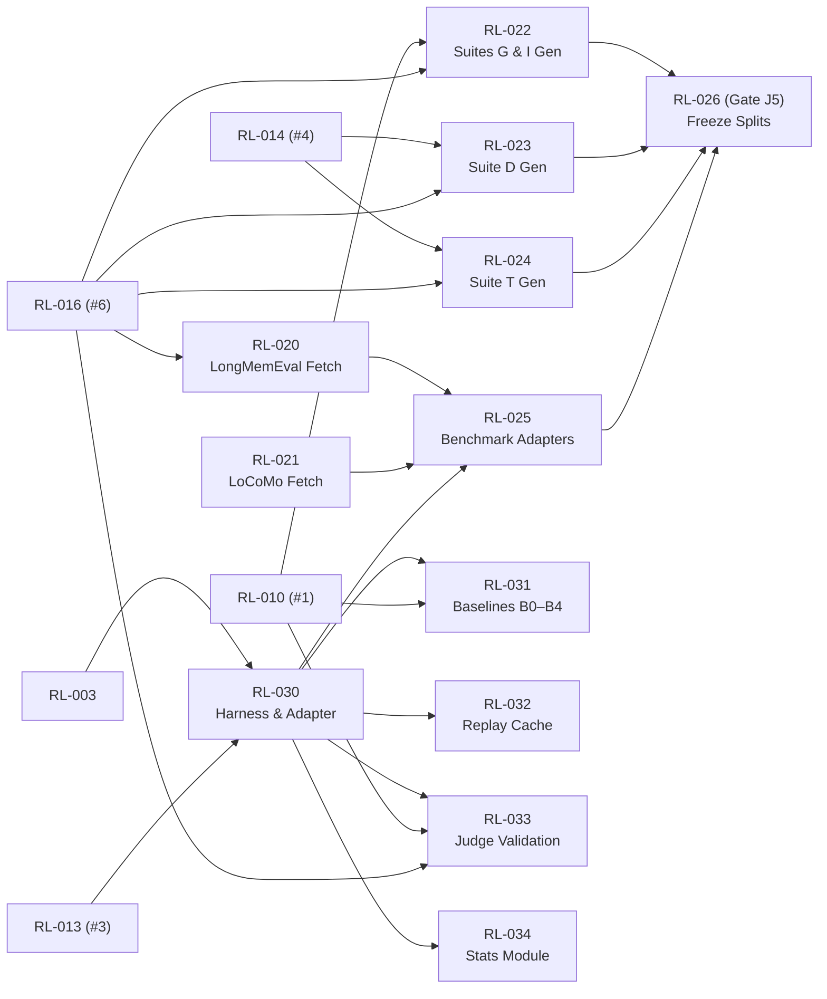
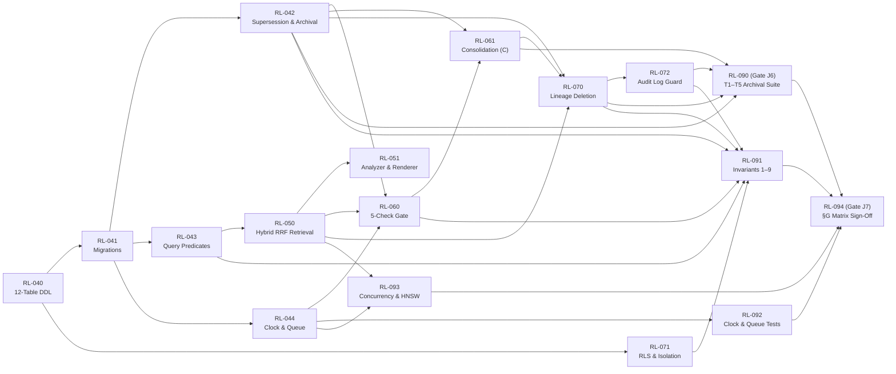
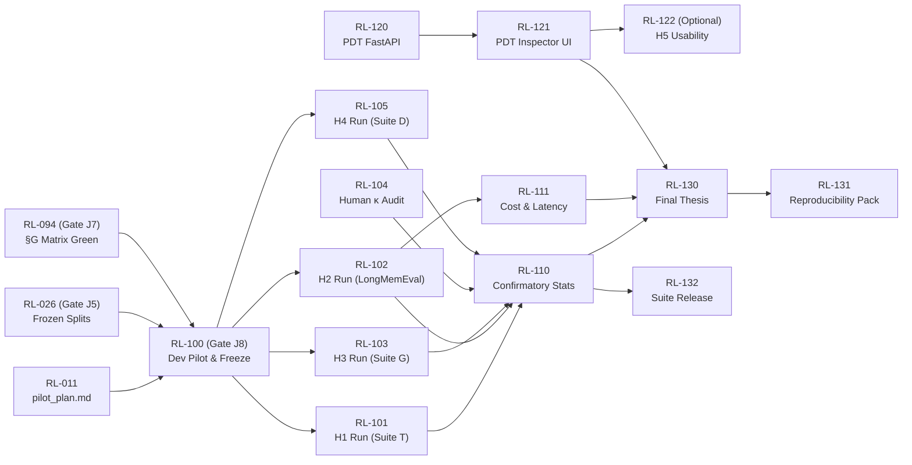

# Visual Dependency Map (`research-lab/`)

**Authority:** Visual companion to [`TASK_GRAPH.md`](TASK_GRAPH.md) (which holds the normative task descriptions, deliverables, and acceptance criteria).

---

## 1. Critical Path Overview

The project critical path runs through six sequential gates:

1. **Wave 1 (`P1` Decisions, open now):** `RL-010`, `RL-012`, `RL-013`, `RL-014`, `RL-016` (plus `RL-002`–`RL-005` in `P0`).
2. **Wave 2 (`P4` Core Schema & `P3` Harness):** `RL-040` (12-table DDL) + `RL-030` (`MemorySystemAdapter` harness) + `RL-020`–`RL-024` (benchmarks & suite generators).
3. **Wave 3 (`P2` Split Freeze & `P5`–`P7` Engine Subsystems):** `RL-026` (`FREEZE_LIST.md`, Gate `J5`) in parallel with `RL-042`–`RL-072` (supersession, hybrid RRF retrieval, 5-check gate, consolidation, and 7-channel lineage deletion).
4. **Wave 4 (`P9` Testing Matrix Gate):** `RL-090` (`T1`–`T5` archival harness, Gate `J6`) and `RL-091`–`RL-093` → `RL-094` (`tests/integration/report.md`, Gate `J7`).
5. **Wave 5 (`P10` Pilot Freeze Gate):** `RL-100` (dev-split pilot & parameter freeze, Gate `J8`).
6. **Wave 6 (`P10` Confirmatory Runs → `P11`–`P13`):** One-shot test runs `RL-101`–`RL-105` (Gate `J9`) → `RL-110` analysis & `RL-120`–`RL-121` PDT app → `RL-130`–`RL-132` thesis and release pack.

---

## 2. Phase P0 & P1 — Bootstrap & Open Decisions

---

## 3. Phase P2 & P3 — Benchmarks, Splits, Harness, & Stats

---

## 4. Phase P4–P9 — Engine Implementation & Testing Matrix Gate

---

## 5. Phase P10–P13 — Pilot Freeze, Confirmatory Runs, PDT App, & Release

