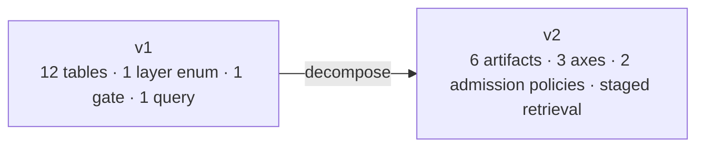
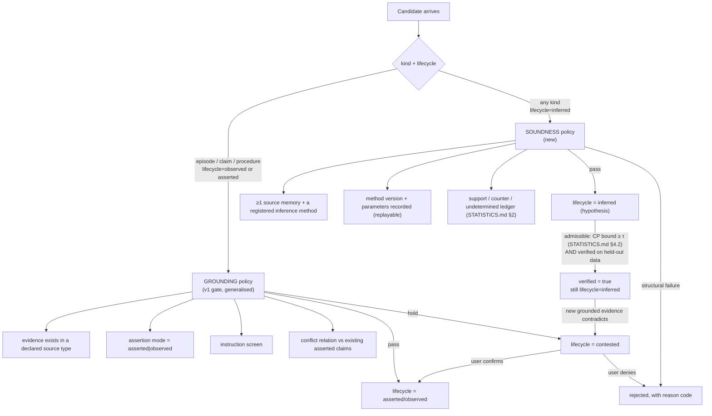

# ChronaMind V2 — Target Architecture

**Scope.** The memory model, the substrate contract, the cognition-layer contract,
retrieval, deletion, scoping, and the v1→v2 migration path. This document is
normative for implementation; `ROADMAP_V2.md` sequences it.

---

## 0. Shape of the change



v1's twelve tables stay; four are generalised, two are added, and the semantics of
one (`layer`) is redistributed across three independent axes.

---

## 1. The five axes of a memory

A memory is not a member of a category. It is a **point in a five-dimensional
space**. Every dimension is an independent decision, which is why a single enum
could never hold the vision.

| Axis | Values | Fixed at | Mutable? | Why it is separate |
|---|---|---|---|---|
| **kind** | `episode` · `claim` · `procedure` · `abstraction` | creation | no | Determines which admission policy applies and which retrieval index serves it. |
| **retention** | `working` · `session` · `durable` | creation | **yes** (promotion/demotion) | Pure cost policy. Must never affect correctness or answerability. |
| **lifecycle** | `observed` · `asserted` · `inferred` · `contested` · `retired` | creation (+resolution) | yes (with rules, §2.3) | Epistemic status. Governs rendering and trust, never deletion. |
| **scope** | hierarchical path (§5) | creation | no (move = copy+retract) | Multi-agent / multi-project. |
| **derivation** | grounded (evidence) or inferred (sources + method) | creation | no | Provenance contract; deletion closure depends on it. |
| **facet** | nullable tag: `preference` · `goal` · `constraint` · `context` · `decision_pattern` · `meta_preference` (canonical list: `USER_MODEL.md` §2.1) | creation | no | Marks an artifact as belonging to a user model. **Not a kind** — see `USER_MODEL.md` §2. |

**Why `facet` is a tag and not a sixth axis.** It is a *use* annotation, orthogonal to
kind, and it must be able to appear on a `claim`, an `abstraction`, or a `procedure`.
Making it an axis would multiply the conformance matrix by six for no expressiveness
gain. It is nullable, indexed, and has no constraint interaction.

**Retention floors (closes the silent-loss hole).** `retention` is orthogonal to
answerability (V2-D10), but a `working` artifact that simply expires would violate
that. Therefore: only `kind='episode'` and `kind='procedure'` may take
`retention='working'` or `'session'`. `claim` and `abstraction` are always `durable`
until explicitly `retired`; their *salience* decays, their *existence* does not. A
workspace reset may purge working-scope episodes, and that purge is recorded as a
scope event, not a deletion of knowledge.

**The requested taxonomy maps onto this as follows** — this table is the answer to
"where does working/short-term/long-term memory live," and it is deliberately *not*
a table of kinds:

| Requested type | Expresses as | Notes |
|---|---|---|
| **Working memory** | `retention='working'`, any kind | Bounded size, TTL-expired, still inspectable, still evidence-bearing. Not a special table. |
| **Short-term memory** | `retention='session'` plus the scope's session | Promotion to `durable` is an explicit, recorded operation. |
| **Episodic memory** | `kind='episode'` | The actual experience: turn, tool call, observation, with event time. |
| **Semantic memory** | `kind='claim'`, `lifecycle IN ('observed','asserted')` | Decontextualised, grounded propositions. |
| **Procedural memory** | `kind='procedure'` | A *how-to* with preconditions, steps, outcome statistics. Not a claim about the world. |
| **Long-term memory** | `retention='durable'` | A retention decision over any kind, not a store. |

**Inference is not a kind.** It is a lifecycle value (`inferred`) plus a derivation
record. This is the single most important modelling decision in V2: it means
reflection can produce a claim about the world, an episode-like observation, or an
abstraction, and all three are guarded by the same no-factification rule.

---

## 2. The artifacts and their admission policies

### 2.1 Artifacts: four memory kinds, four structural tables

**Four memory kinds** (each has `kind` as its discriminator in one physical table):

```text
EPISODE     what happened                     evidence: raw source (turn/tool/file/event)
CLAIM       what is believed true             evidence or inference
PROCEDURE   how to do something               evidence or inference + outcome stats + preconditions
ABSTRACTION what recurs across memories       inference + support ledger ONLY
```

**Four structural tables** (not memories; no lifecycle, no channels):

```text
SCOPE        hierarchy of visibility (§5)
ASSOCIATION  typed, non-provenance edges        (new in V2, §4)
ENTITY       principal-scoped canonical referents (new in V2, §5.2)
METHOD       append-only registry of inference operators + params (new in V2)
```

`METHOD` is the physical table; the field is `method_id`. (The first draft used both
`METHOD` and `INFERENCE_METHOD`; one name now.)

**Correction of an ambiguity in the first draft:** the text said "six artifacts" and
listed six items that mixed memories and structure. Four memory kinds + four
structural tables is the accurate count, and the distinction matters because only
memory kinds participate in channels, lifecycle, and the admission policies.

**`EPISODE` derivation subtlety.** An episode's evidence is its *raw source*, which is
not necessarily a row in the engine (a tool call's stdout is external). Therefore
`EVIDENCE.source_reference` permits `type='external'` with a content hash and a
locator, and the deletion contract for that episode is: the **episode row and its
derived artifacts** are deleted; the external artifact is outside the boundary and is
listed as such, exactly as v1 listed WAL/backups as exclusions (`D-ENG-04`).

### 2.2 Two admission policies (replacing v1's single gate)



> **r7 (`V2-D40`, resolves B-06).** The CP bound gates **verification**, not creation. The
> earlier diagram listed it as `G2d` under the creation gate with `fail → rejected`, which
> contradicted `STATISTICS.md` §4.1–4.2 (an abstraction must be stored to be tested; a
> below-τ result renders as "hypothesis only"). G2 now rejects only on structural failures
> (`G2a`–`G2c`). **r7 (`V2-D41`, resolves B-07):** `G1a`'s declared source types are
> `turn`, `external` and — never as evidence — `artifact`; see `DECISIONS_V2.md`.

**The invariant that replaces v1 Invariant 1 (traceability):**

> **I1′ — No artifact is rendered as knowledge unless it is grounded.**
> A `claim` or `procedure` with `lifecycle='inferred'` and `verified=false` is
> retrievable **only** into the hypothesis channel and must be rendered with its
> support summary and its uncertainty. There is no API path that promotes
> `inferred → asserted`. Promotion requires new grounded evidence, which creates a
> *new* artifact with its own provenance; the inferred one is retained and linked by
> an `ASSOCIATION(type='corroborated_by')` edge.

This is enforceable at two levels — a `CHECK` constraint (inferred ⇒ has derivation
row) and an API contract (rendering channel is a function of lifecycle), so a caller
cannot accidentally render a hypothesis as fact.

### 2.3 Lifecycle transition table (closed; anything else is a bug)

| From | To | Trigger | Recorded |
|---|---|---|---|
| — | `observed` | episode ingested from a declared source | evidence row |
| — | `asserted` | claim/procedure passed grounding | evidence + gate decision |
| — | `inferred` | inference method ran; soundness checks passed | derivation + method record |
| — | `contested` | grounding held (hedged, ambiguous, conflicting) | gate decision |
| `contested` | `asserted` | user confirmation or adjudication | adjudication record |
| `contested` | `retired` | user denial, or supersession by a newer asserted claim | reason code |
| `asserted`/`observed` | `retired` | explicit withdrawal or supersession | recorded-time close |
| `inferred` | `retired` | sources deleted; verification failed; or superseded | reason code |
| `inferred` | `inferred` (verified=true) | held-out verification passed | verification record |
| any | *deleted* | deletion request | content-free audit event |

**Two transition rules that were previously implicit and are now explicit:**

1. **`inferred → asserted` does not exist.** Promotion requires new grounded evidence,
   which creates a *new* artifact with its own provenance (§2.2). The only status
   change an inferred artifact may undergo is `inferred → contested` (grounded
   evidence contradicts it) or `inferred → retired` (refuted, sources deleted, or
   superseded by a verified abstraction).
2. **`retired` is reachable from every state and is not terminal for audit.** A
   retired artifact is excluded from `facts` and `hypotheses` channels, remains
   visible to `audit_as_of`, and remains in the deletion closure. Re-asserting the
   same content creates a new artifact; it never resurrects the retired row.

**Removed from v1:** `archived` as a lifecycle value. Retention handles cost;
lifecycle handles belief. A durable-`retired` claim is still auditable; a
`working`-`asserted` claim is still believed.

---

## 3. Temporal model (three clocks)

v1 has two. V2 needs three, because non-conversational agents observe things that
happened before they were observed (a file written yesterday, read today; a paper
published in 2019, ingested now), and because abstractions have a belief interval
independent of their evidence's.

| Clock | Column(s) | Meaning | Set by |
|---|---|---|---|
| **event time** | `event_range tstzrange` | when the thing was true / happened | producer, or inferred (`event_basis`) |
| **observation time** | `observed_at timestamptz` | when the system first saw the source | clock at ingest |
| **belief time** | `recorded_range tstzrange` | when the system held it as belief | transaction clock only (never a caller) |

v1's `valid_range` becomes `event_range`; v1's `recorded_range` is unchanged in
meaning; `observed_at` is new and is required for episodes and for evidence
ordering. All four v1 temporal predicates (`current_state`, `historical_as_of`,
`historical_window`, `audit_as_of`) survive; their SQL is unchanged except for the
column rename, and `tests/integration/test_predicates*.py` remains the regression
suite.

**Event-basis.** `event_basis IN ('explicit','inferred')` — inherited from v1's
`valid_from_basis`, preserved verbatim because it is already the right idea.

---

## 4. Provenance vs association (the graph, done minimally)

v1 has exactly one edge type (`MEMORY_DERIVATION`), used for lineage. That is
provenance. It must not be confused with association, because the two have different
semantics under deletion:

| Edge class | Table | Deletion behaviour | Can be traversed by retriev**al**? |
|---|---|---|---|
| **Provenance** | `DERIVATION (derived → source, role)` | **Cascades**: deleting a source forces re-derivation or retirement of the derived artifact. | Only downward (drill-down), always with provenance shown. |
| **Attestation** | `EVIDENCE (artifact → source_reference)` | Cascades with the source's deletion. | Not for scoring. |
| **Association** | `ASSOCIATION (from, to, type, weight, created_by)` | Does **not** cascade (an association is a claim about relatedness, not a dependency); it is deleted if either endpoint is deleted. | Yes — this is the traversal graph. |

Association types (closed set, extensible by profile):
`related_to`, `contradicts`, `refines`, `specialises`, `instance_of`, `caused_by`,
`precedes`, `part_of`, `corroborated_by`, `supersedes`.

**Why this matters.** "What did I try before that failed" needs `instance_of` +
`precedes` traversal. "Is this preference contradicted" needs `contradicts`. Neither
is derivational dependency, so neither belongs in the deletion cascade. Keeping them
separate is what allows the graph to grow without making deletion accidentally
transitive in the wrong direction.

**Entity resolution.** `ENTITY` provides canonical referents so that `subject_key`
is not a free-text string compared by equality. An entity has `canonical_name`,
`entity_type`, and aliases. Cross-domain relationships ("this person is both a work
colleague and a running partner") become possible because claims from different
scopes can reference the same entity while remaining scope-isolated.

---

## 5. Scope hierarchy

Replaces bare `user_id`.

```text
scope.path   -- materialised path, e.g. /u/42/p/repo-chronamind/
scope.kind   -- personal | project | session | task | shared
```

**Trailing separator is mandatory.** Every path ends with `/`. This is not cosmetic:
it makes prefix matching unambiguous, and without it `/u/4/` matches `/u/42/…` — a
cross-tenant read. The original V2 draft specified ``LIKE 'S%'`` and would have leaked
data between users whose ids share a prefix. `CHECK (path LIKE '/%') AND
(path = '/' OR path LIKE '%/')` plus a generated `path_with_prefix` are required.

Rules:

1. **Write** lands in exactly one scope. Writes into a scope the caller cannot read are
   rejected before the row is constructed. **r9 (`V2-D53`):** writes and deletions land only in the
   caller's own namespace; a grant is read membership only.
2. **Read authority is a declared set, not a prefix guess.** A request carries
   `read_scopes: list[ScopeSelector]` where each selector is one of
   `exact(path)`, `subtree(path)`, `with_visibility(path, {project, shared})`.
   The effective read set is the **union of selectors, intersected with the caller's
   ACL and with `visible_to_user`**. Ancestors are *not* implicitly readable; they must
   be named. This resolves the V2 ambiguity "+ any ancestor the query explicitly
   names" — the rule is now: nothing is implicit. **ACL storage (`V2-D36`, r7):**
   membership is a row in `scope_grant` (migration 2); a cross-user selector is authorized
   only by an active grant whose subtree contains it, and is denied — not narrowed — if
   broader.
3. **Visibility is `private | project | shared`, and it is evaluated against the scope
   being read, not the scope where the row lives.** A `private` row is returned only
   when the reading selector's path equals the row's own scope path. A `project` row
   is returned to any selector whose subtree contains it **and** whose ACL grants the
   caller membership. This matters because a personal row *shared into* a project must
   not thereby become readable from a sibling project.
4. **RLS is defence in depth, not the primary check.** The application computes and
   validates the read set; RLS enforces the same predicate in SQL with
   `pg_catalog.starts_with(scope_path, prefix)` over canonical paths and a
   `text_pattern_ops` index. **`LIKE` is forbidden for scope matching** (`V2-D35`, r7): the
   approved text said `path_with_prefix LIKE ANY(...)`, under which `_`/`%` inside an id act
   as wildcards and `/u/a_b/` matched tenant `/u/aXb/` (reproduced on PostgreSQL 16). A bug in either
   layer is caught by the isolation suite; neither layer is trusted alone (v1's
   Invariant 7 principle, preserved).
5. **Scope identity is immutable.** ``move`` is implemented as *copy + retract* with a
   recorded `supersedes` association, so provenance history is never rewritten.
6. **Cross-scope reads are logged** with `event_type='scope_read'` and the selector set,
   content-free. This is what makes the isolation claim auditable rather than asserted.

**Backwards compatibility:** the conversational profile sets `scope = /u/<user_id>/`,
so v1's `user_id` semantics are exactly recoverable, and the v1 isolation suite `I`
keeps its meaning.

**A scope below the root is a normal scope (r13, `V2-D64`).** Until migration 15 the substrate admitted only the
personal root on thirteen tables; it now admits any scope *inside* the caller's own namespace (`/u/<id>/p/<repo>/`,
`/u/<id>/o/<org>/`, `/u/<id>/s/<task>/`), which is what the profiles of §13 use. The boundary is unchanged:
`D13` forbids the separator in a user id, so `/u/4/` still does not contain `/u/42/`, and `authorize_write` still
requires the caller's own namespace (`V2-D53`). Single-valued exclusivity (`I5`) and the belief-time watermark (`I4`)
key on the **scope**, not the user, so two scopes of one user are independent for both.

**`/o/<org>/` is a sub-scope, not a namespace (r13, `V2-D64`).** §13 gives the enterprise profile the scope root
`/o/<org>`; the implemented form is `/u/<owner>/o/<org>/`. A top-level `/o/` namespace would need an org principal to
own it, an org-membership ACL, and a policy resolving two principal kinds, because `scope_grant.owner_user_id`
references `app_user` and the read policy matches `/u/<caller>/`. Organisational sharing therefore uses `scope_grant`
on the owner's `/u/<owner>/o/<org>/` subtree - the same mechanism as any project scope, and no schema change.

### 5.1 Known limitation, stated rather than hidden

PostgreSQL RLS policies cannot parameterise over a set-valued selector without a
session variable per selector. We therefore set a single `app.read_scope_prefixes`
session GUC (array of text) at transaction start and compare with `ANY`. This caps the
number of selectors per transaction at a declared limit (default 16); exceeding it is a
resource error, not a security bypass. A caller needing more must decompose the query —
which is the correct behaviour for a memory engine whose batches should be scoped.

> **r9 amendment (`V2-D45`).** RLS does **not** take the selector set. It enforces the caller's
> **ACL** (own namespace at any visibility; `project`/`shared` rows inside an active
> `scope_grant`), computed inside PostgreSQL from `app.user_id` alone
> (`scope.access.rls_read_using`). The selector set, its 16-selector cap and the
> resource error stay in the application layer (`scope.access.resolve_read_set`). This makes
> the two layers independent, as rule 4 requires: a compromised or buggy application cannot
> widen RLS by sending broader prefixes. The `app.read_scope_prefixes` GUC is not used.

### 5.2 Entity opacity across scopes

`ENTITY` is global to a *principal*, not to the database, and this is a deliberate
restriction:

- Entity ids are opaque and `CREATE`d only through the public API;
- An entity's **attributes are never global** — a claim in scope A naming entity `e`
  does not make `e`'s claims in scope B readable;
- Cross-scope linking requires an explicit `link_entity(a, b)` call with the caller
  authorized on **both** scopes; otherwise it is rejected;
- Entity existence is not queryable outside the caller's read set (no "does entity e
  exist" oracle across tenants).

Without this, a shared `ENTITY` table is a cross-tenant side channel: an attacker could
enumerate entity ids and infer the existence and attribute-count of another tenant's
memories. That is the security issue the original V2 draft created by calling `ENTITY`
"canonical referents" with no tenant scoping. `V2-D25` records the fix.

**How the rule is applied (`E-024`).** An entity row lives in one scope of its principal (`entity.scope_path`), and
its label follows that scope's read rules. The same real person referenced from two scopes is therefore two opaque
ids, one per scope, joined only by an explicit `link_entity(a, b, relation)` row (migration 18's `entity_link`). The
link merges nothing: neither id's claims or attributes become readable from the other scope, and it requires both
scopes in the caller's read set. A claim names its entity through `assert`'s optional `subject_entity`, which must lie
in the claim's own scope. `tests/integration/test_cross_domain_entity.py` pins all four bullets above.

---

## 6. Procedure memory (new; the smallest thing that works)

A procedure is not a claim about the world. It needs its own minimal shape:

| Field | Meaning |
|---|---|
| `preconditions` | JSON: conditions under which this applies (structured, matched by the retrieval planner) |
| `steps` | JSON: ordered actions (may be free text in v1 of this feature) |
| `outcome_stats` | `successes`, `failures`, `last_used_at`, `mean_cost` — updated by outcome feedback |
| `derived_from` | episodes that demonstrated it |

Deliberately minimal: no execution engine, no planning, no verification beyond
recording outcomes. The engine stores and retrieves procedures; the *agent* executes
them. Retrospective feedback updates `outcome_stats` through the public API.

---

## 7. Abstraction (the substrate for reflection)

An abstraction is a first-class artifact with statistical content, because that is
the only shape that can be verified:

| Field | Meaning |
|---|---|
| `statement` | Natural-language rendering (for humans and for prompts) |
| `predicate` | Structured, checkable form: `{subject_selector, condition, consequent, scope}` |
| `support_count` / `support_set` | How many memories, which ones (derivation edges with weights) |
| `counter_count` / `counter_set` | Counterexamples. **No longer required to be non-empty** — see `STATISTICS.md` §2.2. What is required is a recorded `opportunity_count` and evidence that refutation was attempted. |
| `opportunity_count`, `undetermined_count`, `coverage` | The denominators that make an empty counter-set interpretable. |
| `refutation_attempts` | Adversarial search actually performed (`STATISTICS.md` §3). Zero attempts ⇒ the artifact is *untested*, not verified. |
| `confidence` | **Not** an ECE-validated point estimate. It is `1 − CP_upper(k + u, o)`: the lower end of a *partially identified* finite-sample interval on the failure rate, with undetermined outcomes assumed to be failures (`STATISTICS.md` §2.2, §4.2). |
| `method_id` + `method_version` + `params_hash` | Which reflection operator produced it, at which prompt/parameter version. Makes ablations replayable. |
| `verification_status` | `unverified` · `verified` · `refuted`. **`stale` is not a value** — it is derived (§9.2, `V2-D24`). |
| `closed_over_hash` | The provenance-closure hash at verification time; staleness is computed by comparing it to the current closure (§9.2). |
| `verified_on` / `held_out_split_id` | Which data verified it; must be **temporally and contextually** disjoint from the support set (`STATISTICS.md` §6). |
| `negative_control_slice_id` | The slice where the condition never held; a clean result is required for admission (§3 of `STATISTICS.md`). |
| `expires_at` | Abstractions decay; a preference from two years ago is not current. |

**The promotion rule (this is P4 made concrete), restated in the corrected statistics:**

> An abstraction is `verified` only if (a) its
> `confidence_lower = 1 − CP_upper(k + u, o) ≥ τ` (undetermined counted as failure),
> (b) it predicts a **temporally and contextually disjoint** slice better than both the
> base-rate predictor and a block-permutation null, (c) it fails the negative-control
> slice, (d) `coverage ≥ τ_coverage`, and (e) at least three refutation attempts are
> recorded. Until then it is a hypothesis and is rendered as one.

That rule is what prevents "reflection" from becoming a confabulation factory. It is
also what makes the research contribution in `RESEARCH_PROGRAM_V2.md` measurable.

---

## 8. Tier B contract and the complete public API

The original V2 draft specified five calls. That was incomplete — it omitted the write
path, outcome feedback, adjudication, association, and export, which meant half the
roadmap referenced an API that did not exist. The full surface is below; **every
operation a tier needs appears here, and nothing outside it exists.**

### 8.1 Capability classes

| Class | Operations | Tier B | Tier C | Notes |
|---|---|---|---|---|
| **Ingest** | `ingest_episode`, `ingest_artifact` | ✓ | ✓ | Writes always land in an explicit scope; the caller is authorized for it. |
| **Read** | `query`, `refine`, `get`, `provenance` | ✓ | ✓ | Channel-separated; provenance never widens the read set. |
| **Write (grounded)** | `assert`, `retract_own` | ✓ | ✓ | Grounded writes go through the *grounding* policy; Tier B asserting about the world is allowed only with source evidence, which is what stops it inventing facts. |
| **Write (inferred)** | `infer`, `verify`, `refute` | ✓ | — | Soundness policy. `verify`/`refute` accept only the artifact's own method lineage. |
| **Structure** | `link`, `unlink`, `create_entity`, `link_entity`, `record_outcome` | ✓ | ✓ | `record_outcome` is retrospective only; no execution. A Tier B `contradicts` link never demotes a grounded artifact (`V2-D48`). |
| **Adjudicate** | `adjudicate`, `dissent` | — | ✓ | User/system correction of `contested` items. **Deliberately not available to Tier B**: a reflection service must not be able to silence a conflict by adjudicating it. |
| **Maintain** | `purge_working`, `expire`, `rebuild_index`, `register_method` | — | ✓ | Administrative: admin role within Tier C (`V2-D47`); `purge_working` is scope-scoped and audited; the method registry is append-only. |
| **Delete** | `delete` | **—** | ✓ | Tier B can never delete. It can only `retract_own` artifacts whose method it produced. |
| **Export** | `export` | — | ✓ | User-facing data export; excludes content whose deletion is pending. |
| **Observe** | `stats`, `cost` | ✓ | ✓ | Support/coverage/usage/cost; never content of other scopes. |
| **Scope** | `create_scope`, `grant_access`, `revoke_access` | — | ✓ | Scope administration (`V2-D46`); owner of the namespace only; Tier B can never change access. |

**The corrected rule:** Tier B *cannot delete*, *cannot adjudicate*, and *cannot write
grounded claims without evidence*. It **can** propose inferences and link structure,
because that is exactly what a cognition layer is for. The original V2 text said Tier B
"cannot change lifecycle directly" — but `infer` **is** a lifecycle-creating
operation, so that sentence was self-contradictory. The precise rule is: Tier B may
*create* artifacts in `inferred`, may *transition them to contested or retired* through
`refute` when the refutation is evidenced, and has **no** operation that moves anything
to `asserted`.

> **r9 (`V2-D46`, `V2-D47`).** Six operations close gaps other sections relied on: `dissent` (§5 of
> `USER_MODEL.md`: a user rejecting an inference), `create_entity` (§5.2), `register_method` (§4,
> `I3`) and the Scope class. 29 operations, 18 for Tier B. `move` and *revise* are compositions,
> not operations (`API_V2.md` §5). Admin is a role within Tier C.

### 8.2 `stats` is the only way Tier B sees evidence

`stats(artifact_id)` returns counts, coverage, refutation attempts, verification status,
and the *ids* of support/counter items — but the **content** of those items is returned
only if the caller could have read them through `query` anyway. This keeps the
aggregate-visibility / item-secrecy separation that §5.2 imposes on entities, applied to
evidence as well.

### 8.3 What Tier B implements

1. **Candidate generation** (cheap, replayable heuristics).
2. **Statistical verification** — *using* `evaluation/stats` as a library, posting
   results through `verify`.
3. **Rendering** — natural language only; the support summary is attached by the
   engine, never by the model.
4. **Scheduling** — when to re-run, on which new evidence, under what budget
   (`STATISTICS.md` §5.3 governs repeated looks).

**What Tier B must not do (tested):** assert without evidence, create an artifact with
no opportunity accounting, adjudicate a conflict, delete anything, or write to a scope
it cannot read.

---

## 9. Retrieval: staged, multi-index, cost-explicit

v1: one query, dense + lexical + RRF. V2: five stages, each with a budget and a
recorded cost.

```mermaid
flowchart LR
    Q["Query + scope selectors + intent + budget"] --> P["1 PLAN<br/>classify intent; pick indexes, filters, expansions"]
    P --> CG["2 CANDIDATE GEN<br/>lexical · dense · temporal · graph-neighbourhood · key-lookup"]
    CG --> EX["3 EXPAND<br/>abstraction↔instances · contradictions · provenance drill-down"]
    EX --> FL["4 FILTER & RE-RANK<br/>temporal predicate · trust tier · corroboration · recency/usage"]
    FL --> AS["5 ASSEMBLE<br/>four channels, token-budgeted"]
    AS --> OUT["Result + provenance bundle + cost + channel coverage"]
    OUT -.->|usage feedback| USG[("usage · reinforcement")]
```



### 9.1 The four channels (resolves the overlap between lifecycle and channel)

| Channel | Contains | Never contains |
|---|---|---|
| **`facts`** | `lifecycle ∈ {observed, asserted}` with valid provenance and **no open contradiction**, and `verified`, fresh abstractions presented **as verified summaries with their bound** | `inferred` claims/procedures (even verified), `contested`, `retired`, anything with an open contradiction |
| **`hypotheses`** | `lifecycle='inferred'` (verified or not), each with confidence lower bound, coverage, and support summary | anything asserted |
| **`procedures`** | `kind='procedure'` with preconditions matched by the planner, plus `outcome_stats` | claims, abstractions |
| **`conflicts`** | artifacts in `contested`, or `asserted` artifacts with an open `contradicts` association | anything settled |

> **r9 (`V2-D48`, `CHANNELS.md` §5).** Membership is exactly the function in `CHANNELS.md` §1: a grounded
> artifact with an open contradiction is in `conflicts`, not `facts` (C-P6); only a `contradicts` edge between
> two grounded endpoints created by the grounding policy or Tier C opens one (C-P4); a verified inferred claim
> stays in `hypotheses` (C-P2); `stale` is the OR of five causes (C-P3).

**The overlap that had to be resolved:** the original draft said "`procedures`",
"`facts`", and "`hypotheses`" but never said where a **contradiction** goes, and never
said whether a *verified abstraction* is a fact or a hypothesis. Decisions:

- A verified abstraction appears in **`facts`** only as a *summary with a visible
  bound* ("in 34/40 observed sessions, X"). It never appears as a bare proposition
  ("X"). The bound is part of the rendered item, not metadata the caller may drop.
- An abstraction with `stale=true` is demoted to **`hypotheses`** at read time.
- Contested content is **excluded from `facts`** and appears **only** in `conflicts`,
  because the v1 model already established that contested material must never reach
  answer context (Invariant 6).

### 9.2 Staleness is derived, not stored (closes a deletion hole)

`stale` was listed as a `verification_status` value in §7, which is wrong: staleness is
a *function of the current provenance closure*, so storing it lets the stored value
disagree with the graph — and the disagreement is exactly what a deletion would
create.

```text
stale(a) ⟺ a.verification_status = 'verified'
        ∧ closure_hash(a.sources_now) ≠ a.closed_over_hash   # recorded at verification

# also stale if support dropped below the verification threshold, or if any source
# was retired, or if the method version changed
```

Consequences that matter:

- **Deletion must make dependents stale inside the same transaction** (§10).
- Re-verification requires the closure hash to be recomputable; if a source is deleted,
  the abstraction cannot silently keep `verified`.
- `verification_status` therefore stores `unverified | verified | refuted`, and
  `stale` is computed. `verified=true ∧ stale=true` is a legal, meaningful state:
  "was verified, needs re-verification" — and it renders in `hypotheses`.

### 9.3 Channel integrity rules (the security-relevant ones)

- **Non-negotiable:** temporal predicate is a filter, not a score term (v1 correct).
- **Provenance bundle always returned**; assembly refuses an item whose provenance
  cannot be materialised.
- **Provenance never widens authorization.** If an abstraction in scope `A` is derived
  from a source in scope `B`, the provenance of that source is rendered as an opaque
  reference unless the caller can also read `B`. Otherwise provenance would be a
  cross-scope read oracle. **r7 (`V2-D37`):** the opaque reference is a per-caller HMAC
  handle plus the derivation type of the caller's own edge — *no* scope, source id or
  source type. The approved text read "(id + scope + type)", which contradicted `I17`.
- **Cost and coverage returned** per stage; `coverage` per channel (how much of the
  budget each channel consumed) so a caller can see if `hypotheses` crowded out
  `facts`.
- **Iteration:** `refine(result, instruction)` for drill-down.

---

## 10. Deletion, extended upward

v1: closure over `MEMORY_DERIVATION` at depth ≤ 3, re-derivation from survivors,
7-channel leak scan, positive control. V2 keeps all of that and changes four things.

1. **Unbounded closure with cycle detection.** Depth is a *performance* parameter, not
a correctness one. It is admissible only if artifacts beyond it are provably
unreachable, which is asserted by a test that builds a chain longer than any configured
bound. If closure sizes prove pathological, the fix is asynchronous closure with a
registered completion barrier (`in_progress` state on the deletion request), **never** a
silent cap.

2. **Dependents are reconciled inside the same transaction, in a fixed order.**

```text
for each dependent in closure order (deepest first):
    if all sources deleted:            → delete
    elif support still ≥ verification threshold:
        → re-derive on survivors → set stale=true (closure hash changed)
        → verification_status stays 'verified' but stale; re-verification queued
    else:                              → retire(reason='source_deleted')
```

> **r9 (`V2-D50`, `V2-D51`; `DELETION_ORDER.md`).** Two orders, not one: dependents are **classified**
> sources-first (a dependent is judged after every one of its sources) and changes are **applied**
> dependents-first ("deepest first" above is the apply order). A dependent is `alive` only if every source is
> alive; a dependent of a *re-derived* source is itself re-derived (transitive). Every dependent that keeps a
> surviving source is re-derived, whatever its derivation type; one that cannot be re-derived is retired.
> **Retire-by-deletion tombstones the content**: id, scope, kind, reason and audit row stay, content,
> statements, bounds and vectors are removed in the same transaction. Locks for a cross-scope closure are
> taken in one global order (`scope.locks.lock_order`).

The critical rule: **`verified` ∧ deleted-source is impossible after commit.** Either
the abstraction is re-derived on surviving support (and flagged stale), or it is
retired. A `verified=true, stale=false` abstraction whose source was deleted is a
correctness bug, and the deletion test asserts it cannot occur.

3. **Staleness propagates transitively, not one level.** Because `stale` is derived
from a *closure hash* (§9.2), every ancestor of a deleted row becomes stale without
needing a per-level touch. This is what makes depth a performance parameter rather
than a correctness cliff: a depth-9 abstraction is stale because its hash changed, not
because a walk reached it.

4. **Channels scanned goes from v1's 7 to 11.** Added: (8) hypothesis-channel rendering,
(9) abstraction statements **including their rendered bounds**, (10) verification
records and method parameters, (11) export snapshots generated before the deletion
(the only place an export can leak is if it is served after).

The user model needs **no extra channel**, and that is the design payoff: because it is
a view over artifacts (`USER_MODEL.md` §2) rather than its own store, there is nothing
extra to scan. If the model had been a table, this section would need a 12th channel and
a second closure.

**The honest ceiling, restated.** A deletion test measures the enumerated channels and
probes. It never proves erasure. V2 keeps the Clopper–Pearson scenario-level bound and
the positive control — and, after `STATISTICS.md`, the same epistemic move is used for
inference confidence, which is a consistency the first draft lacked.

---

## 11. Invariants (V2 numbering)

| # | Invariant | Enforcement |
|---|---|---|
| I1′ | Grounded-or-hypothesis: an artifact is rendered as knowledge only if grounded; inferred artifacts carry support + uncertainty and appear only in the hypothesis channel. | `CHECK` (inferred ⇒ derivation + method) + API channel contract + test |
| I2 | Every artifact has provenance: evidence or derivation. No orphan rows. | Deferred constraint trigger (v1 Invariant 1, generalised) |
| I3 | Inferred artifacts record method id, version, and parameter hash; the method registry is immutable and versioned. | FK to `METHOD` + append-only (`register_method`, `V2-D46`) |
| I4 | Event, observation, and belief clocks are distinct; belief time is never caller-supplied; belief time is non-decreasing per scope, advancing at every new belief and allowed to repeat only where a single logical step closes one belief and opens its successor (`V2-D64`). | v1 Invariant 3 + `observed_at` requirement + `clock_watermark` keyed by `scope_path` |
| I5 | Single-valued exclusivity within a scope for declared single-valued predicates; open-domain content relies on the conflict detector, whose error rate is **measured**, not assumed. | Exclusion constraint (v1) + measured detector accuracy |
| I6 | Retention is orthogonal: durability never changes answerability; retirement never changes retrievability-for-audit. | Property test over the reachability matrix |
| I7 | Scope isolation: no read outside the caller's declared scope path. | RLS on `path` prefix + isolation suite `I` |
| I8 | Deletion closure is complete over the provenance graph, unbounded by correctness, and re-derives survivors. | Postgres recursive walk + depth-exceeding completeness test |
| I9 | Idempotent writes under retry; per-scope serialisation for mutations. | v1 Invariant 9 + scope key |
| I10 | Archive/retire never silently removes an answerable fact (`(S)∨(C)`, extended to retention). | v1 Invariant 10, generalised to `retired` and to abstraction coverage |
| I11 | No verified abstraction without a held-out verification record whose split is disjoint (temporally **and** contextually) from its support set. | FK + disjointness check (`STATISTICS.md` §6) |
| I12 | The engine makes no model call on any guarantee-bearing path. | Import boundary + dependency test |
| I13 | `verified ∧ deleted-source` is unreachable after any committing transaction. | Deletion procedure ordering (§10) + invariant test |
| I14 | Every rendered abstraction carries a bound; no API path renders an abstraction as a bare proposition. | Assembly contract + channel-integrity fuzz (`E-035`) |
| I15 | Counter-support is *searched and recorded* (opportunity ledger present, `refutation_attempts` recorded); it is never required to be non-empty. | Conformance test + `STATISTICS.md` §2.2 |
| I16 | A user denial is sticky: a refuted user-model element cannot be re-inferred over the same predicate/scope without new grounded evidence. | Negative-constraint table + `UM8` test |
| I17 | Cross-scope provenance is opaque: a provenance reference to an unreadable scope exposes no content and no existence oracle. | Scope tests + `I7` extension |

---

## 12. v1 → v2 migration

Additive, so the v1 regression suite keeps running.

| Step | Change | Reversible |
|---|---|---|
| M1 | `layer` → `kind` + `lifecycle` + `retention` with backfill: `episodic→episode/(observed)`, `semantic→claim/(asserted or inferred by derivation presence)`, `opinion→claim`, `persona→abstraction`. | yes (derived columns) |
| M2 | `user_id` → `scope` hierarchy; backfill `path='/u/<user_id>/'` (trailing separator mandatory), `visibility='private'`. Keep `user_id` **stored**, with `CHECK (scope_path = '/u/' \|\| user_id \|\| '/')`, for v1 compatibility (r9 `V2-D49`: a generated column breaks every v1 `INSERT` naming it); `app_user.id` constrained to a valid user segment (`V2-D45`). | yes |
| M3 | `valid_range` → `event_range`; add `observed_at`, `event_basis`. **Apply as one transaction:** drop `no_bitemporal_overlap`, rename, recreate the exclusion constraint on `event_range`, replay `validation/bitemporal_checks.sql`. | yes (view) |
| M4 | `memory_evidence.turn_id` → `SOURCE (type, ref, span, content_hash)`, permitting `type='external'`. Backfill `('turn', turn_id, span)`. | yes |
| M5 | `predicate_schema` becomes **optional metadata**; `predicate_key` nullable. When absent, the conflict detector is the sole single-valued arbiter and its accuracy is logged. **Deferred past W1 (`V2-D43`, r7)**; revisit with `E-021`. | yes |
| M6 | Add `ASSOCIATION`, `ENTITY` (principal-scoped), `METHOD`, `ABSTRACTION_STATS`, `VERIFICATION`, `NEGATIVE_CONSTRAINT` (sticky dissent). | new tables |
| M7 | ~~`archived` status retained as a *retention* value for compatibility~~ **(r7, `V2-D38`):** v1 `archived` → `lifecycle='retired'`, `retention='durable'`; the v1 `status` column stays as the read-compatibility source. Owner `E-010` (`model.axes.V1_BACKFILL_SQL`). | yes |
| M8 | Add `um_facet` nullable tag + index; backfill `NULL`. `claim`/`abstraction` retention forced to `durable` (`CHECK`), existing `working`-like rows unaffected because v1 had no such value. | yes |
| M9 | `scope.path` `CHECK` for trailing separator + `path_with_prefix` generated column + `text_pattern_ops` index (fixes the `/u/4` vs `/u/42` leak). | yes |

**Fairness requirement:** `suite T/G/D/I` must run **unchanged** against v2 through
the same `MemorySystemAdapter`. If a v2 change alters suite results materially for
reasons unrelated to the feature under test, that is a regression, not an improvement.

---

## 13. The four agent profiles (generality proof)

Profiles are config, and this table is the W2 exit test.

| | Conversational (PDT) | Coding agent | Research agent | Enterprise assistant |
|---|---|---|---|---|
| Episode source | chat turns | tool calls, diffs, test runs | paper spans, notebook cells | tickets, emails, docs |
| Claims | user facts & preferences | repo facts, build invariants | findings, citations | policies, entities |
| Procedures | conversation norms | fix patterns, CI recipes | repro recipes | escalation paths |
| Abstractions | preferences, tendencies | recurring failure modes | methodological patterns | institutional norms |
| Scope root | `/u/<id>` | `/u/<id>/p/<repo>` | `/u/<id>/p/<topic>` | `/u/<id>/o/<org>` (`V2-D64`) |
| Retention default | durable | session→durable on promotion | durable | durable + policy TTL |

No row of this table requires a schema change. That is the claim; W2 proves it or
the plan is amended.
