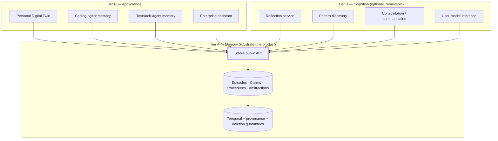

# ChronaMind V2 — Charter

**One sentence.** ChronaMind is a general-purpose cognitive memory engine that
stores what an agent has observed, knows, can do, and has concluded — with exact
temporal and provenance semantics — and that exposes reflection, pattern discovery, and
an evidence-grounded **evolving user model** as a *verifiable, separable layer* on top
of a strict public API.

---

## 1. The three tiers

The most important architectural decision in this document is that these are
**three tiers with a one-way dependency**, not three modules in one repo.

**The rule that makes this real, not decorative:**

> **Tier B may only call Tier A's public API. It has no database credentials, no
> engine imports, and no privileged read path. Any behaviour that Tier B can
> exhibit, a third party could implement from outside the repository.**

This is enforced mechanically (import-boundary test + separate DB role with no more
than the public API's grants), exactly as the v1 independence boundary was enforced
(`tests/test_boundaries.py`). It is the reason the engine stays general: if
reflection needed a special table, "reflection" would be baked into the product and
the product would stop being general.

**Consequence worth stating plainly:** you may delete `Tier B/` and still ship a
complete, general-purpose memory engine. That is the test of whether the
decomposition succeeded.

**But the Personal Digital Twin is not thereby optional.** It is a *product of the
project*, not a side effect of the engine. The distinction the tiering enforces is:

| | Tier | Can it be cut? |
|---|---|---|
| **Evolving user-model capability** (inference, facets, trust ladder, sticky dissent, `own_U` metrics) | **B** | **No** — it is research family F4 (`S14`–`S19`) |
| **Personalization behaviour** inside an agent (form adaptation, recommendations, decision support) | C | No — it is what F4 measures |
| **PDT web UI** | C | Yes → API/CLI inspector |
| **Engine (Tier A)** | A | Not applicable |

The user model lives in Tier B *because* it must be deletable and separable, not
because it is optional. It is built entirely over the public API, so an engine without
it is still complete — and a deployment without it is still a complete engine, just not
a Personal Digital Twin.

---

## 2. What "general-purpose" means operationally

Not a marketing word. Three falsifiable commitments:

| Commitment | Observable | Measured by |
|---|---|---|
| **Domain-independence** | One schema + one engine binary serves a conversational profile and a tool-using coding profile with **zero** schema migrations and **zero** engine code changes; only a *profile* file differs. | Gate G2 (W2). A CI job runs both profiles against the same migrated database. |
| **Type-completeness** | Every requested memory type is expressible as an *axis tuple* without schema change: `(kind, retention, lifecycle)`. | A conformance test enumerates all valid tuples and asserts each is storable, queryable, and deletable. |
| **Model-independence** | The engine performs no LLM call on any guarantee-bearing path. Extraction, inference and scoring are injected. | Engine package has zero provider imports; `pyproject.toml` for the engine has no LLM SDK dependency. (v1 already achieves this — preserve it.) |

If those three hold, the engine is general in the only sense that is testable.

---

## 3. Non-goals (declared now, to keep the plan honest)

- **Not a person simulator.** No behavioural prediction, no personality synthesis,
  no "digital twin that talks like you."
- **Not a model trainer.** No fine-tuning, no parameter-level unlearning.
- **Not a knowledge graph product.** Relations exist to serve memory queries, not to
  be a general-purpose KG with its own query language and reasoning engine.
- **Not a distributed system.** Single PostgreSQL remains authoritative. No
  eventual consistency, no multi-region, no sharding.
- **Not a replacement for context windows.** We compress and select; we do not
  promise unbounded context.
- **Free-form LLM insight generation is a failure mode, not a feature.** Any
  abstraction that cannot state its support, its opportunity to be wrong, and its
  verification status is rejected by the engine, not merely discouraged by a prompt.
- **Not a behavioural simulator.** Predicting arbitrary behaviour is out of scope. The
  user model is a *decision-relevant, contestable record*, not a simulation of the
  person (`USER_MODEL.md` §1).

---

## 4. Design principles (each one constrains the architecture)

### P1 — Orthogonal axes, not a taxonomy enum
Kind, retention, and epistemic lifecycle are independent. A memory is a *point in
that space*, not a member of one of six buckets. (See `ARCHITECTURE_V2.md` §2.)

### P2 — Nothing is a fact unless it was observed or asserted; everything else is a hypothesis

The engine has **two admission policies**, not one gate with an exception. Observed
and asserted content must be *grounded*. Inferred content must be *sound and
falsifiable* — it carries a support/opportunity ledger, a finite-sample confidence
bound, and an active refutation record, and it is never rendered without that
apparatus. There is no path from "inferred" to "asserted" except through new grounded
evidence.

### P3 — Provenance is a hard requirement, not metadata
Every artifact has either evidence (grounded) or a derivation edge to sources
(inferred). Enforced at commit, as in v1. Extended in V2 so that *inference
methods themselves* are recorded objects (versioned prompts, versioned operators),
because an ablation that changes the reflection prompt must be replayable.

### P4 — Abstractions must earn their existence
An abstraction (pattern, preference, tendency, procedure) is created as a
hypothesis, and is promoted only if it survives verification on data not used to
produce it — with temporal and contextual disjointness, a base-rate baseline, and a
clean negative-control slice. Unverified abstractions are retrievable *as hypotheses*
and are never rendered as knowledge.

**Corollary (learned the hard way):** absence of counterevidence is not evidence of
absence. An abstraction must record its *opportunity* to be wrong, not merely its
failures (`STATISTICS.md` §2).

### P5 — Time is three-clocked
`event_time` (when it happened), `observed_time` (when the system learned it), and
`belief_time` / recorded time (when the system held it as its belief). v1 has two of
these fused. Separating them is required for both non-conversational agents and for
reflection (an abstraction's belief interval is independent of its evidence's).

### P6 — Deletion is transitive through cognition
If an abstraction was inferred from memories that are now deleted, the abstraction
must be re-derived or retired. Because Tier B sits on the public API, Tier B's
artifacts are stored *in* Tier A as artifacts with provenance — which is what makes
transitive deletion possible without Tier B cooperation.

### P7 — Retrieval is a bounded, staged process with explicit cost
Not "embed and top-k." Staged: plan → candidate generation (multi-index) → graph
expansion → temporal/trust filtering → verification → budgeted assembly. Each stage
has a recorded cost, and the budget is an input, not a constant.

### P8 — Cost is a first-class output
Every operation reports tokens, latency, and storage delta. A memory system that is
better but 10× more expensive is a different product, and the evaluation must show
the frontier rather than a single number.

### P9 — One engine, many profiles
A *profile* declares: which kinds are in use, which extractors, which inference
operators, retention defaults, scope hierarchy, facet vocabulary, and rendering
conventions. Profiles are data (config), never code forks.

### P10 — Every claim in the plan is falsifiable
Each wave has an exit criterion that can fail. If it cannot fail, it is not a
criterion. See `ROADMAP_V2.md` §1.

### P11 — Measurement instruments precede the capabilities they measure
No capability ships before the instrument that can falsify its value. This applies to
abstraction (`own_P`, null suite) and equally to the user model (`own_U`), which is
why `UM-001`/`UM-002` sit in W4 and `UM-010` in W5.

### P12 — A user model is a view, not a store
The evolving user model is expressed as tagged Tier-A artifacts, never as its own
table. This is what makes deletion, provenance, and lifecycle apply to it for free —
and it is why there is no 12th deletion channel.
