# ChronaMind V2 — Roadmap

**Sequencing principle.** Prove generality *before* building cognition — but prove the
**architecture that makes cognition deletable** before either. The first draft of this
roadmap placed `R-014` (deletion through cognition) in W6, after cognition existed in
W5, which would have meant building the reflection runtime twice. That is fixed here.

**Effort units.** S ≈ 1–2 days · M ≈ 3–5 days · L ≈ 1–2 weeks, one experienced
engineer. Planning values, not commitments.

**Task ID scheme.**
`E-*` engine (Tier A) · `C-*` cognition (Tier B) · `A-*` application (Tier C) ·
`R-*` research/evaluation · `SD-*` statistical design (new) · `UM-*` user-model
capability (new) · `MA-*` meta-architecture audit (new).
Distinct from v1's `RL-*` and from ablation names `A1`–`A10`, which remain in force.

---

## 1. Wave overview

| Wave | Title | Entry | Exit gate (falsifiable) | Reference |
|---|---|---|---|---|
| **W0** | Baseline freeze & honest rebaselining | — | **G0** | §2 |
| **W0b** | Meta-architecture audit & ABI hardening *(new)* | G0 | **G0b** | §3 |
| **W1** | Substrate v2: axes, lifecycle, scope, association | G0b | **G1** type-completeness | §4 |
| **W2** | Generality proof (coding-agent profile) | G1 | **G2** zero-fork dual-profile | §5 |
| **W3** | Procedures, staged retrieval, channels, **deletion-through-cognition** | G2 | **G3** channel + deletion integrity | §6 |
| **W4** | Measurement instruments (abstraction **and** user model) | G3 | **G4** null-suite floor; **G4b** instrument validity | §7 |
| **W5** | Cognition runtime **and** evolving user model | G4, G4b | **G5** abstraction precision; **G5b** personalization utility | §8 |
| **W6** | Verification economics, meta-memory, substrate experiments | G5, G5b | **G6** frontier + `H1`–`H4` | §9 |
| **W7** | Profiles, applications, packaging | G6 | **G7** app on public API only | §10 |
| **W8** | Thesis, release, reproducibility | G7 | **G8** clean-checkout | §11 |

---

## 2. W0 — Baseline freeze & honest rebaselining

**Why.** The current docs contradict each other about what is done (`PROJECT_STATUS.md`
§1 says engine work is "Not Yet Executed" and corrects itself in a header;
`ROADMAP.md` §A says `P0` is "READY TO START" while `TASK_GRAPH.md` says `Complete`).
No plan survives that. One machine-checkable answer first.

| ID | Task | Deliverable | Effort |
|---|---|---|---|
| `E-001` | **Evidence-status audit**: classify every `RL-*` as `code-verified` / `doc-only` / `claimed-unverified`. Generated, not hand-written. | `scripts/audit_status.py` → `STATUS_AUDIT.md` | M |
| `E-002` | **Freeze v1.0.0**: tag, `pytest` counts, benchmark JSON, migration checksum. Later changes to v1 tables must be additive. | tag + `BASELINE.md` | S |
| `E-003` | **Correct stale documents** (headers pointing at `PLAN/V2/`; no history rewritten in `evidence/`). | doc edits | S |
| `E-004` | **Invariant reachability test**: fails if an invariant is declared but not enforced (the guard against the v1 `Invariant 7` / missing `security/` situation). | `tests/test_invariants_declared_and_enforced.py` | M |

**G0.** 100% classified; v1.0.0 tagged; every declared invariant has a passing test or an
explicit `UNENFORCED` marker.

> **r9 (2026-11-01): G0 met.** 100% classified (`STATUS_AUDIT.md`, checked in CI by
> `audit_status.py --check`); `cme-v1.0.0` tags `490904d` (`BASELINE.md` §7.1); every declared
> invariant has a passing test or an explicit `UNENFORCED`/`PLANNED` marker
> (`INVARIANT_LEDGER.md`, `tests/test_invariants_declared_and_enforced.py`). #50, #51, #52, #77 closed.

---

## 3. W0b — Meta-architecture audit & ABI hardening *(new wave)*

**Why this exists.** The review asked for an architecture-consistency audit, and it
found issues that are cheaper to fix *before* the schema moves than after: a cross-tenant
prefix leak, a self-contradictory Tier-B contract, an undefined channel for
contradictions, and a `stale` flag that could disagree with the provenance graph. These
are design-time defects; fixing them in W1 would mean patching migrations.

| ID | Task | Deliverable | Effort |
|---|---|---|---|
| `MA-010` | **Scope-isolation threat model**: enumerate every path by which a caller could observe another tenant's existence, attributes, or counts (entity ids, provenance references, error messages, timing). | `THREAT_MODEL.md` | M |
| `MA-011` | **Scope path & RLS solver**: trailing-separator contract, `path_with_prefix`, selector semantics, the 16-selector GUC limit, and a test that `/u/4/` cannot read `/u/42/`. | design + failing test first | M |
| `MA-012` | **API surface spec**: the capability matrix from `ARCHITECTURE_V2.md` §8.1, frozen as a versioned document with per-operation authorization rules. | `API_V2.md` | M |
| `MA-013` | **Channel contract spec**: four channels, membership as a pure function of `(kind, lifecycle, verification, staleness)`, plus the assembled-item invariant that a bounded abstraction renders only with its bound. | `CHANNELS.md` + property test sketch | M |
| `MA-014` | **Deletion-dependency ordering proof**: the rule that dependents resolve before sources are removed, and that `verified ∧ deleted-source` is unreachable. Written as an argument plus the tests that would falsify it. | `DELETION_ORDER.md` | M |
| `MA-015` | **Capability-to-tier matrix**: every operation from `MA-012` mapped to `Tier B / Tier C / admin`, with the "Tier B cannot delete or adjudicate" rule asserted. | table in `API_V2.md` | S |
| `MA-016` | **Migration risk review**: for each of M1–M9, the failure mode, the rollback, and whether it can run online. | `MIGRATION_RISK.md` | M |
| `MA-017` | **Architecture→plan coverage matrix**: assert every table, invariant (`I1′`–`I17`), channel, and API operation from `ARCHITECTURE_V2.md` has an owning task; fails CI if an architecture element has no task. | `tests/test_plan_coverage.py` | M |
| `MA-018` | **Document consistency check**: extract every task ID, gate, decision ID, and migration referenced across `PLAN/V2/` and fail on unresolved references. | `scripts/check_plan_refs.py` | S |

**G0b.** Every issue raised in the review has either a design decision recorded in
`DECISIONS_V2.md` or a written, tested rejection. `MA-011`'s cross-tenant test fails on
the current design and passes on the corrected one. `MA-012`/`MA-013` are frozen because
W1 code will be written against them. `MA-017`/`MA-018` run green — they are the
mechanical guarantee that the plan stays consistent as it is edited.

> **r7 (2026-10-31).** The review blockers B-01–B-09 now have recorded decisions
> (`DECISIONS_V2.md` §5: `V2-D35`–`V2-D43`, `V2-D13`), each implemented and tested on `main`.
> `MA-011`'s cross-tenant test now exists for the scope primitive
> (`tests/integration/test_scope_matching_db.py`: it reproduces the `LIKE` leak and shows the
> `starts_with` predicate is exact). `MA-012` is frozen in `API_V2.md` and executable in
> `custom_memory_engine.api.contract`. `M5` is explicitly deferred and `M7` owned (`V2-D43`).
> **G0b is not declared by this note:** it still requires `MA-013` frozen and `MA-017`
> green, which are open PRs/tasks.

> **r9 (2026-11-01): G0b met** (G0 met first, §2). Evidence per clause:
> 1. *Every review issue has a recorded decision or a tested rejection:* B-01-B-09 (`V2-D35`-`V2-D43`,
>    `V2-D13`); r8 findings N-1-N-6 (`V2-D48`, `I3` text, `V2-D46`, `V2-D48` C-P4, `V2-D50`, `V2-D44`); every
>    open item of `THREAT_MODEL.md`, `MIGRATION_RISK.md`, `CHANNELS.md`, `DELETION_ORDER.md` and `API_V2.md`
>    decided (`V2-D44`-`V2-D53`).
> 2. *`MA-011`'s cross-tenant test fails on the flawed design and passes on the corrected one:*
>    `tests/test_scope_isolation.py`, `tests/integration/test_scope_isolation.py` (#54 closed).
> 3. *`MA-012`/`MA-013` frozen:* `API_V2.md` (29 operations, `V2-D46`/`V2-D47`), `CHANNELS.md` (`V2-D48`)
>    (#55, #56, #58 closed).
> 4. *`MA-017`/`MA-018` green in CI:* `scripts/plan_coverage.py --check` and `tests/test_plan_coverage.py`
>    (70 elements, 0 unowned); `scripts/check_plan_refs.py` incl. operation names (#60, #78 closed).
>
> **Clearing G0b does not start W1.** W1 begins only on an explicit Project Owner instruction
> (`APPROVAL.md` Amendment 2). Report: `audits/R9_PRE_W1_COMPLETION_REPORT.md`.

---

## 4. W1 — Substrate v2

| ID | Task | Notes | Effort |
|---|---|---|---|
| `E-010` | M1: `kind`, `lifecycle`, `retention` + backfill + dual-write window; **M7** (`V2-D38`) | Additive; v1 tests keep passing. r7: mapping and backfill SQL ready in `model.axes`; runner is multi-version | L |
| `E-011` | M2 + M9: `scope` hierarchy, trailing-separator path, ACL RLS policy (`V2-D45`), `user_id` stored + consistency `CHECK` (`V2-D49`), `app_user.id` segment `CHECK`, `job` idempotency scoped per user (D12) | Must keep suite `I` green; `MA-011`'s test is the acceptance. r7/r9: use `scope.paths.subtree_predicate`, `scope.access.read_predicate`, `authorize_write` and the ACL policy `rls_read_using` (never `LIKE`; `V2-D45`); re-run `tests/scope_isolation_cases.py` on the real schema | L |
| `E-012` | M3: `event_range` rename, `observed_at`, `event_basis` (**single transaction**: drop → rename → recreate constraint → replay `bitemporal_checks.sql`) | Highest-risk migration; see `MIGRATION_RISK.md` | M |
| `E-013` | M4: generalised `SOURCE (type, ref, span, content_hash)`; `type='external'` allowed | Backfill `('turn', …)` | M |
| `E-014` | M6: `ASSOCIATION`, `ENTITY` (principal-scoped), `METHOD`, `ABSTRACTION_STATS`, `VERIFICATION`, `NEGATIVE_CONSTRAINT` | Association has no deletion cascade. r7: attach the degree cap with `model.association.attach_cap_trigger` (`V2-D13`) | L |
| `E-015` | **Admission policy split**: `ground()` (v1 gate generalised over source types) and `assess_soundness()` (the ledger + CP-bound rule from `STATISTICS.md` §4.2) | Pure functions first, DB effects after — mirrors v1's `gate.evaluate` / `record_decision` split. r7: the pure functions exist — `grounding.sources.ground` (`V2-D41`) and `soundness.admission` (`V2-D40`) | L |
| `E-016` | **Lifecycle state machine** with the closed transition table; illegal transitions raise | No silent coercion | M |
| `E-017` | **Channel assembly** per `CHANNELS.md`: four channels, bounded-abstraction rendering, hypothesis channel | `MA-013` is the spec | M |
| `E-018` | **Conformance suite**: enumerate `(kind × retention × lifecycle × facet)` legal tuples; assert storable, queryable, deletable, correctly channelled; assert `claim`/`abstraction` cannot take `working` | This is what makes "type-completeness" real | M |
| `E-019` | **Profile schema**: kinds, extractors, operators, retention defaults, scope root, render conventions, facet vocabulary | Config only; no code branches on profile name | M |
| `E-020` | M8: `um_facet` tag + index; retention floor `CHECK` | Needed before `C-024`, not before | S |
| `E-039` | **Public API entry point** (r9, found by `MA-017`): one callable per `API_V2.md` operation; tier and admin role from the authenticated credential; `api.contract.authorize` on every call; every condition code enforced; static error contract (§1.1). Each operation is wired as its owning task lands; it never adds an operation outside `API_V2.md` | Without it no task owns the dispatch layer, authorization or the error contract; `E-018`'s conformance suite drives the engine through it | M |

**W1 progress (r11).** Six of the twelve tasks are complete on `main` and were verified against their own acceptance
criteria, not against CI alone: `E-010` (migration 5), `E-012` (migration 9, closing `T-28`), `E-013` (migration 8),
`E-015`, `E-017`, `E-019`, `E-020` (migration 6), and `E-039` in all but its `E-018`-facing criterion. Their migrations
are 5-9; 4 was already shipped. `E-016` (migration 7) is **partial**: the closed transition table, kind-conditioned
legality and the `I1'` derivation guard are enforced for every writer, but the record tables the table's own §2.3 rows
require are `E-014`'s (`METHOD`, `VERIFICATION`, adjudication and reason codes), so `I1'` stays `PARTIAL`.
`E-014` (M6), `E-011` (M2+M9) and `E-018` (G1 conformance) are the remaining W1 work, and `E-039`'s last criterion
belongs with `E-018` because that suite is what drives the entry point.

**r10 requirements binding on every W1 task** (`V2-D54`, `V2-D55`; pre-W1 audit `audits/PRE_W1_INDEPENDENT_AUDIT.md`):
1. W1 migrations are files **005+**; `migrate.MIGRATIONS` is append-only and checksum-bound.
2. Every foreign key between two tables carrying `user_id` is composite on `(id, user_id)`, and every SQL function
   pins `search_path = <schema>, pg_catalog, pg_temp`: catalog rules in `test_tenant_integrity_db.py` enforce both.
3. New tables and privileges are added to `provisioning.TABLE_GRANTS` and `rls.sql` (exact matrix).
4. New audit detail keys are added to `audit_guard.AUDIT_DETAIL_KEYS`; no content, key, subject or predicate is
   ever audited or logged.
5. New lifecycle or archival constraint triggers are `DEFERRABLE` and listed in `engine.deletion.ARCHIVAL_GUARD_TRIGGERS`.
6. Oracles that must stay green: `archival/test_t1_to_t5.py` (Invariant 10), `test_replay_gate_db.py` (Invariant 9),
   `test_audit_content_db.py` (Invariant 8), `test_tenant_integrity_db.py` and `test_scope_isolation.py` (I7).
7. Task-specific: `E-012` adds a database-side watermark so recorded time never moves backwards (T-28); `E-039`
   generates every primary key server-side (T-27) and refuses unknown grant principals with `forbidden` (T-30).

**G1 (type-completeness).** `E-018` passes for every legal tuple; v1 suite (1,374 passing of 1,395 collected at full CI scope,
adapted for renamed columns) green; the six requested memory types each creatable,
queryable, deletable via config only; `MA-011`'s isolation test green.
**Added in r7 (strengthening only):** no scope filter uses `LIKE` (`V2-D35`); read sets
are resolved through `scope_grant` with forced RLS (`V2-D36`); the association degree cap
is attached by trigger and its concurrency test passes (`V2-D13`); provenance to unreadable
scopes renders opaque (`V2-D37`).

---

## 5. W2 — Generality proof

| ID | Task | Notes | Effort |
|---|---|---|---|
| `E-021` | **Coding-agent profile**: episodes from tool calls/diffs/test runs; repo claims; build/CI procedures; scope `/u/<id>/p/<repo>/` | **No engine code change permitted.** A needed change is a W1 finding to log, not a W2 patch. | L |
| `E-022` | **Coding-agent benchmark**: script-first, planted CI-failure patterns, "what did we try before", procedure reuse | Extends the suite generator family; keeps script-first discipline | L |
| `E-023` | **Dual-profile CI job**: migrate once, run conversational + coding suites in one database, assert isolation + parity | Proves `I7` and domain-independence together | M |
| `E-024` | **Cross-domain entity resolution**: one entity as colleague and running partner, referenced from two scopes | Tests `ENTITY` opacity; deliberately the hardest case | M |
| `E-025` | **Fork audit**: engine source diff between profiles must be empty | Mechanically checked in CI | S |
| `E-026` | **Transient working memory**: coding profile uses `retention='working'` episodes; automatic session purge; **asserts a purged working episode's durable claims survive** | Direct test of the retention floor (V2-D10) | M |
| `E-027` | **Procedure feedback loop**: does `record_outcome` update `outcome_stats` and change procedure ranking? | The one place the separate profile proves a *kind* is live, not decorative | M |

**G2 (zero-fork dual-profile).** Both profiles pass their suites on one database;
`git diff` of `src/` for profile-specific changes is empty; cross-tenant exposure = 0;
`E-026` proves retention demotion never removes answerability.

**If G2 fails** — and it might — narrow the generality claim honestly to text-grounded
domains and record why tool-grounded memory needs a different substrate.

---

## 6. W3 — Procedures, staged retrieval, channels, deletion through cognition

| ID | Task | Notes | Effort |
|---|---|---|---|
| `E-030` | **Procedure storage** + preconditions matching + `record_outcome` | No execution engine | M |
| `E-031` | **Retrieval planner**: intent → index selection → filters → expansion plan. Rule-based first (replayable), model-assisted later | Model is injected | L |
| `E-032` | **Graph expansion**: association traversal with hop budget + provenance retention | Must not violate the temporal filter | L |
| `E-033` | **Assembly**: four channels, per-channel budgets, provenance bundle, cost + coverage report | Supersedes v1 `render.py` behaviour with a superset | L |
| `E-034` | **Iterative refine** | Needed for coding-agent drill-down | M |
| `E-035` | **Channel-integrity fuzz + red-team**: no path renders an inferred artifact as fact; no path renders an abstraction without its bound | Must run in CI from the first W3 commit | M |
| `E-036` | **Cost instrumentation**: per-stage latency, candidate counts, tokens into `Usage` | Reuse `harness/models.py::Usage` | M |
| `E-037` | **Deletion-through-cognition, implemented now** *(moved from `R-014`/W6)*: unbounded closure with cycle detection, deepest-first dependent resolution, `stale` via closure hash, retirement when support < threshold, **11 channels** | Must exist before W5 writes any abstraction, or W5 is built on an undeletable substrate | L |
| `E-038` | **Staleness derivation** (§9.2): `stale` computed from closure hash, never stored as a flag; `verified ∧ stale` legal and rendered in `hypotheses`. Includes a closure-hash cache with an invalidation path, since recomputing it per query is the obvious performance trap. | Closes the disagreement hole; `V2-D24` | M |

**r10 (`THREAT_MODEL.md` T-29, S-08), binding on `E-037`:** deletion receipts store `target_ref` as a keyed digest
(HMAC-SHA256, deployment key), not plaintext; deleting a memory can also delete its **exclusive** evidence sources in
the same transaction (proposal section 7.7, *Re-learning*), with the turn/source grant widened only for that path.

**G3 (channel + deletion integrity).** `E-035` passes under fuzzing and a red-team
attempt; `E-037`'s chain-longer-than-any-bound test is green; the extended suite `D`
reports zero leaks on 11 channels with a scenario-level CP bound ≤ `u*`; a
positive control leaks **through an abstraction** (or the probes are judged insensitive).
Retrieval **P95** at v1 scale within 2× of the **27 ms dense-channel P50** reference, or the
regression is documented. The reference figure is the P50, not a P95: in the frozen
evidence (`reports/benchmarks/retrieval_2000.json`, 2,000 candidates) the dense P50 is
`26.99 ms` and the dense P95 is `29.41 ms` (fused P95 `29.84 ms`). Anchoring on the
smaller figure is the stricter reading (54 ms vs 59 ms) and is kept deliberately; see
`audits/PLAN_CORRECTION_REGISTER.md` (A5) and `E-002` (#51), which records the exact
comparison basis before W3 measures anything.

---

## 7. W4 — Measurement instruments (build the ruler first)

Two instruments, both before the capabilities they measure. This asymmetry is the
difference between a research contribution and a demo.

| ID | Task | Notes | Effort |
|---|---|---|---|
| `C-010` | **Abstraction artifact** per `ARCHITECTURE_V2.md` §7 + `STATISTICS.md` §2.3: three-state ledger, coverage, refutation attempts, CP-bound confidence, verification split id, expiry | No counter-set requirement | L |
| `C-011` | **Generative-process suite** (`own_P`): latent rule → event stream → probes; the rule is ground truth and never shown | Script-first, seeded, deterministic | L |
| `C-012` | **Null suite** (no planted pattern) | Measures confabulation directly | M |
| `SD-001` | **`abstraction_metrics` module** (was `C-013`): `precision`, `recall`, `coverage`, `refutation_attempts`, `FAR_τ`, Brier, reliability, each with a reference implementation checked against hand-computed values | Mirrors `evaluation/stats/` rigour | L |
| `SD-002` | **CP-bound admission helper**: `ledger(s,k,u)` → partially identified interval; `confidence_lower = 1 − CP_upper(k + u, o)`; admission predicate (`confidence_lower ≥ τ`, `coverage ≥ τ_coverage`, refutations, negative control); composed with the existing Holm machinery. **Not** named "exact" — it is exact only under exchangeability (`STATISTICS.md` §5.4.2). | Reuses `clopper_pearson.py`; asserted against `cp_bounds.output.txt` by `SD-007` | M |
| `SD-003` | **Hierarchical beta-binomial** per facet: partial pooling, `μ`/`κ` estimation, cold-start behaviour, posterior-draw stability tests | `STATISTICS.md` §5.2; the answer to sparse users | L |
| `SD-004` | **Temporal/block conformal + ACI** for continuous outcomes; **block permutation null**; base-rate baseline | `STATISTICS.md` §5.1, §6 | L |
| `SD-005` | **Always-valid inference**: alpha-spending or confidence sequences for the scheduler's repeated looks | `STATISTICS.md` §5.3 | M |
| `SD-006` | **`X-ignore-undetermined` ablation**: the r2 admission rule (`1 − CP_upper(k, o)`), retained solely as the positive control for `S12` | Proves the corrected bound earns its conservatism | S |
| `SD-007` | **`scripts/check_statistics.py`**: reproduces every number in `STATISTICS.md` §10; asserts agreement with `validation/cp_bounds.output.txt` to `1e-9`; runs in CI | Ties inference statistics to the verified v1 asset; the r3 regression test | S |
| `SD-008` | **Dependence correction**: block estimator for `ρ`, design-effect `n_eff`, block bootstrap; takes the **most conservative** of the three bounds | `STATISTICS.md` §5.4.2; no unqualified "exact" claims | L |
| `C-015` | **Free-form reflection baseline** (`X-freeform`): competent prompt, strong model, no support structure | The strawman must be built well or the comparison is worthless | M |
| `UM-001` | **`own_U` generator**: latent user (stable/evolving preferences, goals, constraints, decision policy), 3 noise levels, change points | Script-first; latent structure never shown | L |
| `UM-002` | **User-model metrics** `UM1`–`UM10` defined once in code, with hand-computed reference cases | `USER_MODEL.md` §5.2 | L |
| `UM-003` | **Personalization baselines**: `X-nomodel`, `X-static`, `X-asserted-only`, `X-frozen` | Each isolates one claim | M |
| `C-016` | **Hand-annotated calibration set** (dev only) for statement quality | Judged separately from statistical validity | M |

**G4 (null-suite floor).** On the null suite, false-abstraction rate at
`confidence_lower ≥ τ` is ≤ 5% (scenario level, finite-sample binomial upper bound
reported), `FAR_τ` is measured with its own bound, and **`SD-007` reproduces every
number in `STATISTICS.md` §10 within `1e-9`** — including the r3 regression case
(`s=5, k=0, u=45` must be rejected). If either fails, the admission rule is too weak and
W5 must not start.

**G4b (instrument validity).** `UM-002`'s reference cases pass; `UM-001` reproduces its
latent structure from its own event stream under an oracle solver (proving the suite is
solvable); `X-static` and `X-frozen` produce the *expected* failure signatures (they must
fail `UM2`/`UM3` specifically, not pass by accident). **An instrument that cannot
discriminate its baselines is not an instrument.**

---

## 8. W5 — Cognition runtime and evolving user model

| ID | Task | Notes | Effort |
|---|---|---|---|
| `C-020` | **Candidate generation operators**: entity-cooccurrence, temporal-window, scope-conditioned, procedure-similarity | Cheap, replayable, no LLM | L |
| `C-021` | **Statistical verifier**: ledger counting, partially identified CP-bound admission, dependence correction, multiplicity control across operators, refutation attempts (`STATISTICS.md` §2–§5) | Uses `SD-002`–`SD-008` | L |
| `C-022` | **Statement renderer**: LLM renders a verified relation into prose; the engine attaches the bound | Rendering cannot alter the predicate | M |
| `C-023` | **Reflection scheduler**: triggers (new-data volume, staleness, contradiction), budget, backoff, always-valid looks | Prevents unbounded cost | M |
| `C-026` | **Refutation path**: `refute(abstraction, counter_evidence)` → recovery or retirement, fully recorded | First-class, not an afterthought | M |
| `C-027` | **Cognition cost accounting**: tokens + latency per abstraction produced | Feeds G6 frontier | M |
| `UM-010` | **User-model inference** (`C-024` renamed, now explicitly required): preferences, goals, constraints, context, decision patterns as abstractions with the full ledger | **Not de-scopeable** (see §12) | L |
| `UM-011` | **Facet routing + trust ladder**: `provisional` → form only; `verified` → recommendations; `verified ∧ unexpired ∧ provenance-rendered` → decision support | `USER_MODEL.md` §4 | M |
| `UM-012` | **Sticky dissent**: user rejection → the `dissent` operation (`inferred → retired`, `reason='user_dissent'`, `V2-D46`) + `NEGATIVE_CONSTRAINT(predicate, scope, method_family)`; scheduler consults it before proposing; lifting requires new grounded evidence and is recorded | Safety-critical; `UM8` must be 0 (`V2-D33`) | M |
| `UM-015` | **`X-nosticky` variant** + dissent-persistence test across `K = 7` scheduler cycles | Needed for `S18`; without it the mechanism is unproven | M |
| `UM-013` | **Facet decay**: half-life per facet, `stale` transition, re-verification rather than silent renewal | "Evolving" requires expiry | M |
| `UM-014` | **Protected-attribute deny-list** + conformance test | Sensitive-attribute inference is refused, not discouraged | M |
| `C-025` | **Contradiction watcher**: `contradicts` associations → automatic retirement/confirmation prompts | Keeps abstractions honest over time | M |

**G5 entry requires gate G-TS (`V2-D42`, r7):** J5 frozen-split integrity and coverage
(`scripts/check_test_split_gate.py`, CI) plus a signed `PilotFreeze` (J7/J8) and a one-shot
claim for `own_P`. No confirmatory split may be read before G-TS passes.

**G5 (abstraction precision).** On `own_P` test split, precision@verified is significantly
higher than `X-freeform` (Holm-adjusted, cluster bootstrap, scenario as resampling unit),
**and** `FAR_τ` is within its pre-declared bound, **and** the refutability test passes.

**G5b (personalization utility).** `UM5` improvement over `X-nomodel` is statistically
positive (Holm-adjusted across the F4 family, cluster = simulated user); `UM6`/`UM7`
improve over `X-asserted-only`; `UM8 = 0`; `UM4` (stale-harm) does not increase between
noise levels (a) and (c) beyond the pre-declared margin; the `UM10` frontier shows the
model earns its interventions.

---

## 9. W6 — Verification economics, meta-memory, substrate experiments

| ID | Task | Notes | Effort |
|---|---|---|---|
| `C-030` | **Meta-memory**: coverage per entity/scope; "unknown unknowns" surfaced as gaps | Feeds abstention | L |
| `R-010` | **Legacy `H1`–`H4` as substrate experiments** (F1). `H1` reported as a cost/benefit frontier | Protocol + stats unchanged; framing corrected | L |
| `R-011` | **Cross-profile transfer**: does cognition learned on conversational data help a coding profile, and vice versa | Strongest evidence for generality beyond shared code | L |
| `R-012` | **Cognition ablation matrix**: operators, verification, **counter/opportunity accounting**, calibration, scheduling, facet decay | Answers "which part does the work" | L |
| `R-013` | **Cost/latency/quality frontier** for all profiles and configurations | Required for an honest recommendation | M |
| `R-015` | **Personalization ablations**: `X-nosticky`, `X-noladder`, `X-nodecay`, `X-nohierarchy` | Isolates each F4 mechanism | L |

**G6 (frontier + legacy experiments).** Frontier table with CIs; `H1`–`H4` verdicts under
frozen v1 rules; personalization ablation results with CIs; every negative result reported.

---

## 10. W7 — Profiles and applications

| ID | Task | Notes | Effort |
|---|---|---|---|
| `A-010` | **Profile registry**: conversational, coding, research, enterprise — all config | No code branches | M |
| `A-011` | **PDT application on the public API**: timeline, provenance, **hypothesis panel visibly separate from facts**, correction, deletion, export | The hypothesis panel is the product's honesty feature | L |
| `A-012` | **Coding-agent integration** via MCP | Validates generality in a real consumer | L |
| `A-013` | **API versioning + deprecation policy** | A product needs a contract | M |
| `A-014` | **Operations**: migrations, backup/restore, retention jobs, cost dashboards | Boring, necessary | M |
| `A-015` | **Ethics surface**: consent, export, delete-everything, plain-language "what is inferred vs stated" | Non-negotiable given `UM-010` | M |
| `A-016` | **Docs site** generated from `PLAN/V2/` sources, with per-profile examples | Adoption depends on it | M |
| `A-017` | **Permission audit**: the apps run with a role that cannot read raw tables | Enforces `V2-D07` mechanically | S |

**G7 (app on public API only).** The PDT and coding integrations run with a
no-raw-table role; `A-017` shows only API-granted privileges; the hypothesis panel
demonstrably cannot display an inferred artifact as fact; `UM-011`'s trust ladder is
observable in the UI.

---

## 11. W8 — Thesis, release, reproducibility

| ID | Task | Effort |
|---|---|---|
| `R-030` | Thesis: four families (F1 substrate, F2 epistemic separation, F3 verifiable abstraction, **F4 evolving user model**), with negative results | L |
| `R-031` | Clean-checkout reproduction: one command regenerates every table and figure | M |
| `R-032` | Suite release (`T/G/D/I/P/U`) under MIT, zero benchmark-derived text | M |
| `R-033` | Reproducibility ledger entry for every number in the thesis | S |
| `R-034` | Data statement: what was stored, how long, deleted how, exclusions from the guarantee | S |

**G8.** Clean checkout + one command reproduces confirmatory tables; all declared
invariants have passing tests; nothing in the thesis exceeds what the decision rules
support.

---

## 12. De-scope ladder (corrected)

**The rule the first draft got wrong:**

> **No scope cut may remove a *capability* required by a research hypothesis. Only
> *surfaces* are cuttable.**

The old ladder removed `C-024` (user-model inference) — a core target capability — at
step 4. That is now forbidden. The corrected ladder, applied in order:

| # | Cut | What survives | Family preserved |
|---|---|---|---|
| 1 | `A-012` MCP integration, `A-016` docs site | Capability proven by `E-022`'s dual-profile CI instead | F1 (mechanical) |
| 2 | `R-011` cross-profile transfer | Generality still proven by G2 | F1 |
| 3 | `C-030` meta-memory | Abstention reverts to conservative default | none |
| 4 | `A-011` PDT web UI → **API + CLI inspector** | The user model, its metrics, its panel semantics, the trust ladder | **F4 intact** |
| 5 | Recommendation surface → **decision support only** | `UM5`/`UM7`; drops `UM6` | F4 (narrowed, declared) |
| 6 | `R-015` `X-nohierarchy` ablation *(note: `R-015` is the W6 personalization ablation matrix; `UM-015` is the W5 `X-nosticky` control and is **not** cuttable)* | Hierarchy still used; one ablation fewer | F4 (narrowed) |
| 7 | Human validation study | Construct validity only, never a claim | none |
| 8 | `E-034` iterative refine | Retrieval works, less conveniently | none |

**Never cut:** W0 (`E-001`–`E-004`), W0b (`MA-010`–`MA-018`), G1, G2, `E-026`, G3's
channel integrity and `E-037`, G4's null suite, G4b's instrument validity, G5's
verification, **`UM-010`–`UM-015` and `UM-001`/`UM-002`**, G5b, `A-017`'s permission
audit.

**`UM-015` is on the never-cut list, resolving an r2 inconsistency.** r2 named only
`UM-010`–`UM-014` while `V2-D33` and `S18` both depend on `UM-015` (the `X-nosticky`
comparison). Without it, `UM-012`'s sticky-dissent mechanism would be implemented but
*unproven*: `UM8 = 0` alone is consistent with a scheduler that never re-infers anything,
so the test could pass for the wrong reason. `UM-015` is the control that shows the
mechanism is what produces the result. The cost is one ablation variant, not a surface —
so it belongs with the guarantees, not with the polish.

Cutting 1–8 removes polish, integrations, and one or two ablations. It leaves every
guarantee and every research family intact.

---

## 13. Dependency graph

```mermaid
flowchart LR
    W0["W0 freeze + audit"] --> W0b["W0b ABI hardening"]
    W0b --> W1["W1 substrate v2"]
    W1 --> G1{{"G1 type-completeness"}}
    G1 --> W2["W2 generality proof"]
    W2 --> G2{{"G2 zero-fork dual-profile"}}
    G2 --> W3["W3 procedures + retrieval + channels + deletion"]
    W3 --> G3{{"G3 channel + deletion integrity"}}
    G3 --> W4["W4 instruments: abstraction + user model"]
    W4 --> G4{{"G4 null-suite floor"}}
    W4 --> G4b{{"G4b instrument validity"}}
    G4 --> W5["W5 cognition runtime"]
    G4b --> W5
    W5 --> G5{{"G5 abstraction precision"}}
    W5 --> G5b{{"G5b personalization utility"}}
    G5 --> W6["W6 frontier + H1-H4"]
    G5b --> W6
    W6 --> G6{{"G6 frontier"}}
    G6 --> W7["W7 profiles + apps"]
    W7 --> W8["W8 thesis + release"]
```

**Ordering that changed from the first draft, and why:**

| Change | Reason |
|---|---|
| `R-014` → `E-037` in **W3** (was W6) | Deletion closure must exist before any abstraction is written, or reflection is built on an undeletable substrate and must be rebuilt. |
| `C-013` → `SD-001` in W4, plus `SD-002`–`SD-005` | The statistics corrections (`STATISTICS.md`) are prerequisites for `C-021`, not parallel work. |
| `C-024` → `UM-010`–`UM-014` in W5, new `UM-001`–`UM-003` in W4 | The user model is a research family with its own instrument, not a bullet in a task. |
| New W0b | Scope-isolation and API-surface defects are cheaper to settle before migrations. |
| New `E-038` | `stale` had to become derived from the closure hash before `E-037` could be correct. |
