# ChronaMind V2 — Roadmap

**Sequencing principle.** Prove generality *before* building cognition — but prove the
**architecture that makes cognition deletable** before either. The first draft of this
roadmap placed `R-014` (deletion through cognition) in W6, after cognition existed in
W5, which would have meant building the reflection runtime twice. That is fixed here.

**Effort units.** S ≈ 1–2 days · M ≈ 3–5 days · L ≈ 1–2 weeks, one experienced
engineer. Planning values, not commitments.

**Task ID scheme.**
`E-*` engine (Tier A) · `C-*` cognition (Tier B) · `A-*` application (Tier C) ·
`R-*` research/evaluation · `SD-*` statistical design (new) · `UM-*` user-model
capability (new) · `MA-*` meta-architecture audit (new).
Distinct from v1's `RL-*` and from ablation names `A1`–`A10`, which remain in force.

---

## 1. Wave overview

| Wave | Title | Entry | Exit gate (falsifiable) | Reference |
|---|---|---|---|---|
| **W0** | Baseline freeze & honest rebaselining | — | **G0** | §2 |
| **W0b** | Meta-architecture audit & ABI hardening *(new)* | G0 | **G0b** | §3 |
| **W1** | Substrate v2: axes, lifecycle, scope, association | G0b | **G1** type-completeness | §4 |
| **W2** | Generality proof (coding-agent profile) | G1 | **G2** zero-fork dual-profile | §5 |
| **W3** | Procedures, staged retrieval, channels, **deletion-through-cognition** | G2 | **G3** channel + deletion integrity | §6 |
| **W3.5** | **Semantic & retrieval stabilization** *(new; see §6.1)* | G3 | **G3.5** relevance, multilingual, quarantine | §6.1 |
| **W4** | Measurement instruments (abstraction **and** user model) | G3.5 | **G4** null-suite floor; **G4b** instrument validity | §7 |
| **W5** | Cognition runtime **and** evolving user model | G4, G4b | **G5** abstraction precision; **G5b** personalization utility | §8 |
| **W6** | Verification economics, meta-memory, substrate experiments | G5, G5b | **G6** frontier + `H1`–`H4` | §9 |
| **W7** | Profiles, applications, packaging | G6 | **G7** app on public API only | §10 |
| **W8** | Thesis, release, reproducibility | G7 | **G8** clean-checkout | §11 |

---

## 2. W0 — Baseline freeze & honest rebaselining

**Why.** The current docs contradict each other about what is done (`PROJECT_STATUS.md`
§1 says engine work is "Not Yet Executed" and corrects itself in a header;
`ROADMAP.md` §A says `P0` is "READY TO START" while `TASK_GRAPH.md` says `Complete`).
No plan survives that. One machine-checkable answer first.

| ID | Task | Deliverable | Effort |
|---|---|---|---|
| `E-001` | **Evidence-status audit**: classify every `RL-*` as `code-verified` / `doc-only` / `claimed-unverified`. Generated, not hand-written. | `scripts/audit_status.py` → `STATUS_AUDIT.md` | M |
| `E-002` | **Freeze v1.0.0**: tag, `pytest` counts, benchmark JSON, migration checksum. Later changes to v1 tables must be additive. | tag + `BASELINE.md` | S |
| `E-003` | **Correct stale documents** (headers pointing at `PLAN/V2/`; no history rewritten in `evidence/`). | doc edits | S |
| `E-004` | **Invariant reachability test**: fails if an invariant is declared but not enforced (the guard against the v1 `Invariant 7` / missing `security/` situation). | `tests/test_invariants_declared_and_enforced.py` | M |

**G0.** 100% classified; v1.0.0 tagged; every declared invariant has a passing test or an
explicit `UNENFORCED` marker.

> **r9 (2026-11-01): G0 met.** 100% classified (`STATUS_AUDIT.md`, checked in CI by
> `audit_status.py --check`); `cme-v1.0.0` tags `490904d` (`BASELINE.md` §7.1); every declared
> invariant has a passing test or an explicit `UNENFORCED`/`PLANNED` marker
> (`INVARIANT_LEDGER.md`, `tests/test_invariants_declared_and_enforced.py`). #50, #51, #52, #77 closed.

---

## 3. W0b — Meta-architecture audit & ABI hardening *(new wave)*

**Why this exists.** The review asked for an architecture-consistency audit, and it
found issues that are cheaper to fix *before* the schema moves than after: a cross-tenant
prefix leak, a self-contradictory Tier-B contract, an undefined channel for
contradictions, and a `stale` flag that could disagree with the provenance graph. These
are design-time defects; fixing them in W1 would mean patching migrations.

| ID | Task | Deliverable | Effort |
|---|---|---|---|
| `MA-010` | **Scope-isolation threat model**: enumerate every path by which a caller could observe another tenant's existence, attributes, or counts (entity ids, provenance references, error messages, timing). | `THREAT_MODEL.md` | M |
| `MA-011` | **Scope path & RLS solver**: trailing-separator contract, `path_with_prefix`, selector semantics, the 16-selector GUC limit, and a test that `/u/4/` cannot read `/u/42/`. | design + failing test first | M |
| `MA-012` | **API surface spec**: the capability matrix from `ARCHITECTURE_V2.md` §8.1, frozen as a versioned document with per-operation authorization rules. | `API_V2.md` | M |
| `MA-013` | **Channel contract spec**: four channels, membership as a pure function of `(kind, lifecycle, verification, staleness)`, plus the assembled-item invariant that a bounded abstraction renders only with its bound. | `CHANNELS.md` + property test sketch | M |
| `MA-014` | **Deletion-dependency ordering proof**: the rule that dependents resolve before sources are removed, and that `verified ∧ deleted-source` is unreachable. Written as an argument plus the tests that would falsify it. | `DELETION_ORDER.md` | M |
| `MA-015` | **Capability-to-tier matrix**: every operation from `MA-012` mapped to `Tier B / Tier C / admin`, with the "Tier B cannot delete or adjudicate" rule asserted. | table in `API_V2.md` | S |
| `MA-016` | **Migration risk review**: for each of M1–M9, the failure mode, the rollback, and whether it can run online. | `MIGRATION_RISK.md` | M |
| `MA-017` | **Architecture→plan coverage matrix**: assert every table, invariant (`I1′`–`I17`), channel, and API operation from `ARCHITECTURE_V2.md` has an owning task; fails CI if an architecture element has no task. | `tests/test_plan_coverage.py` | M |
| `MA-018` | **Document consistency check**: extract every task ID, gate, decision ID, and migration referenced across `PLAN/V2/` and fail on unresolved references. | `scripts/check_plan_refs.py` | S |

**G0b.** Every issue raised in the review has either a design decision recorded in
`DECISIONS_V2.md` or a written, tested rejection. `MA-011`'s cross-tenant test fails on
the current design and passes on the corrected one. `MA-012`/`MA-013` are frozen because
W1 code will be written against them. `MA-017`/`MA-018` run green — they are the
mechanical guarantee that the plan stays consistent as it is edited.

> **r7 (2026-10-31).** The review blockers B-01–B-09 now have recorded decisions
> (`DECISIONS_V2.md` §5: `V2-D35`–`V2-D43`, `V2-D13`), each implemented and tested on `main`.
> `MA-011`'s cross-tenant test now exists for the scope primitive
> (`tests/integration/test_scope_matching_db.py`: it reproduces the `LIKE` leak and shows the
> `starts_with` predicate is exact). `MA-012` is frozen in `API_V2.md` and executable in
> `custom_memory_engine.api.contract`. `M5` is explicitly deferred and `M7` owned (`V2-D43`).
> **G0b is not declared by this note:** it still requires `MA-013` frozen and `MA-017`
> green, which are open PRs/tasks.

> **r9 (2026-11-01): G0b met** (G0 met first, §2). Evidence per clause:
> 1. *Every review issue has a recorded decision or a tested rejection:* B-01-B-09 (`V2-D35`-`V2-D43`,
>    `V2-D13`); r8 findings N-1-N-6 (`V2-D48`, `I3` text, `V2-D46`, `V2-D48` C-P4, `V2-D50`, `V2-D44`); every
>    open item of `THREAT_MODEL.md`, `MIGRATION_RISK.md`, `CHANNELS.md`, `DELETION_ORDER.md` and `API_V2.md`
>    decided (`V2-D44`-`V2-D53`).
> 2. *`MA-011`'s cross-tenant test fails on the flawed design and passes on the corrected one:*
>    `tests/test_scope_isolation.py`, `tests/integration/test_scope_isolation.py` (#54 closed).
> 3. *`MA-012`/`MA-013` frozen:* `API_V2.md` (29 operations, `V2-D46`/`V2-D47`), `CHANNELS.md` (`V2-D48`)
>    (#55, #56, #58 closed).
> 4. *`MA-017`/`MA-018` green in CI:* `scripts/plan_coverage.py --check` and `tests/test_plan_coverage.py`
>    (70 elements, 0 unowned); `scripts/check_plan_refs.py` incl. operation names (#60, #78 closed).
>
> **Clearing G0b does not start W1.** W1 begins only on an explicit Project Owner instruction
> (`APPROVAL.md` Amendment 2). Report: `audits/R9_PRE_W1_COMPLETION_REPORT.md`.

---

## 4. W1 — Substrate v2

| ID | Task | Notes | Effort |
|---|---|---|---|
| `E-010` | M1: `kind`, `lifecycle`, `retention` + backfill + dual-write window; **M7** (`V2-D38`) | Additive; v1 tests keep passing. r7: mapping and backfill SQL ready in `model.axes`; runner is multi-version | L |
| `E-011` | M2 + M9: `scope` hierarchy, trailing-separator path, ACL RLS policy (`V2-D45`), `user_id` stored + consistency `CHECK` (`V2-D49`), `app_user.id` segment `CHECK`, `job` idempotency scoped per user (D12) | Must keep suite `I` green; `MA-011`'s test is the acceptance. r7/r9: use `scope.paths.subtree_predicate`, `scope.access.read_predicate`, `authorize_write` and the ACL policy `rls_read_using` (never `LIKE`; `V2-D45`); re-run `tests/scope_isolation_cases.py` on the real schema | L |
| `E-012` | M3: `event_range` rename, `observed_at`, `event_basis` (**single transaction**: drop → rename → recreate constraint → replay `bitemporal_checks.sql`) | Highest-risk migration; see `MIGRATION_RISK.md` | M |
| `E-013` | M4: generalised `SOURCE (type, ref, span, content_hash)`; `type='external'` allowed | Backfill `('turn', …)` | M |
| `E-014` | M6: `ASSOCIATION`, `ENTITY` (principal-scoped), `METHOD`, `ABSTRACTION_STATS`, `VERIFICATION`, `NEGATIVE_CONSTRAINT` | Association has no deletion cascade. r7: attach the degree cap with `model.association.attach_cap_trigger` (`V2-D13`) | L |
| `E-015` | **Admission policy split**: `ground()` (v1 gate generalised over source types) and `assess_soundness()` (the ledger + CP-bound rule from `STATISTICS.md` §4.2) | Pure functions first, DB effects after — mirrors v1's `gate.evaluate` / `record_decision` split. r7: the pure functions exist — `grounding.sources.ground` (`V2-D41`) and `soundness.admission` (`V2-D40`) | L |
| `E-016` | **Lifecycle state machine** with the closed transition table; illegal transitions raise | No silent coercion | M |
| `E-017` | **Channel assembly** per `CHANNELS.md`: four channels, bounded-abstraction rendering, hypothesis channel | `MA-013` is the spec | M |
| `E-018` | **Conformance suite**: enumerate `(kind × retention × lifecycle × facet)` legal tuples; assert storable, queryable, deletable, correctly channelled; assert `claim`/`abstraction` cannot take `working` | This is what makes "type-completeness" real | M |
| `E-019` | **Profile schema**: kinds, extractors, operators, retention defaults, scope root, render conventions, facet vocabulary | Config only; no code branches on profile name | M |
| `E-020` | M8: `um_facet` tag + index; retention floor `CHECK` | Needed before `C-024`, not before | S |
| `E-039` | **Public API entry point** (r9, found by `MA-017`): one callable per `API_V2.md` operation; tier and admin role from the authenticated credential; `api.contract.authorize` on every call; every condition code enforced; static error contract (§1.1). Each operation is wired as its owning task lands; it never adds an operation outside `API_V2.md` | Without it no task owns the dispatch layer, authorization or the error contract; `E-018`'s conformance suite drives the engine through it. **Open (#97) on criterion 5 only**: the suite must drive the engine only through this entry point, which completes as the 11 unwired operations land (§4.1, `V2-D63`) | M |
| `E-040` | **`create_scope`** (r13, `V2-D63`): the operation `API_V2.md` §3 defines and `E-011`'s `SCOPE` table was migrated for, which `E-011` (#62) deliberately left unwired while every scope is personal | Split out of `E-011` at its closure so no operation is owned by a closed task; `E-011` keeps the M2+M9 migration, this task owns the behaviour. Wired through `Engine.call` under `namespace_owner_only`, then driven by `E-018`'s suite (§4.1) | S |

**W1 progress (r13).** Eleven of the thirteen W1 tasks are complete on `main`: `E-010` (migration 5), `E-011`
(migrations 11 and 15, #131 and #150), `E-012` (migration 9, closing `T-28`), `E-013` (migration 8), `E-014` (migration 10,
#130), `E-015`, `E-016` (migrations 7 and 14), `E-017`, `E-018` (`V2-D62`), `E-019` and `E-020` (migration 6). The two
remaining are `E-039` (#97), open on criterion 5 only, which completes as the 11 unwired operations land (§4.1,
`V2-D63`), and `E-040` (#148), the `create_scope` behaviour split out of `E-011` at its closure (`V2-D63`). The r11
note counted `E-014`, `E-011` and `E-018` as outstanding; all three have since closed. This paragraph replaces the r11
one (it contradicted `E-016`'s completion and `E-011`/`E-014`/`E-018`'s closures); the r11 text remains in this file's
git history.

**`E-016` complete.** Migration 10 (`E-014`, #130) added the records of every transition between lifecycles, and
migration 14 adds the records of entry into the lifecycle: the gate decision at creation, and the adjudication of a
staged or held candidate (`V2-D61`). Every §2.3 row is now enforced at commit for every non-superuser role. `I1'` stays
`PARTIAL` only for the channel contract (`E-017`, `E-035`).

**r10 requirements binding on every W1 task** (`V2-D54`, `V2-D55`; pre-W1 audit `audits/PRE_W1_INDEPENDENT_AUDIT.md`):
1. W1 migrations are files **005+**; `migrate.MIGRATIONS` is append-only and checksum-bound.
2. Every foreign key between two tables carrying `user_id` is composite on `(id, user_id)`, and every SQL function
   pins `search_path = <schema>, pg_catalog, pg_temp`: catalog rules in `test_tenant_integrity_db.py` enforce both.
3. New tables and privileges are added to `provisioning.TABLE_GRANTS` and `rls.sql` (exact matrix).
4. New audit detail keys are added to `audit_guard.AUDIT_DETAIL_KEYS`; no content, key, subject or predicate is
   ever audited or logged.
5. New lifecycle or archival constraint triggers are `DEFERRABLE` and listed in `engine.deletion.ARCHIVAL_GUARD_TRIGGERS`.
6. Oracles that must stay green: `archival/test_t1_to_t5.py` (Invariant 10), `test_replay_gate_db.py` (Invariant 9),
   `test_audit_content_db.py` (Invariant 8), `test_tenant_integrity_db.py` and `test_scope_isolation.py` (I7).
7. Task-specific: `E-012` adds a database-side watermark so recorded time never moves backwards (T-28); `E-039`
   generates every primary key server-side (T-27) and refuses unknown grant principals with `forbidden` (T-30).

**G1 (type-completeness).** `E-018` passes for every legal tuple; v1 suite (1,374 passing of 1,395 collected at full CI scope,
adapted for renamed columns) green; the six requested memory types each creatable,
queryable, deletable via config only; `MA-011`'s isolation test green.
**Added in r7 (strengthening only):** no scope filter uses `LIKE` (`V2-D35`); read sets
are resolved through `scope_grant` with forced RLS (`V2-D36`); the association degree cap
is attached by trigger and its concurrency test passes (`V2-D13`); provenance to unreadable
scopes renders opaque (`V2-D37`).

**E-018 / G1 status after W1 (r12, `V2-D62`).** The conformance suite is green on `main` for all four properties
(storable, queryable, deletable, routed) on every legal `(kind × retention × lifecycle × facet)` tuple, and both
`I3` (method registry) and `I6` (retention orthogonality) are `ENFORCED` in the ledger. Two properties are measured
below `Engine.call` because the required W3 operations are not yet wired:
- **deletable** via `Engine.call`: requires `delete` (`E-037`).
- **queryable** via `Engine.call`: requires `query` (`E-033`).
- **procedural memory via `Engine.call`**: requires `infer`/procedure creation (`E-030`).

When these three W3 operations land, the conformance suite's corresponding assertions must be re-pointed at
`Engine.call` and `tests/integration/test_type_completeness.py` updated. Until then, those properties are reported
as "not yet testable", never as passes. `E-018` (#69) is closed with this record; the W3 tasks carry the
outstanding criterion (`V2-D62`).

### 4.1 `E-039` deferral register — the 7 unwired operations (r19, `V2-D63`)

`Engine.call` dispatches to registered handlers and nothing else. **22 of 29** operations are wired on `main`
(`register_method`, `create_entity`, `create_scope`, `link`, `unlink`, `link_entity`, `adjudicate`, `retract_own`,
`grant_access`, `revoke_access` via `api/handlers.py`; `ingest_episode`, `assert`, `ingest_artifact` via
`api/ingest_handlers.py`; `get`, `query`, `provenance`, `refine`, `cost` via `api/read_handlers.py`; `infer` via
`api/infer_handlers.py`; `record_outcome` via `api/outcome_handlers.py`; `purge_working` via `api/maintain_handlers.py`;
`delete` via `api/delete_handlers.py`).
The remaining **7** answer `forbidden` (`operation_not_wired`) before any statement runs, so `E-039`'s criterion 5 — *"`E-018`'s
conformance suite drives the engine only through this entry point"* — cannot be satisfied yet, and `E-039` (#97)
stays open until it is.

**The owner of each operation is the task that builds its behaviour**, as `COVERAGE.md` declares it. The owner is a
roadmap task, not necessarily an open issue: the W3/W4/W5/W7 trackers open child issues when their wave opens, and
`plan_coverage.py --check` fails if any operation loses its owner. `E-039` owns the *door*, never the behaviour, and
must not implement any row below.

**Every row carries the same three-part entry-point acceptance criterion**, in addition to its own behavioural
criteria in its own task:

- **(a) Wired through `Engine.call`** — the operation is registered in `Engine._handlers` and is reachable only
  through the entry point, so authorisation and every declared condition code run before any statement. A call
  made without permission is `forbidden` before anything executes, and `Engine.unwired_operations()` no longer
  lists it.
- **(b) `E-018` conformance updated** — `tests/integration/test_type_completeness.py` is updated to exercise this
  operation **exclusively** through `Engine.call`, and its entry in
  `test_unwired_operations_are_reported_as_not_yet_testable_never_as_passes` is removed as the operation lands.
- **(c) Properties verified through the public entry point** — the queryable, deletable and procedural
  properties this operation touches are asserted through `Engine.call`, never below it and never against the
  table or the module directly.

| # | Operation | Owner | Issue | Entry-point criterion (a)(b)(c) |
|---|---|---|---|---|
| 1 | ~~`query`~~ | ~~`E-033`~~ | **wired** (#203, #218, `805365e`) | `query` is wired with four-channel assembly, budgets, coverage, `change` mode (`V2-D81`) and `E-018`'s `queryable` property runs through `Engine.call`; it leaves this register |
| 2 | ~~`get`~~ | ~~`E-033`~~ | **wired** (#203, #218, `805365e`) | `get` is wired through `Engine.call` and routed through `assemble` (`I14`, `R2`–`R5`, `tests/integration/test_w3_audit_closures_db.py`); it leaves this register |
| 3 | ~~`provenance`~~ | ~~`E-033`~~ | **wired** (#203, #218, `805365e`) | `provenance` is wired with bounded depth (`1..8`) and per-caller opaque handles (`V2-D37`, `tests/integration/test_read_path_db.py`, `tests/integration/test_cross_domain_entity.py`); it leaves this register |
| 4 | ~~`refine`~~ | ~~`E-034`~~ | **wired** (#204, #225, `d23cf3e`) | `refine` is wired with opaque handles, read-set containment and rule-based narrowing (`V2-D83`, `tests/integration/test_refine_db.py`); it leaves this register |
| 5 | ~~`infer`~~ | ~~`C-021`~~ | **wired** (`V2-D66`, #158, #161) | `infer` is wired through `Engine.call` (`api/infer_handlers.py`, `tests/integration/test_infer_db.py`); full W5 reflection runtime stays with `C-021` (#75); it leaves this register |
| 6 | `verify` | `C-021` | W5 tracker #75 (child not yet created) | wires `verify`; `I11`/`I15` ledger properties asserted through `Engine.call` |
| 7 | `refute` | `C-026` | W5 tracker #75 (child not yet created) | wires `refute`; recovery-or-retirement asserted through `Engine.call` |
| 8 | ~~`link_entity`~~ | ~~`E-024`~~ | **wired** (#145/#190) | `link_entity` is wired with dual-scope authorization and asserted through `Engine.call` (`tests/integration/test_cross_domain_entity.py`); it leaves this register |
| 9 | ~~`record_outcome`~~ | ~~`E-027`~~ | **wired** (#194) | `record_outcome` is wired with the three error cases (`API_V2.md` 4.5) and asserted through `Engine.call` (`tests/integration/test_record_outcome_db.py`); `E-030` owns `preconditions`/`steps` and extends the `outcome_stats` side table it left; it leaves this register |
| 10 | `dissent` | `UM-012` | W5 tracker #75 (child not yet created) | wires `dissent`; sticky dissent (`I16`) asserted through `Engine.call` |
| 11 | ~~`purge_working`~~ | ~~`E-026`~~ | **wired** (#189) | `purge_working` is wired admin-only and asserted through `Engine.call` (`tests/integration/test_purge_working_db.py`); the retention-floor survivor test runs through the entry point; it leaves this register |
| 12 | ~~`expire`~~ | ~~`A-014`~~ | **wired** (`E-048`, `V2-D97`; scheduled by #255, `V2-D119`) | `expire` is wired admin-only through `Engine.call` (`api/maintain_handlers.py`) with `I9` idempotency asserted there (`tests/integration/test_api_wiring_lifecycle_db.py::test_a_retried_expire_changes_nothing_the_first_one_did`); `worker/maintenance.py` calls it on the documented cadence (`deploy/cme-maintenance.timer`, `tests/integration/test_maintenance_scheduler_db.py`); it leaves this register |
| 13 | ~~`rebuild_index`~~ | ~~`A-014`~~ | **wired** (`E-048`, `V2-D97`; scheduled by #255, `V2-D119`) | `rebuild_index` is wired admin-only through `Engine.call` with the non-admin refusal asserted there (`tests/integration/test_api_wiring_lifecycle_db.py::test_rebuild_index_refuses_an_unknown_index_and_a_non_admin`); `worker/maintenance.py` queues it and the worker drains the job (`tests/integration/test_maintenance_scheduler_db.py`); it leaves this register |
| 14 | ~~`delete`~~ | ~~`E-037`~~ | **wired** (#207, #228, `932456d`) | `delete` is wired for Tier C with unbounded closure, two-phase ordering, 11-channel scanning, T-29 keyed-digest receipts, S-08 exclusive-turn deletion, and `E-018`'s **deletable** property runs through `Engine.call` (`tests/integration/test_type_completeness.py`, `tests/integration/test_deletion_through_cognition_db.py`); it leaves this register |
| 15 | `export` | `A-015` | W7 tracker #79 (child not yet created) | wires `export`; export selector set asserted through `Engine.call` |
| 16 | ~~`create_scope`~~ | ~~`E-040`~~ | **wired** (#151) | `create_scope` is wired under `namespace_owner_only` and asserted through `Engine.call` (`tests/integration/test_create_scope.py`); it leaves this register |
| 17 | `stats` | `C-010` | W4 tracker #74 (child not yet created) | wires `stats`; `ABSTRACTION_STATS` read asserted through `Engine.call` |
| 18 | ~~`cost`~~ | ~~`E-036`~~ | **wired** (#206, #227, `cdcbc84`) | `cost` is wired for Tier B/C with per-stage `QueryCost`/`CostReport` and asserted through `Engine.call` (`tests/integration/test_cost_db.py`, `tests/integration/test_type_completeness.py`); it leaves this register |

**Closure conditions for `E-039` (#97).** Criterion 5 is satisfied when, and only when:

1. `Engine.unwired_operations()` is empty — all 29 contract operations dispatch through `Engine.call`;
2. `E-018`'s conformance suite drives every property it asserts through `Engine.call`, with no assertion below it;
3. the suite's "not yet testable" reporting test has nothing left to report.

Criteria 1–4 of `E-039` are already met and verified against behaviour (see the issue's r12 comment); nothing in
this register reopens them.

**Scope protection.** A task acquiring a row here does not thereby acquire permission to start outside its wave: W3
tasks wait for `G2` and the Project Owner's authorisation, `C-021`/`C-026`/`UM-012` for `G4`/`G4b`, `A-014`/`A-015`
for `G6`. The register records an obligation, not a start signal.

---

## 5. W2 — Generality proof

| ID | Task | Notes | Effort |
|---|---|---|---|
| `E-021` | **Coding-agent profile**: episodes from tool calls/diffs/test runs; repo claims; build/CI procedures; scope `/u/<id>/p/<repo>/` | **Closed (#136, PR #143, `11ea247`).** Six fixtures stored, queried and routed through `Engine.call`. The engine work landed early under `V2-D66` (#159–#162), and profile binding is decided by `V2-D67`. Follow-ups done: promotion (`V2-D70`, #163) and extractor enforcement (`V2-D69`, #164). Deferred: full `C-021` in W5 (#75). | L |
| `E-022` | **Coding-agent benchmark**: script-first, planted CI-failure patterns, "what did we try before", procedure reuse | **Closed (#137, PR #177, `10ef7bb`).** Own Suite `C`: five families, dev 20 / test 50, frozen split registered (`G-TS` exit 0), byte-identical regeneration, no engine change. | L |
| `E-023` | **Dual-profile CI job**: migrate once, run conversational + coding suites in one database, assert isolation + parity | **Closed (#138, PR #197, `d569eed`).** Job `dual-profile` on `main`: one migration invocation in the whole job (`schema.migrate apply`, applied state gated by `jq -e`), then both profile suites on that one database plus `tests/integration/test_dual_profile_db.py` (parity, `forbidden` both ways, RLS-indistinguishable with an own-row positive control, both orders) and the Suite I bound. Exposure 0, `cp_upper_97_5=0.168433`; 38 s wall-clock. The job is **advisory**, not a required check (§1.2 unchanged). | M |
| `E-024` | **Cross-domain entity resolution**: one entity as colleague and running partner, referenced from two scopes | **Closed (#139; PRs #145 `816654e`, #190 `436066f`).** Rule `V2-D71`: one opaque id per scope, joined only by explicit `link_entity` (`entity_link`, migration 18); `assert` gains optional `subject_entity`, made structural by **migration 19 / `V2-D74`** (composite FK: exists, same principal, same scope; `ON DELETE RESTRICT`). §10 row 10's waiver re-examined and retired: the engine diff is the minimum the rule needs. | M |
| `E-025` | **Fork audit**: engine source diff between profiles must be empty | Mechanically checked in CI | S |
| `E-026` | **Transient working memory**: coding profile uses `retention='working'` episodes; automatic session purge; **asserts a purged working episode's durable claims survive** | **Closed (#141; PR #189 `00a82bb` + `V2-D73`).** `purge_working` wired, rule PW-1 = `V2-D72`; answerability now proven **through `Engine.call` in every temporal mode** (`E-031`), so §9 rows 5 and 13 hold at the public entry point. Direct test of the retention floor (V2-D10) | M |
| `E-027` | **Procedure feedback loop**: does `record_outcome` update `outcome_stats` and change procedure ranking? | **Closed (#142).** `record_outcome` wired (`API_V2.md` 4.5, three error cases), migration 20's `outcome_stats` side table, and rule `V2-D75`: the `procedures` channel is ordered by Laplace-smoothed success rate, then recency, then id, applied **after** channel routing so no statistic can promote a contested or retired procedure. The minimal substrate `E-030` extends (sequencing finding `E-027-F1`). | M |

**W2 progress (r15, 2026-11-16).** All seven W2 tasks are complete on `main`: `E-021` (#136), `E-022` (#137), `E-023`
(#138), `E-024` (#139), `E-025` (#140), `E-026` (#141) and `E-027` (#142). `G2` is met — the four criteria and their
evidence are in the table below. What W2 proved, in one sentence: one engine built from one source serves a
conversationally-shaped and a tool-shaped application on one database, with the profile document as the only
difference and no tenant able to observe another.

Three findings were recorded rather than patched away, all on #72:
`E-026-F1` (PW-1 retains cited working episodes, so working memory is not strictly bounded — `V2-D72`),
`E-027-F1` (a W2 task consumed a substrate sequenced for W3 — `outcome_stats` was absent from `main`; **Option (a)**
taken: a minimal side table, with `E-030` named as the owner that extends it), and
`E-027-F2` (no decision record governed whether statistics may reorder within a channel — resolved as `V2-D75`).

Two limitations are stated, not hidden: `dual-profile` is **advisory**, not a required check (§1.2 is unchanged; making
it required is a branch-protection change outside `E-023`'s scope), and its cross-profile Clopper–Pearson bound is
`0.841886` over two probe directions — honest, but weak on its own; the Suite I bound over 20 scenarios is the
stronger evidence. The generality claim therefore rests on the paired observation, not on the narrow bound alone.

**W2 is closed.** Work moves to W3 (§6); `E-039` (#97) remains open on criterion 5 until the 11 unwired operations land.

**G2 (zero-fork dual-profile) — MET (2026-11-16).** All four criteria hold on `main` at `d569eed`, each verified independently of the PR that delivered it:

| Criterion | Status | Evidence |
|---|---|---|
| Both profiles pass their suites on one database | **met** | `dual-profile` job: 8 conversational + 5 coding + 6 cross-profile + 10 restricted-role passed against one migrated schema, one migration invocation |
| `git diff` of `src/` for profile-specific changes is empty | **met** | `python -m tests.engine_source_identity` → `PASS (2 profiles: coding, conversational)`; `git diff b6ce974...d569eed -- src/` empty |
| Cross-tenant exposure = 0 | **met** | `Suite I dev: probes=60 cross_user_exposures=0 exposed_scenarios=0/20 cp_upper_97_5=0.168433`; cross-profile module `cross_profile_exposures=0` in both orders |
| `E-026` proves retention demotion never removes answerability | **met** | `test_rule_pw1_a_purge_never_removes_answerability` through `Engine.call` in every temporal mode; all 12 purge tests green |

**The honest-boundary clause was never needed:** G2 did not fail, so the generality claim stands at full scope rather than narrowed to text-grounded domains. Two limitations are recorded rather than hidden — `dual-profile` is advisory (adding it to branch protection is a separate change), and the cross-profile CP bound is `0.841886` over only two probe directions, which is honest but weak evidence on its own; the Suite I bound is the stronger one.

**If G2 fails** — and it might — narrow the generality claim honestly to text-grounded
domains and record why tool-grounded memory needs a different substrate.

---

## 6. W3 — Procedures, staged retrieval, channels, deletion through cognition

| ID | Task | Notes | Effort |
|---|---|---|---|
| `E-030` | **Procedure storage**: `preconditions`, `steps`, preconditions matching. **Done** (#201, `4583952`): its own side table `procedure_shape` (migration 21, `V2-D77`), not columns on `outcome_stats`; the `E-031` planner applies the matcher before routing | No execution engine. Child issue **#201** | M |
| `E-031` | **Retrieval planner**: intent → index selection → filters → expansion plan. Rule-based first (replayable), model-assisted later. **Done** (#200, `8c35512`): `engine/planning.py`, five stages named for `E-036`; the temporal predicate runs in candidate generation (`V2-D76`) | **Temporal modes landed (`V2-D73`):** `query` runs `current_state`, `historical_as_of`, `historical_window` and `audit_as_of` through `compile_predicate`, with the read set applied in the same statement and ρ taken from the engine clock (never the caller). `change` stays with `E-033`, as do budgets, ranking and `refine`. Child issue **#200** | L |
| `E-032` | **Graph expansion**: association traversal with hop budget + provenance retention. **Done** (#202, `72e0bf0` + #219, `99ceb11`): single-statement recursive traversal with temporal + read predicates at every hop, recorded `hop_budget` (`V2-D79`), and `row_budget` paging (`E-032-F2`/`F3` closed) | Must not violate the temporal filter. Child issue **#202** | L |
| `E-033` | **Assembly**: four channels, per-channel budgets, provenance bundle, cost + coverage report. **Done** (#203, `805365e`): `ChannelBudgets`, `CoverageReport`, `AssemblyCost`, `get`/`provenance` wired, per-edge conflict counterparts (`V2-D80`), `change` mode (`V2-D81`), close-then-insert placement fix (`V2-D82`) | Supersedes v1 `render.py` behaviour with a superset. Child issue **#203** | L |
| `E-034` | **Iterative refine**. **Done** (#204, `d23cf3e`): opaque `res_` handles (`V2-D83`), read-set containment, rule-based `artifact`/`channel`/`mention`/`scope` narrowing, depth cap 4, wired through `Engine.call` | Needed for coding-agent drill-down. Child issue **#204** | M |
| `E-035` | **Channel-integrity fuzz + red-team**: no path renders an inferred artifact as fact; no path renders an abstraction without its bound. **Done** (#205; 205-A `71b7ea1` + 205-B `97e693a`): 320-tuple enumeration, seeded fuzz, budget/coverage + public `change` gates running in CI `verify` | Runs in CI from the first W3 commit. Child issue **#205** | M |
| `E-036` | **Cost instrumentation**: per-stage latency, candidate counts, tokens into `Usage`. **Done** (#206, `cdcbc84`): `StageCost`/`QueryCost`/`CostStore`, `cost` wired for Tier B/C, `evaluation/harness/cost.py` `Usage` boundary, G3 benchmark report `reports/benchmarks/retrieval_stages_2000.json` (V2 staged P95 11.82 ms vs stricter 2× limit 53.98 ms) | Reuse `harness/models.py::Usage`. Child issue **#206** | M |
| `E-037` | **Deletion-through-cognition, implemented now** *(moved from `R-014`/W6)*: unbounded closure with cycle detection, deepest-first dependent resolution, `stale` via closure hash, retirement when support < threshold, **11 channels**. **Done** (#207, #228, `932456d`): `delete` wired for Tier C (`api/delete_handlers.py`), migration 22, T-29 keyed-digest receipts, S-08 exclusive-turn deletion | Must exist before W5 writes any abstraction, or W5 is built on an undeletable substrate. Owns the channel-7 base shift and the keyed-digest receipt (`T-29`). Child issue **#207** | L |
| `E-038` | **Staleness derivation** (§9.2): `stale` computed from closure hash, never stored as a flag; `verified ∧ stale` legal and rendered in `hypotheses`. Includes a closure-hash cache with an invalidation path, since recomputing it per query is the obvious performance trap. **Done** (#199, `d374e89`); consumed by `get`/`query` since the integrity pass (`E-038-F5` closed) | Closes the disagreement hole; `V2-D24`. Child issue **#199** | M |

**W3 progress (r19, 2026-11-20).** **Nine of nine** W3 tasks are complete on `main`: `E-038` (#199, `d374e89`),
`E-031` (#200, `8c35512`), `E-030` (#201, `4583952`), `E-032` (#202, `72e0bf0` + `99ceb11`), `E-033` (#203, `805365e`),
`E-034` (#204, `d23cf3e`), `E-035` (#205, `71b7ea1` + `97e693a`), `E-036` (#206, `cdcbc84`), and `E-037` (#207, `932456d`).
A pre-closure W3 audit closed six remaining gaps before G3 sign-off:
1. `api/read_handlers.py::get` now routes through `engine/channels.py::assemble` so verified abstractions never render bare without bounds (`I14`/`R2`–`R4`) and one-sided conflicts (`R5`) fail closed (`tests/integration/test_w3_audit_closures_db.py`).
2. `api/read_handlers.py::refine` enforces Tier C on `audit_as_of` handles even when empty and evaluates procedure applicability (`exists{...}`) over the live candidate set *before* applying the caller's narrowing instruction (`tests/integration/test_w3_audit_closures_db.py`).
3. `tests/integration/test_type_completeness.py` re-pointed `E-018`'s **deletable** property across all legal tuples from direct `delete_memory` to `Engine.call(..., "delete", ...)` (`V2-D62`, `V2-D63`) and exercises `provenance` and `refine` through `Engine.call`.
4. `consolidation/consolidator.py` exposes `max_depth: int | None = MAX_DERIVATION_DEPTH` as a cost/performance parameter (`V2-D09`, `DELETION_ORDER.md` §6) now that `E-037` makes deletion closure unbounded.
5. `evaluation/harness/deletion_suite.py` adds 11-channel Suite `D` measurement (`--channels 11` / `include_cognition_channels=True`, default 7 preserved), verified clean under `P` and sensitive under `A8` (`tests/integration/test_deletion_suite_db.py`). The recorded runs are `reports/deletion/suite_d_dev_11ch_{P,A8}.json`: **0 leaking scenarios of 20 on all 11 channels, `incomplete_measurements = 0`**, and the `A8` control leaks with residual counts on channel 8 alongside the v1 channels (`channel_8_hypothesis_rendering = 80`), so the extended half is sensitive rather than merely present. Channels 9–11 record zero under this ablation because Suite `D`'s scenarios carry no abstraction, verification record or export snapshot for the canary; their controls sit beside the probes (`test_deletion_through_cognition_db.py`: `A8` leaks on channel 9 through a verified abstraction; channel 11 is proven by the stale-epoch export refusal), so a measured-but-unexercised channel is never cited as evidence of a leak. The 7-channel reports were regenerated with the frozen model and differ only by the new explicit `channels` field.
6. `INVARIANT_LEDGER.md` promotes `I1′`, `I8`, `I13`, `I14`, and `I17` to `ENFORCED`; `THREAT_MODEL.md` moves `T-29` to `existing`; `COVERAGE.md` and `COVERAGE_MATRIX.md` match the 22 wired / 7 unwired state (all 7 remaining unwired operations belong to W4/W5/W7).
7. `E-018`'s **queryable** property is now asserted for `get` as well: for every legal tuple, the by-id route returns the *identical* artifact `query` delivered (same content, bound, label, support summary, provenance, shape and channel), a `retired` tuple is `forbidden` by id, and a deleted row leaves the by-id route (`tests/integration/test_type_completeness.py`). This is the class of divergence finding 1 fixed, pinned across the whole tuple space rather than one example.

**Channel 7 (`#207` §4.4, requirement 14) is closed.** `E-037`'s obligation to prove or qualify the application-log
probe is met by a positive control, not a qualification: `structlog.testing.capture_logs()` emits a real canary and
`log_sink_probe` reports `residual_count = 1, leaked = True`
(`tests/integration/test_deletion_through_cognition_db.py::test_eleven_channel_scan_clean_on_v2_deletion_and_a8_leaks_through_abstraction`).
The `A8` suite still records `0` on channel 7 because no deleted scenario writes the canary to a log, which is
the probe behaving correctly; the control is what makes that zero evidence.

**G3 confirmatory sample-size note (`D-16` / `u*`):** `pilot_rules.py` freezes `u* = 0.10`, which requires `N_D >= 36` zero-leak scenarios for the one-sided 97.5% Clopper–Pearson bound. Suite `D` `dev` has `N = 20` (`cp_upper_97_5 = 0.168433 > 0.10`), while Suite `D` `test` has `N = 50` (`cp_upper_97_5 = 0.071122 <= 0.10`) and remains locked behind gate `G-TS` until the confirmatory phase. This is the same basis `G2` was signed off on (`E-023`, Suite `I`: 20 scenarios, `0.168433`): the frozen `dev` split measures the *mechanism* at zero leaks on every channel, and the number that must meet `u*` is the confirmatory `test` split, which no W3 run touches. No frozen split was executed or modified.

**W3 child issues created (r16, 2026-11-16).** All nine were specified up front, each carrying the W2 issue
format plus the W3 additions: an explicit **execution order** position, a **ground-truth** section that makes the
author establish the current state with file and line before writing code, and a **dependency table**. Execution order
is derived from what each task consumes, not from row order: `E-038` (#199) → `E-031` (#200) → `E-030` (#201) and
`E-032` (#202) in parallel → `E-033` (#203) → `E-034` (#204) and `E-036` (#206) in parallel → `E-035` (#205) →
`E-037` (#207). The full DAG is in tracker #73 §9.

**W3 progress (r18, 2026-11-18).** **Four** of nine tasks are complete on `main`. `E-032` (#202) merged as
`72e0bf0`, so association expansion now runs between candidate generation and filter-and-re-rank: one recursive
statement, the temporal and read predicates at every hop, a hop budget, and `hop_distance` on every artifact.
`V2-D78` records the behaviour change it introduced — the planner now records `expansion="association"` for every
intent, so every `query` traverses — which had shipped without a decision record.

The findings that pass left open were then closed at the root (`#219`, `99ceb11`) under **`V2-D79`**, each with a
control that fails when the fix is reverted:

- **`E-032-F2`** — a response was bounded only by migration 3's degree cap times the page size (up to 32,000 rows at
  `MAX_LIMIT`, with no `resource_limit`). `expand_associations` now takes a **required** `row_budget` and the executor
  passes the plan's `rows`, so a response is at most twice `limit`. Truncation is the deterministic nearest-hop prefix,
  and it is a page rather than an error: `resource_limit` stays reserved for a declared bound.
- **`E-032-F3`** — the plan recorded *that* expansion happens but not *how far*. `Plan.hop_budget` is validated
  (`none` ⇒ 0, `association` ⇒ ≥ 1), serialised for expanding plans only, and **refused** on replay when an expanding
  record omits it, because filling it from the current default was the defect.
- **`E-038-F2` (citation half)** — `negative_constraint.dissented_version_id` was the one non-cascading reference to
  `memory_version` missing from `purge.EVIDENCE_REFERENCES`, excused by *"an episode is never inferred"*. That premise
  is false — `LEGAL_LIFECYCLE` permits `episode/inferred` and a working episode is purgeable — so a purge silently
  cleared what a dissent rejected (`ON DELETE SET NULL`) while keeping the rejection. It is retained now, and the
  classification test compares the consulted set to the schema's own foreign keys with **no hand-written exception**.
  The *token* half stays with `E-037` (#207).

**`E-032-F1` is deliberately not fixed.** Both endpoints of a `contradicts` edge are the caller's own artifacts, so it
is not a cross-tenant leak, and routing a contested artifact to `conflicts` is the fail-closed direction (`C-P3`). It
is now an explicit requirement of `E-033` (#203) with a recommended answer, rather than an accident of where a filter
happens to be applied.

**Three of nine tasks complete (r17)** — the earlier state, kept for the sequence they established:
`E-038` (#199, `d374e89`), `E-031` (#200, `8c35512`), `E-030` (#201, `4583952`). `E-035`'s harness (205-A) merged
before them (`71b7ea1`) as designed, so the channel-integrity gate has guarded every W3 `src/` change.

The sequence was then checked as a whole (`#214`, `a5638a1`), which found one **live guarantee violation** and three
defects of record. `E-038`'s derivation was never consumed by the storage read path, so a stale verified abstraction
rendered as a **fact** through `get`/`query` (`E-038-F5`) — a `C-P3` violation that `assemble`-only tests could not
see. That deferral, and the `C-021` gate it cited, were both wrong and are corrected. The §9 diagram's stage placement
was wrong too (`V2-D76`), and `E-030`'s schema home had no record superseding migration 20's note (`V2-D77`).

Two process facts now have teeth, both recorded in `CLOSURE_PROTOCOL.md`: a closure keeps its evidence only if the
record is posted *and* read back (`gh issue close` silently ignores a body), and a deferral needs the same verification
as a closure. `scripts/check_evidence.py` checks a record's test and file references; it found a stale citation in
`V2-D55` on its first full run.

Two ordering facts the roadmap previously left implicit and the child issues now state explicitly:

1. **`E-035`'s harness precedes its task, as a separate PR.** The roadmap says it "must run in CI from the first W3
   commit". #205 therefore ships in two PRs: **205-A** (the fuzz enumerator, the four channel invariants as property
   tests, positive controls, and the CI job) needs nothing from #203 because the invariants already hold or fail against
   today's `assemble` (#68, merged); **205-B** (budget and coverage assertions on the new surface) lands after #203. The
   header still lists #205 at position 7 because its *completion* needs #203 — that is not a reason to delay 205-A. If
   205-A is not split out, #199–#203 merge before the integrity checks exist and any violation they introduce is found
   when the offending code is already in `main`.
2. **`RL-070` (#46) is MET, not a gate.** #46 closed 2026-10-31 with all seven channels measured and complete
   (`reports/deletion/suite_d_dev_P.json`: `0 incomplete / 0 leaking`) and the `A8` control firing on six of seven.
   **One hole carries forward and #207 owns it:** channel 7 (application logs) records zero even under `A8`, so its
   probe is measured but unproven. #207 §4.4 and requirement 14 require either a channel-7 positive control or an
   explicit `measured-but-control-absent` qualification — a measured-but-unproven channel must not be cited as an
   11-channel zero. `ARCHITECTURE_V2.md` §10.4 still extends 7 channels to 11; that is unchanged.

**Improvements over the W2 issue format**, applied to all nine:
- A **"Ground truth you must establish first"** section (`§4`), separate from the open questions: named files and the
  specific facts to confirm before coding. `E-027` in W2 discovered mid-flight that `outcome_stats` did not exist;
  requiring that discovery *before* the first commit is the direct lesson.
- An explicit **execution order position** in the header (`3 of 9 — starts in parallel with E-031, merges after`), so a
  contributor never has to
  reconstruct the DAG.
- A **dependency table** with `Requires` / `Blocks` / `Carries` / `Must not disturb` rows, issue numbers included.
- **`W9`** on #199 for the one task whose performance is a correctness input (the closure-hash cache), because the
  roadmap names "recomputing it per query" as the obvious trap.
- Each acceptance criterion names the **`DELETION_ORDER.md` test ID** (`F1`–`F13`) where one exists, instead of
  inventing a parallel name — those names are requirements, not suggestions.

**r10 (`THREAT_MODEL.md` T-29, S-08), binding on `E-037`:** deletion receipts store `target_ref` as a keyed digest
(HMAC-SHA256, deployment key), not plaintext; deleting a memory can also delete its **exclusive** evidence sources in
the same transaction (proposal section 7.7, *Re-learning*), with the turn/source grant widened only for that path.

**G3 (channel + deletion integrity).** `E-035` passes under fuzzing and a red-team
attempt; `E-037`'s chain-longer-than-any-bound test is green; the extended suite `D`
reports zero leaks on 11 channels with a scenario-level CP bound ≤ `u*`; a
positive control leaks **through an abstraction** (or the probes are judged insensitive).
Retrieval **P95** at v1 scale within 2× of the **27 ms dense-channel P50** reference, or the
regression is documented. The reference figure is the P50, not a P95: in the frozen
evidence (`reports/benchmarks/retrieval_2000.json`, 2,000 candidates) the dense P50 is
`26.99 ms` and the dense P95 is `29.41 ms` (fused P95 `29.84 ms`). Anchoring on the
smaller figure is the stricter reading (54 ms vs 59 ms) and is kept deliberately; see
`audits/PLAN_CORRECTION_REGISTER.md` (A5) and `E-002` (#51), which records the exact
comparison basis before W3 measures anything.

**G3 (channel + deletion integrity) — MET (2026-11-20), with one criterion deferred to the confirmatory phase.**
Every criterion is evidenced on `main`; none is asserted. The two rows that could be mistaken for a stronger claim than
they are say so in place.

| Criterion | Status | Evidence |
|---|---|---|
| `E-035` passes under fuzzing and a red-team attempt | **met** | `tests/test_channel_integrity.py` (320-tuple enumeration, seeded sweep with `CME_FUZZ_SEED`, eight red-team cases), `tests/test_channel_integrity_budget.py`, `tests/integration/test_change_channel_integrity_db.py`; CI `verify` steps *Channel-integrity fuzz (E-035 gate)* and *Channel integrity in change mode* run from the first W3 commit |
| `E-037`'s chain-longer-than-any-bound test is green | **met** | `tests/integration/test_deletion_through_cognition_db.py::test_chain_longer_than_any_bound_is_fully_reconciled` (the `F2` chain the v1 depth-3 cap left alive); `tests/test_deletion_order_model.py` reproduces 698 → 0 |
| Extended Suite `D` reports zero leaks on 11 channels, measured distinguished from unmeasured | **met** | `reports/deletion/suite_d_dev_11ch_P.json`: `leaking_scenarios = 0/20`, `incomplete_measurements = 0`, all 11 channels at `0`, `channels` names the targeted set; `A8` run beside it |
| Scenario-level CP bound ≤ `u*` | **deferred to the confirmatory phase** (owner `R-010`, gate `G-TS`, #76) | `dev` has `N = 20` → `cp_upper_97_5 = 0.168433`; `u* = 0.10` needs `N_D >= 36`, which the frozen `test` split meets (`N = 50`, `0.071122`) and no W3 run may read before `G-TS` (`V2-D42`). `V2-D84` records why eleven channels do not change `N_D` and why the `dev` run is the mechanism check, not the confirmatory claim — the same basis `G2` was signed off on |
| A positive control leaks **through an abstraction** | **met** | `suite_d_dev_11ch_A8.json` leaks on `channel_8_hypothesis_rendering` (80) beside the v1 channels; `test_eleven_channel_scan_clean_on_v2_deletion_and_a8_leaks_through_abstraction` also leaks on channel 9 through a verified abstraction; channel 7's probe is proven by its own positive control (`§4.4(a)`) |
| Retrieval P95 at v1 scale within 2× of the 27 ms reference | **met**, re-baselined by `W3.5` | `reports/benchmarks/retrieval_stages_2000.json` recorded 11.82 ms P95 for a `query` that performed no vector search, no lexical search and no ranking (`V2-D86`); `reports/benchmarks/retrieval_hybrid_2000.json` re-measures the **hybrid** path at **38.39 ms** P95 (lexical-only 24.61 ms) against the same 53.98 ms limit, with `charged_calls = 0` |

**Not claimed.** The confirmatory CP bound is *not* met on the frozen `dev` split and is not presented as met; it is the
number the confirmatory run must produce after `G-TS`, and `E-022`'s split gate refuses to load that split today.
Channels 9–11 record zero under the suite's `A8` ablation because no scenario carries an abstraction, verification
record or export snapshot for the canary — measured, controls beside the probes, never cited as a leak.

**W3 is closed.** Work moves to W3.5 (§6.1). `E-039` (#97) stays open on criterion 5 until the remaining 7 unwired
operations land, all of them in W4/W5/W7; no W3 obligation is carried forward except the confirmatory CP bound row
above, which belongs to the measurement phase by `V2-D42` and `V2-D84`.

---

## 6.1 W3.5 — Semantic & retrieval stabilization (`E-040`, `E-041`, `E-042`)

**Why this wave exists and why it sits here.** G3 signed off a substrate whose governance was verified and whose read
and write paths could not use it: `query` never read the request's text (`V2-D86`), `assert` disabled conflict
detection, facets and non-turn grounding (`V2-D87`), storage was English-locked, and the semantic layer the engine
needed was documented as an unspecified external callable. Every W4 instrument would have measured that: a null-suite
floor over an abstraction pipeline built on a recency scan, and a W5 cognition runtime proposing patterns from a corpus
no human phrasing could enter. So the wave is a **bridge, not a feature**: it makes the already-verified substrate
usable, and it adds no new invariant.

**What it does not reopen.** RLS, the temporal exclusion, the four channels, provenance, the deletion closure and the
statistical programme are untouched. `I1′`–`I17` keep their status; the two phases that change the schema are additive
and their rollbacks restore the previous catalog fingerprint exactly (`schema/README.md`, migrations 23–24).

| ID | Task | Notes | Effort |
|---|---|---|---|
| `E-040` | **Multilingual storage substrate** (migration 23): `content_fts_simple` (a `to_tsvector` generated column in the `simple` configuration) + `pg_trgm` GIN, and the `halfvec` embedding slots 768/1024/1536/3072 with one partial HNSW index each | `'english'` stemming does not merely fail on Arabic or CJK, it discards the morphology; a 384-wide `vector` column cannot hold a multilingual embedder. Slots, not a "configurable" column: HNSW is one fixed width, and a typmod-free `vector` cannot carry an HNSW index at all. **Done:** `schema/023_multilingual_index.sql`; `tests/integration/test_migration_m23.py` | M |
| `E-044` | **Slot-aware exclusion key and open semantic vocabulary** (migration 24): `semantic_slot`, `cardinality_hint`, `authority_rank` (generated), `no_bitemporal_overlap` on `COALESCE(semantic_slot, predicate_key)` | **Done:** `schema/024_semantic_slot.sql`; `tests/integration/test_migration_m24.py` (23 checks) | M |
| `E-041` | **Hybrid read path** (`V2-D86`): `Intent.text`, `Plan.recall`/`query_digest`, `engine.hybrid` (dense + `'simple'` lexical + trigram + RRF + reranker seam), `execute_plan` id-restricted fetch, embedding persistence in the right slot | **Done:** `engine/hybrid.py`; `api/read_handlers.py`; `tests/test_hybrid.py`; `tests/integration/test_hybrid_recall_db.py`. `resolve_mention` is on the write path (`V2-D90`'s last criterion): `semantic/ingestor.py::_resolve_entities` resolves every extracted mention through it, pinned by `tests/integration/test_semantic_ingestor_db.py::test_a_mention_that_is_not_the_subject_never_becomes_the_subject` and `tests/integration/test_migration_m30_entity_mentions_db.py` | M |
| `E-042` | **Semantic understanding layer** (`V2-D88`–`V2-D91`): contracts, grounding, authority, slots, temporal validation, cascaded entity resolution, three-stage conflict, two-lane ingestor | **Done:** `semantic/` (9 modules) and its test suite. No provider SDK enters the engine; every model-shaped capability is an injected protocol | L |
| `E-045` | **Write-path repair** (`V2-D87`): `assert` accepts `cardinality`, `semantic_slot`, `um_facet`, `assertion_mode`; non-turn evidence accepted and quarantined; third-party mode holds instead of rejecting | **Done:** `api/ingest_handlers.py`, `api/contract.py`, `engine/gate.py`, `engine/ingest.py`, `engine/transactions.py`; `PLAN/V2/API_V2.md` §4.3 | M |
| `E-046` | **Engine-side HTTP host** (`V2-D93`): `POST /v1/call {operation, arguments}` → `Engine.call`, tier from the bearer token and never from the body, the seven static codes mapped to statuses without identifiers or content, a bounded body, unauthenticated content-free `/healthz`, and a `refute` handler so the lifecycle has no unreachable state | **Landed.** `host/` (credentials, service, app), `api/wiring.wire_engine` (one wiring call, with `UNWIRED_OPERATIONS` naming what is missing and why), `api/lifecycle_handlers.py`, `scripts/run_host.py`; `tests/integration/test_host_e2e_db.py` (18 tests: real uvicorn on a real socket, real database, tier-from-token, no cross-caller leakage on a pooled connection) | M |
| `E-048` | **Every operation wired, and the machinery each one needed** (`V2-D97`): `stats`, `verify`, `dissent`, `expire`, `rebuild_index`, `export` — with the disjointness algorithm `I11` recorded as unbuilt, the `negative_constraint` reader `I16` requires, the profile-driven expiry `V2-D14` leaves to the deployment, the two index-maintenance shapes, and a durable export manifest (migration 25) that can actually implement channel 11 | **Landed.** `engine/statistics.py`, `engine/verification.py`, `engine/expiry.py`, `engine/index_maintenance.py`, `engine/export.py`, `api/export_handlers.py`, `api/lifecycle_handlers.py` (`dissent`, `verify`), `api/maintain_handlers.py` (`expire`, `rebuild_index`), `InferHandlers._blocked`; `UNWIRED_OPERATIONS` is empty; `tests/integration/test_api_wiring_lifecycle_db.py` (23 tests through `Engine.call`) and `test_migration_m25.py` | M |
| `E-049` | **The engine embeds the query** (`V2-D98`): the read path computes the dense arm's vector from the deployment's embedder, the write path embeds documents with the same model, and a model failure degrades to the lexical arms while reporting which arms ran | **Landed.** `ReadHandlers.embedder`, `QueryResult.arms`, `IngestHandlers._document_vector`, `wire_engine` with an `embedder` argument, `host.embedder_from_environment`; tests in `test_hybrid_recall_db.py` (fake embedder) and `test_host_e2e_db.py` (real `bge-m3` through real HTTP) | M |
| `E-050` | **Retrieval re-measured on 64 labelled questions** (`V2-D100`): BM25 and a reranker evaluated against the shipped fusion, the dense floor re-derived, and function-word pruning added to the lexical arm | **Landed.** `evaluation/retrieval/`, `tests/integration/test_retrieval_eval_db.py`, `reports/retrieval/`; `hybrid.TERM_PRUNING_DF_RATIO`, `DENSE_SIMILARITY_FLOOR = 0.55` | M |
| `E-051` | **Entity embeddings as a proposal source** (`V2-D101`): migration 26 gives `entity` a vector slot, and the vector stage runs only where exact/alias/trigram found nothing, at a floor measured to keep the false-merge cases out | **Landed.** `schema/026_entity_embedding.sql` + rollback, `semantic/entities._vector_candidates`, `create_entity(embedding=)`, ingestor mention vectors; `reports/entity_resolution/README.md`; three tests including the false-merge regression | M |
| `E-052` | **Worker deployment** (`V2-D103`): a systemd unit and a container image/compose file, a queue-based health probe, and tests for lease recovery and dead-lettering | **Landed.** `deploy/` (unit, Dockerfile, compose, README), `scripts/worker_healthcheck.py`, `tests/integration/test_worker_deployment_db.py` | S |
| `E-053` | **The relevance judge, and the lift `I16` was missing** (`V2-D104`, `V2-D105`): a local cross-encoder applied to the fused page where the candidate rows are already in hand, gating as well as reordering; and the two operations that close the dissent loop — `lift` (reopen a denied element on new grounded evidence) and `constraints` (name the block) | **Landed.** `integrations/cross_encoder.py`, `hybrid.RelevanceJudge`/`JUDGE_RELEVANCE_FLOOR`, `ReadHandlers.judge`, `QueryResult.judgement`, `host.judge_from_environment`; `api/lifecycle_handlers.lift`/`constraints`, `_op("lift")`/`_op("constraints")`; `tests/integration/test_retrieval_eval_db.py` (`hybrid_judged`: no-match FP 0.000, nDCG 0.896), `test_hybrid_recall_db.py` (5 gate tests), `test_host_e2e_db.py` (the near-miss refused over real HTTP), `test_api_wiring_lifecycle_db.py` (8 lift/constraint tests) | M |
| `E-047` | **Asynchronous slow lane** (`V2-D96`): `claim_one` → model call outside any transaction → `complete_one`, with `recover_stale` for an expired lease and `MAX_ATTEMPTS` then `dead_letter` | **Landed.** `semantic/slow_lane.py` (claim/complete/recover), `semantic.ingestor.apply_extraction` (the pure-database half), `scripts/run_worker.py`; `tests/integration/test_slow_lane_db.py` (8 tests, real queue) | M |
| `E-043` | **Honest re-baseline of the G3 latency figure**: the 11.82 ms P95 measured a recency scan; publish the hybrid figure with the arms named, and record which arms ran | **Done:** `scripts/bench_hybrid.py` → `reports/benchmarks/retrieval_hybrid_2000.json`. Measured: recency 10.16 ms P95 (the old figure, reproduced), lexical-only 24.61 ms P95, hybrid 38.39 ms P95 — still inside G3's 53.98 ms limit, and `charged_calls = 0`. Rules of measurement in `reports/benchmarks/README.md` | S |

**G3.5 (relevance, multilingual, quarantine) — the exit gate.** Four falsifiable criteria, each with a test that fails
without the change:

1. **A relevance query returns the matching memory rather than the newest ones.** `test_hybrid_recall_db.py::test_a_relevance_query_returns_the_matching_memory_rather_than_the_newest_ones`
   seeds the match first and four decoys after it: the old path returns decoys, the new one returns the match, and the
   same request without `text` still returns the recency page.
2. **A non-English memory is found by a non-English query**, and a code-switched memory by a query in either of its
   languages (`::test_an_arabic_query_finds_an_arabic_memory_through_the_language_agnostic_lexical_arm`,
   `::test_a_mixed_script_conversation_is_searchable_from_either_language`).
3. **A paraphrase with no shared token is found only by the dense arm**, proving the arm exists and is wired
   (`::test_the_dense_arm_bridges_wording_a_lexical_arm_cannot`).
4. **A third-party claim cannot be presented as fact and is not lost**: `test_api_wiring_ingest.py::test_third_party_evidence_is_accepted_and_quarantined_rather_than_refused`
   asserts the row is stored `contested` with `assertion_mode = 'third_party'` and `authority_rank = 3`.

Plus two structural criteria: relevance never widens what a caller may read
(`::test_relevance_cannot_return_another_users_memory_however_well_it_matches`,
`::test_a_scope_outside_the_read_set_still_refuses_even_with_a_perfect_match`), and both migrations roll back to the
byte-identical previous catalog fingerprint (`test_migration_m23.py`, `test_migration_m24.py`).

**G3.5 — MET (2026-11-26), after a pre-W4 closure audit.** Status: **the pre-W4 scope is closed**; work moves to W4.
Two things happened: the gate's own criteria were verified on `main`, and a review of the whole implementation
(177 files, one PR) found and fixed the defects that would have sent W4 back into W3.5.

*The gate itself.* `E-040`–`E-053` are all landed; the four `G3.5` criteria each have a test that fails without the
change (listed above), and so do the two structural ones (`test_hybrid_recall_db.py` relevance scoping,
`test_migration_m23/m24` rollback fingerprints).

*The audit (`#243`–`#258`, one branch).* A full review of the implementation closed the invariant gaps that the wave
left open — `I2` (structural provenance, migration 29), `I7` (owners share, grantees read exactly the shared rows,
migration 32), `I8` (mention and entity erasure, migration 30), `I11` (a verification record pins held-out artifacts,
migration 31), `I15` (the ledger is derived, never supplied) — and the operational and integrity gaps around them: the
host's rate and concurrency bounds, a `SKIP LOCKED` worker proven under contention, `/metrics`, the maintenance
scheduler, deploy artefacts that CI actually executes, a real app-to-engine boundary test, the derived judge floor, the
abstraction ledger, the delegation model (`V2-D120`), the app's semantic slot classifier (`V2-D121`), the erasure
journal (`V2-D122`), and the hardening that three independent reviews then produced (`V2-D123`, `V2-D124`).

*What is deliberately not closed, and why.*

1. **#258 `move`** stays open: no consumer, sharing covers `I7` with a single deletion surface, and a copy doubles it
   (`V2-D113`).
2. **T-46 is closed** (`V2-D125`, migration 33). A deletion records what it erased besides its target — the evidence
   turns and the write identities — and the journal carries them, so a restore plus a replay cannot re-derive a deleted
   claim from a turn the backup still holds, and a client's resend under an erased key answers with the erased result.
   The worker and the host refuse a database the journal has not been replayed into. Measured over real
   `pg_dump`/`pg_restore` by `scripts/rehearse_restore.py` (`t46_*` in its report). Three limitations it did not close
   are tracked as their own issues rather than left in prose: **#262** (a data-only or PITR restore keeps every OID, so
   the reconciliation check cannot see it), **#263** (the markers inherit the journal's recovery point, and no check
   compares that point with the backup being restored), and **#264** (the final commit's independent review did not run
   — a tooling failure, not a finding). The availability-only `T-47` is **#261**. `#258` stays open above.
3. **The statistical instruments that W4 owns were started early, and only as far as `I11`/`I15` needed them.**
   `SD-001`, `SD-002` and `SD-008` have drafts with their level separation, required evidence, dependence gating and a
   grid pin to the engine's own admission predicate (`V2-D114`, `V2-D124`). `C-012` and gate `G4` are **not** started:
   an earlier record described a Monte-Carlo self-check of the admission rule as a "G4 null-suite proof", which was
   wrong and is corrected — the module is `evaluation/suites/admission_calibration.py`, and the real null suite still
   has to drive `infer` and `verify` over no-pattern streams.
4. Structural provenance is *recorded and enforced* (`I2`) but its read model (`read_artifact_provenance`,
   `read_entity_provenance`) has no operation yet: a W4+ product decision, not a defect.

---

## 7. W4 — Measurement instruments (build the ruler first)

Two instruments, both before the capabilities they measure. This asymmetry is the
difference between a research contribution and a demo.

| ID | Task | Notes | Effort |
|---|---|---|---|
| `C-010` | **Abstraction artifact** per `ARCHITECTURE_V2.md` §7 + `STATISTICS.md` §2.3: three-state ledger, coverage, refutation attempts, CP-bound confidence, verification split id, expiry | No counter-set requirement | L |
| `C-011` | **Generative-process suite** (`own_P`): latent rule → event stream → probes; the rule is ground truth and never shown | Script-first, seeded, deterministic | L |
| `C-012` | **Null suite** (no planted pattern) | Measures confabulation directly. **Not started**: `evaluation/suites/admission_calibration.py` is a Monte-Carlo self-check of the admission rule, not this, and gate `G4` is not claimed (`V2-D114`) | M |
| `SD-001` | **`abstraction_metrics` module** (was `C-013`): `precision`, `recall`, `coverage`, `refutation_attempts`, `FAR_τ`, Brier, reliability, each with a reference implementation checked against hand-computed values | Mirrors `evaluation/stats/` rigour. **Draft landed early** (`evaluation/stats/abstraction_metrics.py`, `V2-D114`): the three-state metrics and their references exist; W4 owes `precision@verified` against a base rate, per-facet reliability, and the §10 hand-computed constants | L |
| `SD-002` | **CP-bound admission helper**: `ledger(s,k,u)` → partially identified interval; `confidence_lower = 1 − CP_upper(k + u, o)`; admission predicate (`confidence_lower ≥ τ`, `coverage ≥ τ_coverage`, refutations, negative control); composed with the existing Holm machinery. **Not** named "exact" — it is exact only under exchangeability (`STATISTICS.md` §5.4.2). | Reuses `clopper_pearson.py`; asserted against `cp_bounds.output.txt` by `SD-007`. **Draft landed early** (`evaluation/stats/admission.py`, `V2-D114`, `V2-D124`): the §4.2 predicate, Holm at the independent FWER level, required evidence, dependence gating and a 1 352-tuple pin to `soundness.admission`. W4 still owes §5.4.3's third condition (`SD-005`) | M |
| `SD-003` | **Hierarchical beta-binomial** per facet: partial pooling, `μ`/`κ` estimation, cold-start behaviour, posterior-draw stability tests | `STATISTICS.md` §5.2; the answer to sparse users | L |
| `SD-004` | **Temporal/block conformal + ACI** for continuous outcomes; **block permutation null**; base-rate baseline | `STATISTICS.md` §5.1, §6 | L |
| `SD-005` | **Always-valid inference**: alpha-spending or confidence sequences for the scheduler's repeated looks | `STATISTICS.md` §5.3 | M |
| `SD-006` | **`X-ignore-undetermined` ablation**: the r2 admission rule (`1 − CP_upper(k, o)`), retained solely as the positive control for `S12` | Proves the corrected bound earns its conservatism | S |
| `SD-007` | **`scripts/check_statistics.py`**: reproduces every number in `STATISTICS.md` §10; asserts agreement with `validation/cp_bounds.output.txt` to `1e-9`; runs in CI | Ties inference statistics to the verified v1 asset; the r3 regression test | S |
| `SD-008` | **Dependence correction**: block estimator for `ρ`, design-effect `n_eff`, block bootstrap; takes the **most conservative** of the three bounds | `STATISTICS.md` §5.4.2; no unqualified "exact" claims. **Draft landed early** (`evaluation/stats/dependence.py`): the three bounds exist and admission gates on the conservative one; W4 owes real cluster evidence | L |
| `C-015` | **Free-form reflection baseline** (`X-freeform`): competent prompt, strong model, no support structure | The strawman must be built well or the comparison is worthless | M |
| `UM-001` | **`own_U` generator**: latent user (stable/evolving preferences, goals, constraints, decision policy), 3 noise levels, change points | Script-first; latent structure never shown | L |
| `UM-002` | **User-model metrics** `UM1`–`UM10` defined once in code, with hand-computed reference cases | `USER_MODEL.md` §5.2 | L |
| `UM-003` | **Personalization baselines**: `X-nomodel`, `X-static`, `X-asserted-only`, `X-frozen` | Each isolates one claim | M |
| `C-016` | **Hand-annotated calibration set** (dev only) for statement quality | Judged separately from statistical validity | M |
| `UM-016` | **Linguistic realism track** *(new, `V2-D88`)*: every `own_P`/`own_U` scenario rendered in three paraphrased registers, an Arabic register, and a code-switched register, from the same latent rule | The W5 cognition runtime must be measured on language a person could actually produce. A generator that emits one canonical phrasing per event measures a pattern-matcher, not a memory engine: the 2026 reference engines that look strong on `own_P`-shaped suites fail on paraphrased dialogue, and MIRIX's own code comments record a `-7.7` QA regression from naive merging. The F1 claim is "on natural language", so the instrument must contain some |
| `SD-009` | **Sparsity calibration for real users** *(new, `V2-D92`)*: `SD-003`'s hierarchical pooling, a **stated-preference fast path** (`assert`-written single-valued claims are evidence of themselves, not samples of a latent process), and **tiered trust** (`provisional` / `verified`) calibrated so 3–10 recurring observations produce a usable, honestly-labelled model | `V2-D19`'s `o >= 36` zero-counter opportunity bound is correct for a *statistical* claim and starves a real PDT user, whose preferences recur 3–10 times. Tiering is not a weakening of the bound: `verified` keeps `confidence_lower >= τ` exactly as `V2-D19` demands, and `provisional` is a *rendering* label that `UM-011` already distinguishes and that the channel router already keeps out of `facts`. What must be measured is that the provisional tier's precision is honestly reported, not that it reaches τ | L |

**G4 entry requires G3.5** (`ROADMAP_V2.md` §6.1): the instruments measure a pipeline whose read and write paths have
been shown to work, not one that discards the question.

**G4 (null-suite floor).** On the null suite, false-abstraction rate at
`confidence_lower ≥ τ` is ≤ 5% (scenario level, finite-sample binomial upper bound
reported), `FAR_τ` is measured with its own bound, and **`SD-007` reproduces every
number in `STATISTICS.md` §10 within `1e-9`** — including the r3 regression case
(`s=5, k=0, u=45` must be rejected). If either fails, the admission rule is too weak and
W5 must not start.

**G4b (instrument validity).** `UM-002`'s reference cases pass; `UM-001` reproduces its
latent structure from its own event stream under an oracle solver (proving the suite is
solvable); `X-static` and `X-frozen` produce the *expected* failure signatures (they must
fail `UM2`/`UM3` specifically, not pass by accident), and `UM-016`'s paraphrased and multilingual registers change no
latent structure (the oracle solver reports the same rule at every register, or the renderer is defective).
**An instrument that cannot discriminate its baselines is not an instrument.**

---

## 8. W5 — Cognition runtime and evolving user model

| ID | Task | Notes | Effort |
|---|---|---|---|
| `C-020` | **Candidate generation: semantic clustering → LLM hypothesis proposal → blind LLM evidence scoring**, over grounded turns and claims, handing `(s, k, u)` counts to `C-021`. The deterministic operators (entity-cooccurrence, temporal-window, scope-conditioned, procedure-similarity) are retained as **recall arms**, not as the proposer *(amended by `V2-D92`)* | Non-LLM co-occurrence finds patterns in a synthetic discrete-predicate stream and is blind to a paraphrased preference: "I hate morning standups" and "don't book me anything before 10am" share no entity and no window. Quipu's `patterns.zig` (propose → blind score → exact statistical test) is the proven shape, and ChronaMind's `(s, k, u)` ledger is a *stronger* verifier than Quipu's. The LLM proposes; the statistics admit | L |
| `C-021` | **Statistical verifier**: ledger counting, partially identified CP-bound admission, dependence correction, multiplicity control across operators, refutation attempts (`STATISTICS.md` §2–§5) | Uses `SD-002`–`SD-008` | L |
| `C-022` | **Statement renderer**: LLM renders a verified relation into prose; the engine attaches the bound | Rendering cannot alter the predicate | M |
| `C-023` | **Reflection scheduler**: triggers (new-data volume, staleness, contradiction), budget, backoff, always-valid looks | Prevents unbounded cost | M |
| `C-026` | **Refutation path**: `refute(abstraction, counter_evidence)` → recovery or retirement, fully recorded | First-class, not an afterthought | M |
| `C-027` | **Cognition cost accounting**: tokens + latency per abstraction produced | Feeds G6 frontier | M |
| `UM-010` | **User-model inference** (`C-024` renamed, now explicitly required): preferences, goals, constraints, context, decision patterns as abstractions with the full ledger | **Not de-scopeable** (see §12) | L |
| `UM-011` | **Facet routing + trust ladder**: `provisional` → form only; `verified` → recommendations; `verified ∧ unexpired ∧ provenance-rendered` → decision support. Facets are now actually **written** (`V2-D87`), so this has data to route | `USER_MODEL.md` §4; thresholds calibrated by `SD-009` | M |
| `UM-012` | **Sticky dissent**: user rejection → the `dissent` operation (`inferred → retired`, `reason='user_dissent'`, `V2-D46`) + `NEGATIVE_CONSTRAINT(predicate, scope, method_family)`; scheduler consults it before proposing; lifting requires new grounded evidence and is recorded | Safety-critical; `UM8` must be 0 (`V2-D33`) | M |
| `UM-015` | **`X-nosticky` variant** + dissent-persistence test across `K = 7` scheduler cycles | Needed for `S18`; without it the mechanism is unproven | M |
| `UM-013` | **Facet decay**: half-life per facet, `stale` transition, re-verification rather than silent renewal | "Evolving" requires expiry | M |
| `UM-014` | **Protected-attribute deny-list** + conformance test | Sensitive-attribute inference is refused, not discouraged | M |
| `C-025` | **Contradiction watcher**: `contradicts` associations → automatic retirement/confirmation prompts | Keeps abstractions honest over time | M |

**G5 entry requires G3.5 and G4/G4b**, and `C-020`'s proposer must be the semantic one (`V2-D92`): a precision claim
about paraphrased, multilingual input cannot be earned by a candidate generator that cannot read the input.

**G5 entry requires gate G-TS (`V2-D42`, r7):** J5 frozen-split integrity and coverage
(`scripts/check_test_split_gate.py`, CI) plus a signed `PilotFreeze` (J7/J8) and a one-shot
claim for `own_P`. No confirmatory split may be read before G-TS passes.

**G5 (abstraction precision).** On `own_P` test split, precision@verified is significantly
higher than `X-freeform` (Holm-adjusted, cluster bootstrap, scenario as resampling unit),
**and** `FAR_τ` is within its pre-declared bound, **and** the refutability test passes.

**G5b (personalization utility).** `UM5` improvement over `X-nomodel` is statistically
positive (Holm-adjusted across the F4 family, cluster = simulated user); `UM6`/`UM7`
improve over `X-asserted-only`; `UM8 = 0`; `UM4` (stale-harm) does not increase between
noise levels (a) and (c) beyond the pre-declared margin; the `UM10` frontier shows the
model earns its interventions.

---

## 9. W6 — Verification economics, meta-memory, substrate experiments

| ID | Task | Notes | Effort |
|---|---|---|---|
| `C-030` | **Meta-memory**: coverage per entity/scope; "unknown unknowns" surfaced as gaps | Feeds abstention | L |
| `R-010` | **Legacy `H1`–`H4` as substrate experiments** (F1). `H1` reported as a cost/benefit frontier | Protocol + stats unchanged; framing corrected | L |
| `R-011` | **Cross-profile transfer**: does cognition learned on conversational data help a coding profile, and vice versa | Strongest evidence for generality beyond shared code | L |
| `R-012` | **Cognition ablation matrix**: operators, verification, **counter/opportunity accounting**, calibration, scheduling, facet decay | Answers "which part does the work" | L |
| `R-013` | **Cost/latency/quality frontier** for all profiles and configurations | Required for an honest recommendation | M |
| `R-015` | **Personalization ablations**: `X-nosticky`, `X-noladder`, `X-nodecay`, `X-nohierarchy` | Isolates each F4 mechanism | L |

**G6 (frontier + legacy experiments).** Frontier table with CIs; `H1`–`H4` verdicts under
frozen v1 rules; personalization ablation results with CIs; every negative result reported.

---

## 10. W7 — Profiles and applications

| ID | Task | Notes | Effort |
|---|---|---|---|
| `A-010` | **Profile registry**: conversational, coding, research, enterprise — all config | No code branches | M |
| `A-011` | **PDT application on the public API**: timeline, provenance, **hypothesis panel visibly separate from facts**, correction, deletion, export | The hypothesis panel is the product's honesty feature | L |
| `A-012` | **Coding-agent integration** via MCP | Validates generality in a real consumer | L |
| `A-013` | **API versioning + deprecation policy** | A product needs a contract | M |
| `A-014` | **Operations**: migrations, backup/restore, retention jobs, cost dashboards | Boring, necessary | M |
| `A-015` | **Ethics surface**: consent, export, delete-everything, plain-language "what is inferred vs stated" | Non-negotiable given `UM-010` | M |
| `A-016` | **Docs site** generated from `PLAN/V2/` sources, with per-profile examples | Adoption depends on it | M |
| `A-017` | **Permission audit**: the apps run with a role that cannot read raw tables | Enforces `V2-D07` mechanically | S |

**G7 (app on public API only).** The PDT and coding integrations run with a
no-raw-table role; `A-017` shows only API-granted privileges; the hypothesis panel
demonstrably cannot display an inferred artifact as fact; `UM-011`'s trust ladder is
observable in the UI.

---

## 11. W8 — Thesis, release, reproducibility

| ID | Task | Effort |
|---|---|---|
| `R-030` | Thesis: four families (F1 substrate, F2 epistemic separation, F3 verifiable abstraction, **F4 evolving user model**), with negative results | L |
| `R-031` | Clean-checkout reproduction: one command regenerates every table and figure | M |
| `R-032` | Suite release (`T/G/D/I/P/U`) under MIT, zero benchmark-derived text | M |
| `R-033` | Reproducibility ledger entry for every number in the thesis | S |
| `R-034` | Data statement: what was stored, how long, deleted how, exclusions from the guarantee | S |

**G8.** Clean checkout + one command reproduces confirmatory tables; all declared
invariants have passing tests; nothing in the thesis exceeds what the decision rules
support.

---

## 12. De-scope ladder (corrected)

**The rule the first draft got wrong:**

> **No scope cut may remove a *capability* required by a research hypothesis. Only
> *surfaces* are cuttable.**

The old ladder removed `C-024` (user-model inference) — a core target capability — at
step 4. That is now forbidden. The corrected ladder, applied in order:

| # | Cut | What survives | Family preserved |
|---|---|---|---|
| 1 | `A-012` MCP integration, `A-016` docs site | Capability proven by `E-022`'s dual-profile CI instead | F1 (mechanical) |
| 2 | `R-011` cross-profile transfer | Generality still proven by G2 | F1 |
| 3 | `C-030` meta-memory | Abstention reverts to conservative default | none |
| 4 | `A-011` PDT web UI → **API + CLI inspector** | The user model, its metrics, its panel semantics, the trust ladder | **F4 intact** |
| 5 | Recommendation surface → **decision support only** | `UM5`/`UM7`; drops `UM6` | F4 (narrowed, declared) |
| 6 | `R-015` `X-nohierarchy` ablation *(note: `R-015` is the W6 personalization ablation matrix; `UM-015` is the W5 `X-nosticky` control and is **not** cuttable)* | Hierarchy still used; one ablation fewer | F4 (narrowed) |
| 7 | Human validation study | Construct validity only, never a claim | none |
| 8 | `E-034` iterative refine | Retrieval works, less conveniently | none |

**Never cut:** W0 (`E-001`–`E-004`), W0b (`MA-010`–`MA-018`), G1, G2, `E-026`, G3's
channel integrity and `E-037`, G4's null suite, G4b's instrument validity, G5's
verification, **`UM-010`–`UM-015` and `UM-001`/`UM-002`**, G5b, `A-017`'s permission
audit.

**`UM-015` is on the never-cut list, resolving an r2 inconsistency.** r2 named only
`UM-010`–`UM-014` while `V2-D33` and `S18` both depend on `UM-015` (the `X-nosticky`
comparison). Without it, `UM-012`'s sticky-dissent mechanism would be implemented but
*unproven*: `UM8 = 0` alone is consistent with a scheduler that never re-infers anything,
so the test could pass for the wrong reason. `UM-015` is the control that shows the
mechanism is what produces the result. The cost is one ablation variant, not a surface —
so it belongs with the guarantees, not with the polish.

Cutting 1–8 removes polish, integrations, and one or two ablations. It leaves every
guarantee and every research family intact.

---

## 13. Dependency graph

```mermaid
flowchart LR
    W0["W0 freeze + audit"] --> W0b["W0b ABI hardening"]
    W0b --> W1["W1 substrate v2"]
    W1 --> G1{{"G1 type-completeness"}}
    G1 --> W2["W2 generality proof"]
    W2 --> G2{{"G2 zero-fork dual-profile"}}
    G2 --> W3["W3 procedures + retrieval + channels + deletion"]
    W3 --> G3{{"G3 channel + deletion integrity"}}
    G3 --> W4["W4 instruments: abstraction + user model"]
    W4 --> G4{{"G4 null-suite floor"}}
    W4 --> G4b{{"G4b instrument validity"}}
    G4 --> W5["W5 cognition runtime"]
    G4b --> W5
    W5 --> G5{{"G5 abstraction precision"}}
    W5 --> G5b{{"G5b personalization utility"}}
    G5 --> W6["W6 frontier + H1-H4"]
    G5b --> W6
    W6 --> G6{{"G6 frontier"}}
    G6 --> W7["W7 profiles + apps"]
    W7 --> W8["W8 thesis + release"]
```

**Ordering that changed from the first draft, and why:**

| Change | Reason |
|---|---|
| `R-014` → `E-037` in **W3** (was W6) | Deletion closure must exist before any abstraction is written, or reflection is built on an undeletable substrate and must be rebuilt. |
| `C-013` → `SD-001` in W4, plus `SD-002`–`SD-005` | The statistics corrections (`STATISTICS.md`) are prerequisites for `C-021`, not parallel work. |
| `C-024` → `UM-010`–`UM-014` in W5, new `UM-001`–`UM-003` in W4 | The user model is a research family with its own instrument, not a bullet in a task. |
| New W0b | Scope-isolation and API-surface defects are cheaper to settle before migrations. |
| New `E-038` | `stale` had to become derived from the closure hash before `E-037` could be correct. |
