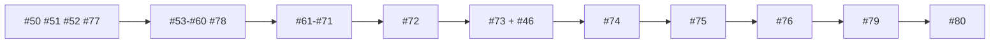

# V2 Traceability Report — Backlog Transition

**Date:** 2026-10-31 · **Companion:** [`TRANSITION_AUDIT.md`](TRANSITION_AUDIT.md)
**Revision:** r4.2. V2 approved as the canonical plan ([`APPROVAL.md`](APPROVAL.md)); PR #49 merged.
r4.1 counts were re-verified against the live tracker and test runs; corrections are listed in
[`TRANSITION_AUDIT.md`](TRANSITION_AUDIT.md) §7, and the r4.2 changes in §9.
**Purpose:** prove that every V2 roadmap task has an issue or a stated reason it does
not, that no v1 work was lost, and that the backlog is executable in the intended order.

---

## 1. Coverage: every roadmap task accounted for

`ROADMAP_V2.md` contains **88 tasks** across 10 waves. Every one is mapped below.
Counts were extracted mechanically from the roadmap's task tables, not counted by hand.
Per-wave sum: 4 + 9 + 11 + 7 + 9 + **16** + 13 + 6 + 8 + 5 = **88**. *(r4.1: `TRANSITION_AUDIT.md`
§4 said W4 had 17, which was wrong; this table already said 16. The roadmap has 91 unique
task **ids**, which is 88 tasks plus 3 retired aliases: `C-013`→`SD-001`, `C-024`→`UM-010`–`UM-014`,
`R-014`→`E-037`.)*

| Wave | Tasks | Individual issues | Tracker | Unmapped |
|---|---:|---|---|---:|
| W0 | 4 (`E-001`–`E-004`) | #50, #51, #77, #52 | — | **0** |
| W0b | 9 (`MA-010`–`MA-018`) | #53–#60, #78 | — | **0** |
| W1 | 11 (`E-010`–`E-020`) | #61–#71 | — | **0** |
| W2 | 7 (`E-021`–`E-027`) | — | #72 | **0** |
| W3 | 9 (`E-030`–`E-038`) | — | #73 | **0** |
| W4 | 16 | — | #74 | **0** |
| W5 | 13 | — | #75 | **0** |
| W6 | 6 | — | #76 | **0** |
| W7 | 8 | — | #79 | **0** |
| W8 | 5 | — | #80 | **0** |
| **Total** | **88** | **24** | **7** | **0** |

### 1.1 Why 24 individual issues and 7 trackers (the deliberate trade-off)

W0, W0b and W1 get one issue per task because they are **next** and their acceptance
criteria are precise and stable — a tracker would hide exactly the detail an implementer
needs. W2–W8 get one tracker each with the full task list as a checklist, because:

1. the roadmap gates are **per wave**, not per task;
2. measurement in W4/W5 will legitimately re-scope later tasks, and 60 speculative
   issues would either go stale or be rewritten — reproducing the drift this audit exists
   to fix;
3. each task is promoted to its own issue **when its wave opens**, keeping the backlog
   honest rather than merely complete.

**This is a trade-off, not an omission.** It is recorded here so a future reader does not
mistake `#72`–`#80` for placeholders. Each tracker names every task, its deliverable
intent, and the exit gate that must be demonstrated before the next wave starts.

---

## 2. Unmapped tasks and missing dependencies

### 2.1 Unmapped roadmap tasks

**None.** All 88 map to an issue (24) or a tracker (64).

### 2.2 Tasks that intentionally have no issue

| Item | Reason recorded |
|---|---|
| `RL-001` (approve architecture) | Executed as an owner decision with no issue; folded into `D-ARCH` |
| v1 `RL-090`–`RL-094` | Never had issues; work absorbed into V2 tasks `E-004`, `E-016`, `E-036`, `E-037` and gates G0–G8. Creating four retroactive issues would add noise without traceability |
| v1 `RL-100`–`RL-132` | Drafted only; superseded by `R-010` (#76), `UM-*` (#75), `A-011` (#79), `R-030`–`R-034` (#80) |

### 2.3 Dependencies — verified order



**Cross-cutting dependencies that are easy to miss, and are now explicit in the issue
bodies:**

| Dependency | Why it matters |
|---|---|
| `E-011` (#62) ← `MA-011` (#54) | The cross-tenant test must be written **first** so it fails on the current design and passes after the migration |
| `E-012` (#63) ← `MA-016` (#59) | M3 drops and recreates the GiST exclusion constraint in one transaction; the risk review must precede it |
| `E-015` (#66) ← `MA-018` (#78) | The statistical formula was repaired twice in review; the doc checker prevents a third drift |
| `E-017` (#68) ← `MA-013` (#56) | Channel membership is a pure function; the spec must be frozen before code |
| `E-018` (#69) ← `E-020` (#71) | Type-completeness suite asserts the facet enum and retention floors, so both must exist |
| `E-037` (in #73) **before** W5 (#75) | Deletion closure must exist before abstractions are written, or the reflection runtime is built on an undeletable substrate and rebuilt |
| `SD-007` (in #74) **before** W5 (#75) | The admission bound must be numerically verified before anything is admitted by it |

### 2.4 Blocking issues that are **not** roadmap tasks

| Blocker | Status | Notes |
|---|---|---|
| `#47` (`RL-071`) | Open, re-scoped to W1 | Suite `I` zero-exposure cannot be asserted until the `app_role` + grants exist. `E-011` (#62) depends on it |
| `#46` (`RL-070`) | Open, re-scoped to W3 | `A8` toggle and 11-channel scanner absent on `main`; blocks G3 and therefore `S4`. *(r4.1: PR #49 implements `A8` + the 7-channel scanner. It is held open on a reproduced queue-starvation defect; see `TRANSITION_AUDIT.md` §8)* *(r4.2: #49 was fixed and merged as `394dcf2`, so `A8` and the 7-channel scanner are on `main`. Still open: the 11-channel extension and the unbounded closure under `E-037`, which blocks G3)* |

Neither is a blocker for **W0 or W0b**, and both are correctly sequenced after them.

---

## 3. Backlog classification summary

| Classification | Count | Issues |
|---|---:|---|
| **Retain unchanged** | **27** | #1, #2, #3, #4, #5, #6, #9, #10, #11, #13, #14, #15, #16, #19, #20, #21, #22, #23, #24, #30, #31, #32, #33, #34, #35, #42, #45 |
| **Update acceptance criteria** | **1** | #12 (workflow filename is `custom-memory-engine.yaml`, not `research-lab.yaml`) |
| **Update scope** | **2** | #46 (`E-037`/`E-038` re-home), #47 (two critical security defects added) |
| **Extend (retained + V2 additions)** | **5** | #17 (+`own_P`), #18 (7→11 channels), #25 (+M1–M9), #43 (+four-channel assembly), #44 (+`assess_soundness`) |
| **Split** | 1 | #17 — suite G/I retained; `own_P` split out to `C-011` (#74). *Also counted under `extend`; the split refers to the new `own_P` task, not to this issue.* |
| **Merge** | 0 | — |
| **Superseded** | **0 issues** | No *issue* was superseded. v1 *decisions* (`A10`, the `layer` enum) are superseded via `V2-D01`, which is a decision-level change, not an issue-level one |
| **Implemented, requiring verification** | 3 areas | RLS role (#47), deletion completeness (#46), P9 verification suite (→ #52, #67, #73) |
| **Newly created** | **31** | #50–#80: 24 individual task issues (#50–#71, #77, #78) + 7 wave trackers (#72–#76, #79, #80) |
| **Total accounted for** | **66** | 35 v1 (27 retain + 1 update-criteria + 2 update-scope + 5 extend = 35) + 31 new |

**Verification of the arithmetic:** 27 + 1 + 2 + 5 = 35 v1 issues, exactly matching the
tracker (33 closed + 2 open). The `split` and reorder notes are properties of individual
issues already counted, not additional issues, so they are not added to the total.

**No issue was closed, reopened, retitled, or deleted.** Every disposition is an additive
comment plus a milestone re-point; the original text and all discussion remain intact.

---

## 4. V1 asset preservation — verified, not asserted

| Asset | Verification |
|---|---|
| Frozen research record | `md5sum -c validation/document_hashes.txt` → **all 5 OK** |
| v1 test suite | Full CI scope (`uv sync --frozen --extra baselines`, DB up, `uv run pytest -q`): **1374 passed, 21 skipped**, 1395 collected. Non-integration (`-m 'not integration'`): **1234 passed, 18 skipped, 143 deselected**. *r4 printed "1252 passed", which was wrong: 1252 is the number selected by the marker. Full reconciliation: `TRANSITION_AUDIT.md` §1.1* |
| v1 milestones P0–P7 | 8 milestones intact; 33 closed issues still closed |
| Historical evidence | `evidence/*`, `CHANGELOG.md`, `REFACTORING.md` unmodified; `E-003` forbids rewriting them |
| Engine code | **zero lines changed** during this audit (documentation and tracker only) |

---

## 5. Unresolved conflicts and risks

| # | Conflict / risk | Status |
|---|---|---|
| 1 | `PROJECT_STATUS.md` §1 still says engine work is "Not Yet Executed" | Header corrects it; full fix is `E-003` (#77) |
| 2 | Issue #12 names `research-lab.yaml`; actual file is `custom-memory-engine.yaml` | Recorded in the disposition comment; the issue's history is not rewritten |
| 3 | Two `own_*` suite references in early audit commands used wrong paths | Caught and corrected during the audit; recorded in `TRANSITION_AUDIT.md` §1 |
| 4 | `MAX_LINEAGE_DEPTH = 3` is a live correctness bug | Re-scoped into #46 and `E-037`; not fixed yet, correctly deferred |
| 5 | `A8` (`P-nolineage`) absent, so `S4`'s positive control cannot run | Blocks G3 only; sequenced into `E-037`. **r4.2: resolved on `main`** by PR #49 (`394dcf2`) |
| 6 | W2–W8 task granularity is tracker-level | Deliberate; see §1.1 |
| 7 | `own_P` / `own_U` splits not yet frozen | `C-011`/`UM-001` in W4, before any measurement |
| 8 | Open decisions `V2-D30`–`V2-D34` | Correctly open; frozen from pilot data, not guessed |

---

## 6. Readiness verdict

> **r4.2.** V2 is approved as the canonical plan (2026-10-31). The verdicts below are
> unchanged. "Ready" means *ready once the Project Owner authorises implementation*, which
> is a separate instruction that has not yet been given. No W0, W0b or W1 task has started.

### W0 — **READY TO START**

All four issues exist with precise, verifiable acceptance criteria (#50, #51, #77, #52).
No dependencies, no open decisions, no engine changes required. `E-001` is the single
highest-value next action: it replaces prose status claims with a generated audit.

### W0b — **READY TO START after W0's G0 gate**

All nine issues exist (#53–#60, #78). Three of them (`MA-012`, `MA-013`, `MA-018`) must be
**frozen before W1 code is written**, which is exactly the wave ordering the roadmap
specifies. `MA-011` carries a failing-test-first requirement that is verifiable.

### W1 — **NOT READY; two hard prerequisites**

1. `MA-011` (#54) must produce a **failing** cross-tenant test against the current design;
   otherwise migration M2/M9 will encode the `/u/4` vs `/u/42` leak.
2. `MA-016` (#59) must specify M3 as a single transaction with the 43-assertion
   `bitemporal_checks.sql` replay; M3 is the highest-risk migration in the programme.

Additionally, `#47`'s `app_role` work must land before G1 can assert zero cross-tenant
exposure. That is expected and sequenced correctly.

### Explicit statement

**The backlog is ready for W0 and W0b execution.** It is **not** ready for W1, and W1
must not start until G0 and G0b are demonstrated — specifically until `MA-011`'s test fails
first and `MA-016`'s M3 specification is reviewed. That is the intended protection, not a
gap.

---

## 7. Reproducing this audit

```bash
cd custom-memory-engine
uv sync --frozen --extra baselines                   # CI-equivalent install
docker compose up -d --wait                          # disposable pgvector DB
set -a; . ./.env; set +a                             # CME_TEST_DATABASE_URL
uv run pytest -q                                     # at 998558f: 1374 passed, 21 skipped (1395 collected)
                                                     # at 394dcf2 (after #49): 1402 passed, 21 skipped (1423)
uv run pytest -q -m 'not integration'                # at 998558f: 1234 passed, 18 skipped, 143 deselected
                                                     # at 394dcf2: 1248 passed, 18 skipped, 157 deselected
md5sum -c validation/document_hashes.txt             # 5 OK
cd .. && gh issue list --state all --limit 200       # 66 issues: 33 open, 33 closed
gh pr list --state open                              # r4.1: 1 open (#49, held). r4.2: #49 merged (394dcf2)
gh api repos/:owner/:repo/milestones --jq '.[].title'  # W0..W8 + P0..P7
```

Expected: 35 v1 issues (33 closed, 2 open) + 31 new V2 issues = **66 total**, of which
**33 are open** and 33 closed. The 33 open issues are:

| Group | Count | Issues |
|---|---:|---|
| Individual V2 task issues (W0 4, W0b 9, W1 11) | 24 | #50–#71, #77, #78 |
| V2 wave trackers (W2–W8) | 7 | #72–#76, #79, #80 |
| Retained, re-scoped v1 issues | 2 | #46, #47 |

The milestones are:
**18 milestones** (8 v1 + 10 V2: W0, W0b, W1–W8).
