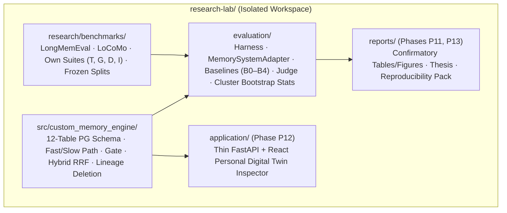
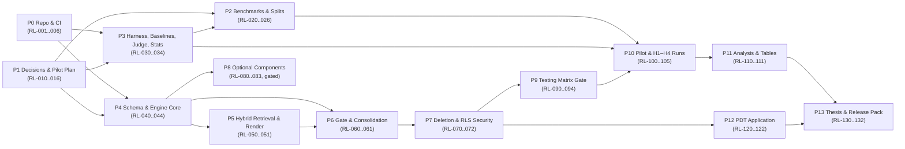

> **Direction notice (2026-10-31).** This phase plan (`P0`–`P13`) is **superseded for post-v1.0.0 work** (V2 approved as the canonical plan by the Project Owner on 2026-10-31; [`PLAN/V2/APPROVAL.md`](PLAN/V2/APPROVAL.md)) by [`PLAN/V2/ROADMAP_V2.md`](PLAN/V2/ROADMAP_V2.md) (waves `W0`–`W8`). The `P0`–`P13` table below is retained as the v1 execution record; the risk register (§F), testing matrix (§G), reproducibility rules (§H) and Definition of Done (§I) remain in force and are incorporated into the V2 plan. §A's status summary is stale relative to the repository — see `E-001` in [`PLAN/V2/ROADMAP_V2.md`](PLAN/V2/ROADMAP_V2.md).

---

# Project Roadmap — Bi-Temporal Memory Engine (`research-lab/`)

**Authority:** Operationalizes [`Graduation_Project_Proposal.md`](Graduation_Project_Proposal.md) (V4) and [`TECHNICAL_SPECIFICATION.md`](TECHNICAL_SPECIFICATION.md).
**Companion Plans:** Detailed task specs live in [`PLAN/TASK_GRAPH.md`](PLAN/TASK_GRAPH.md); visual dependency graphs in [`PLAN/DEPENDENCY_MAP.md`](PLAN/DEPENDENCY_MAP.md); role assignments in [`PLAN/ASSIGNMENTS.md`](PLAN/ASSIGNMENTS.md); 24-week timeline in [`PLAN/SCHEDULE.md`](PLAN/SCHEDULE.md).

---

## A. Project Status Summary

| Workstream | Status | Evidence / Location |
|---|---|---|
| **V4 Research Proposal & Audit Ledger** | `COMPLETE` | [`Graduation_Project_Proposal.md`](Graduation_Project_Proposal.md), [`Methodology_and_Consistency_Checklist.md`](Methodology_and_Consistency_Checklist.md), [`reference/Source_Evidence_Ledger.md`](reference/Source_Evidence_Ledger.md), [`reference/Research_and_Fact_Check_Audit.md`](reference/Research_and_Fact_Check_Audit.md) |
| **Reduced-Schema Bi-Temporal SQL Check (`43/43` assertions)** | `COMPLETE` | [`validation/bitemporal_checks.sql`](validation/bitemporal_checks.sql), [`validation/bitemporal_checks.output.txt`](validation/bitemporal_checks.output.txt) |
| **Clopper–Pearson Exact Bound Verification** | `COMPLETE` | [`validation/cp_bounds.py`](validation/cp_bounds.py), [`validation/cp_bounds.output.txt`](validation/cp_bounds.output.txt) |
| **Architecture Selection (`D-ARCH`: Option C Hybrid) & `RL-001` Approval** | `COMPLETE` | [`PLAN/ARCHITECTURE.md`](PLAN/ARCHITECTURE.md), [`reference/ARCHITECTURE_DECISION_MATRIX.md`](reference/ARCHITECTURE_DECISION_MATRIX.md), [`PLAN/PROJECT_STATUS.md`](PLAN/PROJECT_STATUS.md) |
| **First-Wave Phase P1 Decision Issues (`#1`–`#6`)** | `OPEN ON GITHUB` | `RL-010` (`#1`), `RL-012` (`#2`), `RL-013` (`#3`), `RL-014` (`#4`), `RL-015` (`#5`), `RL-016` (`#6`) |
| **Phase P0 Workspace Tooling (`RL-002`–`RL-006`)** | `READY TO START` | Scaffold verification, `pyproject.toml`/`uv.lock`, Docker Compose (`pgvector` + `btree_gist`), CI workflow, pre-commit hooks |
| **Engine, Harness, Suites, Pilot, & `H1`–`H4` (`P2`–`P13`)** | `PLANNED` | Tracked in [`PLAN/TASK_GRAPH.md`](PLAN/TASK_GRAPH.md) (`RL-011`, `RL-020`–`RL-132`) |

---

## B. System & Package Architecture

Under the Hybrid Architecture (`D-ARCH`, [`PLAN/ARCHITECTURE.md`](PLAN/ARCHITECTURE.md)), `research-lab/` is a self-contained workspace with zero code or runtime imports from the root `app/` service ([`PLAN/INDEPENDENCE_BOUNDARY.md`](PLAN/INDEPENDENCE_BOUNDARY.md)):

---

## C. Phase Breakdown (`P0`–`P13`)

| Phase | Title | Objective | Entry Criteria | Exit Deliverable & Gate |Tasks |
|---|---|---|---|---|---|
| **`P0`** | Repository, environment, & CI | Bootstrap `research-lab/` Python project, Docker PostgreSQL (`pgvector` + `btree_gist`), CI, and pre-commit checks. | `RL-001` approved (`Done`). | `D-P0`: Green `research-lab` CI workflow running mechanical, CP, and reduced-SQL checks. | `RL-001`–`RL-006` |
| **`P1`** | Resolve open decisions | Close pre-implementation decisions (`D-01`–`D-08`, `D-15`–`D-20`, `D-23`–`D-27`) and author the `pilot_plan.md` protocol (`RL-011`). | `P0` underway or complete (parallelizable). | `D-P1`: Signed decision memos in `PLAN/decisions/` + `evaluation/pilot_plan.md`. | `RL-010`–`RL-016` |
| **`P2`** | Benchmarks & own suites | Acquire/verify LongMemEval and LoCoMo; build deterministic script-first generators for suites `T`, `G`, `D`, `I`; freeze dev/test splits. | `RL-014`, `RL-016`, `RL-030` (adapter signature). | `D-P2`: `research/benchmarks/splits/FREEZE_LIST.md` signed before any test run (`J5`). | `RL-020`–`RL-026` |
| **`P3`** | Harness, baselines, judge, & stats | Implement `evaluation/harness/`, extraction record-and-replay cache, baselines `B0`–`B3` (+ conditional `B4`), validated LLM judge, and cluster-bootstrap/Holm/CP stats module. | `RL-003`, `RL-010`, `RL-013`. | `D-P3`: Deterministic harness + calibrated judge + unit-tested statistics against `cp_bounds.py`. | `RL-030`–`RL-034` |
| **`P4`** | Schema & engine core | Author the 12-table PostgreSQL DDL (`Invariant 1`–`7`, `9`), migrations, transactional supersession/archival procedures (`R1`–`R8`), query predicates, and `SKIP LOCKED` worker queue. | `RL-004`, `RL-010`, `RL-012`, `RL-013`. | `D-P4`: Full-schema SQL passing reduced-schema assertions + transactional procedure tests. | `RL-040`–`RL-044` |
| **`P5`** | Retrieval, fusion, & rendering | Implement dense (`pgvector`) + lexical (`ts_rank_cd`) retrieval, RRF (`k = 60`), weighted-sum ablation `A7`, and role-labeled context builder (`§7.3` render rule). | `RL-010` (`D-02`), `RL-040`, `RL-043`. | `D-P5`: Retrieval + context assembly passing `A5`/`A6`/`A7` ablation toggles. | `RL-050`, `RL-051` |
| **`P6`** | Validation gate & consolidation | Implement the 5-check validation gate (`§7.5`), conflict detector, `A3`/`A4` toggles, and minimal episodic → semantic/summary consolidation with `MEMORY_DERIVATION` links. | `RL-040`, `RL-042`, `RL-050`. | `D-P6`: Gate + consolidation pipeline satisfying Invariant 1 and branch `(C)` archival links. | `RL-060`, `RL-061` |
| **`P7`** | Deletion & security | Implement single-transaction lineage deletion (`§7.7`, `R6`, `deletion_epoch`, multi-source re-derivation), 7-channel scanner, `A8` toggle, and `FORCE ROW LEVEL SECURITY` (`Invariant 7`). | `RL-040`, `RL-042`, `RL-050`, `RL-061`. | `D-P7`: Zero-leak deletion engine + enforced per-user RLS + audit log redaction check. | `RL-070`–`RL-072` |
| **`P8`** | Optional components (gated) | Implement optional `A9` retention ranking, `A10` persona layer, BM25 channel, or Redis queue **only if** enabled by `D-04`–`D-07`. | `RL-010` signoff enabling any optional item (otherwise skipped). | `D-P8`: Exploratory modules or documented `SKIPPED` status. | `RL-080`–`RL-083` |
| **`P9`** | Testing matrix & verification | Execute the `T1`–`T5` archival harness (`RL-090`), invariants `1`–`9` suite (`RL-091`), clock/queue determinism (`RL-092`), concurrency/HNSW load tests (`RL-093`), and review gate (`RL-094`). | `P4`–`P7` complete. | `D-P9`: `tests/integration/report.md` with all mandatory `§G` rows green (`J6`, `J7`). | `RL-090`–`RL-094` |
| **`P10`** | Pilot & confirmatory experiments | Run dev-split pilot and freeze `D-09`–`D-14`, `D-21`, `D-22` (`RL-100`); execute one-shot test-split runs for `H1` (`RL-101`), `H2` (`RL-102`), `H3` (`RL-103`), human κ audit (`RL-104`), and `H4` (`RL-105`). | `RL-026`, `RL-094`, `P3` complete. | `D-P10`: Signed pilot `FREEZE_LIST.md` (`J8`) + immutable test-split run artifacts (`J9`). | `RL-100`–`RL-105` |
| **`P11`** | Reporting & analysis | Generate confirmatory tables, cluster-bootstrap CIs, Holm-adjusted p-values, diagnostic breakdowns, and cost/latency profiles. | `P10` complete. | `D-P11`: `reports/analysis/` tables and figures with honest `Supported` / `Not supported` / `Inconclusive` labels. | `RL-110`, `RL-111` |
| **`P12`** | Personal Digital Twin (PDT) app | Build the thin FastAPI backend + React/TypeScript Memory Inspector (timeline view, conflict queue, deletion UI); optional `H5` study if `D-08` is enabled. | `P4`–`P7` complete (scheduled after `P10` to protect experiments). | `D-P12`: Working PDT demonstrator (`D4`). | `RL-120`–`RL-122` |
| **`P13`** | Final packaging & release | Compile thesis report (`RL-130`), verify one-command reproducibility pack (`RL-131`), and package own suites (`T`, `G`, `D`, `I`) for release (`RL-132`). | `P11`, `P12` complete. | `D-P13`: Final thesis + clean-checkout reproduction transcript (`D5`). | `RL-130`–`RL-132` |

---

## D. Task Breakdown & Concurrency Alignment Notes

The full specification of all 46 tasks (`RL-001`–`RL-132`) — including deliverables, acceptance criteria, and dependencies — is maintained in [`PLAN/TASK_GRAPH.md`](PLAN/TASK_GRAPH.md) (single source of truth for task definitions) and [`PLAN/issue_drafts/`](PLAN/issue_drafts/).

### Key Engineering Alignment Notes Across Phases
1. **Invariant 4 Concurrency (`D-18`, `RL-012`, `RL-040`, `RL-093`):** The database enforces `EXCLUDE USING gist (user_id WITH =, subject_key WITH =, predicate_key WITH =, valid_range WITH &&, recorded_range WITH &&) WHERE (single_valued AND status IN ('active','archived'))`, and slow-path workers serialize per-user mutations with `pg_advisory_xact_lock(hashtext(user_id))`. If the `RL-093` multi-worker load test exposes GiST page-split contention, the transaction isolation level is promoted to `SERIALIZABLE` with bounded tenacity retry while keeping the exclusion constraint intact.
2. **Decision Memo Output Path (`RL-010`, `RL-012`–`RL-016`):** All Phase P1 decision records are written to `research-lab/PLAN/decisions/<decision_or_task_id>.md` and indexed in [`PLAN/DECISIONS_REGISTER.md`](PLAN/DECISIONS_REGISTER.md).
3. **One-Shot Test-Split Rule (`RL-101`, `RL-102`, `RL-103`, `RL-105`):** Confirmatory test splits frozen in `RL-026` may be executed **only after** `RL-094` (§G testing matrix gate) and `RL-100` (pilot freeze gate) are signed off, and **at most once** per hypothesis.

---

## E. Open Decisions & Parameter Freeze Register

All 27 project decisions (`D-01`–`D-27`), `D-ARCH`, and `D-ENG-01`–`D-ENG-04` are tracked in [`PLAN/DECISIONS_REGISTER.md`](PLAN/DECISIONS_REGISTER.md) (the single authoritative decision register) and summarized in [`TECHNICAL_SPECIFICATION.md`](TECHNICAL_SPECIFICATION.md) §2.

---

## F. Risk Register (Proposal §13 + Feasibility Extensions)

| Risk ID | Risk Description | Likelihood / Impact | Mitigation & Fallback | Owning Tasks |
|---|---|---|---|---|
| **`R1`** | `LongMemEval_S` ingestion (~57M input tokens) exceeds API budget or rate limits. | Medium / High | Enforce extraction record-and-replay (`RL-032`) so extraction runs once per extractor version; if full `S` exceeds budget in pilot, freeze a seeded stratified subset (`D-22`, `RL-100`). | `RL-010`, `RL-032`, `RL-100` |
| **`R2`** | Baseline `B4` (Graphiti) fails to run reliably with frozen models or exceeds ingestion budget. | High / Medium | Apply predeclared `D-21` inclusion rule on the dev split (`RL-031`, `RL-100`); if `B4` fails or overflows budget, exclude it and report the measured obstacle (`Proposal §10.1`). | `RL-031`, `RL-100` |
| **`R3`** | Validation gate (`§7.5`) is overly conservative, depressing legitimate acceptance (`LUAR < 1 − δ_luar`). | Medium / High | Tune gate prompts and disable uncalibrated numeric confidence thresholding on the dev split (`RL-060`, `RL-100`); log per-check rejection reasons in `MEMORY_CONFLICT` (`A4` ablation). | `RL-060`, `RL-100`, `RL-103` |
| **`R4`** | Rendering historical versions confuses the answering LLM on present-state queries (`H1` non-inferiority failure). | Medium / High | Enforce the `§7.3` render rule (`RL-051`): never render superseded versions, and omit historical versions in `current` query mode; label validity intervals explicitly. | `RL-051`, `RL-100`, `RL-101` |
| **`R5`** | Positive control `A8` (`P-nolineage`) fails to leak on suite `D`, rendering `H4` inconclusive. | Medium / High | Verify probe sensitivity on the dev split (`RL-023`, `RL-100`) before freezing test probes; include direct and indirect derived-memory probes across all 7 channels. | `RL-023`, `RL-100`, `RL-105` |
| **`R6`** | LLM judge exhibits position, verbosity, or self-preference bias, or low human agreement (`κ`). | Medium / High | Prefer deterministic match on scripted values; validate judge against two human annotators on dev sample (`RL-033`) before any test scoring; randomize order and use a distinct judge model (`D-03`). | `RL-033`, `RL-104` |
| **`R7`** | PostgreSQL `btree_gist` exclusion constraint (`Invariant 4`) experiences lock contention under concurrent slow-path workers. | Low–Medium / Medium | Serialize per-user slow-path jobs via `pg_advisory_xact_lock(hashtext(user_id))` (`RL-044`); test 8-worker contention in `RL-093` and promote to `SERIALIZABLE` + retry if needed (`D-18`). | `RL-012`, `RL-044`, `RL-093` |
| **`R8`** | Out-of-order session dates or `question_date < last_turn_ts` in `LongMemEval` corrupt recorded-time ordering. | High (34/500 & 43/500 observed) / Medium | Stable-sort sessions chronologically prior to ingestion, enforce monotonic `clock_now()` (`R3`), and set `ρ = max(question_date, last_turn_ts)` (`Proposal §7.4`, `RL-020`, `RL-044`). | `RL-020`, `RL-044`, `RL-092` |
| **`R9`** | Multi-source derived summary retains deleted canary text after partial source deletion. | Medium / High | Never keep a multi-source derived artifact as-is when any source is deleted (`Proposal §7.7`); delete the old version and synchronously re-derive solely from surviving `Active` sources (`RL-070`). | `RL-061`, `RL-070`, `RL-090` |
| **`R10`** | Archival silently drops a historical current belief from `historical_as_of` retrieval (the V3 bug fixed in V4). | Low (specified) / High | Enforce V4 Archival Precondition `(S) ∨ (C)` inside `archive_version` (`RL-042`, `RL-061`) and gate P10 on passing the `T1`–`T5` regression suite (`RL-090`). | `RL-042`, `RL-061`, `RL-090` |

---

## G. Mandatory Testing & Verification Matrix

Every mandatory row below must be `COMPLETE` (or carry a signed supervisor waiver in `tests/integration/report.md`) at the `RL-094` review gate before Phase P10 begins.

| Test ID / Group | Target Mechanism / Invariant | Verification Type | Current Status | Evidence Location / Task |
|---|---|---|---|---|
| **`M-DOC`** | Proposal, checklist, & changelog mechanical invariants (`citations`, `SHA-256`, `tables`, `H1`, `H4`). | Automated script | `COMPLETE` | `validation/mechanical_checks.py` |
| **`M-CP`** | Exact Clopper–Pearson scenario-level upper bounds (`N = 20..100`). | Deterministic script | `COMPLETE` | `validation/cp_bounds.py`, `validation/cp_bounds.output.txt` |
| **`M-SQL-RED`** | Reduced-schema bitemporal constraints (`Inv. 2, 3, 4, 5, 6`), `R1`–`R6`, `R8`, worked example `E1`–`E3`. | PostgreSQL 16.15 SQL script (`43/43` assertions) | `COMPLETE` | `validation/bitemporal_checks.sql`, `validation/bitemporal_checks.output.txt` |
| **`TEMP-Q`** | Four canonical temporal modes, R8 guards, reference/belief containment, status visibility and tenant-scoped execution. | Pure tests + full-schema PostgreSQL query/RLS tests | `IMPLEMENTED; REVIEW PENDING` | `RL-043`, `tests/integration/test_predicates*.py`, `evidence/RL-043-verification.md` |
| **`T1`–`T5`** | **Invariant 10 (V4 Archival Precondition `(S) ∨ (C)`):** `T1` reject active current; `T2` reject historical current belief; `T3` accept superseded `(S)`; `T4` accept derived replacement `(C)`; `T5` deletion closure removes derived replacement. | Integration test suite on full schema | `PLANNED` (Mandatory) | `RL-090` (`tests/integration/archival/`) |
| **`INV-1`** | **Invariant 1 (Traceability):** Commit fails if `Active`/`Archived` version lacks `MEMORY_EVIDENCE` (extracted) or `MEMORY_DERIVATION` (derived). | Database trigger test | `PLANNED` (Mandatory) | `RL-091` (`tests/integration/invariants/`) |
| **`INV-2-6`** | **Invariants 2–6 on full 12-table schema:** Range bounds, `guard_update` trigger, `btree_gist` overlap rejection, supersession retention, staging exclusion. | Full-schema SQL + pytest | `PLANNED` (Mandatory) | `RL-040`, `RL-091` |
| **`INV-7-RLS`** | **Invariant 7 (Cross-user RLS & Isolation):** Non-superuser `app_role` with `FORCE ROW LEVEL SECURITY` blocks cross-user reads/writes; suite `I` exposure = `0`. | Security & isolation test | `EXECUTED` for the restricted role, guard and dev-split Suite `I` (`RL-071`); full `Invariant 1`–`9` suite pending (`RL-091`) | `tests/integration/test_rls_isolation.py`, `tests/test_security_scoping.py`, `RL-091` |
| **`INV-8-DEL`** | **Invariant 8 (7-Channel Deletion Closure):** `delete_memory` purges all versions of `memory_key` (`R6`), embeddings, FTS, derived closure, queue payloads, caches, and keeps `AUDIT_EVENT` content-free. | End-to-end deletion test | `PLANNED` (Mandatory) | `RL-070`, `RL-072`, `RL-090` (`T5`) |
| **`INV-9-IDEM`** | **Invariant 9 (Worker Idempotency & Queue):** Duplicate job replay produces zero duplicate `MEMORY_VERSION` rows; `SKIP LOCKED` + per-user advisory lock preserves order. | Worker integration test | `PARTIAL` (RL-044 src/custom_memory_engine/native checks; wider RL-092 gate pending) | `tests/integration/test_clock_queue_db.py`, `tests/integration/test_queue_regressions_db.py`, `evidence/RL-044-verification.md` |
| **`CLK-REP`** | **Replay Clock Monotonicity (`R3`):** Out-of-order benchmark sessions are sorted; identical timestamps increment by `1 µs`; `t > ρ` and `β > clock` rejected (`R8`). | Harness + clock unit/integration test | `PARTIAL` (durable live/replay allocation implemented; full replay/read-guard integration pending) | `RL-044`, `tests/integration/test_clock.py`, `tests/integration/test_clock_queue_db.py`; wider `RL-092` |
| **`LOAD-CONC`** | **Concurrency & HNSW Recall (`D-18`):** 8 concurrent slow-path workers across users and same-user contention; ANN recall vs. exact scan (`descriptive`). | Load & benchmark test | `PLANNED` (Concurrency mandatory; HNSW descriptive) | `RL-093` |
| **`STAT-UNIT`** | **Statistical Module Verification:** Cluster bootstrap, paired permutation, Holm–Bonferroni, Clopper–Pearson, and mechanical H1–H4 decisions match analytical reference values. | [`evaluation/stats/tests/`](evaluation/stats/tests/), [contract/status](evaluation/stats/README.md) | `COMPLETE` (software verification only; not a research gate sign-off) | `RL-034` |

---

## H. Reproducibility Rules

1. **Pinned dependencies:** All Python packages are locked in `research-lab/uv.lock` (`RL-003`); Docker images (`postgres:16-alpine` / `pgvector`) are pinned by version and digest (`RL-004`, `RL-012`).
2. **Deterministic seeds:** Every suite generator (`RL-022`–`RL-024`), split hash (`RL-026`), LLM call (`temperature = 0`, `seed` where supported), and bootstrap test (`B = 10,000`, `RL-034`) uses an explicit recorded seed.
3. **Extraction record-and-replay (`RL-032`):** Slow-path extraction outputs are cached by `(turn_id, extractor_version, model_id)` so ablations (`P`, `A1`–`A10`) replay identical candidate extractions without confounding LLM variance.
4. **Immutable run manifests (`RL-030`):** Every pilot and confirmatory run records a complete `manifest.json` (commit SHA, dataset SHA-256, model IDs, timing, token costs).

---

## I. Definition of Done (Task & Phase Level)

A task (`RL-xxx`) is **Done** only when:
1. All deliverables listed in [`PLAN/TASK_GRAPH.md`](PLAN/TASK_GRAPH.md) exist at their declared paths inside `research-lab/`.
2. Automated tests (`pytest`, SQL checks, `mechanical_checks.py`) pass in CI without touching root `app/` code ([`PLAN/INDEPENDENCE_BOUNDARY.md`](PLAN/INDEPENDENCE_BOUNDARY.md)).
3. Any corresponding row in [`TRACEABILITY_MATRIX.md`](TRACEABILITY_MATRIX.md) or [`PLAN/DECISIONS_REGISTER.md`](PLAN/DECISIONS_REGISTER.md) is updated in the same PR.
4. The PR passes peer review by the designated reviewer in [`PLAN/ASSIGNMENTS.md`](PLAN/ASSIGNMENTS.md).

---

## J. Quality Gates (`J1`–`J10`)

Tracked with live status in [`TRACEABILITY_MATRIX.md`](TRACEABILITY_MATRIX.md) §5.

---

## K. High-Level Phase Dependency Graph

Detailed task-level Mermaid diagrams are maintained in [`PLAN/DEPENDENCY_MAP.md`](PLAN/DEPENDENCY_MAP.md).

