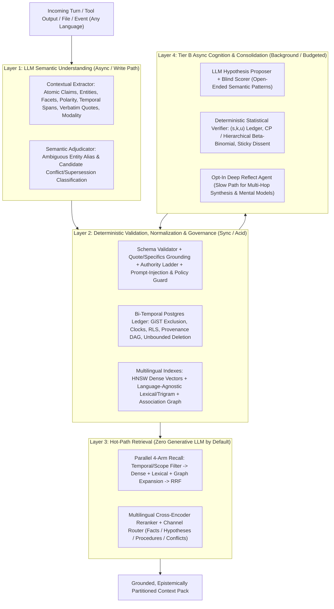

# ChronaMind Memory Engine — End-to-End Technical & Architectural Review (2026)

> [!IMPORTANT]
> **Executive Verdict:** ChronaMind (`custom-memory-engine/`) has built **the strongest deterministic governance, bi-temporal integrity, multi-tenant RLS security, epistemic channel separation, and lineage-complete deletion ledger of any open-source memory engine inspected** (surpassing all 12 external engines on these dimensions). **However, it is currently only a deterministic governance & storage ledger — not yet an intelligent semantic memory engine.**
>
> Three critical architectural defects must be corrected *before* investing in Waves W4–W8:
> 1. **V2 `query` is completely text-blind** — it ignores `request["text"]` and returns `ORDER BY recorded_range DESC LIMIT N` without dense vector or lexical search, invalidating the Gate G3 retrieval latency comparison.
> 2. **V2 `assert` disables conflict detection, supersession, facets, embeddings, and non-turn grounding**, while underlying layers conflate static database catalogs (`predicate_schema`), English-only FTS/embeddings, and literal string matching with semantic understanding.
> 3. **Planned W5 Cognition (`C-020`–`C-022`) places the LLM in the wrong role** — using non-LLM co-occurrence heuristics for candidate generation and restricting the LLM to prose rendering, which fails on natural, paraphrased, and multilingual human language.
>
> **Strategic Recommendation:** **Do NOT replace ChronaMind** with an external engine (none combine ChronaMind's bi-temporal exclusion, Postgres RLS, cryptographic deletion, and epistemic channel enforcement). **Do NOT continue W4–W5 unmodified either.** Adopt a **Hybrid Upgraded Architecture**: keep ChronaMind's Tier A Postgres + pgvector governance substrate verbatim, fix its multilingual/semantic storage & retrieval plumbing immediately, and add an **LLM-Driven Semantic Understanding & Resolution Layer** plus **LLM-Proposed / Statistically-Verified Tier B Cognition** adopting battle-tested mechanisms from **Hindsight**, **Quipu**, **Honcho**, **Graphiti**, and **Veracium**.

---

## 1. End-to-End Lifecycle Audit of ChronaMind (`custom-memory-engine/`)

ChronaMind's custom memory engine has completed **Waves W0–W3** (Gate G3 signed off on 2026-11-20, 22/29 public API operations wired, 22 SQL migrations, ~4,035 tests passing). Waves **W4–W8** (measurement instruments, cognition runtime, evolving user model, profiles/apps, thesis) have not started. Separately, the FastAPI root app ([memory.py](file:///home/elewashy/Desktop/ChronaMind/app/services/memory.py)) still runs legacy `mem0ai` (`AsyncMemory` + pgvector) and is not yet integrated with `custom-memory-engine/`.

### Stage-by-Stage Forensic Evaluation

| # | Lifecycle Stage | Current Implementation (W0–W3) & Plan (W4–W8) | Evidence (`file:line`) | Approach Verdict |
|---|---|---|---|---|
| **1** | **Memory Extraction & Ingestion** | **No extractor exists.** `Engine.call` accepts pre-extracted structured `content` + verbatim `span` + `content_hash`. Extraction is punted to an unspecified external callable. V2 `assert` rejects all non-turn sources (`tool`/`file`/`event`/`external`) with `external_evidence_cannot_be_grounded`. | [ingest_handlers.py](file:///home/elewashy/Desktop/ChronaMind/custom-memory-engine/src/custom_memory_engine/api/ingest_handlers.py#L294-L393), [p_engine.py](file:///home/elewashy/Desktop/ChronaMind/custom-memory-engine/evaluation/baselines/p_engine.py#L80) | **Incomplete / Flawed boundary.** Leaving extraction outside the core engine without a first-class LLM semantic pipeline turns ChronaMind into a storage driver, not a memory engine, and breaks non-chat agents (coding/research). |
| **2** | **Entity & Relationship Identification** | Principal-scoped opaque entity registry (`subject_entity_id` FK in Migration 19) and explicit `association` edges. Zero NER, coreference, alias merging, or relationship extraction; V2 `assert` defaults `subject_key="self"` unless the caller passes an exact pre-resolved UUID. | [ingest_handlers.py](file:///home/elewashy/Desktop/ChronaMind/custom-memory-engine/src/custom_memory_engine/api/ingest_handlers.py#L308-L320), [010_structural_tables.sql](file:///home/elewashy/Desktop/ChronaMind/custom-memory-engine/src/custom_memory_engine/schema/010_structural_tables.sql) | **Strong DB schema, missing resolution layer.** Opaque principal-scoped entities are great for security (`V2-D25`), but an engine must resolve `"Mom"`, `"my mother"`, and `"Sarah"` across sessions automatically. |
| **3** | **Fact Extraction & Structuring** | V1 required `(subject_key, predicate_key, single_valued)` against a hard FK table `predicate_schema`. V2 `assert` hardcodes `predicate_key="statement"` and `single_valued=False` for every claim (`M5` making `predicate_schema` optional was deferred in `V2-D43`). `evidence_supported` requires exact contiguous substring `span in content` inside a `role='user'` turn. | [001_full_schema.sql](file:///home/elewashy/Desktop/ChronaMind/custom-memory-engine/src/custom_memory_engine/schema/001_full_schema.sql#L32-L46), [ingest_handlers.py](file:///home/elewashy/Desktop/ChronaMind/custom-memory-engine/src/custom_memory_engine/api/ingest_handlers.py#L363-L364), [gate.py](file:///home/elewashy/Desktop/ChronaMind/custom-memory-engine/src/custom_memory_engine/engine/gate.py#L95-L100) | **Conflates DB schema with semantics.** Hardcoding `predicate_key="statement"` neutralizes single-valued governance; static `predicate_schema` fails general-purpose open domains; literal substring checks break paraphrased & cross-lingual grounding. |
| **4** | **Classification & Categorization** | Clean orthogonal axes (`kind`, `lifecycle`, `verification`, `visibility`, nullable `um_facet` with 6 values: `preference`, `goal`, `constraint`, `context`, `decision_pattern`, `meta_preference`). **Bug:** `um_facet` is **never written** by any ingest/infer handler — only read in `read_handlers.py` and preserved in `rederive.py`. `_INSTRUCTION_PATTERNS` is a 12-phrase hardcoded English substring list. | [USER_MODEL.md](file:///home/elewashy/Desktop/ChronaMind/custom-memory-engine/PLAN/V2/USER_MODEL.md#L54-L81), [gate.py](file:///home/elewashy/Desktop/ChronaMind/custom-memory-engine/src/custom_memory_engine/engine/gate.py#L73-L92), [ingest_handlers.py](file:///home/elewashy/Desktop/ChronaMind/custom-memory-engine/src/custom_memory_engine/api/ingest_handlers.py#L355-L374) | **Axis design is excellent; execution is broken.** Separating epistemic `lifecycle` from functional `um_facet` is textbook-correct, but classification is unwired and English-heuristic injection screening is trivially bypassed. |
| **5** | **Deduplication & Conflict Resolution** | `engine/gate.py::existing_relation` checks exact `(subject_key, predicate_key)` AND exact whitespace-normalized lowercase string equality (`" ".join(content.lower().split())`). `RelationClassifier` type alias (`gate.py:244`) is **never wired** into `apply_candidate`. Worse, because V2 `assert` sets `single_valued=False`, `if "conflict" in gate_enabled and candidate.single_valued:` (`ingest.py:213`) **never executes** on V2 writes! | [gate.py](file:///home/elewashy/Desktop/ChronaMind/custom-memory-engine/src/custom_memory_engine/engine/gate.py#L211-L244), [ingest.py](file:///home/elewashy/Desktop/ChronaMind/custom-memory-engine/src/custom_memory_engine/engine/ingest.py#L211-L223) | **Critical gap.** Zero paraphrase/semantic deduplication, zero semantic contradiction detection, and V2 `assert` silently bypasses the entire supersession/conflict gate. |
| **6** | **Temporal Reasoning & Updates** | **Best-in-class DB substrate:** Bi-/tri-temporal `event_range`, `observed_at`, `recorded_range`, PostgreSQL GiST `no_bitemporal_overlap` exclusion constraint, monotonic scope-keyed `clock_watermark` (`I4`), non-destructive archival branches (`S`/`C`), and `change` diff mode (`diff_views`). However, no natural-language temporal resolution exists on write or query. | [001_full_schema.sql](file:///home/elewashy/Desktop/ChronaMind/custom-memory-engine/src/custom_memory_engine/schema/001_full_schema.sql#L48-L75), [read_handlers.py](file:///home/elewashy/Desktop/ChronaMind/custom-memory-engine/src/custom_memory_engine/api/read_handlers.py#L1096-L1122) | **Database half is A+; linguistic half is missing.** Keep the GiST exclusion, clocks, and `audit_as_of` verbatim; add LLM temporal normalization at extraction/query boundaries. |
| **7** | **Consolidation & Summarization (W5 Plan)** | Planned `C-020` uses **non-LLM co-occurrence/window heuristics** to propose abstraction candidates; `C-021` verifies via 3-state `(s, k, u)` partial-identification CP bound `1 - CP_upper(k+u, o)`; `C-022` restricts the LLM to rendering prose after verification. Sticky user dissent (`UM-012`, `NEGATIVE_CONSTRAINT`) and facet decay (`UM-013`) are specified. | [ROADMAP_V2.md](file:///home/elewashy/Desktop/ChronaMind/custom-memory-engine/PLAN/V2/ROADMAP_V2.md#L485-L515), [USER_MODEL.md](file:///home/elewashy/Desktop/ChronaMind/custom-memory-engine/PLAN/V2/USER_MODEL.md#L84-L131) | **Verification math & sticky dissent are brilliant; candidate generation is flawed.** Non-LLM `C-020` fails on open-ended natural language, and `o >= 36` (`tau=0.90`, 97.5% one-sided CP) will starve real PDT users unless tiered/hierarchically pooled (`SD-003`). |
| **8** | **Storage & Database Operations** | **World-class multi-tenant Postgres architecture:** `FORCE ROW LEVEL SECURITY`, `NOSUPERUSER NOBYPASSRLS`, exact `TABLE_GRANTS`, composite `(id, user_id)` FKs, canonical trailing-slash `starts_with` scope prefixing, pinned `search_path`, content-free audit logs. **Storage defects:** hardcodes `to_tsvector('english', content)` and `vector(384)` (`BAAI/bge-small-en-v1.5`, strict `len(embedding) != 384`). | [001_full_schema.sql](file:///home/elewashy/Desktop/ChronaMind/custom-memory-engine/src/custom_memory_engine/schema/001_full_schema.sql#L63-L104), [ingest.py](file:///home/elewashy/Desktop/ChronaMind/custom-memory-engine/src/custom_memory_engine/engine/ingest.py#L60), [ingest.py](file:///home/elewashy/Desktop/ChronaMind/custom-memory-engine/src/custom_memory_engine/engine/ingest.py#L383-L384) | **Security & schema engineering are unmatched; indexing is locked to English 2023 models.** Must migrate to multilingual embeddings (configurable dim, HNSW) and language-agnostic FTS (`simple` + `pg_trgm` or BM25/ICU). |
| **9** | **Retrieval, Ranking & Relevance** | **CRITICAL DEFECT:** V2 `query` (`read_handlers.py:1376-1436`) **completely ignores `request["text"]`!** `execute_plan` runs `fetch_scoped_rows` (`ORDER BY recorded_range DESC LIMIT N`) + 1-hop unweighted graph expansion and explicitly documents *"No score is computed here"* (`read_handlers.py:1047`). V1's `retrieval.rank_versions` (dense + `'english'` FTS + RRF) is never called by V2, and `ingest_handlers.py` never writes to `memory_embedding`! | [read_handlers.py](file:///home/elewashy/Desktop/ChronaMind/custom-memory-engine/src/custom_memory_engine/api/read_handlers.py#L1040-L1050), [read_handlers.py](file:///home/elewashy/Desktop/ChronaMind/custom-memory-engine/src/custom_memory_engine/api/read_handlers.py#L1123-L1153), [retrieval.py](file:///home/elewashy/Desktop/ChronaMind/custom-memory-engine/src/custom_memory_engine/engine/retrieval.py#L170-L225) | **Broken for production retrieval.** Gate G3's `11.82 ms` P95 vs V1 `32.61 ms` ([retrieval_stages_2000.json](file:///home/elewashy/Desktop/ChronaMind/custom-memory-engine/reports/benchmarks/retrieval_stages_2000.json)) is apples-to-oranges (`charged_calls=0`, `embedding_tokens=0`, zero relevance ranking). |
| **10** | **Context Construction & Response Prep** | **Industry-leading epistemic discipline:** 4 mutually exclusive channels (`facts`, `hypotheses`, `procedures`, `conflicts`) routed purely by `(kind, lifecycle, verification, stale, open_contradiction)` so no score can ever launder a hypothesis into a fact. Unforgeable `BoundedFact`, per-caller HMAC provenance handles (`I17`), explicit conflict counterparts, token budgets, `refine` narrowing. | [read_handlers.py](file:///home/elewashy/Desktop/ChronaMind/custom-memory-engine/src/custom_memory_engine/api/read_handlers.py#L1254-L1374), [channels.py](file:///home/elewashy/Desktop/ChronaMind/custom-memory-engine/src/custom_memory_engine/engine/channels.py) | **Preserve verbatim.** This is ChronaMind's defining product moat — far cleaner and safer than flat text dumps in Mem0/Letta/Cognee. |
| **11** | **Updates, Deletion & Lifecycle Mgmt** | **Best-in-class deletion engine:** Two-phase ordering (classify sources-first, apply dependents-first), unbounded recursive provenance closure (`V2-D09`), 11-channel leak scanner with positive controls, HMAC-SHA256 deletion receipts (`T-29`), closure-hash staleness (`epoch:request_id:purge_id`, `I13`) preventing `verified ∧ deleted-source`. | [deletion.py](file:///home/elewashy/Desktop/ChronaMind/custom-memory-engine/src/custom_memory_engine/engine/deletion.py), [staleness.py](file:///home/elewashy/Desktop/ChronaMind/custom-memory-engine/src/custom_memory_engine/engine/staleness.py), [ROADMAP_V2.md](file:///home/elewashy/Desktop/ChronaMind/custom-memory-engine/PLAN/V2/ROADMAP_V2.md#L426-L433) | **Preserve verbatim.** Not a single one of the 12 external engines matches ChronaMind's unbounded closure + 11-channel leak verification + cryptographic receipt guarantees. |

> [!WARNING]
> **Gate G3 Latency Metric Caveat:** [ROADMAP_V2.md](file:///home/elewashy/Desktop/ChronaMind/custom-memory-engine/PLAN/V2/ROADMAP_V2.md#L433) marks *"Retrieval P95 at v1 scale within 2× of the 27 ms reference"* as **met** at **11.82 ms** based on [retrieval_stages_2000.json](file:///home/elewashy/Desktop/ChronaMind/custom-memory-engine/reports/benchmarks/retrieval_stages_2000.json). Because V2 `query` currently performs **zero vector search, zero FTS search, and zero reranking**, that 11.82 ms measures only a recency-sorted `LIMIT` scan + metadata joins. Once real hybrid dense + lexical + graph retrieval is wired into V2, latency must be re-baselined honestly.

---

## 2. LLM Placement & Deterministic Responsibilities

The core architectural question of this review is: **Where does an LLM create genuine irreplaceable value, and where do deterministic rules, SQL constraints, and neural non-generative models (embeddings/cross-encoders) win on reliability, latency, and cost?**

### The Confusion in ChronaMind Today
ChronaMind currently exhibits a **two-sided boundary error**:
1. **Under-using the LLM for semantic understanding**: Treating `predicate_schema` FK keys, exact lowercased string matching (`existing_relation`), hardcoded 12-phrase English substring lists (`_INSTRUCTION_PATTERNS`), rigid operator-only `refine`, and non-LLM co-occurrence candidate generation (`C-020`) as substitutes for natural language understanding.
2. **Leaving the semantic layer undefined outside the engine**: Pushing extraction, coreference, temporal parsing, entity linking, and contradiction classification onto unspecified caller code guarantees that every consumer will reinvent ad-hoc, fragile LLM glue — or bypass governance altogether.

### Clean Layer Responsibility Architecture

### Exact Responsibility Matrix (LLM vs. Deterministic vs. Specialized Neural Models)

| Capability | Right Owner | Why | Anti-Pattern to Avoid |
|---|---|---|---|
| **Extract atomic facts, entities, facets (`preference`/`goal`/`constraint`/`context`), modality (`asserted`/`hedged`/`planned`/`quoted`/`third_party`), & relative temporal spans** | **LLM** (Structured JSON output, single batched call per chunk/turn window, async) | Requires contextual pragmatics, sarcasm/hedging detection, coreference, and natural multilingual comprehension. | Static regexes, spaCy English NER (`Mem0`), fixed `predicate_schema` FK catalogs (`ChronaMind v1`), or GLiNER fixed English label banks. |
| **Verify quote grounding, specifics (numbers/dates/IDs), authority level (`USER > SYSTEM > ASSISTANT > THIRD_PARTY`), & schema invariants** | **Deterministic Code** | LLMs hallucinate citations and obey injected instructions. Deterministic verification guarantees provenance and blocks prompt injection structurally (as in `Veracium` + `Quipu` + `ChronaMind`). | Trusting LLM self-reported confidence or English-only `_INSTRUCTION_PATTERNS` substring filters. |
| **Entity Resolution & Alias Merging** | **Hybrid Cascade** (Deterministic exact/trigram/vector shortlist → **LLM** *only* for borderline candidates) | Exact/trigram + vector similarity (`Graphiti` / `Hindsight`) resolves ~85–90% at <2 ms and \$0; a batched LLM call resolves hard cross-lingual/semantic aliases (`"my boss"` = `"أحمد"` = `"Ahmed"`). | Running O(N) LLM calls for every mention, or ASCII-only `[^a-z0-9]+` stripping (`Graphiti`, `Cognee`, `MIRIX`). |
| **Deduplication & Conflict / Supersession Classification** | **Hybrid 3-Stage** (Deterministic vector+entity candidate recall → **LLM** propose + blind verify → Deterministic GiST exclusion & non-destructive archival) | Exact string equality misses `"I moved to Berlin"` vs `"Living in Berlin now"`. Open-ended 3-stage semantic update (`Quipu` / `Graphiti`) handles arbitrary domains without a static `predicate_schema` catalog, while Postgres GiST guarantees zero active overlap. | Exact string dedup (`ChronaMind` `gate.py:238`), ADD-only writes (`Mem0`), or destructive in-place overwrites (`LangMem`, `Memobase`). |
| **Temporal Storage, Watermarks, `as_of` & `change` Diffs** | **Deterministic SQL (Postgres)** | Bi-temporal correctness, monotonic clocks (`I4`), and audit reproducibility must be mathematically exact and immune to LLM drift. | Letting an LLM compute time diffs or store dates only as prose inside Markdown (`Letta Code`). |
| **Hot-Path Retrieval (`query` / `recall`)** | **Deterministic SQL + Neural Embedder + Multilingual Cross-Encoder** (**0 generative LLM calls**) | Keeps P95 latency under ~50–150 ms and cost near \$0 per turn. Matches `Hindsight` (`recall`), `Honcho` (`/context`), and `Mem0` read-path economics. | Calling a generative LLM on every read (`Memobase`, `Graphiti` default `OpenAIRerankerClient`, `Cognee` default `*_COMPLETION`). |
| **Deep Multi-Hop Synthesis / Reflection (`reflect` / Dialectic)** | **Opt-In Agentic LLM** (Slow path, explicit caller budget) | Complex cross-session reasoning ("why did my architecture decisions shift over Q3?") genuinely needs iterative LLM tool use over pre-filtered grounded evidence (`Hindsight` `reflect`, `Honcho` Dialectic). | Making every ordinary turn pay 3–10 LLM roundtrips. |
| **Pattern Discovery & Evolving User Model (Tier B)** | **Hybrid: LLM proposes & blind-scores semantic hypotheses → Deterministic statistical verifier admits/rejects & enforces sticky dissent** | LLMs excel at noticing semantic regularities across differently phrased sessions (`Quipu` `patterns.zig`, `Honcho` Dreamer); deterministic `(s,k,u)` statistics + hierarchical pooling + sticky dissent (`ChronaMind`) prevent confabulation and overnight re-inference. | Pure non-LLM co-occurrence heuristics (`C-020`), OR unverified free-form LLM reflection (`Letta`, `Memobase`, `Cognee`). |
| **Access Control, Scoping, Epistemic Routing & Deletion** | **100% Deterministic (Postgres RLS + Pure Channel Router + Recursive Closure Purge)** | Security, GDPR/right-to-erasure, and never presenting a hypothesis as fact are hard invariants — never prompt instructions. | Application-only `WHERE bank_id =` without RLS (`Hindsight`), silent deletion leaks (`Mem0`, `MIRIX`, `Graphiti`), or prompt-only uncertainty hedging. |

### Cost, Latency, Accuracy & Scalability Balance
- **Write Path (Async/Decoupled):** 1 fast structured-output LLM call per turn-window/chunk (e.g., Gemini Flash / GPT-4.1-mini class, ~\$0.0001–\$0.0005/turn) + conditional conflict/alias adjudication only when vector neighbors exceed similarity threshold (e.g., cosine ≥ 0.78). Use a **fast/slow dual ingestion lane** (`MemOS` / `Honcho` / `Cognee` early indexing): commit raw turn/episode immediately (<10 ms, searchable via raw lexical/dense) and run LLM extraction + graph/conflict resolution asynchronously in a background worker.
- **Hot Read Path (Synchronous):** **0 generative LLM calls.** Single-transaction RLS/scope/temporal SQL filter → parallel HNSW dense + language-agnostic lexical + bounded graph expansion → RRF → local/fast multilingual cross-encoder (top-50 → top-K, ~15–40 ms) → deterministic channel assembly. Total P95 target: **40–120 ms** at \$0 generative LLM cost.
- **Background Cognition (Scheduled/Budgeted):** Token-buffered or event-triggered batch consolidation (`Honcho` Dreamer / `Hindsight` Consolidator / `Memobase` buffer zones), with always-valid alpha-spending and hard per-user token budgets (`C-023`, `C-027`).

---

## 3. Forensic Comparison of 12 Open-Source Memory Engines (2026 Source-Code Audit)

Every engine below was cloned locally into `reference-memory-engines/` and audited at its **actual 2026 source-code HEAD** (not marketing docs or 2024–2025 blog summaries).

### Master Architecture Comparison Table

| Engine (Version / License) | Core Storage Stack | Write-Path LLM | Read-Path Generative LLM | Temporal Model | Conflict & Supersession | Consolidation / Reflection | Deletion & Multi-Tenancy | Multilingual Reality (Code-Verified) |
|---|---|---|---|---|---|---|---|---|
| **ChronaMind** (W3 / Internal) | **Postgres + pgvector + FORCE RLS** | None yet (external) | **0** (bug: ignores text) | **Bi-/tri-temporal + GiST exclusion + clocks** | Exact-string only; **disabled on V2 `assert`** | Planned `C-020`–`C-025` (non-LLM proposals + CP math) | **Best-in-class:** Unbounded closure + 11-ch scan + HMAC receipts + RLS | **Broken:** `bge-small-en-v1.5` (384d), `'english'` FTS, 12 English regexes |
| **Hindsight** (`v1.2.3` / **MIT**) | **Postgres + pgvector/vchord/pg_search** (or Oracle) | 1 call/chunk (0 in `chunks` mode) | **0 on `recall`**; Agentic loop on `reflect` | `occurred_start`/`end` + `mentioned_at` + ±24h temporal graph | Raw append-only; async LLM `observation` synthesis (0.97 dedup) | Async `consolidator` → `observation` + `mental_models` (`delta_ops`) | Dual-pass stale obs cleanup + relink; **no RLS**, `llm_requests` & partial-bank leaks | Prompts preserve language, **but** default `bge-small-en`, `'english'` mental-model FTS, `_query_can_score` blocks non-EN temporal queries |
| **Honcho** (`v3.6.2` / **AGPL-3.0**) | **Postgres + pgvector + RLS + `HASH(tenant_id)`** + `pg_trgm` | 1 async Deriver call (cite-first) | **0 on `/context`**; Opt-in Dialectic LLM | Event timestamps + recency decay (no bi-temporal exclusion) | 4 epistemic levels (`explicit`/`deductive`/`inductive`/`contradiction`) | Async **Dreamer** (`Deduction`, `Induction`, `CardRefresh` specialists) | Strong: RLS + fail-closed allowlists + 2-phase vector/DB reconciler | Multilingual embeddings + `pg_trgm`, **but** PG FTS hardcodes `'english'` & Dialectic has EN search hints |
| **Graphiti / Zep** (`v0.31.2` / **Apache-2.0**) | Neo4j / FalkorDB / Neptune / Kuzu (Graph DB) | High (entities + edges + dedup + summaries) | **O(N) LLM default reranker** (opt-out RRF/MMR) | **Bi-temporal** (`valid_at`/`invalid_at`/`created_at`/`expired_at`) | Non-destructive LLM contradiction + deterministic interval invalidation | Label-propagation communities + incremental Saga summaries | `group_id` filter; `remove_episode` fails to un-invalidate edges or update sagas | **Broken:** `[^a-z0-9' ]` strips all non-ASCII scripts; EN-only temporal regexes & stopwords |
| **Quipu** (2026 HEAD / **MIT**) | Embedded **LatticeDB** (Zig: Graph + BM25 + HNSW + WAL) | Open-ended quote-grounded assertions + 3-stage updates | **0** on search; optional query expansion | Temporal normalization + supersession edges | **3-stage open-ended update:** LLM propose → isolated LLM verify → deterministic check | **LLM hypothesis proposal + blind scoring + exact statistical test (`p<=0.06`)** | Strong: provenance-closure forgetting + Wyhash 8-token leak fingerprinting | **Broken:** ASCII `isAlphanumeric` & English-only rules in `temporal.zig`, `query_expansion.zig`, `fact_updates.zig` |
| **Veracium** (2026 HEAD / **MIT**) | Embedded **SQLite** (in-Python lexical/cosine) | Extraction + optional verification | **0** on retrieval; abstention gate in `answer()` | Bi-temporal `as_of` resolution | **Deterministic authority ladder** (`USER > SYSTEM > ASSISTANT > THIRD_PARTY`) + CAS + refusals | Grounded-only compiled wiki view | Provenance-first + third-party quarantine; single-tenant SQLite | **Broken:** English-only regexes, stemmers, lexicons, static `DEFAULT_RELATIONS` |
| **Cognee** (`v1.6.10` / **Apache-2.0**) | SQLite/PG + LanceDB/PGVector + **Ladybug (Kuzu)**/Neo4j | 1 call/chunk (`gliner_demo` keyless fallback) | **1+ LLM** default (`HYBRID_COMPLETION`; 0 w/ `only_context`) | `Timestamp` leaf nodes + rolling `dateparser` hints (`temporal_cognify` removed) | Append-only + `improve()` Stage 8 LLM `FactConflict` review + manual resolve | 9-stage **`improve()`** (`feedback_weights`, `distill_sessions`, `truth_subspace`, `global_context_index`) | Graph-embedded ref-counted provenance deletion + RBAC + per-dataset physical isolation | **English-centric:** `languages=["en"]` hints, EN `query_router`, EN stopwords, `[^a-z0-9]+` entity dedup (+ opt-in `translate_content`) |
| **Letta Code** (`v0.34.68` / **Apache-2.0**) | **Git-backed MemFS v2** (`MEMORY.md` Markdown files) | Main agent file edits + Git worktree reflection subagent | Always-in-context core `.md` + `Memory(path)` + forked `recall` subagent | Git commit timestamps only (prose dates by prompt) | Git rebase + LLM repair subagent; semantic conflicts by prompt only | Background **"Dreaming"** subagent in isolated Git worktree + pre-commit validators | Per-agent path guard + OS kernel sandbox (`bwrap`/Seatbelt); **no true forgetting** (Git retains history) | Strong Unicode/CJK local BM25, **but** hardcoded EN `REFLECTION_AUTO_QUERIES`, `4 bytes/tok` heuristic, EN prompts |
| **Mem0** (`v2.2.1` / **Apache-2.0**) | Qdrant/PGVector/etc. + SQLite history (OSS **no graph**) | 1 call ADD-only (`ADDITIVE_EXTRACTION_PROMPT`) | **0** (dense + BM25 + entity boost) | **None in OSS** (`timestamp` raises `ValueError`) | **Append-only** (legacy UPDATE/DELETE prompts dead code) | **None** | **Severe leaks:** plaintext remains in SQLite `history`/`messages`; no tenant auth on `get`/`delete(id)` | **Broken:** hardcodes `en_core_web_sm`, English stopwords, ignores `use_input_language` |
| **LangMem** (`v0.0.30` / **MIT**) | LangGraph `BaseStore` (KV + vector) | `trustcall` JSON-patch calls | **0** (store search) | **None** | Destructive in-place `aput` overwrites & `adelete` over top-5 recall | Debounced `ReflectionExecutor` + procedural prompt optimizers | Store-level namespace only; zero provenance or cascading deletion | **Cleanest language neutrality** (zero hardcoded EN regex/NLP heuristics) |
| **MemOS** (`v2.0.36` / **Apache-2.0**) | **Postgres `halfvec` HNSW** / Neo4j + Qdrant/Milvus | Fast raw write → async `MEM_READ` fine extraction | 0–1 (fast/graph search) | Timestamps + tree structure | Fast-node cleanup; **graph reasoning detector commented out** | `MiniBatchKMeans` tree reorganizer + `CommunityDreamPlugin` (`LoRAMemory` is stub) | User/cube scoping; `dream/maintenance.py` unimplemented | **Binary EN/ZH only:** `jieba` + ASCII `[a-zA-Z0-9]+` drops Arabic/Cyrillic/accented scripts |
| **MIRIX** (`v0.1.0` / **Apache-2.0**) | Postgres + Redis + optional Neo4j hypergraph | Heavy (MetaAgent + 1–5 sub-agents + entity LLM) | 0 on search; skill BM25/cosine/RRF | Timestamps + `prior_values` audit | Deterministic `"E / R"` triple overwrite (no re-embed/cache invalidation!) | AutoDream (`graph_only=True` after PG merge lost **-7.7 QA**) + procedural `SkillObject` | **Critical leaks:** Neo4j never deleted; `delete_user_memories` wipes across all orgs! | **Broken:** `'english'` FTS, ASCII `[^a-z0-9 ]`, EN-only regexes |
| **Memobase** (`358c16b` / **Apache-2.0**) | Postgres + pgvector + Redis cache/locks | 3–5 LLM calls per token-buffered flush | **Calls LLM on read path** (`filter_profiles_with_chats`) | **None** (destructive in-place profile overwrite) | Destructive overwrite of YAML profile slots | Token-buffered async flush + `UserEventGist` | Hard-deletes raw chat blobs by default (**zero provenance!**); no cascade | **Binary EN/ZH prompts only**; zero HNSW/IVFFlat or BM25 indexes |

### Evidence-Backed Findings: Benchmarks vs. Source-Code Reality (2025–2026)

> [!NOTE]
> **Critical Benchmark Hygiene:** Public memory-engine benchmarks (LoCoMo, LongMemEval-S/M) suffer heavily from evaluator-prompt variance, backbone LLM differences (GPT-4o vs Gemini 2.5 vs OSS-120B), and self-reported tuning. Code inspection reveals glaring gaps between marketing claims and shipped code:

1. **Hindsight (`arXiv:2512.12818`, Vectorize AI):**
   - *Benchmarks:* Reports state-of-the-art ~91.4% (up to ~94.6% with larger models) on LongMemEval and ~89.6%–92% on LoCoMo — driven primarily by its **4-way parallel Postgres retrieval + cross-encoder reranker (`hs-rerank-1`) + observation consolidation + agentic `reflect`**.
   - *Source-Code Reality (`62a03bf`):* Far more engineered than the 2025 paper, but **diverged significantly**: the `opinion` network & `confidence_score` were deleted ([g2h3i4j5k6l7_remove_opinion_fact_type.py](file:///home/elewashy/Desktop/ChronaMind/reference-memory-engines/hindsight/hindsight-api-slim/hindsight_api/alembic/versions/g2h3i4j5k6l7_remove_opinion_fact_type.py#L31-L51)), MPFP/BFS graph algorithms were replaced by a single-roundtrip SQL CTE (`LinkExpansionRetriever`), **zero PostgreSQL RLS** exists, `DateparserQueryAnalyzer` silently drops non-English temporal queries via `_query_can_score` ([query_analyzer.py](file:///home/elewashy/Desktop/ChronaMind/reference-memory-engines/hindsight/hindsight-api-slim/hindsight_api/engine/query_analyzer.py#L418-L425)), and `mental_models` hardcode `'english'` FTS.
2. **Honcho (Plastic Labs, `dcd3203`):**
   - *Source-Code Reality:* Arguably the **cleanest production PostgreSQL + pgvector + RLS user-modeling architecture** in open source (`HASH(tenant_id)` partitioning, cite-first async Deriver with `ConclusionSourceMessage`, 4 explicit epistemic levels, zero-LLM hot-path `/context`, Dreamer specialists with surprisal sampling, fail-closed session allowlists).
   - *Dealbreaker for Direct Adoption:* **AGPL-3.0 copyleft license** (viral for SaaS/network services) + no bi-temporal exclusion/audit clocks + `'english'` FTS.
3. **Zep / Graphiti (`arXiv:2501.13956`, `9b8a463`):**
   - *Benchmarks:* Strong historical LongMemEval (~71.2% reported with GPT-4o) & temporal reasoning, though 2025–2026 follow-up studies (including Hindsight and Mem0 evaluations) show high write-time latency/token cost and mixed LoCoMo competitiveness.
   - *Source-Code Reality:* Best open-source **cascaded entity resolution** (exact → MinHash/LSH → batched LLM) and bi-temporal edge invalidation, **but** suffers from zero ANN vector indexes (brute-force scans in Neo4j/FalkorDB), O(N) LLM default reranker with hardcoded OpenAI token IDs `6432`/`7983`, ASCII-stripping `[^a-z0-9' ]`, and separate graph DB ops overhead.
4. **Quipu (`a6de3c1`) & Veracium (`804253b`):**
   - *2026 Breakthrough Patterns:* Both are newer 2026 architectures built specifically to solve the exact epistemic/security failures of 2024–2025 engines. **Quipu** proves you can do **open-ended conflict/update detection without static predicate catalogs** (`fact_updates.zig`: LLM propose → isolated LLM verify → deterministic value/frame overlap) AND **LLM-proposed, blind-scored, exact statistically tested pattern discovery** (`patterns.zig`, `p_max=0.06, gap_min=0.6`). **Veracium** (`arXiv:2607.21962`) introduces **third-party quarantine**, a deterministic **authority ladder** (`USER > SYSTEM > ASSISTANT > THIRD_PARTY`), **specifics grounding** (verifying numbers/dates/IDs verbatim), and an **evidence-grounded abstention gate**.
   - *Why Neither Replaces ChronaMind:* Embedded single-node stores (LatticeDB / SQLite), no Postgres RLS multi-tenancy, and heavily English-only deterministic rules.
5. **Mem0 (`arXiv:2504.19413`, `fff8a64`):**
   - *Source-Code Reality vs Marketing:* The OSS Python engine (`v2.2.1`) **removed `GraphMemory`**, downgraded `add()` to ADD-only (legacy UPDATE/DELETE prompts are dead code), blocked temporal timestamps as "Platform-only", leaks deleted plaintext in SQLite `history`/`messages`, and lacks tenant auth checks on ID endpoints. **ChronaMind's root FastAPI app currently depends on `mem0ai` — migrating off it is strongly validated.**
6. **Letta Code (`v0.34.68`, `76428c1`), Cognee (`v1.6.10`, `1961133`), MIRIX (`9077e4b`), MemOS (`3a16e5f`), Memobase (`358c16b`), LangMem (`4beb9c3`):**
   - **Letta Code** pivoted completely away from MemGPT database blocks to **Git-backed Markdown MemFS v2** + worktree "Dreaming" subagents — brilliant for single-developer coding agents, unsuitable as a multi-tenant bi-temporal governed memory service.
   - **Cognee** evolved impressively into 9-stage `improve()` + `FactConflict` + `truth_subspace` + ref-counted provenance deletion, but depends on a 3-database stack (SQL + LanceDB subprocess + Ladybug/Kuzu subprocess), runs LLM on default reads, and relies on English-centric heuristics (`translate_content` workaround).
   - **MIRIX** provides a crucial empirical warning directly in its codebase comments: naive LLM flat-PG merging **degraded LongMemEval-S by `-7.7` QA points**, forcing AutoDream to default to `graph_only=True`. Its deletion path also has critical cross-org/Neo4j leaks.
   - **MemOS** (`LoRAMemory` is a `b"Placeholder"` stub; graph reasoning detector commented out) and **Memobase** (LLM on read path, destructive overwrites, deletes raw blobs by default) are unsuitable foundations, though MemOS's fast/slow dual ingestion and Memobase's token-buffered Redis-locked flush are useful operational patterns.

---

## 4. Semantic Understanding, Contextual Classification & Emergent Multilingualism

Your core principle — **that semantic understanding and classification must be LLM-driven and naturally multilingual, while deterministic code validates, normalizes, enforces constraints, and persists** — exposes a systemic failure shared by **both ChronaMind today and 10 of the 12 external engines**.

### Why Static Vocabularies & Language-Specific Rules Fail
1. **Static `predicate_schema` FK ([001_full_schema.sql](file:///home/elewashy/Desktop/ChronaMind/custom-memory-engine/src/custom_memory_engine/schema/001_full_schema.sql#L32-L45)):** Forces every general-purpose domain (health, finance, coding, family, research) into a pre-registered closed catalog of keys, or else degrades to `predicate_key="statement"` (which turns off conflict detection completely in V2).
2. **Literal String Dedup & Grounding ([gate.py](file:///home/elewashy/Desktop/ChronaMind/custom-memory-engine/src/custom_memory_engine/engine/gate.py#L95-L100), [gate.py](file:///home/elewashy/Desktop/ChronaMind/custom-memory-engine/src/custom_memory_engine/engine/gate.py#L236-L240)):** Fails when the user writes in Arabic (`"انتقلت إلى برلين الأسبوع الماضي"`) and later asks in English (`"Where do I live now?"`), or paraphrases (`"I hate morning standups"` vs `"Don't book me anything before 10am"`).
3. **English-Locked Storage & Indexing:**
   - `memory_embedding.embedding vector(384)` + `BAAI/bge-small-en-v1.5` ([ingest.py](file:///home/elewashy/Desktop/ChronaMind/custom-memory-engine/src/custom_memory_engine/engine/ingest.py#L60), [ingest.py](file:///home/elewashy/Desktop/ChronaMind/custom-memory-engine/src/custom_memory_engine/engine/ingest.py#L383)) cannot embed Arabic, CJK, or mixed-language semantics accurately.
   - `to_tsvector('english', content)` ([001_full_schema.sql](file:///home/elewashy/Desktop/ChronaMind/custom-memory-engine/src/custom_memory_engine/schema/001_full_schema.sql#L63)) and `plainto_tsquery('english', ...)` ([retrieval.py](file:///home/elewashy/Desktop/ChronaMind/custom-memory-engine/src/custom_memory_engine/engine/retrieval.py#L172)) apply English Porter stemming and drop non-English morphology.
   - `_INSTRUCTION_PATTERNS` ([gate.py](file:///home/elewashy/Desktop/ChronaMind/custom-memory-engine/src/custom_memory_engine/engine/gate.py#L73-L86)) misses every non-English or paraphrased prompt injection.

### How to Achieve True Emergent Multilingual Semantic Understanding

1. **LLM Contextual Extraction (Open-Ended Semantics, Controlled Epistemic Schema):**
   - Do **not** constrain the LLM to a fixed domain predicate table. Let the LLM extract:
     - `canonical_claim`: clear, self-contained semantic statement (preserving source language or storing canonical language alongside original quote).
     - `verbatim_quote`: exact quote from the source turn/tool/file in the **original language** (so deterministic grounding succeeds without translation drift!).
     - `entities`: open-ended entity mentions + contextual types + coreference resolution.
     - `subject_attribute_slot` (open semantic slot, e.g., `"residence"`, `"meeting_time_constraint"`, `"preferred_editor"` — *suggested* by the LLM as a soft grouping key, **not** a hard DB FK).
     - `cardinality_hint`: `"single_valued"` | `"multi_valued"` | `"event"` (LLM contextual judgment, validated by conflict pipeline).
     - `um_facet`: optional contextual tag from the 6 functional facets (`preference`, `goal`, `constraint`, `context`, `decision_pattern`, `meta_preference`) — or `None` for non-user-model facts.
     - `assertion_mode`: LLM contextual pragmatics (`asserted`, `hedged`, `hypothetical`, `planned`, `quoted`, `third_party`, `joking`).
     - `temporal_bounds`: ISO `event_start`/`event_end` resolved by the LLM against the turn's `occurred_at` (eliminating English-only `dateparser` bugs like Hindsight's `_query_can_score` and Cognee's `languages=["en"]`!).
2. **Deterministic Validation Without Replacing Semantic Understanding:**
   - **Quote + Specifics Grounding** (`Quipu` + `Veracium`): Deterministically verify that `verbatim_quote` (Unicode NFKC-normalized) exists in the referenced turn/document/tool payload AND that extracted numbers, dates, and identifiers appear in the source.
   - **Authority & Quarantine Gate** (`Veracium` + `ChronaMind`): Deterministically enforce `USER > SYSTEM > ASSISTANT > THIRD_PARTY` — third-party/tool/web content is structurally quarantined and can **never** silently supersede a user-asserted claim or inject directives (replacing the brittle 12-phrase English `_INSTRUCTION_PATTERNS` as the primary defense).
   - **Open-Ended 3-Stage Conflict & Dedup Pipeline** (`Quipu` + `Graphiti`):
     1. *Deterministic Recall:* Vector similarity (multilingual embeddings, cosine ≥ 0.78) + entity overlap retrieves up to top-10 active beliefs for the same user/scope (regardless of predicate name or language!).
     2. *LLM Propose + Blind Verify:* Classifies candidate vs. existing beliefs as `duplicate` / `update` / `correction` / `contradiction` / `additive` / `unrelated` across languages and paraphrases.
     3. *Deterministic Commit:* Postgres executes atomic non-destructive supersession (`recorded_range` closure + archival branch) or opens a first-class `conflict` association routed to the `conflicts` channel — preserving ChronaMind's GiST invariants.
3. **Multilingual Storage & Retrieval Plumbing (Zero Language-Specific Branches):**
   - Replace hardcoded `vector(384)` / `BAAI/bge-small-en-v1.5` with configurable-dimension `halfvec`/`vector` + HNSW index supporting top multilingual embedders (e.g., `BAAI/bge-m3`, `Qwen3-Embedding`, `text-embedding-3-large`, `gemini-embedding-001`).
   - Replace `to_tsvector('english', content)` with `to_tsvector('simple', content)` + `pg_trgm` GIN index (or `ParadeDB pg_search` ICU tokenizer / `PGroonga`), which handles English, Arabic, CJK, and mixed-script identifiers without language-specific code paths.
   - Pair with a **multilingual cross-encoder reranker** (e.g., `BAAI/bge-reranker-v2-m3` or API reranker) on the top-50 RRF candidates.

---

## 5. Architectural Gaps, Risks & Inefficiencies in ChronaMind

| Severity | Gap / Risk | Root Cause in Code / Plan | Concrete Impact |
|---|---|---|---|
| **P0 — Critical** | **V2 `query` ignores query text entirely** | [read_handlers.py](file:///home/elewashy/Desktop/ChronaMind/custom-memory-engine/src/custom_memory_engine/api/read_handlers.py#L1045-L1153) never invokes vector or FTS search; [ingest_handlers.py](file:///home/elewashy/Desktop/ChronaMind/custom-memory-engine/src/custom_memory_engine/api/ingest_handlers.py#L375) never writes `memory_embedding`. | Any user with >50 memories gets recency-dumped irrelevant facts; G3 latency benchmark (`11.82 ms`) is unrepresentative. |
| **P0 — Critical** | **V2 `assert` disables conflict detection, supersession, facets, & non-turn grounding** | [ingest_handlers.py](file:///home/elewashy/Desktop/ChronaMind/custom-memory-engine/src/custom_memory_engine/api/ingest_handlers.py#L332-L365) hardcodes `predicate_key="statement"`, `single_valued=False`, rejects `tool`/`file`/`event`/`external`, and omits `um_facet`. | Core ChronaMind differentiators (bi-temporal supersession, non-chat generality, user-model facets) are dormant on the public V2 API. |
| **P0 — Critical** | **No LLM semantic extraction or semantic conflict/entity layer in the engine** | Left as an unspecified external callable (`p_engine.py:80`, `gate.py:244`). | Engine cannot ingest natural conversation, resolve cross-session entities, detect paraphrased duplicates/conflicts, or function cross-lingually. |
| **P1 — High** | **W5 `C-020` non-LLM candidate generation fails on real natural language** | [ROADMAP_V2.md](file:///home/elewashy/Desktop/ChronaMind/custom-memory-engine/PLAN/V2/ROADMAP_V2.md#L489-L491) mandates non-LLM co-occurrence/window heuristics for `C-020`. | Works only on synthetic discrete-predicate suites (`own_P`/`own_U`); blind to real-world paraphrased preferences and decision patterns. |
| **P1 — High** | **English-only indexing & guardrails** | `vector(384)` / `bge-small-en-v1.5`, `'english'` FTS, 12-phrase English `_INSTRUCTION_PATTERNS`, literal contiguous `span in content`. | Breaks Arabic, CJK, and non-English / code-switched users — violating emergent multilingualism. |
| **P1 — High** | **Strict CP threshold (`o >= 36`) starves real PDT personalization** | `V2-D19` requires `>= 36` zero-counter opportunities for `confidence_lower >= 0.90` at 97.5% one-sided CP. | In real PDT usage, genuine preferences recur 3–10 times; users see near-empty verified user models unless hierarchical pooling (`SD-003`) + stated-preference fast path + tiered confidence thresholds (`provisional` vs `verified`) are calibrated for realistic sparsity. |
| **P2 — Medium** | **Root app (`app/`) disconnected from `custom-memory-engine/`** | [memory.py](file:///home/elewashy/Desktop/ChronaMind/app/services/memory.py) still wraps `mem0ai` with a separate schema and Python 3.14 vs 3.12 split. | Architectural drift between the LangGraph FastAPI product and the memory engine being built for it. |
| **P2 — Medium** | **Heavy research-first sequencing delays real-world validation** | W4 builds 16 synthetic measurement/ablation modules before any end-to-end semantic extraction + retrieval runs on real dialogues. | Risk of over-fitting W5 cognition to synthetic discrete event streams (`own_P`/`own_U`) that lack linguistic noise, paraphrases, and multilingual turns. |

---

## 6. Build vs. Adopt vs. Hybrid Comparison

| Option | What You Gain | What You Lose | Suitability Verdict |
|---|---|---|---|
| **Option A: Continue ChronaMind W4–W8 As-Is** | Keeps world-class Tier A governance, RLS, deletion, and thesis-grade statistical proofs (`own_P`/`own_U`). | Ships a text-blind V2 query path, English-locked 384d/FTS storage, non-LLM `C-020` that fails on natural dialogue, and no built-in extraction/resolution pipeline. High risk of building an impressive formal-verification prototype that underperforms in real PDT conversations. | **REJECT.** Must fix semantic/retrieval/LLM placement first. |
| **Option B1: Replace with Hindsight (MIT)** | Immediate 4-way Postgres retrieval + cross-encoder + async observation consolidation + `reflect` + `mental_models` + strong LongMemEval/LoCoMo scores. | **Loses:** Postgres `FORCE RLS`, hard bi-temporal GiST exclusion & audit clocks, 4-channel epistemic separation (`facts` vs `hypotheses` vs `conflicts`), statistical verification `(s,k,u)` bounds, sticky user dissent, and leak-proof unbounded deletion (`llm_requests`/partial-bank gaps). Inherits English-broken `DateparserQueryAnalyzer` and `mental_models` FTS. | **REJECT as full replacement.** Best single source of *retrieval & consolidation patterns* to adopt. |
| **Option B2: Replace with Honcho (AGPL-3.0)** | Postgres + pgvector + RLS + cite-first Deriver + 4 epistemic levels + Dreamer + zero-LLM `/context`. | **AGPL-3.0 copyleft viral license** (blocks proprietary/commercial deployment without open-sourcing the whole service); loses bi-temporal exclusion, audit clocks, cryptographic deletion receipts, and sticky dissent constraints. | **REJECT as dependency.** Adopt architectural patterns cleanly (clean-room re-implementation). |
| **Option B3: Replace with Graphiti / Cognee / Mem0 / Letta** | Fast initial prototyping for narrow use cases (Graphiti: bi-temporal graph; Letta: coding-agent MemFS; Cognee: doc pipelines). | **Graphiti:** separate Graph DB, brute-force vector scans, O(N) LLM reranker, broken non-ASCII. **Cognee:** 3-DB stack, LLM on read path, English heuristics. **Mem0:** no graph/temporal in OSS, severe deletion leaks. **Letta:** Git markdown files, no structured temporal/multi-tenant governance. | **REJECT.** None fit a governed, multi-tenant, general-purpose + PDT memory engine. |
| **Option C (RECOMMENDED): Hybrid Upgraded ChronaMind** | **Keeps 100% of ChronaMind's unmatched Tier A substrate** (Postgres + pgvector + `FORCE RLS` + GiST bi-temporal exclusion + 4 epistemic channels + unbounded 11-channel deletion + sticky dissent + statistical verifier) **AND adds** a clean, provider-agnostic **LLM Semantic Ingestion & Resolution Layer** + **4-Arm Multilingual Hybrid Retrieval** + **LLM-Proposed / Statistically-Verified Tier B Cognition**. | Adds ~2–4 weeks of targeted engineering *before* W5 to wire multilingual hybrid retrieval, open-ended semantic extraction/conflict resolution, and LLM-proposed `C-020`. | **STRONGEST FOUNDATION.** Delivers both industry-leading governance/trust AND SOTA semantic/multilingual intelligence on a single PostgreSQL stack. |

### Specific Proven Mechanisms to Adopt (and Avoid)

**Adopt (Clean-Room Design Patterns):**
1. **From Hindsight (MIT):** 4-arm parallel PostgreSQL retrieval (partial HNSW + pluggable BM25/FTS + single-CTE bounded link expansion + temporal window) → RRF + cross-encoder reranking (`0` generative LLM calls on hot read); delta chunk hashing on re-ingest; `observation_history` snapshots; byte-preserving `delta_ops` for curated summary views; opt-in agentic `reflect` slow path.
2. **From Quipu (MIT):** Verbatim quote-grounded open-ended `Assertion` extraction; **3-stage open-ended knowledge update** (vector recall → LLM propose → isolated blind LLM verify → deterministic commit, eliminating static `predicate_schema` FKs); **LLM-proposed + blind-scored + exact statistically tested pattern discovery** (replaces non-LLM `C-020` while keeping ChronaMind's superior `(s,k,u)` CP + hierarchical statistical verification!).
3. **From Veracium (MIT):** Structural **third-party quarantine**; deterministic **authority ladder** (`USER > SYSTEM > ASSISTANT > THIRD_PARTY`) with `supersession_refusals`; **specifics grounding** (deterministic verification of numbers/dates/IDs); evidence-grounded abstention gate.
4. **From Graphiti (Apache-2.0):** **Cascaded entity resolution** (exact → trigram/vector shortlist → batched LLM adjudication only for ambiguous pairs); non-destructive bi-temporal edge invalidation.
5. **From Honcho (Design Concept Only — AGPL-3.0, Do Not Copy Code):** Cite-first async Deriver; clear split between zero-LLM hot-path `/context` and opt-in LLM Dialectic; specialized Dreamer workers (`Deduction`, `Induction`, `CardRefresh`).
6. **From MemOS / Memobase (Operational Pattern):** Fast/slow dual ingestion lane (immediate raw episode availability + async token-buffered LLM extraction with per-user advisory locks).

**Explicitly Avoid:**
- Separate Graph DBs (Neo4j/Ladybug/FalkorDB) for core memory — PostgreSQL + pgvector + recursive CTEs already power both Hindsight and Honcho while giving ChronaMind ACID transactions, `FORCE RLS`, and single-DB backup/deletion.
- Generative LLM calls on the hot read path (`Memobase`, `Graphiti` default reranker, `Cognee` default completion).
- Destructive in-place memory overwrites or dropping raw source blobs (`LangMem`, `Memobase`).
- Hardcoded English NLP rules (`spacy en_core_web_sm`, `to_tsvector('english')`, `[^a-z0-9]+`, English date regexes, English prompt-injection substring lists).
- Naive LLM flat-table merging without provenance/epistemic separation (empirically degraded MIRIX by `-7.7` QA points on LongMemEval-S).

---

## 7. Final Architectural Assessment (Answers to All 8 Questions)

1. **Are we following the right architectural direction?**
   **Yes in core philosophy (Tier A governance + Tier B verified cognition + Postgres single-store + epistemic channel separation), No in execution completeness.** ChronaMind solves the hardest problems that every major OSS engine gets wrong (bi-temporal truth, RLS isolation, leak-proof deletion, hypothesis-vs-fact honesty, sticky user dissent). The mistake is treating the semantic understanding and relevance retrieval layers as afterthoughts outside the engine boundary.

2. **Is the LLM positioned correctly throughout the memory lifecycle?**
   **No.** Currently, the LLM is **absent** where it is indispensable (contextual extraction, modality/facet classification, cross-lingual temporal normalization, ambiguous entity/conflict adjudication, semantic pattern proposal in `C-020`) and planned **only** where it adds minimal value (`C-022` prose rendering after non-LLM counting). Repositioning the LLM to **async semantic understanding + semantic hypothesis proposal + opt-in deep reflect**, while keeping **hot-path retrieval, validation, authority, temporal math, statistical verification, RLS, and deletion 100% deterministic**, achieves the optimal balance.

3. **Are we unnecessarily relying on static vocabularies or database-driven extraction?**
   **Yes.** `predicate_schema` hard FKs (`001_full_schema.sql:32-45`), exact lowercased string dedup (`gate.py:238`), hardcoded 12-phrase English `_INSTRUCTION_PATTERNS` (`gate.py:73-86`), literal contiguous `span in content` (`gate.py:100`), English `'english'` FTS (`001_full_schema.sql:63`), English `bge-small-en-v1.5` 384d vectors (`ingest.py:60,383`), closed-axis `procedure_matching`, and non-LLM `C-020` all substitute brittle static/DB artifacts for contextual understanding. Keep **epistemic/structural enums** closed (`kind`, `lifecycle`, `verification`, `visibility`, the 6 functional `um_facet` roles, authority tiers), and make **domain semantics** (entities, attributes/slots, claims, patterns, language) open-ended and LLM-interpreted.

4. **Will our final memory engine be intelligent, efficient, accurate, and scalable?**
   **Not on the current unmodified path — YES with the recommended amendments.** Unmodified, V2 `query` cannot rank by relevance and W5 `C-020` cannot discover natural-language patterns. With multilingual 4-arm Postgres HNSW + FTS + graph retrieval, fast/slow async LLM extraction, cascaded entity/conflict resolution, and LLM-proposed/statistically-verified cognition, the architecture scales cleanly to millions of memories per Postgres cluster (partitionable by `user_id` like Honcho), maintains **40–120 ms P95 hot reads at \$0 generative LLM cost**, and achieves high accuracy without confabulation.

5. **Can it support general-purpose memory and Personal Digital Twin requirements?**
   **Yes — uniquely well, once non-turn grounding and open-ended semantics are unlocked.** ChronaMind's core data model (`scope_path`, orthogonal axes, named `um_facet` view with zero PDT-only tables, profile registry, sticky user dissent, trust ladder) is genuinely general-purpose. Unlocking `tool`/`file`/`event`/`external` grounding (with Veracium-style authority/quarantine) lets coding, research, and enterprise agents share the exact same engine alongside the flagship PDT agent.

6. **Are there architectural weaknesses or missing capabilities that could prevent us from achieving our goals?**
   **Yes — six specific blockers:** (1) Text-blind V2 `query` + unpopulated `memory_embedding`, (2) V2 `assert` disabling conflict/supersession, `um_facet`, and non-turn evidence, (3) missing built-in LLM semantic extraction & 3-stage open-ended conflict/entity pipeline, (4) English-only FTS/384d embeddings/guardrails, (5) non-LLM `C-020` + uncalibrated `o >= 36` sparse-user bottleneck for real PDT conversations, and (6) disconnected `app/services/memory.py` still running `mem0ai`.

7. **Which existing memory engine or combination of approaches offers the strongest foundation?**
   **ChronaMind's Tier A Postgres substrate** as the core foundation, augmented with a clean-room synthesis of:
   - **Hindsight** (4-arm Postgres retrieval + cross-encoder reranking + observation history + opt-in `reflect`),
   - **Quipu** (quote-grounded open-ended assertions + 3-stage open-ended conflict verification + LLM-proposed/blind-scored/statistically-verified pattern discovery),
   - **Veracium** (authority ladder + third-party quarantine + specifics grounding + abstention gate),
   - **Graphiti** (cascaded deterministic→LLM entity resolution), and
   - **Honcho** (cite-first async deriver + zero-LLM hot-path `/context` vs opt-in dialectic + Dreamer specialization).

8. **What should we change in our plan before continuing development?**
   Execute a targeted **"W3.5 Semantic & Retrieval Stabilization"** bridge before W4/W5, plus two surgical amendments to the W4/W5 specifications (detailed below).

---

## 8. Recommended Plan Amendments Before Starting W4–W5

> [!TIP]
> **These are recommendations only** — no ChronaMind code, schema, or plan documents have been modified during this review.

### Priority 1 — Insert a Short "W3.5 Semantic & Retrieval Foundation" Gate Before W4/W5
1. **Fix V2 `query` to execute real 4-arm hybrid retrieval** (`candidate_generation` = RLS/scope/temporal SQL filter → parallel HNSW dense + language-agnostic lexical + bounded association expansion → RRF → pluggable multilingual cross-encoder reranker → deterministic channel assembly). Re-run and re-baseline the Gate G3 retrieval benchmark honestly with embeddings enabled.
2. **Make storage genuinely multilingual & model-agnostic (new SQL migration):**
   - Lift `memory_embedding` from hardcoded `vector(384)` (`bge-small-en-v1.5`) to configurable dimension / `halfvec` with HNSW index supporting multilingual embedders (e.g., `bge-m3` 1024d / OpenAI / Gemini embeddings).
   - Replace `to_tsvector('english', content)` with `to_tsvector('simple', content)` + `pg_trgm` GIN (or `pg_search` ICU) so English, Arabic, CJK, and mixed-script text work identically without language switches.
   - Lift `predicate_schema` hard FK (`M5`, currently deferred in `V2-D43`) so open-ended LLM-proposed semantic slots work alongside optional profile schemas.
3. **Repair V2 `assert` / Write Path & Add Authority Quarantine:**
   - Wire `um_facet`, `assertion_mode`, `subject_entity_id`, semantic slot, cardinality hint, and automatic embedding persistence into V2 `assert`.
   - Enable grounded non-turn evidence (`tool`, `file`, `event`, `external`) governed by a deterministic **authority ladder** (`USER > SYSTEM > ASSISTANT > THIRD_PARTY`) and structural third-party quarantine (replacing the 12-phrase English `_INSTRUCTION_PATTERNS` as primary injection defense).
   - Replace exact-string `existing_relation` with **3-stage semantic dedup & conflict resolution** (vector+entity shortlist → LLM propose/verify → deterministic GiST supersession or `conflict` association).
4. **Add a First-Class Async LLM Semantic Ingestion Layer (`SemanticIngestor`):**
   - Implement a provider-agnostic, fast/slow ingestion pipeline sitting cleanly above `Engine.call`: immediate raw turn/episode persistence (`<10 ms`) + async batched LLM extraction (atomic claims, open entities, facets, modality, ISO temporal spans, verbatim quotes in source language) + deterministic quote/specifics validator + cascaded entity resolver.

### Priority 2 — Amend W4 & W5 Specifications Before Implementation
5. **Upgrade W5 `C-020` to LLM-Proposed, Blind-Scored, Statistically-Verified Cognition (Quipu + ChronaMind):**
   - Keep `C-021`'s `(s,k,u)` partial-identification ledger, dependence correction (`SD-008`), always-valid looks (`SD-005`), and sticky dissent (`UM-012`) verbatim — they are your scientific moat.
   - Replace non-LLM co-occurrence-only `C-020` with **semantic clustering + LLM hypothesis proposal + blind LLM evidence scoring** over grounded turns/claims, then pass the resulting `(s, k, u)` counts into `C-021`'s exact statistical admission gate.
6. **Add a Natural-Language & Multilingual Realism Track to W4 (`own_P` / `own_U`):**
   - Augment synthetic discrete benchmarks with paraphrased, noisy, and multilingual (e.g., English + Arabic + code-switched) dialogue renders so W5 cognition is tested against real linguistic variation — and calibrate `SD-003` hierarchical pooling + tiered trust thresholds so real PDT users with 3–10 recurring observations receive value safely without waiting for 36 repetitions.
7. **Plan Early `app/` Integration Checkpoint:**
   - Define the adapter replacing `mem0ai` in [memory.py](file:///home/elewashy/Desktop/ChronaMind/app/services/memory.py) against `Engine.call` (and resolve the Python 3.12 vs 3.14 packaging/service boundary — e.g., sidecar HTTP/gRPC service or unified interpreter) before W7 so the FastAPI agent validates the real engine continuously.

---

## 9. Inventory of Downloaded Reference Memory Engines

All 12 reference engines (13 repositories, including both the archived `letta-ai/letta` landing repo and its active successor `letta-ai/letta-code`) were shallow-cloned unmodified into `/home/elewashy/Desktop/ChronaMind/reference-memory-engines/`.

**Git Isolation Verified:**
- Root [.gitignore](file:///home/elewashy/Desktop/ChronaMind/.gitignore#L35-L37) includes `reference-memory-engines/`.
- `git check-ignore -v reference-memory-engines/` matches `.gitignore:37:reference-memory-engines/`.
- `git status --short` reports **only** ` M .gitignore` — zero untracked or staged files from any reference repository.

| # | Engine | Local Path | Upstream Repository | Pinned Commit | License | Notes |
|---|---|---|---|---|---|---|
| 1 | **Hindsight** | [hindsight/](file:///home/elewashy/Desktop/ChronaMind/reference-memory-engines/hindsight) | `https://github.com/vectorize-io/hindsight.git` | `62a03bf` | MIT | Full source & docs (`hindsight-docs/static/` 400 media files excluded via sparse-checkout) |
| 2 | **Honcho** | [honcho/](file:///home/elewashy/Desktop/ChronaMind/reference-memory-engines/honcho) | `https://github.com/plastic-labs/honcho.git` | `dcd3203` | AGPL-3.0 | Reference study only (copyleft license) |
| 3 | **Graphiti (Zep)** | [graphiti/](file:///home/elewashy/Desktop/ChronaMind/reference-memory-engines/graphiti) | `https://github.com/getzep/graphiti.git` | `9b8a463` | Apache-2.0 | Bi-temporal KG engine (`v0.31.2`) |
| 4 | **Quipu** | [quipu/](file:///home/elewashy/Desktop/ChronaMind/reference-memory-engines/quipu) | `https://github.com/jeffhajewski/quipu.git` | `a6de3c1` | MIT | Zig + LatticeDB; 3-stage updates & statistical patterns |
| 5 | **Veracium** | [veracium/](file:///home/elewashy/Desktop/ChronaMind/reference-memory-engines/veracium) | `https://github.com/veracium-ai/Veracium.git` | `804253b` | MIT | Provenance-first authority ladder & quarantine |
| 6 | **Cognee** | [cognee/](file:///home/elewashy/Desktop/ChronaMind/reference-memory-engines/cognee) | `https://github.com/topoteretes/cognee.git` | `1961133` | Apache-2.0 | ECL + 9-stage `improve()` (`v1.6.10`) |
| 7 | **Letta Code** | [letta-code/](file:///home/elewashy/Desktop/ChronaMind/reference-memory-engines/letta-code) | `https://github.com/letta-ai/letta-code.git` | `76428c1` | Apache-2.0* | Active Letta implementation: Git MemFS v2 (`v0.34.68`; *brand exclusion) |
| — | *Letta (Redirect)* | [letta/](file:///home/elewashy/Desktop/ChronaMind/reference-memory-engines/letta) | `https://github.com/letta-ai/letta.git` | `8816d3a` | Apache-2.0 | Upstream `main` is now an emptied stub redirecting to `letta-code` |
| 8 | **Mem0** | [mem0/](file:///home/elewashy/Desktop/ChronaMind/reference-memory-engines/mem0) | `https://github.com/mem0ai/mem0.git` | `fff8a64` | Apache-2.0 | OSS Python (`v2.2.1`; `GraphMemory` removed in OSS) |
| 9 | **LangMem** | [langmem/](file:///home/elewashy/Desktop/ChronaMind/reference-memory-engines/langmem) | `https://github.com/langchain-ai/langmem.git` | `4beb9c3` | MIT | `trustcall` + `ReflectionExecutor` (`v0.0.30`) |
| 10 | **MemOS** | [memos/](file:///home/elewashy/Desktop/ChronaMind/reference-memory-engines/memos) | `https://github.com/MemTensor/MemOS.git` | `3a16e5f` | Apache-2.0 | Dual fast/slow ingest + PG `halfvec` (`v2.0.36`) |
| 11 | **MIRIX** | [mirix/](file:///home/elewashy/Desktop/ChronaMind/reference-memory-engines/mirix) | `https://github.com/Mirix-AI/MIRIX.git` | `9077e4b` | Apache-2.0 | 6-component store + Neo4j hypergraph + skills (`v0.1.0`) |
| 12 | **Memobase** | [memobase/](file:///home/elewashy/Desktop/ChronaMind/reference-memory-engines/memobase) | `https://github.com/memodb-io/memobase.git` | `358c16b` | Apache-2.0 | Token-buffered profile store (Postgres + Redis) |
