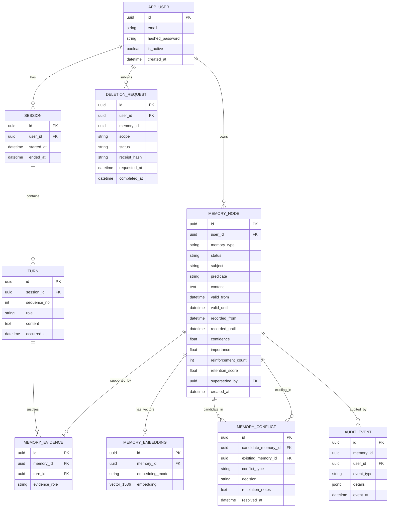

# ChronaMind: Master Integration Blueprint
## Personal Digital Twin Agent with Temporally-Aware, Governed Long-Term Memory
### Enhanced with Native LangGraph Primitives, Bi-Temporal Algebra, and Model Context Protocol (MCP)

**Academic Year:** 2026 / 2027
**Project Lead & AI / Orchestration Lead:** Abdulrahman Aymen
**Memory Algorithms Lead:** Abdulrahman Mohamed
**Backend Architecture Lead:** Mohamed Tamer
**Governance, QA & Frontend Lead:** Mazen Ehab
**Temporal State Specialist:** Moaz Loaie
**Infrastructure Specialist:** Ahmed Loaie
**Retrieval & Security Lead:** Abdelrahman Nashaat

---

## 1. Executive Summary & Vision

Conversational AI agents powered by Large Language Models (LLMs) suffer from a fundamental architectural limitation: they are stateless across interaction boundaries. Conventional workarounds rely on naive Retrieval-Augmented Generation (RAG) over flat vector stores or context replaying. Both approaches fail when human knowledge changes over time:
- **Temporal Confusion:** Historical preferences conflict with current states (e.g., *"I am vegan"* in March vs. *"I started eating fish"* in August).
- **Ungoverned Writes:** Hallucinations, jokes, hedged statements, or adversarial injections become immutable "facts" without validation.
- **Unreliable Erasure:** Deleting a chat message leaves vector embeddings, summaries, and persona inferences untouched, violating data protection mandates (GDPR Art. 17).
- **Zero Transparency:** Users cannot inspect, verify, or correct what an assistant remembers about them.

This blueprint establishes the enhanced integration between our **production-grade FastAPI + LangGraph repository foundation** and the **ChronaMind theoretical & algorithmic proposal**. By integrating the latest **LangGraph primitives** (Dual-layer persistence with `AsyncPostgresSaver` and `AsyncPostgresStore`, Human-in-the-Loop via `interrupt()` & `Command`, Time-Travel state auditing, and Model Context Protocol adapters) with state-of-the-art memory engineering (4-layer taxonomy, bi-temporal versioning, contradiction gates, verifiable right-to-forget, and hybrid retrieval), we create an open-source, academically rigorous, and production-viable **Personal Digital Twin Agent**.

---

## 2. Symbiotic Synthesis: Merging Repository Strengths with Proposal Innovations

| Dimension | Existing Repository Strengths | ChronaMind Proposal Innovations | Enhanced LangGraph Strategy (State of the Art) |
| :--- | :--- | :--- | :--- |
| **Agent Orchestration** | LangGraph `StateGraph`, `AsyncPostgresSaver` checkpointer, sub-graph composition, `RunnableConfig` context passing. | Dual-path separation: Fast-path (real-time answering) and Slow-path (asynchronous background consolidation). | **LangGraph Fast-Path Graph** (`QueryAnalyzer` $\to$ `HybridRetrieval` $\to$ `BoundedContext` $\to$ `StreamingLLM`) executing in $\le 300\text{ms}$. Non-blocking background worker dispatch via Redis queue for the slow path. |
| **Memory Architecture** | Single-table `mem0` wrapper over `pgvector` (`app/services/memory.py`). | 4-layer memory taxonomy (Episodic, Semantic, Opinion/State, Persona) with lifecycle state transitions. | **Dual-Engine Memory Hierarchy**: Preserve `mem0` as **Baseline B3**. Introduce **LangGraph `AsyncPostgresStore`** with namespaces `(user_id, layer)` for fast cached memory views, backed transactionally by our bi-temporal PostgreSQL relational schema (**P**). |
| **Temporal Handling** | None (pure semantic similarity). | Bi-temporal intervals: Valid Time $[valid\_from, valid\_until)$ and Recorded Time $[recorded\_from, recorded\_until)$ with supersession pointers. | **`TemporalStateManager` + Time-Travel Auditing**: Relational GiST exclusion constraints prevent overlapping valid intervals. LangGraph `get_state_history()` paired with recorded-time timestamps enables true historical state replaying. |
| **Safety & Governance** | Basic prompt guardrails. | Contradiction-Validation Gate; confidence, provenance, and explicitness thresholds; `Conflict-Pending` quarantine. | **Native LangGraph Human-in-the-Loop (HITL)**: When contradictions or ambiguous updates occur, the graph triggers `interrupt({"type": "conflict", ...})`, freezing graph state. Resumed cleanly via `Command(resume=resolution)` from the review queue. |
| **Ranking & Retrieval** | Pure cosine vector distance. | Multi-signal Hybrid Retrieval: dense pgvector + lexical GIN full-text + dynamic retention score + temporal validity gate. | **`HybridRetriever`**: pgvector HNSW cosine distance + PostgreSQL tsvector GIN full-text rank + offline retention decay + temporal validity mask. Evaluated against Reciprocal Rank Fusion (RRF). |
| **Observability & Tracing** | Langfuse Cloud integration, Prometheus metrics, structured `structlog` with correlation IDs. | Traceable provenance links linking every memory node to turn IDs, score components, and audit events. | **Full-Lifecycle Tracing**: Langfuse spans record every retrieval score component, validation gate decision, and background extraction job. Prometheus gauges monitor P50/P95 latency budgets and worker queue depths. |
| **LLM Resilience** | `LLMRegistry` with circular model fallback, `tenacity` retries, timeout budgets, Atlas Cloud / OpenAI multi-model support. | Provider-agnostic adapter; frozen model configuration for reproducible evaluation. | **Deterministic Research vs. Resilient Production**: Run frozen open-weights/OpenAI models during research benchmarks; leverage circular fallback during live Digital Twin deployment. |
| **Data Privacy & Erasure** | Single-record delete in Mem0. | Verifiable 3-level Right-to-Forget (direct SQL, lexical/vector scan, derived memory scan) with non-content audit receipts. | **Atomic Purge Transactions**: Cascading erasure across relational nodes, LangGraph Store keys, embeddings, summaries, and persona links with cryptographic audit logging. |
| **Extensibility (MCP)** | Basic custom tools list. | Memory inspector API and external tool bridges. | **Dual-Role Model Context Protocol (MCP)**: Expose ChronaMind as an MCP Server (`/mcp` Streamable HTTP) for external IDEs/agents; equip agent with `MCPAdapter` to consume external tools. |

---

## 3. End-to-End System Architecture

```mermaid
flowchart TD
    subgraph ClientLayer ["1. Presentation & Client Layer"]
        UI["Personal Digital Twin Web App (React)"]
        Inspector["Memory Inspector & Timeline Visualizer"]
        ReviewQueue["Conflict Review Queue & Forget Controls"]
        ExternalAgent["External IDE / AI Agent (Cursor, Claude Code, Codex)"]
    end

    subgraph APILayer ["2. Gateway & API Layer (FastAPI)"]
        Auth["JWT Auth & Session Manager"]
        RateLimit["Rate Limiter (slowapi)"]
        TraceMW["Correlation & Langfuse Middleware"]
        Router["API Router (/api/v1/chatbot, /api/v1/memory)"]
        MCPEndpoint["MCP Server Endpoint (/mcp Streamable HTTP)"]
    end

    subgraph FastPath ["3. Fast Path (Synchronous, Sub-300ms Budget)"]
        TurnIngest["Turn Ingestion & Persistence"]
        QueryAnalyzer["Query Analyzer Node (Temporal Intent Detector)"]
        HybridRetriever["Hybrid Retriever (Dense + Lexical + Retention + Temporal)"]
        ContextBuilder["Bounded Context Builder Node (Token Budgeted)"]
        LangGraphAgent["LangGraph Agent (StateGraph + AsyncPostgresSaver)"]
        HITLNode["HITL Node: interrupt() on Contradictions"]
        LLMAdapter["LLM Service (Circular Fallback + astream_events v2)"]
    end

    subgraph SlowPath ["4. Slow Path (Asynchronous Background Workers via Redis)"]
        WorkerQueue["Redis Worker Queue (ARQ / Celery)"]
        Extractor["Candidate Memory Extractor (Structured Pydantic)"]
        ValidationGate["Contradiction-Validation Gate"]
        TemporalManager["Temporal State Manager (Bi-Temporal Versioning)"]
        Consolidator["Consolidation & Persona Promotion Engine"]
        RetentionWorker["Retention Decay & Compression Worker"]
    end

    subgraph StorageLayer ["5. Storage Layer (PostgreSQL 16 + pgvector + Redis)"]
        PG_Saver["LangGraph Checkpointer: AsyncPostgresSaver (Checkpoints & Threads)"]
        PG_Store["LangGraph Store: AsyncPostgresStore (Cached Memory Views)"]
        PG_Relational["Relational: Users, Sessions, Turns, Audit Events"]
        PG_Memory["Memory: Memory Nodes, Evidence Links, Conflicts"]
        PG_Vector["Vector: pgvector HNSW Embeddings (1536-dim)"]
        PG_Lexical["Lexical: PostgreSQL GIN tsvector Indexes"]
        Redis_State["Redis: Worker State, Idempotency Keys, Cache Fallback"]
    end

    UI --> Auth --> RateLimit --> TraceMW --> Router
    Inspector --> Router
    ReviewQueue --> Router
    ExternalAgent <--> MCPEndpoint --> Router

    Router --> TurnIngest --> LangGraphAgent
    LangGraphAgent --> QueryAnalyzer --> HybridRetriever
    HybridRetriever --> ContextBuilder --> LLMAdapter --> UI

    LangGraphAgent -.->|On Ambiguity / Conflict| HITLNode
    ReviewQueue -.->|Command(resume=...)| HITLNode

    TurnIngest -.->|Async Dispatch| WorkerQueue
    WorkerQueue --> Extractor --> ValidationGate
    ValidationGate -->|Valid & Non-Conflicting| TemporalManager
    ValidationGate -->|Conflicting / Low Conf| PG_Memory
    TemporalManager --> Consolidator --> PG_Memory
    RetentionWorker --> PG_Memory

    HybridRetriever <--> PG_Vector
    HybridRetriever <--> PG_Lexical
    HybridRetriever <--> PG_Memory
    LangGraphAgent <--> PG_Saver
    LangGraphAgent <--> PG_Store
```

---

## 4. Formal Mathematical & Algorithmic Formulations

### 4.1 Bi-Temporal Interval Algebra
Every memory version $m$ carries two orthogonal temporal intervals:
1. **Valid Time ($T_v$):** $[valid\_from, valid\_until) \in \mathbb{R}^+ \cup \{\infty\}$, representing when the fact was objectively true in the real world.
2. **Recorded Time ($T_r$):** $[recorded\_from, recorded\_until) \in \mathbb{R}^+ \cup \{\infty\}$, representing when the system stored and believed the proposition.

**Invariants:**
- $valid\_from < valid\_until$ whenever $valid\_until$ is defined.
- $recorded\_from < recorded\_until$ whenever $recorded\_until$ is defined.
- **Single-Valued Predicate Exclusivity:** For a single-valued predicate $P$ on subject $S$ for user $U$:
  $$\forall m_1, m_2 \in \mathcal{M}_{\text{active}}(U, S, P) \implies T_v(m_1) \cap T_v(m_2) = \emptyset$$
  *(Enforced in PostgreSQL via GiST exclusion constraint).*
- **Supersession Rule:** When a new explicit update $m_{\text{new}}$ replaces an active memory $m_{\text{old}}$:
  $$valid\_until(m_{\text{old}}) \leftarrow valid\_from(m_{\text{new}})$$
  $$recorded\_until(m_{\text{old}}) \leftarrow \text{now}()$$
  $$superseded\_by(m_{\text{old}}) \leftarrow id(m_{\text{new}})$$

### 4.2 Dynamic Retention Scoring
Offline workers calculate memory retention $S_{\text{ret}}(m)$ to govern archival, compression, and promotion:
$$S_{\text{ret}}(m) = w_i \cdot I(m) + w_c \cdot C(m) + w_f \cdot \log(1 + R(m)) - \lambda_{\text{type}} \cdot \Delta t$$

Where:
- $I(m) \in [0, 1]$: Intrinsic importance score assigned at extraction.
- $C(m) \in [0, 1]$: Extraction confidence score.
- $R(m) \in \mathbb{N}_0$: Number of reinforcements (cross-session corroborations or re-mentions).
- $\Delta t$: Elapsed time since last reinforcement ($t_{\text{current}} - t_{\text{last\_reinforced}}$).
- $\lambda_{\text{type}}$: Layer-specific exponential decay coefficient:
  $$\lambda_{\text{episodic}} > \lambda_{\text{opinion}} > \lambda_{\text{semantic}} > \lambda_{\text{persona}}$$
- Weights ($w_i, w_c, w_f$) are normalized ($w_i + w_c + w_f = 1$).

### 4.3 Multi-Signal Hybrid Retrieval & Fusion
For a query $q$ issued at time $t_q$ with target temporal scope $T_{\text{target}}$:
$$S_{\text{retrieval}}(m, q) = \alpha \cdot \text{dense}(m, q) + \beta \cdot \text{lexical}(m, q) + \gamma \cdot S_{\text{ret}}(m) + \delta \cdot I_{\text{valid}}(m, T_{\text{target}})$$

Where:
- $\text{dense}(m, q) = \frac{\mathbf{e}_m \cdot \mathbf{e}_q}{\|\mathbf{e}_m\| \|\mathbf{e}_q\|}$ (Cosine similarity of embeddings via pgvector HNSW).
- $\text{lexical}(m, q) = \text{ts\_rank\_cd}(\text{tsvector}(m), \text{query\_tokens}(q))$ (Normalized BM25-style full-text rank via PostgreSQL GIN).
- $S_{\text{ret}}(m)$: Precomputed retention score.
- $I_{\text{valid}}(m, T_{\text{target}}) = \begin{cases} 1 & \text{if } T_v(m) \cap T_{\text{target}} \neq \emptyset \\ 0 & \text{otherwise} \end{cases}$
- Hyperparameters $\alpha, \beta, \gamma, \delta$ are tuned strictly on the development split and frozen before evaluation.

**Reciprocal Rank Fusion (RRF) Formulation:**
$$RRF(m, q) = \sum_{c \in \{\text{dense}, \text{lexical}\}} \frac{1}{k + \text{rank}_c(m)} + \gamma \cdot S_{\text{ret}}(m) \cdot I_{\text{valid}}(m, T_{\text{target}})$$

### 4.4 Contradiction-Validation Gate & Native LangGraph HITL
Given candidate extraction $c = (S, P, O, \text{conf}, T_v)$:
1. Search active memories: $\mathcal{M}_{\text{match}} = \{m \in \mathcal{M} \mid \text{user}(m) = \text{user}(c) \land \text{subject}(m) = S \land \text{predicate}(m) = P \land \text{status}(m) = \text{'active'}\}$.
2. **Case A (No Prior Memory):**
   - If $\text{conf}(c) \ge \theta_{\text{accept}}$, set $\text{status} \leftarrow \text{'active'}$.
   - Else, set $\text{status} \leftarrow \text{'candidate'}$.
3. **Case B (Exact Agreement):**
   - If $\text{object}(m) == O$, increment reinforcement $R(m) \leftarrow R(m) + 1$, update $t_{\text{last\_reinforced}} \leftarrow \text{now}()$.
4. **Case C (Contradiction Detected $\text{object}(m) \neq O$):**
   - If $c$ is marked **explicitly updated** by user: supersede $m$, activate $c$.
   - If $c$ is **ambiguous, conflicting, or hedged**:
     - Quarantine $c$ as $\text{status} \leftarrow \text{'conflict\_pending'}$.
     - Persist `MemoryConflict` record.
     - **LangGraph HITL Activation:** Call `interrupt({"type": "conflict", "conflict_id": conflict.id, "message": "Conflict detected on " + P})` to prompt user clarification.
     - Graph resumes upon receiving `Command(resume={"action": "supersede" | "keep_old" | "clarify"})`.

---

## 5. Comprehensive Relational Data Model & PostgreSQL Invariants



### PostgreSQL 16 Invariants & Physical Schema Rules
1. **Temporal Non-Overlap GiST Constraint:**
   ```sql
   ALTER TABLE memory_node ADD CONSTRAINT exclude_overlapping_valid_intervals
   EXCLUDE USING gist (
       user_id WITH =,
       subject WITH =,
       predicate WITH =,
       tsrange(valid_from, valid_until) WITH &&
   ) WHERE (status = 'active');
   ```
2. **Provenanced Integrity:** Every persistent memory node must have at least one foreign key link in `memory_evidence` pointing to an immutable turn ID.
3. **Quarantine Isolation:** Fast-path retrieval queries strictly filter `WHERE status = 'active'`, making candidate or conflict leaks impossible.
4. **Non-Content Audit Trail:** When a `DELETION_REQUEST` executes, the target memory node content, embeddings, and derived links are hard-deleted (`DELETE`), while `audit_event` retains only cryptographic identifiers, timestamps, and hash receipts.

---

## 6. Detailed File-by-File Repository Integration Architecture

```text
app/
├── api/v1/
│   ├── api.py                      # Aggregates auth, chatbot, memory endpoints
│   ├── auth.py                     # JWT token generation, password hashing, session context
│   ├── chatbot.py                  # Fast-path chat endpoint (SSE streaming, turn recording)
│   ├── memory.py                   # NEW: Memory Inspector, Timeline, Conflict Review & Erasure APIs
│   └── mcp.py                      # NEW: FastMCP Streamable HTTP endpoint (/mcp) for external IDEs
├── core/
│   ├── config.py                   # Extended Settings (Temporal thresholds, decay weights, queue names)
│   ├── database.py                 # Async PostgreSQL engine with pgvector extension check
│   ├── cache.py                    # Valkey/Redis cache + in-memory fallback
│   ├── logging.py                  # Structlog with correlation IDs & lowercase_underscore events
│   ├── observability.py            # Langfuse tracing, client lifecycle, graceful flush
│   ├── limiter.py                  # Slowapi rate limiters on all route handlers
│   └── langgraph/
│       ├── graph.py                # StateGraph compiling the fast-path agent + checkpointer + store
│       ├── state.py                # GraphState with user_id, session_id, retrieved_memories, pending_question
│       ├── hitl.py                 # NEW: Human-in-the-loop interrupt and Command resume handlers
│       └── tools/                  # Agent tools (calculator, search, inspector bridge, MCPAdapter)
├── memory/                         # NEW: ChronaMind Core Engine
│   ├── taxonomy.py                 # MemoryType enum (Episodic, Semantic, Opinion, Persona)
│   ├── temporal.py                 # TemporalStateManager, valid/recorded time algebra
│   ├── validation.py               # Contradiction-Validation Gate & conflict resolver
│   ├── retention.py                # Decay curve calculations, reinforcement counters
│   ├── retrieval.py                # HybridRetriever (Dense pgvector + Lexical GIN + Temporal mask)
│   ├── fusion.py                   # Reciprocal Rank Fusion & weighted score combiner
│   └── erasure.py                  # Verifiable 3-level Right-to-Forget cascade
├── models/
│   ├── user.py                     # AppUser model
│   ├── session.py                  # Session and Turn SQLModels
│   ├── memory.py                   # NEW: MemoryNode, MemoryEvidence, MemoryEmbedding
│   ├── conflict.py                 # NEW: MemoryConflict SQLModel
│   └── audit.py                    # NEW: AuditEvent, DeletionRequest SQLModels
├── schemas/
│   ├── auth.py                     # Token & User schemas
│   ├── chat.py                     # ChatRequest, ChatResponse, StreamChunk
│   ├── memory.py                   # NEW: MemoryInspectorResponse, TimelineView, ConflictResolutionDTO
│   └── graph.py                    # GraphState Pydantic schemas
├── services/
│   ├── database.py                 # DatabaseService connection pool
│   ├── memory.py                   # PRESERVED: mem0 wrapper acting as Baseline B3
│   ├── memory_service.py           # NEW: Unified ChronaMind facade coordinating Store & relational DB
│   └── llm/
│       ├── registry.py             # Circular LLM fallback catalog
│       └── service.py              # LLMService with tenacity retries and budget timeouts
└── workers/                        # NEW: Asynchronous Slow-Path Engine
    ├── queue.py                    # Redis ARQ / Celery connection & worker pool
    ├── tasks.py                    # extract_turn_memories, decay_retention_scores
    ├── extractor.py                # Structured LLM extraction with JSON Schema validation
    └── consolidator.py             # Episodic-to-Semantic & Persona promotion logic
```

---

## 7. Advanced LangGraph Technical Strategies

### 7.1 Dual-Engine Memory Hierarchy (`AsyncPostgresSaver` + `AsyncPostgresStore`)
LangGraph distinguishes between **Within-Thread Conversational State** and **Cross-Thread Persistent Memory**:
- **Within-Thread (Checkpointer):** `AsyncPostgresSaver` stores the complete state graph execution history across turns in a conversation thread.
- **Cross-Thread (Store):** `AsyncPostgresStore` stores long-term memory across sessions using hierarchical namespaces:
  ```python
  # Namespace pattern: (user_id, memory_layer)
  await store.aput(
      namespace=(user_id, "opinion"),
      key=memory_node.id,
      value={
          "subject": memory_node.subject,
          "predicate": memory_node.predicate,
          "content": memory_node.content,
          "valid_from": memory_node.valid_from.isoformat(),
          "valid_until": memory_node.valid_until.isoformat() if memory_node.valid_until else None,
          "retention_score": memory_node.retention_score,
      }
  )
  ```
- **Relational Integrity:** The relational PostgreSQL tables remain the authoritative source of truth, guaranteeing ACID transactions, foreign keys, and GiST exclusion constraints. The LangGraph Store serves as the fast indexed cache for multi-agent retrieval.

### 7.2 Native Human-In-The-Loop (HITL) via `interrupt()` & `Command`
Rather than building ad-hoc polling for contradiction resolution, ChronaMind uses native LangGraph interrupts:
1. In the `ContradictionNode` / `validation_gate`:
   ```python
   if conflict_detected:
       # Pause the graph execution; state is saved to AsyncPostgresSaver
       user_decision = interrupt({
           "type": "memory_conflict",
           "conflict_id": str(conflict.id),
           "subject": candidate.subject,
           "predicate": candidate.predicate,
           "old_value": existing.content,
           "new_value": candidate.content,
           "question": f"Did you mean you stopped {existing.predicate} or is this a temporary change?"
       })
   ```
2. When the user resolves the conflict via the Review Queue UI or chat response:
   ```python
   # Resumes graph execution at the exact checkpoint
   await graph.ainvoke(
       Command(resume={"action": "supersede", "notes": "Confirmed by user"}),
       config={"configurable": {"thread_id": thread_id}}
   )
   ```

### 7.3 Real-Time Streaming with `astream_events(version="v2")`
FastAPI streams tokens to the UI via Server-Sent Events (SSE). By upgrading to LangGraph's `astream_events(version="v2")`:
- Real-time token generation streams via `on_chat_model_stream`.
- Retrieval metadata and temporal validity tags stream via `on_custom_event` (`chronamind_retrieval_metadata`), allowing the frontend to render memory badges and temporal timeline highlights *as the model speaks*.

### 7.4 First-Class Model Context Protocol (MCP) Integration
ChronaMind functions in two MCP modes:
1. **ChronaMind as an MCP Server (`/mcp` on FastAPI via FastMCP Streamable HTTP):**
   - Exposes tools to external coding agents (Cursor, Claude Code, Codex, Antigravity IDE):
     - `chronamind_get_user_timeline`: Fetch bi-temporal memory timeline.
     - `chronamind_inspect_memories`: Filter memories by layer and status.
     - `chronamind_resolve_conflict`: Resolve pending conflicts programmatically.
     - `chronamind_verifiable_delete`: Trigger right-to-forget with cryptographic receipt.
2. **ChronaMind Agent as an MCP Client (`MCPAdapter`):**
   - Connects to external MCP servers (calculators, knowledge bases, web search) dynamically without hardcoding client tools.

---

## 8. Rigorous Evaluation Framework & Benchmarking Plan

### 8.1 Systems Compared
- **B0 (No Memory):** Current session context only; no persistence.
- **B1 (Full Context):** Entire conversation history concatenated into LLM context window (truncated at token ceiling).
- **B2 (Vanilla RAG):** Dense similarity retrieval over raw past turns; no time filtering, no validation.
- **B3 (Open-Source Baseline - Mem0):** The existing implementation in `app/services/memory.py`.
- **P (Proposed ChronaMind):** 4-layer bi-temporal governed memory engine with hybrid retrieval.

### 8.2 Datasets & Benchmark Suites
1. **Public Benchmarks:**
   - **LoCoMo** (Evaluating Very Long-Term Conversational Memory).
   - **LongMemEval** (Multi-session interactive reasoning and temporal recall).
2. **Custom Target Suites:**
   - **Temporal Change Suite:** Scripted dialogues with shifting facts and paired Current vs. Historical probes.
   - **Contradiction Suite:** Ambiguous, unconfirmed, and conflicting claims testing the validation gate.
   - **Deletion Suite:** Direct and indirect probes post-erasure across SQL, vector, and derived channels.
   - **Adversarial / PoisonedRAG Suite:** Injected malicious "facts", prompt overrides, and cross-user leaks.

### 8.3 Ablation Studies (Measuring Component Contributions)
We systematically ablate one component at a time from **P**:
- **(a) No Temporal Validity Signal:** Set $\delta = 0$ in retrieval scoring.
- **(b) No Retention Score:** Set $\gamma = 0$ in retrieval scoring.
- **(c) No Lexical Retrieval:** Set $\beta = 0$ (dense pgvector only).
- **(d) No Dense Retrieval:** Set $\alpha = 0$ (lexical BM25 only).
- **(e) No Validation Gate:** Auto-activate all extracted candidates without conflict checks.
- **(f) No Multi-Layer Consolidation:** Treat all memories as flat episodic records.
- **(g) Overwrite Model:** Replace bi-temporal versioning with direct SQL overwrites.

### 8.4 Statistical Rigor & Metrics
- Paired bootstrap test and Wilcoxon signed-rank test across benchmark queries ($p < 0.05$).
- 95% bootstrap confidence intervals across random seeds.
- **Pareto Frontier Analysis:** Plot Answer Quality (F1 / LLM-as-a-judge score) against P95 Latency (ms) and Token Cost ($).

---

## 9. 24-Week Master Implementation Roadmap (Milestones M1–M8)

```text
Research Phase (Weeks 1–14)                                   Application Phase (Weeks 15–24)
M1: DB Foundation & Data Contract (W1-2)    --> Gate 1        M8.1: UI Scaffolding & Auth (W15-16)
M2: Core Fast-Path Infrastructure (W3-4)   --> Gate 2        M8.2: Memory Inspector & Timeline (W17-19)
M3: Retention & Async Workers (W5-6)       --> Gate 3        M8.3: Explainability & Persona (W18-20)
M4: Contradiction Gate & Persona (W7-8)    --> Gate 4        M8.4: Hardening & Security (W19-21)
M5: Right-to-Forget & Baseline Freeze (W9-10)-> Gate 5       M8.5: Human User Study (W21-22)
M6: Benchmarking & Ablation Suite (W11-13)                    M8.6: Final Thesis & Defense (W23-24) -> Gate 7
M7: Research Defense & Thesis Draft (W14)   --> Gate 6
```

### Milestone Breakdown & Team Ownership
- **Milestone 1 (Weeks 1–2 | Gate 1):**
  - Schema migrations, bi-temporal SQL GiST constraints, index optimization, Docker environment, frozen dataset splits.
  - *Lead:* Mohamed Tamer & Moaz Loaie | *Sign-off:* Ahmed Loaie & Abdulrahman Mohamed.
- **Milestone 2 (Weeks 3–4 | Gate 2):**
  - Fast-path hybrid retrieval, LangGraph query intent node, bounded context assembly, latency metrics, `astream_events(v2)`.
  - *Lead:* Abdulrahman Aymen & Abdelrahman Nashaat | *Sign-off:* Mohamed Tamer & Mazen Ehab.
- **Milestone 3 (Weeks 5–6 | Gate 3):**
  - Redis worker pipeline, idempotency keys, retention decay math, temporal supersession engine, LangGraph Store cache.
  - *Lead:* Ahmed Loaie & Abdulrahman Mohamed | *Sign-off:* Moaz Loaie & Mohamed Tamer.
- **Milestone 4 (Weeks 7–8 | Gate 4):**
  - Contradiction-validation gate, LangGraph `interrupt()` & `Command(resume=...)` HITL, semantic consolidation, persona promotion.
  - *Lead:* Moaz Loaie & Mazen Ehab | *Sign-off:* Abdulrahman Aymen & Abdelrahman Nashaat.
- **Milestone 5 (Weeks 9–10 | Gate 5):**
  - 3-level right-to-forget cascade, audit trail, baseline B0–B3 encapsulation, research freeze tag (`v1.0-research-freeze`).
  - *Lead:* Mazen Ehab & Mohamed Tamer | *Sign-off:* Abdelrahman Nashaat & Ahmed Loaie.
- **Milestone 6 (Weeks 11–13):**
  - Empirical execution of LoCoMo, LongMemEval, ablations (a)–(g), Pareto latency/cost analysis, statistics.
  - *All Team Members coordinated by Abdulrahman Aymen.*
- **Milestone 7 (Week 14 | Gate 6):**
  - Research report, statistical verification, academic thesis draft, research defense.
  - *Supervisor sign-off.*
- **Milestone 8 (Weeks 15–24 | Gate 7):**
  - React Personal Digital Twin application, interactive Memory Inspector, FastMCP server endpoint, user study (15–20 participants), final thesis & demo video.
  - *Lead:* Mazen Ehab & All Team Members.

---

## 10. Key Decisions for Immediate Team Discussion

1. **Worker Engine Choice:**
   - **ARQ (Async Redis Queue)** *(Recommended)*: Native `asyncio`, zero boilerplate, shares our existing Redis instance in [app/core/cache.py](file:///D:/Engeenering%20Faculty/grad_project/ChronaMind/app/core/cache.py).
   - **Celery**: Industry standard, but heavier thread/multiprocessing footprint.
2. **Fixed Embedding Model for Evaluation:**
   - Pinned OpenAI `text-embedding-3-small` (1536-dim) or local `bge-large-en-v1.5` across all baselines and proposed systems for fair comparison.
3. **Database Migration Strategy:**
   - Preserve existing `users` and `sessions` tables; introduce `memory_node`, `memory_evidence`, `memory_embedding`, `memory_conflict`, `audit_event`, and `deletion_request` in a clean, reversible Alembic migration script.
4. **LangGraph MCP Server Endpoint:**
   - Expose the memory engine as an MCP tool server (`ChronaMind-Memory-MCP`) via FastMCP on `/mcp` to allow external agents and IDEs to query memory timelines and trigger verifiable deletions.
