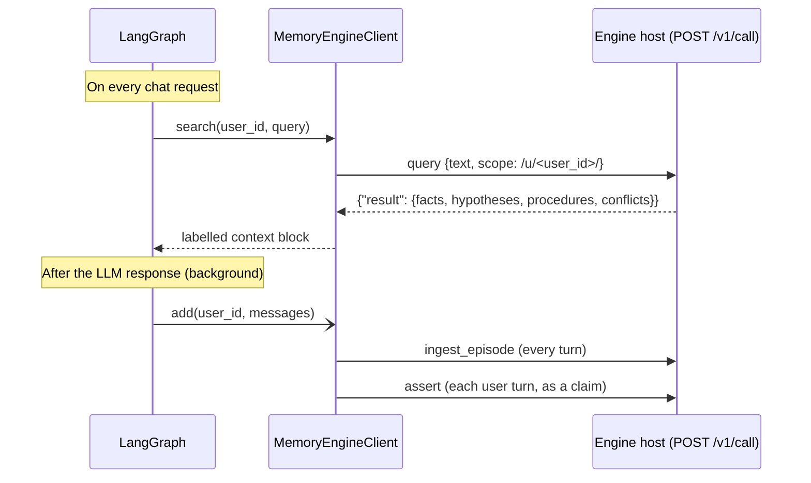

# Memory

## Overview

Long-term memory is the ChronaMind memory engine (`custom-memory-engine/`), reached over HTTP by
`app/services/memory_engine.py` (`MemoryEngineClient`). The engine and the app run on different interpreters on purpose,
so the boundary is a wire contract, not an import. The legacy `mem0ai` client (`app/services/memory.py`) is not on the
agent's path.

If `MEMORY_ENGINE_URL` is empty the agent has **no** long-term memory. There is no fallback to mem0.

## How it works



Every call is `POST {MEMORY_ENGINE_URL}/v1/call` with `Authorization: Bearer {MEMORY_ENGINE_TOKEN}` and the body
`{"operation": ..., "principal": "<user_id>", "arguments": {...}}`. The answer is `{"result": {...}}`, or
`{"error": {"code": ..., "detail": ...}}` with a 4xx/5xx status. Failures are logged and the agent continues without
memory.

## What the agent sees

`search()` renders the engine's channels with their labels, so the model can tell what it may rely on:

| Section | Contents |
| --- | --- |
| `Known facts` | claims the user stated (current beliefs; a superseded claim is not returned) |
| `Hypotheses (inferred, not confirmed)` | inferred artifacts |
| `Procedures that applied` | procedures |
| `Open contradictions (unresolved)` | contested beliefs, shown as unresolved |
| `Earlier conversation (verbatim; may be outdated; not confirmed facts)` | recorded turns (user or assistant), minus any text already rendered above |

## Single-valued facts

A user message that states the speaker's *current* value of a single-valued attribute is written with
`cardinality: "single"` and a `semantic_slot`, so the engine supersedes the previous value: "I live in Berlin" then
"I moved to Paris" (or "أنا ساكن في برلين" then "انتقلت إلى باريس") leaves one known fact. The slots are `residence`,
`employer` and `name` (`V2-D121`).

The classifier (`app/services/memory_slots.py`) is semantic and language-independent: a language model reads the
message in whatever language or mix of languages it is written and reports the slot, whether the statement is the
speaker's current value (not a past fact, a plan, a hypothetical, a denial or a question), and the value as written.
The app then accepts it only if the value occurs verbatim in the message (after Unicode normalization) and the other
checks pass. There is no keyword or grammar rule for any language. Only the newest user message of each `add()` is
classified (one model call per turn). Any model failure, and `MEMORY_SLOT_CLASSIFIER=off`, gives
`cardinality: "multi"` with no slot: the claim is recorded and supersedes nothing.

| Setting | Default | Meaning |
|---|---|---|
| `MEMORY_SLOT_CLASSIFIER` | `llm` | `llm`: the semantic classifier; `off`: every claim is multi-valued |
| `MEMORY_SLOT_CLASSIFIER_MODEL` | *(default model)* | the model the classifier asks; one the app's LLM registry does not serve turns the classifier off with a start-up warning |

## No cache

Memory search results are **not** cached. A rendered context is plaintext memory content, and a client-side copy would
outlive a deletion or a supersession in the engine; every `search()` asks the engine.

## Configuration

| Variable | Description |
| --- | --- |
| `MEMORY_ENGINE_URL` | Base URL of the engine host, e.g. `http://127.0.0.1:8100`. Empty disables long-term memory |
| `MEMORY_ENGINE_TOKEN` | The agent's service token on the engine host (Tier B) |
| `MEMORY_ENGINE_USER_TOKEN` | The memory inspector's service token (Tier C), used only by `/api/v1/memory/*`. Empty disables those routes (503); the agent's memory is unaffected |
| `RATE_LIMIT_MEMORY` | Rate limit of the inspector routes, default `60 per minute` |

Both tokens must be configured on the engine host as **delegating** service tokens, so that one token can act for every
end user (each end user is the engine principal, with their own `/u/<user_id>/` namespace, provisioned on first call):

```bash
CME_HOST_TOKENS='{"<MEMORY_ENGINE_TOKEN>":      {"principal": "chronamind-app",       "tier": "B", "delegate": true},
                 "<MEMORY_ENGINE_USER_TOKEN>": {"principal": "chronamind-inspector", "tier": "C", "delegate": true}}'
```

The tier comes from the token; the app never sends one. Two tokens, because the agent must never be able to erase or
export: Tier B is refused `delete`, `adjudicate`, `export` and `audit_as_of`, which are exactly the operations a user's
own "show me / forget me" actions need. Whoever holds the Tier C token can erase and export for every end user
(`THREAT_MODEL.md` `T-42`), so it is a service secret like the database password. See `custom-memory-engine/scripts/run_host.py` for the host's
own variables (`CME_DATABASE_URL`, `CME_RUNTIME_ROLE`, `CME_SCHEMA`, `CME_PROVENANCE_KEY`, `CME_DELETION_RECEIPT_KEY`).

## The memory inspector API (`/api/v1/memory`)

`app/api/v1/memory.py` lets a signed-in user see and manage their own long-term memory. It is the backend of the demo
interface (`tickets/EPIC-demo-interface.md`). Every route takes the **user** token (from `/auth/register` or
`/auth/login`, not the session token) and acts as that user only: the engine principal is `str(user.id)`, the same id the
agent writes under, and no request field can name another user or a tier.

| Route | Engine call | Answer |
| --- | --- | --- |
| `GET /health` (no token) | host `GET /healthz` | `{"engine": "up" \| "down" \| "not_configured"}` |
| `GET /?limit=200` | `query`, mode `current_state`, no text | `MemoryView` |
| `POST /search` `{text}` (2–300 chars) | `query`, mode `current_state`, with text | `MemoryView` (top 20) |
| `GET /timeline?at=<ISO-8601 with offset>` | `query`, mode `audit_as_of`, `target_time = belief_time = at` | `TimelineView` |
| `GET /changes?start=&end=` | `query`, mode `change` | `ChangesView` |
| `GET /{id}` | `get` | `MemoryItemResponse` |
| `GET /{id}/provenance?depth=1` (1–8) | `provenance` | `ProvenanceOut` |
| `POST /{id}/adjudicate` `{decision: "confirm" \| "deny", note?}` | `adjudicate` | `AdjudicateResult` |
| `POST /forget` `{confirm: "DELETE"}` | `delete` scope `all`, then every chat session of the user is cleared, then three after-checks | `ForgetResult` |

The models are in `app/schemas/memory.py`; `docs/api/openapi.json` is generated from them (`scripts/export_openapi.py`)
and is what the web interface builds its types from.

**What the views mean.**

- `MemoryView` splits the engine's `facts` channel. A recorded turn (`kind: episode`, the verbatim words of either
  speaker, never superseded) goes to `conversation`, and only the rest is `known_facts`. After "I live in Berlin" and
  "I moved to Paris", `known_facts` holds Paris alone, while both sentences stay in `conversation`.
- An item carries `id`, `kind`, `lifecycle`, `channel`, `content`, `verification`, `label`, `support_summary`, `bound`
  (always present on a bounded abstraction, `I14`), `conflict_sides` and `sources`.
- An item has **no timestamps**, because the engine's `Artifact` has none. Ask `/timeline` for time.
- A source is a reference, never text: `{readable, source_type, derivation_type, ref}`. An opaque source (`readable:
  false`) carries only its per-caller handle. A reference's scope path is never forwarded.
- `/timeline` and `/changes` take no question: the engine refuses text in `audit_as_of` and `change` (`V2-D86`). For
  the Berlin → Paris move, `change` reports `changed` for the residence and `added` for the new turn.

**Forget.** `POST /forget` erases first and clears second. If the erasure fails, no chat session is touched. After the
erasure, every chat session of the user is cleared and its history epoch advanced, because the agent re-reads a
session's whole transcript every turn and would otherwise keep answering from it. The response then reports:

- the engine's receipt as counts only;
- the number of chat sessions cleared, and the number that could not be cleared;
- four observed checks: every chat history was cleared, the list is empty, the export counts 0 items, and an id listed
  before the erasure now answers `forbidden`.

A check that could not run is `null`, never `true`. If any transcript could not be cleared, `failed_chat_sessions` is
above 0 and `chat_history_cleared` is false. The forget is then **incomplete**, because the agent still reads that
transcript, and the caller must say so. `POST /forget` is idempotent: calling it again finds nothing left to erase and
retries the clearing. Deleting a single memory is not offered: `delete` scope `memory`
takes a `memory_key` that no API response exposes.

**Held claims.** A claim the gate holds (for example `assertion_mode: hedged`) is `contested`, and `get` returns it in
the `conflicts` channel. `query` delivers it in no mode until it is adjudicated (`API_V2.md` §4.2). Only the `assert`
receipt's id reaches it, so a client that wants to offer Confirm or Deny keeps that id.

**Errors** are `{"detail": {"code", "detail"}}` with the engine's own static code:

| Code | Status |
| --- | --- |
| `validation_error` | 422 |
| `forbidden` (absent and not yours are one answer) | 404 |
| `precondition_failed` | 409 |
| `retryable_conflict` (Forget retries once first) | 409 |
| `resource_limit` | 429 |
| `internal_error`, `engine_unavailable`, `engine_response_invalid` | 502 |
| `inspector_not_configured` | 503 |

## Startup pre-warming

At startup, `memory_engine.initialize()` probes the host's `GET /healthz` so the first request does not pay connection
setup. A failure is logged, not fatal.

## Per-user isolation

Each end user is a separate engine principal. A search acts for exactly one user and cannot read another user's memory;
an anonymous session gets no long-term memory at all.

## Tests

- `tests/test_memory_engine_boundary.py`: the request shapes and the rendering, without a server.
- `tests/test_memory_slots.py`: the classifier's language-independent checks, in Arabic, English and mixed text.
- `tests/live/test_memory_slots_live.py`: the classifier against a real model (opt-in, `MEMORY_SLOT_LIVE_EVAL=1`):
  Arabic, English, mixed-language, corrections, historical facts and Berlin → Paris → Berlin.
- `tests/test_memory_inspector_client.py`: the inspector client's token, envelope and error surfacing, without a server.
- `tests/test_memory_view.py`: the mapping from engine results to the inspector's models.
- `tests/test_memory_router.py`: every inspector route against a scripted host: principal, arguments, error codes,
  the facts and conversation split, and Forget's order and checks.
- `tests/test_openapi_export.py`: `docs/api/openapi.json` equals the application.
- `tests/integration/test_app_engine_boundary.py`: the client against a real engine host and PostgreSQL.
- `tests/integration/test_memory_router_live.py`: the inspector routes against a real host holding both tokens.

  The two integration modules need `custom-memory-engine/.venv` (`uv sync --locked --extra host` in
  `custom-memory-engine/`) and `CME_TEST_DATABASE_URL`, and skip with the reason otherwise. CI's `app-engine-boundary`
  job runs both and fails on a skip. On Windows the host is started on a selector event loop, because psycopg's async
  pool refuses the Proactor loop.
