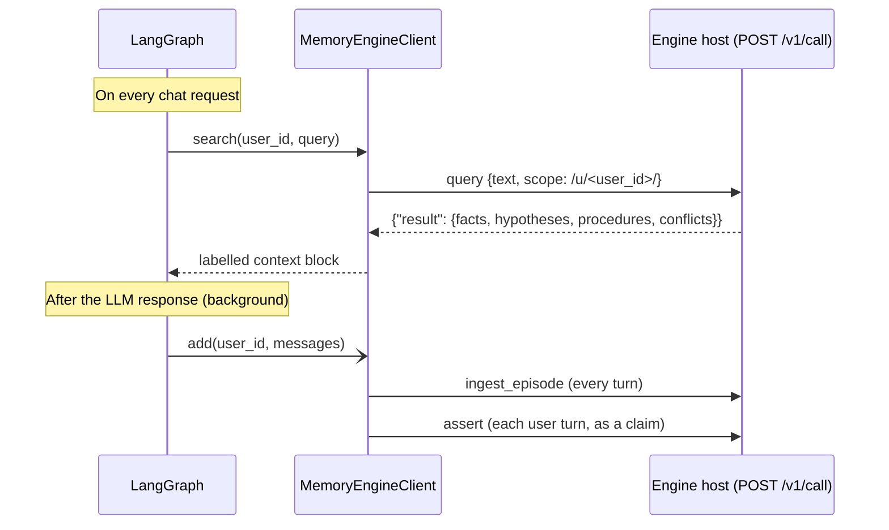

# Memory

## Overview

Long-term memory is the ChronaMind memory engine (`custom-memory-engine/`), reached over HTTP by
`app/services/memory_engine.py` (`MemoryEngineClient`). The engine and the app run on different interpreters on purpose,
so the boundary is a wire contract, not an import. The legacy `mem0ai` client (`app/services/memory.py`) is not on the
agent's path.

If `MEMORY_ENGINE_URL` is empty the agent has **no** long-term memory. There is no fallback to mem0.

## How it works



Every call is `POST {MEMORY_ENGINE_URL}/v1/call` with `Authorization: Bearer {MEMORY_ENGINE_TOKEN}` and the body
`{"operation": ..., "principal": "<user_id>", "arguments": {...}}`. The answer is `{"result": {...}}`, or
`{"error": {"code": ..., "detail": ...}}` with a 4xx/5xx status. Failures are logged and the agent continues without
memory.

## What the agent sees

`search()` renders the engine's channels with their labels, so the model can tell what it may rely on:

| Section | Contents |
| --- | --- |
| `Known facts` | claims the user stated (current beliefs; a superseded claim is not returned) |
| `Hypotheses (inferred, not confirmed)` | inferred artifacts |
| `Procedures that applied` | procedures |
| `Open contradictions (unresolved)` | contested beliefs, shown as unresolved |
| `Earlier conversation (verbatim; may be outdated; not confirmed facts)` | recorded turns (user or assistant), minus any text already rendered above |

## Single-valued facts

A user message that states the speaker's *current* value of a single-valued attribute is written with
`cardinality: "single"` and a `semantic_slot`, so the engine supersedes the previous value: "I live in Berlin" then
"I moved to Paris" (or "أنا ساكن في برلين" then "انتقلت إلى باريس") leaves one known fact. The slots are `residence`,
`employer` and `name` (`V2-D121`).

The classifier (`app/services/memory_slots.py`) is semantic and language-independent: a language model reads the
message in whatever language or mix of languages it is written and reports the slot, whether the statement is the
speaker's current value (not a past fact, a plan, a hypothetical, a denial or a question), and the value as written.
The app then accepts it only if the value occurs verbatim in the message (after Unicode normalization) and the other
checks pass. There is no keyword or grammar rule for any language. Only the newest user message of each `add()` is
classified (one model call per turn). Any model failure, and `MEMORY_SLOT_CLASSIFIER=off`, gives
`cardinality: "multi"` with no slot: the claim is recorded and supersedes nothing.

| Setting | Default | Meaning |
|---|---|---|
| `MEMORY_SLOT_CLASSIFIER` | `llm` | `llm`: the semantic classifier; `off`: every claim is multi-valued |
| `MEMORY_SLOT_CLASSIFIER_MODEL` | *(default model)* | the model the classifier asks |

## No cache

Memory search results are **not** cached. A rendered context is plaintext memory content, and a client-side copy would
outlive a deletion or a supersession in the engine; every `search()` asks the engine.

## Configuration

The app needs two variables:

| Variable | Description |
| --- | --- |
| `MEMORY_ENGINE_URL` | Base URL of the engine host, e.g. `http://127.0.0.1:8100`. Empty disables long-term memory |
| `MEMORY_ENGINE_TOKEN` | The app's service token on the engine host |

The token must be configured on the engine host as a **delegating** service token, so that one token can act for every
end user (each end user is the engine principal, with their own `/u/<user_id>/` namespace, provisioned on first call):

```bash
CME_HOST_TOKENS='{"<MEMORY_ENGINE_TOKEN>": {"principal": "chronamind-app", "tier": "B", "delegate": true}}'
```

The tier comes from the token; the app never sends one. See `custom-memory-engine/scripts/run_host.py` for the host's
own variables (`CME_DATABASE_URL`, `CME_RUNTIME_ROLE`, `CME_SCHEMA`, `CME_PROVENANCE_KEY`, `CME_DELETION_RECEIPT_KEY`).

## Startup pre-warming

At startup, `memory_engine.initialize()` probes the host's `GET /healthz` so the first request does not pay connection
setup. A failure is logged, not fatal.

## Per-user isolation

Each end user is a separate engine principal. A search acts for exactly one user and cannot read another user's memory;
an anonymous session gets no long-term memory at all.

## Tests

- `tests/test_memory_engine_boundary.py`: the request shapes and the rendering, without a server.
- `tests/test_memory_slots.py`: the classifier's language-independent checks, in Arabic, English and mixed text.
- `tests/live/test_memory_slots_live.py`: the classifier against a real model (opt-in, `MEMORY_SLOT_LIVE_EVAL=1`):
  Arabic, English, mixed-language, corrections, historical facts and Berlin → Paris → Berlin.
- `tests/integration/test_app_engine_boundary.py`: the client against a real engine host and PostgreSQL. It needs
  `custom-memory-engine/.venv` (`uv sync --locked --extra host` in `custom-memory-engine/`) and `CME_TEST_DATABASE_URL`,
  and skips with the reason otherwise.
