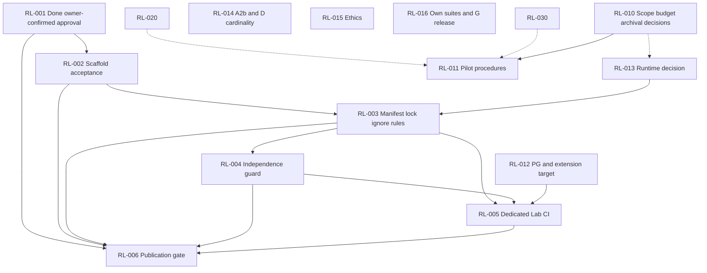
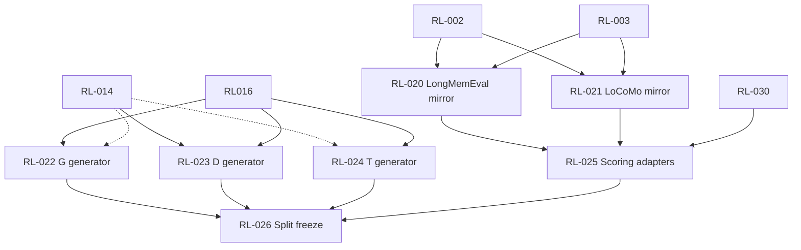
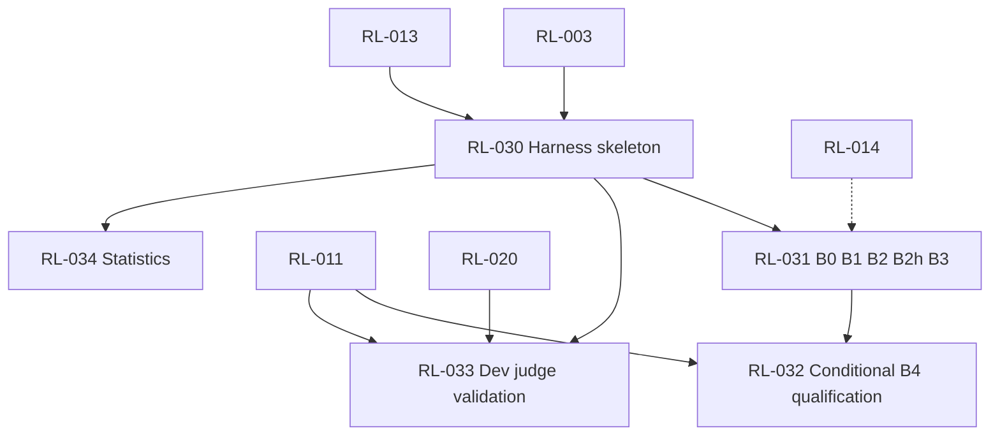
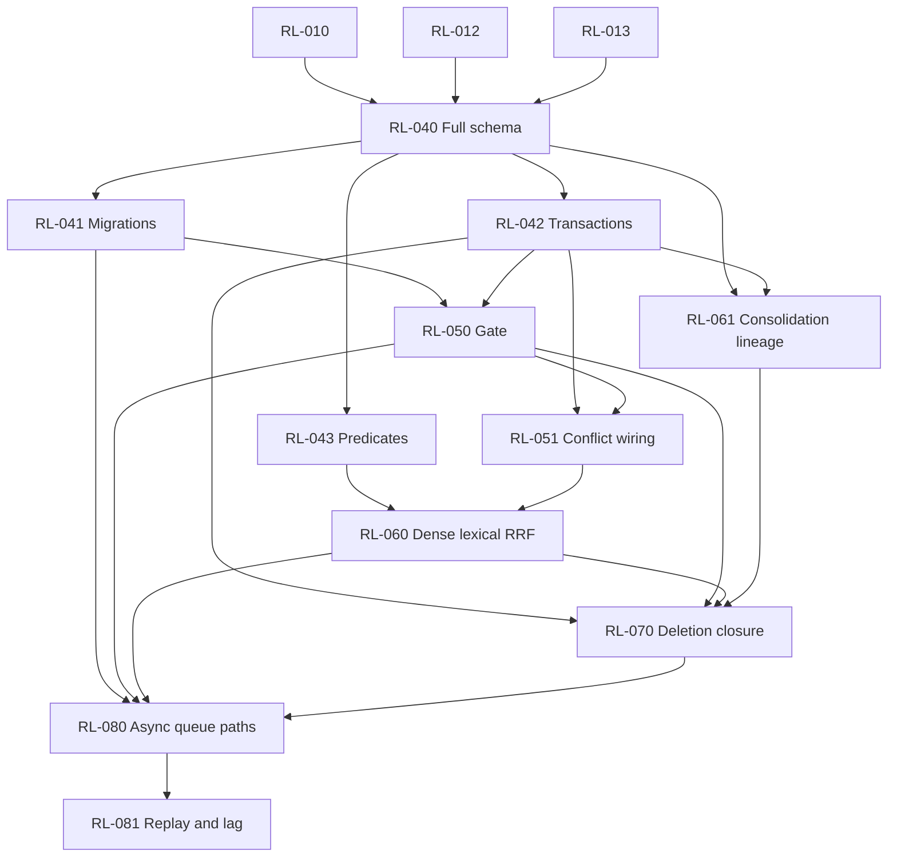
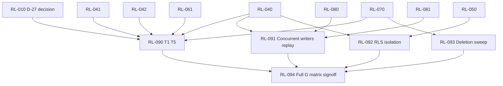
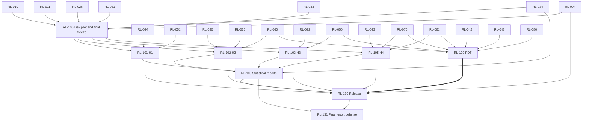
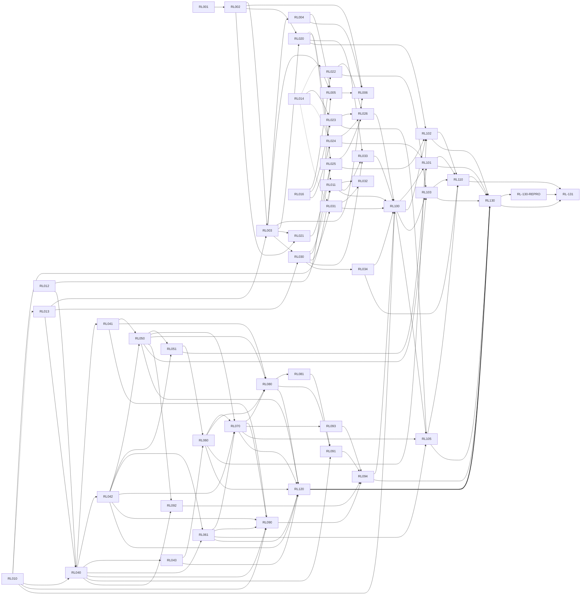

# Dependency map — view of TASK_GRAPH.md

**Authority:** [TASK_GRAPH.md](TASK_GRAPH.md) is canonical for task prerequisites. This map is a synchronized visual view, not a second task system. RL-001 team acceptance is satisfied by owner confirmation (PROJECT_STATUS.md §6); individual review responses and reviewed-revision audit details were not supplied. Existing publication/claim and task-specific prerequisites remain; Hybrid alone does not mark implementation Done. Actual state: [PROJECT_STATUS.md](PROJECT_STATUS.md).

**Legend:** `-->` blocking (accepted before start); `-.->` non-blocking (preparation may start, acceptance waits); `==>` conditional application-track prerequisite. Dependencies on decisions and research/ethics conditions are in [DECISIONS_REGISTER.md](DECISIONS_REGISTER.md). Solid arrows describe implementation prerequisites, not published issues. No Mermaid parser/rendering is claimed by the edge/cycle check.

## 0. Phase acceptance and parallel preparation

Roadmap §C defines phases; TASK_GRAPH.md §A defines their accepted deliverables. Preparatory work follows task prerequisites below, not a blanket requirement that every pilot-dependent P1 value be frozen before P2/P3 can start. Full phase completion still needs all acceptance criteria. P8 follows P7 for deletion/epoch integration; P9 gates the pilot; P10 freeze gates test experiments. P12 is parallel to research once engine integration is stable; release depends on P12 only for the mandatory application track.

## 1. Foundation and decisions

## 2. Benchmarks and own suites

The dependency chain is `RL-002 + RL-013 → RL-003 → RL-020/RL-021`. RL-001 is already owner-confirmed Done; it does not substitute for accepted RL-002 or the RL-013 runtime decision. Both mirrors require scaffold **and** manifest/ignore rules to be accepted. They may run in parallel after those prerequisites. RL-016 is not a prerequisite for either mirror.

## 3. Harness, baselines, judge, statistics

D-20 governs actual paid/model calls, not a dummy-fixture skeleton. RL-011 defines the dev qualification/validation procedure before RL-032/033. Final B4 inclusion and judge/sample freeze remain in RL-100; no reverse edge from that final freeze to constructing its prerequisites.

## 4. Engine implementation

Full-schema concurrency feasibility D-18 is evaluated against this implementation in RL-091; it cannot require RL-091 completion before the DDL it needs is authored. The mandatory exclusion constraint is retained. A conflicting fallback is escalated through spec §13, not adopted silently.

## 5. Integration and security validation

RL-094 covers **all** mandatory roadmap §G rows, including end-to-end and queue tests, not just the four named test tasks. Waivers require documented approval where the contract permits them; do not use a waiver to fabricate invariant-10 or H4 evidence.

## 6. Pilot, experiments, reports, release

## 6.1 Complete explicit task-edge view

This diagram enumerates every explicit task prerequisite in TASK_GRAPH.md, expanding RL-006’s RL-002-through-RL-005 range. `-->` denotes blocking, `-.->` denotes non-blocking preparation/awareness, and `==>` denotes a conditional prerequisite. RL-001 is not repeated as a global prerequisite on every task; the current global approval status is recorded in PROJECT_STATUS.md §6.

## 7. Execution sequence and gates

1. **Now:** RL-001 Done by owner confirmation; actual team-reviewed hash/date and individual responses unavailable. Follow current readiness/handoff in PROJECT_STATUS.md §10; record real identities/availability and local claims, not fabricated approval comments.
2. **First wave:** RL-002 remains In Review for separate scaffold acceptance/merge; RL-010/012/013/014/015/016 are Ready for decision preparation, with RL-013's awareness handoff to RL-010 retained. Their six GitHub issues are published and unassigned. Supervisor/ethics outcomes and compatibility acceptance are not guaranteed.
3. **Foundation:** RL-002 + RL-013 → RL-003 → RL-004; RL-012 + RL-003/004 → RL-005 → separately authorized RL-006. Dedicated-file RL-005 additionally needs the boundary §5 supervisor-approved exception; existing §4 allows only an added job. RL-001 review is closed; technical readiness is not a claim. Use the local bootstrap procedure in CONTRIBUTING.md §3 for claims until publication.
4. **Branches:** mirrors after RL-003; own generators after their research decisions; RL-030 after runtime/manifest. RL-025 requires both mirrors and harness interface. Harness/baselines/stats may run alongside engine tasks once each prerequisite is accepted.
5. **Engine:** RL-040 → migrations/transactions/predicates; lineage after transactions; gate → conflict → retrieval; lineage/retrieval/gate → deletion; deletion + retrieval/gate → async → replay verification.
6. **Validation:** archival T1–T5 (including real deletion), concurrency/replay, RLS/isolation, deletion sweeps and all §G integration rows → RL-094 accepted.
7. **Pilot:** RL-010/011/026/031/033/034/094 accepted; dev data only, budget and scope settled; B4 qualification per D-21 when attempted; final declared values, versions, models, prompts, judge, splits, analysis and aggregation freeze signed before any H1–H4 test scoring.
8. **Experiments/release:** frozen RL-100 → four declared experiments → statistical/error reports → release → independent reproduction → final report. PDT is parallel once engine stable and conditional for release track. No post-hoc choice of runs or thresholds.

## 8. Review gates

RL-001 owner-confirmed team acceptance (satisfied); RL-002 separate scaffold acceptance/merge; RL-006 explicit publication authorization; RL-094 mandatory matrix acceptance; RL-100 signed final experimental freeze; RL-130-REPRO independent reproduction before RL-131. S-07 is not an additional architecture gate; see owner record. Approval provenance is canonical in PROJECT_STATUS.md §6, not this map.

## 9. Consistency verification

The owner-planning pass checks all explicit task inbound edges against this map, full issue drafts and compact source material before consolidation, and detects cycles using a standard-library topological traversal. Actual results and limitations are in [CHANGELOG.md](../CHANGELOG.md). No diagram-rendering or runtime validation is implied. Research/decision conditions, conditional application-track edge and non-exhaustive downstream handoff lists are distinguished from blocking task edges.
