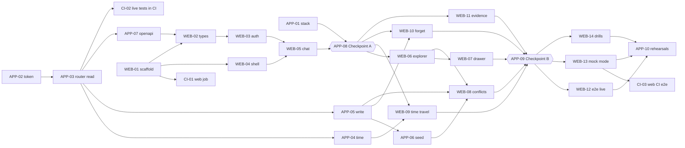

# ChronaMind Studio — Epic and tickets

| File | Contents |
|---|---|
| [`EPIC-demo-interface.md`](EPIC-demo-interface.md) | The Epic: objective, current state, plan alignment, acceptance criteria, scope, phases, files, technical details, metrics. It is authoritative for every ticket |
| [`tickets_app.md`](tickets_app.md) | `app` tickets APP-01 to APP-10 (CPython 3.14, `make check`) |
| [`tickets_web.md`](tickets_web.md) | `web` tickets WEB-01 to WEB-14 (Node 22, `npm run check`) |
| [`tickets_ci.md`](tickets_ci.md) | `ci` tickets CI-01 to CI-03 (`make check`, actionlint) |
| [`create_issues.py`](create_issues.py) | Opens one GitHub issue per ticket and links them |

## Order of work

Phase 0 and the web scaffold start in parallel on day one. The two checkpoint tickets are gates: Phase 2 starts only
after APP-08 passes, and Phase 3 only after APP-09 passes.

| Phase | Tickets | Ends with |
|---|---|---|
| 0 Live backend and contract | APP-01, APP-02, APP-03, APP-04, APP-05, APP-06, APP-07, CI-02 | The router proven against a real engine host in CI |
| 1 Walking skeleton | WEB-01, CI-01, WEB-02, WEB-03, WEB-04, WEB-05, APP-08 | Checkpoint A: J1 live from a clean checkout |
| 2 Screens | WEB-06, WEB-07, WEB-08, WEB-09, WEB-10, WEB-11, APP-09 | Checkpoint B: J1–J5 live in one run |
| 3 Hardening | WEB-12, WEB-13, CI-03, WEB-14, APP-10 | Two timed rehearsals |



## Opening the issues

```bash
uv run python tickets/create_issues.py            # dry run: 27 tickets with their labels
uv run python tickets/create_issues.py --create   # missing labels, the issues, then cross-links and issue-map.txt
```

The script creates only the labels that do not exist yet (`app`, `web`, `ci`, `feature`, `security`, `test`, `docs`).
`engine` already exists in the repository and is left as it is.
